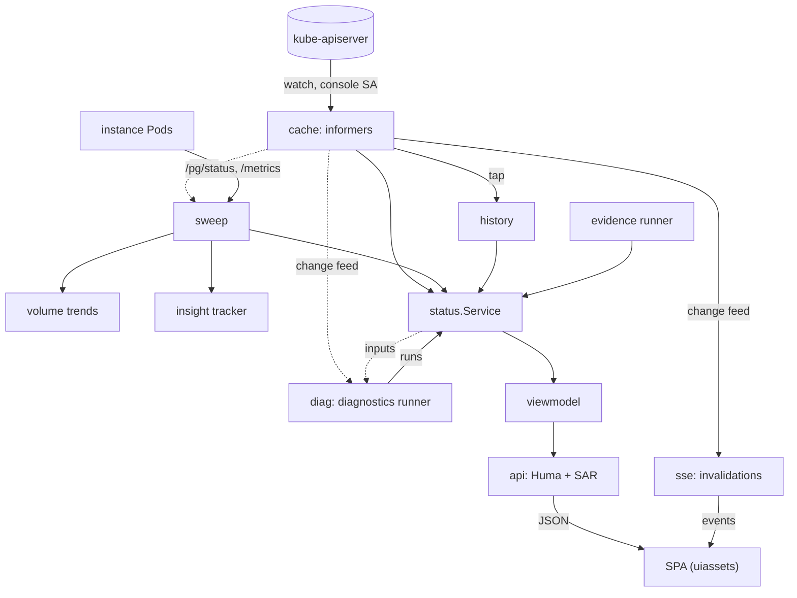

# Architecture

How pgToolBox is put together, for someone about to change it. Read
[README.md](README.md) first for what the product does; [AGENTS.md](AGENTS.md)
and [CONTRIBUTING.md](CONTRIBUTING.md) carry the rules every change must keep.

The documentation site has the same picture with diagrams, for readers who run
the product: [how pgToolBox fits together](docs/site/docs/architecture/index.md)
(components, ports, identities), [deployment models](docs/site/docs/architecture/deployment-models.md),
[console internals](docs/site/docs/architecture/console-internals.md) and
[trust boundaries](docs/site/docs/architecture/trust-boundaries.md).

This page describes the code as it is. When it and the code disagree, the code is
right and this page is the bug: fix the page in the same change. Each package's
own doc comment (`go doc ./internal/console/sweep`) is the longer version of the
one line it gets here.

## Three programs, two charts, one repository

- **The console** (`cmd/console`, image `pgtoolbox-console`) is what people use. One Deployment per team
  namespace. It watches the CloudNativePG objects of its namespaces, reads each
  PostgreSQL instance's own status report, runs the diagnostics, and serves a
  JSON API and a single-page application (SPA). It holds no authority of its
  own: every read is checked with a SelfSubjectAccessReview sent with the signed-in
  person's token, and every write is sent with that same token.
- **The operator** (`cmd/operator`, image `pgtoolbox-operator`) is optional. It reconciles four custom
  resources: `PgAdmin`, `EvidenceAgent`, `PgToolBoxConsole` and `PgAccessRequest`. A
  fifth kind, `PgAdminAccess`, is a grant that the `PgAdmin` controller reads.
- **The evidence agent** (`cmd/evidence-agent`, image `pgtoolbox-evidence-agent`) reads
  a backup repository (the Barman Cloud layout on S3, Azure Blob or GCS, and the
  pgBackRest layout, repository format 5, on S3 or Azure Blob) and tells the
  console what is really there, so the console can compare it with what
  CloudNativePG claims. It is the only program that holds object-store
  credentials.

Two Helm charts install them:

| Chart | Installs | Who installs it |
|---|---|---|
| `charts/pgtoolbox` | the operator and its CRDs (cluster-scoped objects) | a cluster admin, once |
| `charts/pgtools` | "team mode": a console, evidence agents, an optional pgAdmin, the insight pack, **no operator** | a namespace admin |

The operator can also create a console from a `PgToolBoxConsole` object; it is the same
console the `pgtools` chart installs. `config/` (kustomize) and `deploy/olm/`
(OLM bundle and catalog) are the other ways to install the operator;
`make validate-packaging` keeps the three in agreement.

## Binaries (`cmd/` and tools)

| Package | Image / form | Role |
|---|---|---|
| `cmd/console` | `pgtoolbox-console` | The console. Validates its whole environment before listening; shuts down cleanly on SIGTERM. |
| `cmd/operator` | `pgtoolbox-operator` (binary `/manager`) | The four controllers, plus subcommands the pgAdmin Pod and Jobs run from this same binary: `install`, `passfile-sync`, `pgadmin-register`, `pgadmin-backup`. |
| `cmd/evidence-agent` | `pgtoolbox-evidence-agent` (binary `/evidence-agent`) | The evidence agent. Modes: standalone (a read-only viewer UI); `RUNTIME_MODE=agent` (deployed by the operator, HTTPS with bound-token authentication); `RUNTIME_MODE=agent` with `AGENT_RESOLVE=cluster` (team mode: it finds its repository from the Cluster itself and checks a shared token). |
| `internal/console/api/gen` | dev tool | Writes `openapi.yaml` and the API's example fixtures (`make openapi`). |
| `pkg/evidence/cmd/evidence-artifacts` | dev tool | Writes the evidence JSON Schemas and wire examples (`make generate-evidence-artifacts`). |
| `hack/readonlycheck` | dev tool | The console's write boundary, checked on the typed syntax tree (`make check-repo`). |
| `hack/evidence-fingerprint` | dev tool | Prints an S3 destination's repository fingerprint, for local testing. |
| `hack/loadtest/cmd/loadgen` | dev tool | Drives the load test: fake Clusters on KWOK nodes, API and stream load. |

`make build` builds the binaries into `bin/`. A `go build ./cmd/<name>` run from
the root writes the binary at the root; `.gitignore` ignores those names.

Outside Go: `ui/` is the SPA (React, TypeScript), embedded in the console image;
`headlamp/` is a small Headlamp plugin that links a CloudNativePG Cluster to its
console; `docs/site/` is the Docusaurus documentation site.

## Layering rules

Two Go modules: the root module, and `pkg/evidence`, a nested module with **no
dependencies at all** (the evidence wire contract, importable by anyone).
`go.work` joins them; the root `go.mod` also `replace`s it so that `GOWORK=off`
builds work.

`hack/check-layering.sh` checks these rules on the real import graph (`make lint`
runs it through `make check-repo`):

- `pkg/**` imports nothing from `internal/**`: a `pkg/` library is usable alone.
- `pkg/evidence` has no module requirements.
- `internal/evidence` (the agent) imports neither `internal/console` nor
  `internal/operator`.
- `internal/console` imports neither `internal/operator` nor `internal/evidence`:
  the console receives evidence conclusions over HTTPS, never credentials.
- `internal/operator` imports neither `internal/console` nor `internal/evidence`.
- `internal/backupresolve` imports no other `internal/` package: it is the one
  piece the operator and the agent share, so it must not become a path between
  them.

Other checks in `make check-repo`:

- `hack/check-readonly.sh` and `hack/readonlycheck`: in the console, every call
  that could change something in the cluster is listed with its exact count.
  Writes start only in `internal/console/ops` (sent with the person's token); the
  console's own identity writes only its state ConfigMap (`sharedstate`), its
  digest Lease when digests are delivered (`leader`) and, opt-in, the
  restore-drill cleanup.
- `hack/check-deps.sh`: no cloud SDK, SQL driver or repository parser compiles
  into the console, the operator or `pkg/`; those belong to the agent.
- `hack/check-boilerplate.sh` (licence headers) and `hack/check-toolchain.sh`
  (Go version follows `mise.toml`).

## The console

### Data flow

Data flows from the sources (left) to the browser (right); dashed arrows are
inputs a loop reads, solid arrows what it publishes. The site's
[console internals](docs/site/docs/architecture/console-internals.md) page
explains each step and has a sequence diagram of one page load.



- `cache`: informers over the watched namespaces, label-filtered, as the
  console's ServiceAccount; no Secrets or ConfigMaps.
- `sweep`: every instance's `/pg/status` (TLS 1.3, verified against the admin's CA
  bundle) and `/metrics`; feeds `pkg/cnpgstatus/volumetrend` and the
  `pkg/cnpgstatus/insight` tracker.
- `diag`: runs `pkg/diagnose` on every change of a Cluster's inputs and on a
  cadence.
- `status.Service`: joins cache, sweep, diagnostics, history and evidence, and
  applies the per-minor CloudNativePG tables of `pkg/cnpgstatus`.
- `viewmodel`: the typed JSON shapes (golden fixtures in `viewmodel/fixtures`).
- `api`: Huma operations, each checked by a SelfSubjectAccessReview with the
  caller's token (positive answers cached 10 s, negative never); `sse`:
  invalidation events, filtered per subscriber.
- `server`: sign-in (`auth`), CSRF, headers, `/metrics`, the runner supervisor.
- `ui/`: the React SPA, embedded through `uiassets`; its API client is generated
  from `openapi.yaml`.

The SPA computes nothing about state: it renders what the view models say. When
something cannot be known (a broken watch, an unverifiable instance), the view
model says so; it is never shown as healthy.

### Background loops

`internal/console/readmodel` lists the read side's loops, `cmd/console` adds
`invalidations` and `restore-drills`, and `internal/console/server` adds
`revocation-list`; the server's supervisor runs them and restarts a loop that exits. While a **core** loop is down the
console reports not ready.

| Loop | Core | What it does |
|---|---|---|
| `informer-cache` | yes | Keeps the watched objects in memory (`cache`). |
| `instance-status-sweep` | yes | Reads every instance's `/pg/status` and metrics over TLS (`sweep`); feeds the volume trends and the insight-pack tracker. |
| `diagnostics` | yes | Runs the diagnostics after each change of a Cluster's inputs and on a safety cadence (`diag`). |
| `invalidations` | yes | Turns cache changes into SSE events for open browsers (`wiring`, `sse`). |
| `revocation-list` | yes | Reloads the admin-maintained session revocation list (`auth`). |
| `status-clocks` | no | Keeps the console's own "since" clocks current between reads. |
| `kube-version` | no | The API server's version. |
| `log-follow` | no | Follows member pod logs for the log rules, when logs are allowed (`logfollow`). |
| `evidence` | no | Finds `EvidenceAgent` objects and asks each agent for its evidence (`evidence`). |
| `history-journal` | no | Writes the revision history to its bbolt file when `HISTORY_PATH` is set. |
| `timeline`, `timeline-journal` | no | Records what the console saw happen and persists it (`timeline`). |
| `digest` | no | Builds and delivers the daily summary (`digest`). |
| `volume-trend-journal` | no | Persists the 30-day volume series. |
| `restore-drills` | no | Supervises and cleans up restore drills (`drills`), when enabled. |

### Writes

The console is read-only unless operations are enabled (`OPERATIONS_ENABLED`). A
write follows one path:
`internal/console/operations` (what the caller is offered, the request, tracking
the operator's reaction) then `internal/console/ops` (the enumerated writes:
backup, reload, restart, promote, plus the access-request, personal database role
and restore-drill writes), sent
to the API server **as the signed-in person**. `hack/readonlycheck` fails the
build if a write appears anywhere else.

## The operator

One controller-runtime manager (`cmd/operator`) with one controller per kind:

- `internal/operator/pgadmin`: one pgAdmin per team namespace; a Job registers the
  namespace's Clusters as shared servers; a sidecar (`passfile-sync`) writes the
  libpq password file. Reads `PgAdminAccess` grants for Clusters of other
  namespaces.
- `internal/operator/evidenceagent`: one evidence agent Deployment per
  `EvidenceAgent`, with its serving certificate (CA published in `status.caBundle`).
- `internal/operator/console`: one console per `PgToolBoxConsole`, watching that
  namespace.
- `internal/operator/accessrequest`: removes the RoleBinding of a `PgAccessRequest`
  when it expires, is revoked or drifts. It never creates one: the console creates
  it with the approver's token.

Shared machinery: `reconcile` (server-side apply, error classification),
`conditions`, `specs` (content hash, security contexts, image references),
`metadata` (labels and names), `exposure` (Route, Ingress, HTTPRoute),
`configuration` (environment, ConfigMap, Secret), `cachemetrics`, `cnpgcred`.
Optional APIs (OpenShift Routes, Gateway API, CloudNativePG `DatabaseRole`,
`Pooler`, `Database`) are probed at startup with `pkg/discovery`; a missing one
turns its feature off. The operator never writes to a CloudNativePG `Cluster`.

## The evidence agent

```
provider (s3 | gcs | azure)  ->  store  ->  inventory (immutable snapshot)
   ->  repository + formats/barmancloud  ->  evidence (format-neutral facts)
   ->  evidenceapi (the pkg/evidence/v1alpha1 contract)  ->  agent (HTTPS) | web
```

`internal/evidence/config` parses and validates the whole environment before
anything listens. `internal/evidence/application` assembles the runtime and the
background refresh; a failed refresh never replaces good evidence.
`internal/evidence/selfresolve` is team mode (`AGENT_RESOLVE=cluster`).
`internal/backupresolve` turns a Cluster into the repository to read; the operator
uses the same code.

## Contracts between the pieces

A change to one of these needs a change on both sides:

| Contract | Defined in | Read by |
|---|---|---|
| Evidence wire contract | `pkg/evidence/v1alpha1` (and its JSON Schema) | `internal/evidence/evidenceapi` writes it, `internal/console/evidence` reads it |
| Console JSON API | `internal/console/viewmodel` -> `internal/console/api/openapi.yaml` | `ui/src/api/generated` (orval) |
| CRDs | `api/v1alpha1` -> `config/crd/bases` and the chart and OLM copies | operator, console, charts |
| Insight pack queries | `charts/pgtools/files/insight-pack` (copy in `deploy/insight-pack`) | `pkg/cnpgstatus/insight` |
| PostgreSQL end-of-life table | `pkg/lifecycletable` (copy in `charts/pgtools/files/lifecycle.json`, kept equal by a test) | `pkg/diagnose`, the operator |
| Image names, env vars | `Dockerfile`, chart values, OLM CSV | `make validate-packaging` compares them |

## Generated files

Never edit these by hand. CI fails when one is stale.

| File(s) | Source | Regenerate with |
|---|---|---|
| `api/**/zz_generated.deepcopy.go` | `api/` types | `make generate` |
| `config/crd/bases`, `config/rbac`, the CRD and Role copies in `charts/` and `deploy/olm/` | kubebuilder markers | `make manifests` |
| `internal/console/api/openapi.yaml`, `internal/console/api/testdata/fixtures` | view models and fixtures | `make openapi` (check: `make verify-openapi`) |
| `docs/site/docs/reference/checks.md` | the diagnostics catalog | `make catalog-docs` |
| `docs/site/docs/reference/api.md` | `api/v1alpha1` | `make crd-ref-docs` |
| `deploy/insight-pack/insight-pack.yaml` | the `pgtools` chart's pack | `make insight-pack` |
| `pkg/evidence/v1alpha*/schema.json` and wire goldens | `pkg/evidence` types | `make generate-evidence-artifacts` |
| `ui/src/api/generated/`, `ui/src/routeTree.gen.ts`, `ui/mocks` fixtures | `openapi.yaml`, `ui/src/routes` | `cd ui && pnpm generate` |
| `ui/src/paraglide/` (not committed) | `ui/messages` | `cd ui && pnpm i18n` |
| `ui/tokens/tokens.ts` | `ui/tokens/tokens.css` and `fyannk.css` | `cd ui/tokens && pnpm generate` |

A change to the API types usually needs, in order: `make generate manifests
openapi crd-ref-docs`, then `cd ui && pnpm generate`.

## Tests

| Kind | Where | Run with |
|---|---|---|
| Unit (table-driven, golden files) | next to the code, `*_test.go` | `make test`, `make test-race` |
| Fuzz (every parser of untrusted input) | `Fuzz*` functions next to the parser | `make test-fuzz` (`FUZZ_TIME`) |
| envtest (a real API server, no nodes: CEL rules, RBAC, reconcilers) | `api/v1alpha1`, `cmd/operator`, `internal/console/{cache,ops,evidence}`, `internal/evidence/agent` (tag `envtest`) | `make test-envtest`, `make test-console-core`, `make test-envtest-operator` |
| Object-store integration (Docker) | `internal/evidence/provider/*` (tag `integration`) | `make test-evidence-integration` |
| kind end-to-end | `test/e2e/` (see its README), `hack/matrix.sh` for the Kubernetes x CloudNativePG matrix | `make test-e2e-console`, `test-e2e-chart`, `test-e2e-team`, `test-e2e-pgbackrest`, `test-e2e-pgadmin`, `test-e2e-evidenceagent`, `test-e2e-matrix` |
| Chart gates | `charts/*/tests`, `charts/*/ci` | `make chart-gates` |
| UI unit (Vitest) | `ui/src/**/*.test.ts(x)` | `cd ui && pnpm test` |
| UI stories (Storybook, with axe) | `ui/src/**/*.stories.tsx` | `cd ui && pnpm test:stories` |
| UI end-to-end and screenshots (Playwright) | `ui/e2e/`, baselines in `ui/e2e/__screenshots__` | `make ui-e2e`; re-render baselines with `make ui-e2e-update` and review the image diff |

`make ui-check` runs the whole SPA gate; `make ui-dev` runs the SPA with mock data
and no cluster. `make check` runs everything CI runs without Docker or kind.

## Packages, one line each

**API**

- `api/v1alpha1`: the CRD types (PgAdmin, EvidenceAgent, PgToolBoxConsole,
  PgAccessRequest, PgAdminAccess) of `pgtoolbox.fyannk.dev`.

**pkg/** (no `internal/` imports)

- `pkg/cnpgstatus`: the per-minor CloudNativePG read model (phases, conditions,
  what they mean, facts derived from a Cluster and its Pods).
- `pkg/cnpgstatus/observe`: the collector and the immutable snapshot the console renders.
- `pkg/cnpgstatus/instancestatus`: reads an instance's `/pg/status` report.
- `pkg/cnpgstatus/scrape`: polls the instances' Prometheus endpoints.
- `pkg/cnpgstatus/metrics`: a bounded window of metric samples.
- `pkg/cnpgstatus/history`: a bounded revision timeline of object definitions;
  `history/bolt` persists it to a bbolt file.
- `pkg/cnpgstatus/logstream`: follows member pod logs and hands lines to sinks.
- `pkg/cnpgstatus/insight`: parses the insight-pack metrics and tracks them.
- `pkg/cnpgstatus/pgconf`: reads PostgreSQL setting values the way the server does.
- `pkg/cnpgstatus/preview`: what a change to a Cluster spec will set in motion.
- `pkg/cnpgstatus/volumetrend`: 30-day volume series and time until full.
- `pkg/cnpgstatus/evidence`: the evidence projection the diagnostics read: states, reasons, counts and times only, never free text from the agent.
- `pkg/diagnose`: the diagnostics engine (facts in, findings out).
- `pkg/diagnose/catalog`, `pkg/diagnose/catalog/cnpg`: the rules.
- `pkg/diagnose/triage`: walks the diagnostics from a symptom.
- `pkg/discovery`: probes whether an optional API may be listed here.
- `pkg/lifecycletable`: the PostgreSQL end-of-life table.
- `pkg/memlimit`: sets the Go memory limit from the container's.
- `pkg/redact`: safe error categories for output boundaries.
- `pkg/evidence/v1alpha1` (nested module): the evidence
  wire contract; `pkg/evidence/internal/evidenceartifacts` generates its schemas.

**internal/console/**

- `api`: the JSON API (Huma operations, each authorized with the caller's token).
- `assistant`: the "Connect an assistant" setup for the MCP endpoint, per client.
- `auth`: sign-in (OIDC, OpenShift OAuth, pasted token), session cookie, CSRF,
  revocation list.
- `authz`: the console's authorization checks (SelfSubjectAccessReview).
- `cache`: the informer cache over the watched namespaces.
- `config`: the environment contract, validated before listening.
- `diag`: runs the diagnostics in the background and publishes snapshots.
- `docsbundle`: the documentation of the console's own version, embedded with a search index.
- `digest`: the daily summary and its delivery.
- `drills`: restore drills: their record, the check, the cleanup supervisor.
- `evidence`: finds evidence agents and calls them over HTTPS.
- `history`: the revision history fed by the cache.
- `insightview`: insight-pack data as view models.
- `kube`: converts cached objects into diagnostics facts and history observations.
- `leader`: elects the one replica that delivers the daily digest (a Lease).
- `logfollow`: follows pod logs for the log rules.
- `mcp`, `mcpauth`, `mcpoauth`: the MCP endpoint at `/mcp`, its bearer-token
  authentication, and the OAuth authorization server for MCP clients.
- `operations`: offers, requests and tracking of day-2 operations.
- `ops`: the only origin of the console's writes.
- `opstate`: the read model's answers the operations read (a Cluster's cached
  state, a pgBackRest drill's target), so `status` does not import `operations`.
- `podlogs`: bounded log reads for the log viewer.
- `readmodel`: wires the read side and lists its loops.
- `server`: the HTTP surface, security headers, runner supervisor, `/metrics`.
- `sharedstate`: the few facts every replica must agree on, in one ConfigMap the
  console owns.
- `sse`: the live-update event stream.
- `statesnap`: snapshots of the in-memory series to the history volume.
- `status`: the read-model service that builds the view models.
- `sweep`: reads every instance's `/pg/status` and metrics.
- `timeline`, `timeline/boltfile`: what the console saw happen, and its file storage.
- `topology`: layout of a Cluster's wiring drawing.
- `tracing`: OpenTelemetry instrumentation of requests and API calls.
- `uiassets`: serves the embedded SPA.
- `viewmodel`, `viewmodel/fixtures`: the typed JSON contract and its golden scenarios.
- `wiring`: adapters between the read model and the API (names, the change feed, pod logs, the operation service).

**internal/operator/**

- `pgadmin`: the PgAdmin controller; `pgadmin/offer` its contract with the sidecar
  and the Job; `pgadmin/passfilesync` the sidecar; `pgadmin/register` the Job;
  `pgadmin/declared` pgAdmin servers declared by the `pgtools` chart.
- `evidenceagent`: the EvidenceAgent controller.
- `console`: the PgToolBoxConsole controller.
- `accessrequest`: the PgAccessRequest controller (only removes grants).
- `adminsync`: writes libpq's service and password files.
- `admissionpolicy`: envtest proofs of the operator chart's admission policies (tests only).
- `cachemetrics`: the `pgtoolbox_cached_objects` metric.
- `cnpgcred`: which CloudNativePG Secret carries which credential.
- `conditions`: the shared condition helpers.
- `configuration`: the operator's configuration.
- `exposure`: Route, Ingress and HTTPRoute objects.
- `metadata`: labels, annotations and generated names.
- `reconcile`: server-side apply and error classification shared by controllers.
- `specs`: content hash, security contexts, image references.

**internal/evidence/**

- `agent`: HTTPS listener and the two authenticators (bound token, shared token).
- `application`: assembles the runtime and the background inventory refresh.
- `config`: the environment contract.
- `evidence`: facts that mean the same in every repository format.
- `evidenceapi`: projects an inventory into the versioned contract.
- `fault`: the failure vocabulary.
- `formats`, `formats/barmancloud`, `formats/pgbackrest`: repository formats.
- `inventory`: immutable object inventories.
- `provider/s3`, `provider/gcs`, `provider/azure`: read-only object-store
  clients; `provider/cursor` confines continuation tokens; `provider/nofollow` is
  their HTTP client, which follows no redirect; `provider/providertest` shared
  acceptance tests.
- `readiness`: configuration validity and store reachability.
- `redact`: last-resort redaction.
- `repository`: format selection.
- `selfresolve`: team mode, the agent finds its own repository.
- `store`, `store/storetest`: the object-store interface and its fake.
- `web`: renders the evidence envelope.

**Other**

- `internal/backupresolve`: a Cluster's backup repository, for the operator and the agent.
