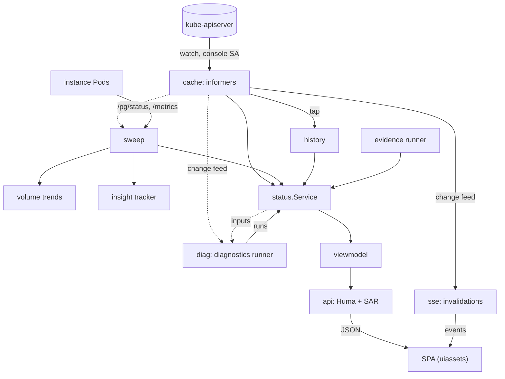
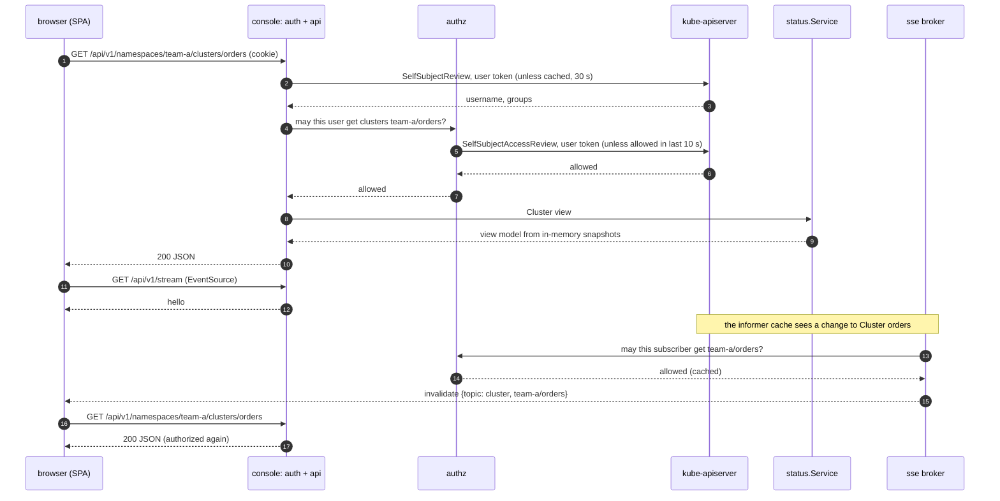

# Console internals

The console is a read model: background loops keep in-memory snapshots current,
and a request only reads those snapshots after asking the API server whether the
caller may see the object. No request path opens a connection to an instance or an
agent. The packages named here are under `internal/console` unless a path says
otherwise; `go doc` on each gives the long version.

## Data flow

The diagram follows data from its sources (left) to the browser (right); dashed
arrows are inputs a loop reads, solid arrows are what it publishes.

### Informers: `cache`

One informer cache over the watched namespaces, as the console's ServiceAccount.
It holds the CloudNativePG kinds (Clusters, Backups, ScheduledBackups, Poolers,
Databases, DatabaseRoles, Publications, Subscriptions, ImageCatalogs,
FailoverQuorums), barman-cloud `ObjectStores`, Pods, Events, PVCs, Services, PDBs
and Leases, and, where the cluster serves them, `PgAdmin`, `EvidenceAgent` and
`PgAccessRequest` objects (the full list is `cache/kinds.go`). **It holds no Secret
and no ConfigMap**; the two ConfigMaps the console reads through the API, the
session revocation list and its own state ConfigMap, it gets and watches by name
through a small Role each. With digest delivery it also takes one Lease,
`DIGEST_LEASE`, through a Role naming it. A source whose list or watch fails is
reported as not read, never as empty.

The cache publishes a change feed. Three consumers subscribe: the diagnostics
runner, the SSE invalidations, and the revision history (`history`, a bounded
timeline of object definitions, persisted to a bbolt file when `HISTORY_PATH` is
set).

### Instance reads: `sweep`

Every `INSTANCE_STATUS_INTERVAL` (30 s) the sweep reads each instance Pod of each
Cluster in the cache:

- `GET https://<pod IP>:8000/pg/status`, **TLS 1.3 only**, the certificate
  verified against the instance CA bundle (`INSTANCE_STATUS_CA_FILE`, mounted from
  a ConfigMap the operator mirrors for a `PgToolBoxConsole` or the admin fills for the
  chart, reloaded when the file changes) and the Cluster's Service name. A Pod without a verifiable
  certificate is a "not verifiable" row, never a plaintext or unverified read.
- `GET <pod IP>:9187/metrics`, over HTTPS when the Cluster's monitoring TLS is
  on and HTTP otherwise. A failed scrape leaves a gap; the status read decides the
  row.

Each read is bounded in time, size and concurrency, and opens a fresh connection.
The sweep keeps the last good report per Pod and short in-memory rings
(`RING_RETENTION`, one hour) for "since when" and the sparklines. It also feeds:

- **volume trends** (`pkg/cnpgstatus/volumetrend`): 30-day volume series and the
  time until a volume is full, persisted beside the history when it is
  persistent;
- **the insight tracker** (`pkg/cnpgstatus/insight`): the insight-pack metrics
  read out of the same `/metrics` body.

### Diagnostics: `diag`

The runner evaluates `pkg/diagnose` for every watched Cluster after each change of
the Cluster's inputs (debounced) and on a safety cadence (`DIAGNOSTICS_INTERVAL`,
one minute), never on a request. Its input is assembled by `status` from the
published snapshots (cache plus sweep); each published run records, per finding,
when the console first saw it in an unbroken series of runs.

### Evidence, Prometheus, timeline

- **Evidence** (`evidence`): asks each evidence agent for its snapshot every
  `EVIDENCE_INTERVAL` (one minute) and keeps the last result per agent
  ([sequence](../evidence-agent.md#the-channel)).
- **Prometheus** (`status/prometheus.go`): only with `PROMETHEUS_URL`. Unlike the
  others it is queried while serving a Metrics view, with the answers cached 30 s
  per Cluster ([Prometheus charts](../console/prometheus.md)).
- **Timeline and digest** (`timeline`, `digest`): what the console saw happen,
  derived from successive diagnostics runs and cache changes.

### The join: `status`, `viewmodel`

`status.Service` joins cache, sweep, diagnostics, history and evidence, and applies
the per-minor CloudNativePG tables of `pkg/cnpgstatus` (phases, conditions, what
they mean). Every method is an in-memory read of published snapshots: no API call,
no network. Authorization is not in it.

`viewmodel` holds the typed JSON shapes; their golden scenarios are in
`viewmodel/fixtures`, and `make openapi` turns them into `api/openapi.yaml`, from
which the SPA's client is generated. When something cannot be known (a broken
watch, an unverifiable instance), the view model says so; the SPA computes nothing
about state.

### The API: `api`, `authz`, `auth`

`api` registers the operations with [Huma](https://huma.rocks). Before an
operation runs, `auth` turns the session cookie into a principal: the user's token,
and who the API server says that token is (a SelfSubjectReview, positive answers
cached 30 s). Each operation then asks `authz` whether that user may perform the
verb on the object:

- the question goes to the API server as a **SelfSubjectAccessReview sent with the
  user's own token**, so the console's ServiceAccount needs no review grant;
- a question about a named Cluster is first asked for the whole namespace (one
  review covers every Cluster of a list), then by name if that is denied;
- **positive answers are cached 10 s; negative answers and errors are never
  cached**, so a new grant shows on the next request and a revocation within 10 s.
  An API server that cannot be asked gives "could not check", which grants
  nothing;
- reviews are bounded: 16 at a time, 4 per user, 5 s each.

The list operation keeps only the Clusters the review allows. Writes do not go
through this cache at all: they are sent to the API server with the user's token
(`operations`, then `ops`), which authorizes them itself.

### Live updates: `sse`

`GET /api/v1/stream` is a Server-Sent Events stream that carries **invalidations,
never data**. The `invalidations` loop turns each batch of cache changes into one
`clusters` event and one `cluster` event per named Cluster; the broker drops, per
subscriber, events about a Cluster that subscriber may not `get`. The browser then
refetches through the JSON API, where the read is authorized again. Other events:
`hello` (refetch everything after a connect), `resync` (refetch everything: events
were dropped for a slow client, or whether the subscriber may see one could not be
checked, so it is announced this way instead of being dropped silently),
`reauth` (the session is about to end). A stream that ends with its session (its
expiry, a token the API server no longer accepts, a revocation) sends a last
`resync` with the reason `session expired` or `session ended`: the refetch meets
the 401 that leads to sign-in. A comment line every 15 s keeps idle
proxies from closing the stream.

### The SPA: `uiassets`, `server`

The React application in `ui/` is embedded in the binary and served by `uiassets`
behind the same sign-in. `server` adds the security headers, the CSRF rules (the
`X-PgToolBox-Request: 1` header and a same-origin check on unsafe methods),
`/healthz`, `/readyz` and `/metrics` on the probe port, and the supervisor that
restarts a loop that exits.

## One page load

The sequence shows a person opening one Cluster and the page refreshing after a
change, with the caches that keep repeated requests off the API server.

The review comes first (`authorizeCluster` in `api/api.go`): a denial returns 403
and a review the API server could not answer returns 503, both without reading the
model. In the Cluster list, a Cluster whose review could not be answered is left
out and counted (`unchecked`), never shown.

## Background loops

`readmodel` lists the read side's loops, `cmd/console` adds `invalidations` and
`restore-drills`, and `server` adds `revocation-list`; the server's supervisor runs
them all and restarts a loop that exits. While a **core** loop is down the console reports not ready.

| Loop | Core | What it does |
|---|---|---|
| `informer-cache` | yes | The informers (`cache`). |
| `instance-status-sweep` | yes | `/pg/status` and `/metrics` of every instance (`sweep`), feeding the volume trends and the insight tracker. |
| `diagnostics` | yes | The diagnostics runner (`diag`). |
| `invalidations` | yes | Cache changes to SSE events (`wiring`, `sse`). |
| `revocation-list` | yes | Reloads the admin-maintained session revocation list (`auth`). |
| `status-clocks` | no | The console's own "since" clocks. |
| `kube-version` | no | The API server's version. |
| `log-follow` | no | Member Pod logs for the log rules, when logs are allowed (`logfollow`). |
| `evidence` | no | Reads the evidence agents (`evidence`). |
| `history-journal` | no | Writes the revision history to its bbolt file when `HISTORY_PATH` is set. |
| `timeline`, `timeline-journal` | no | The incident timeline and its file. |
| `digest` | no | The daily summary and its delivery. |
| `digest-leader` | no | With `DIGEST_LEASE` and a delivery channel: competes for the Lease; only its holder delivers (`leader`). |
| `volume-trend-journal` | no | Persists the 30-day volume series. |
| `state-snapshots` | no | Snapshots the sweep (rings, last readings, metrics window, insight) and the log matches beside `HISTORY_PATH` every minute and at shutdown (`statesnap`). |
| `shared-state` | no | Watches and writes the state ConfigMap the replicas share (`sharedstate`). |
| `restore-drills` | no | Supervises and cleans up restore drills, when enabled. |

### State across restarts and replicas

Two optional layers ([configuration](../console/configuration.md#what-survives-a-restart)):

- **`statesnap`**, with a persistent history: one file per part next to the
  history file, a versioned header, written through a temporary file, synced and
  renamed. Loaded once at start and held as "pending" per Cluster; the sweep and
  the log follower adopt a Cluster's pending state the first time they see that
  Cluster with the **same UID** (and each pod with the same UID), so a recreated
  Cluster starts empty. Unclaimed pending state expires.
- **`sharedstate`**, with `STATE_CONFIGMAP`: three JSON documents in one ConfigMap.
  Sign-outs are a set of session hashes with their expiry; "since" facts map an
  object UID and a state hash to the earliest time any replica saw that state;
  delivery marks map a digest and a channel to when it was first delivered.
  Every replica applies the same merge (union of sign-outs, the latest expiry;
  for a fact, the earliest time of the same state, else the newer state; for a
  mark, the earliest time), so replicas converge whatever the order of their
  writes. Writes are debounced, preconditioned on `resourceVersion` and merged
  again on a conflict.

With persistent history the console is a StatefulSet with a volume per replica:
the snapshots, the journal, the timeline and the digests are per replica, and
the ConfigMap is the shared layer. The one task only one replica may do, the
digest delivery, goes to the holder of a Lease (`leader`: client-go leader
election through a lock whose `Create` and `Update` are the console's only Lease
writes, pinned by `hack/readonlycheck`); a new holder reads the delivery marks
before it sends anything.
