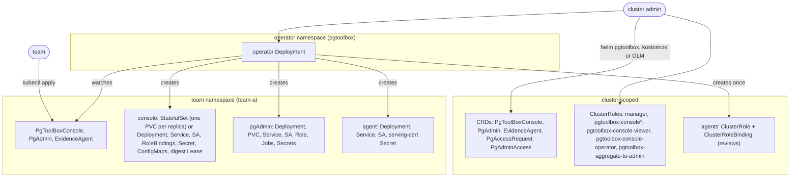
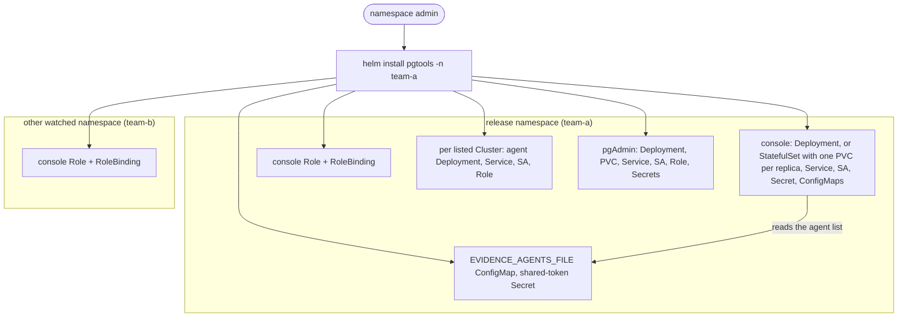

# Deployment models

The same three workloads (console, evidence agent, pgAdmin) can be put in a
namespace two ways:

- **Operator mode.** A cluster admin installs the pgToolBox operator once, with
  its CRDs. Teams then declare `PgToolBoxConsole`, `PgAdmin` and `EvidenceAgent` objects
  in their namespaces, and the operator creates and keeps the workloads.
- **Team mode.** A namespace admin installs the `pgtools` chart. Helm renders the
  console, the agents and pgAdmin directly from values. No operator, no CRD,
  nothing cluster-scoped by default.

The workloads are the same binaries with the same environment: the `PgToolBoxConsole`
builders render the objects the chart renders, and a test
(`TestDeploymentMatchesTheChart`) holds them to that. What differs is who
installs, what is cluster-scoped, and how the console finds agents and pgAdmin.
Pick one per namespace.

## Operator mode

The cluster admin installs the cluster-scoped half once; a team's objects then
turn into workloads in the team's own namespace.

- **Three ways to install the operator** render the same objects, compared field
  by field by `make validate-packaging`: the Helm chart `charts/pgtoolbox`
  ([Helm chart](../install/chart.md)), `config/default` with kustomize
  ([kustomize](../install/kustomize.md)), and the OLM bundle in `deploy/olm`
  ([OLM](../install/olm.md)).
- **The operator watches** every namespace its ClusterRole allows, or
  `operator.config.watchNamespaces`.
- **Children live in the custom resource's namespace.** A `PgToolBoxConsole` watches its
  own namespace only; its ServiceAccount is bound to the shipped
  `pgtoolbox-console` (and, unless withheld, `pgtoolbox-console-pod-logs`)
  ClusterRole by a RoleBinding there. The one cluster-scoped child is the shared
  ClusterRole and ClusterRoleBinding that let every agent create TokenReviews and
  SubjectAccessReviews.
- **The console finds agents and pgAdmin by listing** `EvidenceAgent` and
  `PgAdmin` objects in its namespaces; the agent's endpoint and CA come from
  `EvidenceAgent.status`.

## Team mode

A namespace admin installs one release; the chart writes everything in the
release namespace, plus a Role and RoleBinding in each watched namespace.

- **No CRD and no operator.** The default render holds only namespaced kinds
  (`make helm-unittest` proves it). Three optional pieces are cluster-scoped and
  off by default: `console.clusterImageCatalogs.enabled`,
  `console.metrics.readerClusterRole` and the restore drills' admission policy
  (`console.restoreDrills.admissionPolicy.create`).
- **Watched namespaces** are `console.watchNamespaces` (at most sixteen), read at
  install time; a new namespace is a `helm upgrade`. The installing user needs
  `admin` in each of them, plus read on the CloudNativePG kinds, because
  Kubernetes lets a user grant only what they hold.
- **Evidence agents** run in the release namespace, one per entry of
  `evidence.agents`, and find their repository from the Cluster themselves
  (`AGENT_RESOLVE=cluster`). The console calls them with a shared token, not a
  bound ServiceAccount token ([team mode](../evidence-agent.md#team-mode-without-the-operator)).
- **pgAdmin** is one Pod: the operator's registration Job becomes a native
  sidecar and its pre-upgrade backup Job an init container, because the SQLite
  settings database on a ReadWriteOnce volume cannot be opened from a second Pod
  ([pgAdmin without the operator](../install/pgadmin-without-operator.md)).

## Side by side

| | Operator mode | Team mode (`pgtools`) |
|---|---|---|
| Installed by | a cluster admin (operator); then whoever may create the kinds in a namespace | a namespace admin |
| Cluster-scoped objects | CRDs, the operator's ClusterRole, the console and user ClusterRoles, the agents' review ClusterRole and binding | none by default |
| Console scope | its own namespace | the release namespace or up to sixteen (`console.watchNamespaces`) |
| Console's RBAC | RoleBindings to the shipped `pgtoolbox-console` ClusterRoles | Roles the chart renders in each watched namespace |
| How the console finds agents | lists `EvidenceAgent` objects, trusts `status.endpoint` and `status.caBundle` written by the operator | a fixed list, `EVIDENCE_AGENTS_FILE` |
| Console → agent authentication | bound token, audience `pgtoolbox-evidence-agent/<namespace>`; TokenReview + SubjectAccessReview in the agent | shared token from a Secret both mount |
| Agent's repository | resolved by the operator, rendered as environment | resolved by the agent from the Cluster (same code, `internal/backupresolve`) |
| pgAdmin registration | a Job per offered set, a Job per image change | a native sidecar and an init container of the pgAdmin Pod |
| A new Cluster | seen by the console; offered by a `PgAdmin` whose `clusterSelector` matches it; an agent needs its own `EvidenceAgent` | seen by the console; agents and pgAdmin only once listed in values |
| Upgrade | the operator rolls the children | `helm upgrade` |

## What each admin needs

| Who | Operator mode | Team mode |
|---|---|---|
| Cluster admin | Installs the operator and its CRDs; grants `create` on `pgtoolboxconsoles`, `pgadmins`, `evidenceagents` to the teams that should declare them (the shipped `pgtoolbox-aggregate-to-admin` adds only read on them, and `create` on `pgaccessrequests`, to `admin`). Optionally enables the operator chart's admission policy. | Nothing, unless an optional cluster-scoped piece is wanted. Without the operator chart, the user ClusterRoles `pgtoolbox-console-viewer` and `pgtoolbox-console-operator` do not exist: grant people ordinary Roles. |
| Namespace admin | Creates the custom resources; binds `pgtoolbox-console-viewer` or `pgtoolbox-console-operator` to people with RoleBindings. The operator keeps the instance CA bundle of a `PgToolBoxConsole`. | `admin` and CloudNativePG read in every watched namespace; `helm install`; the same RoleBindings; the instance CA bundle ConfigMap, kept current across CloudNativePG's 90-day CA renewals ([how](../console/configuration.md#console-installed-by-the-pgtools-chart)). |

Both models can share a cluster: an operator may run while some teams use
`pgtools`. The console of a `pgtools` release links to `PgAdmin` and
`EvidenceAgent` objects when the cluster serves those kinds
(`console.rbac.operatorKinds: auto`).
