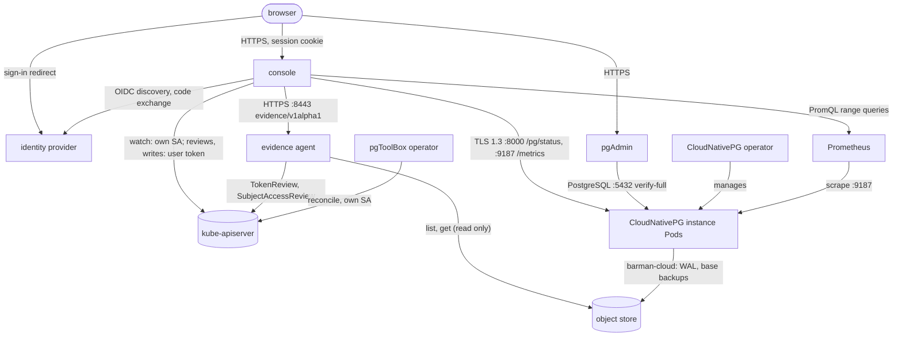

# How pgToolBox fits together

This section shows the moving parts and the wires between them. It describes the
code as it is; when a page and the code disagree, the code is right.

- This page: the components, who talks to whom, on which port, and with which
  identity.
- [Deployment models](deployment-models.md): the operator install next to the
  team-only `pgtools` chart, and what each creates where.
- [Console internals](console-internals.md): how the console turns watches and
  instance reads into the JSON a browser gets.
- [Trust boundaries](trust-boundaries.md): what crosses each boundary and what
  checks it.

## The components

| Component | Code | Runs as | Role |
|---|---|---|---|
| Console | `cmd/console`, `internal/console` | one Deployment per team namespace | Watches the CloudNativePG objects of its namespaces, reads each instance's own status report, runs the diagnostics, serves a JSON API and the SPA. |
| Evidence agent | `cmd/evidence-agent`, `internal/evidence` (image `pgtoolbox-evidence-agent`) | one Deployment per backup repository | Reads a Barman Cloud or pgBackRest repository and tells the console what is really there. The only holder of object-store credentials. |
| pgAdmin | the pgAdmin image, plus `passfile-sync` and the registration step from `cmd/operator` | one Deployment per team namespace | A shared pgAdmin with the team's Clusters registered as servers. |
| pgToolBox operator | `cmd/operator`, `internal/operator` | one Deployment per Kubernetes cluster (optional) | Reconciles `PgToolBoxConsole`, `PgAdmin`, `EvidenceAgent` and `PgAccessRequest` into the workloads above. |
| `pgtools` chart | `charts/pgtools` | a Helm release per team namespace | The same console, agents and pgAdmin, without the operator ([team mode](deployment-models.md)). |

Around them: the Kubernetes API server, the CloudNativePG operator and its
instance Pods, the object store the backups go to, an optional Prometheus, and
the identity provider people sign in with.

## Who talks to whom

The diagram shows every network path the product opens at run time; each arrow
points from the side that opens the connection.

The console never opens a PostgreSQL connection and never touches the object
store; the evidence agent never talks to an instance; the operator talks only to
the API server. `hack/check-layering.sh` and `hack/check-deps.sh` keep it that way
in the import graph: no SQL driver or cloud SDK compiles into the console or the
operator.

## Each hop and its identity

| From → to | Protocol and port | Identity presented | Notes |
|---|---|---|---|
| browser → console | HTTPS at the edge (Ingress, Route, HTTPRoute) to Service port 80, pod port 3000; HTTPS in the pod with `console.tls.secretName` | the sealed session cookie, plus `X-PgToolBox-Request: 1` on unsafe calls | [Authentication](../console/authentication.md) |
| console → identity provider | HTTPS | the console's OIDC client (`OIDC_*`), or the OpenShift OAuth client | discovery and the code exchange; the browser does the redirects |
| console → API server (reads) | HTTPS 443/6443 | **the console's ServiceAccount** | informers over the watched namespaces; no Secrets, one ConfigMap by name |
| console → API server (decisions) | HTTPS | **the signed-in person's token** | a SelfSubjectReview (who is this, cached 30 s) and SelfSubjectAccessReviews (may they, positive answers cached 10 s) |
| console → API server (writes) | HTTPS | **the signed-in person's token** | the four operations and the access-request, role and drill writes; the API server authorizes and audits them |
| console → instance Pods | HTTPS, TLS 1.3, `:8000` `/pg/status`; `:9187` `/metrics` (HTTPS when the Cluster's monitoring TLS is on, else HTTP) | none: the console verifies the server against the instance CA bundle (kept by the operator for a `PgToolBoxConsole`, supplied by the admin with the chart) and the Cluster's Service name | [The instance CA bundle](../console/configuration.md#the-instance-ca-bundle) |
| console → evidence agent | HTTPS, TLS 1.3, `:8443` (plain HTTP in team mode with `evidence.tls.mode: none`) | a bound ServiceAccount token of audience `pgtoolbox-evidence-agent/<namespace>` (operator mode), or the shared token of the chart (team mode) | [The channel](../evidence-agent.md#the-channel) |
| console → Prometheus | HTTPS (or HTTP without a token) | optional bearer token file (`PROMETHEUS_TOKEN_FILE`) | only with `PROMETHEUS_URL`; [Prometheus charts](../console/prometheus.md) |
| evidence agent → API server | HTTPS | the agent's ServiceAccount | TokenReview and SubjectAccessReview (operator mode); in team mode it reads its Cluster, ObjectStore and the listed Secrets |
| evidence agent → object store | the store's HTTPS API (S3, Azure Blob, GCS) | the credentials the `ObjectStore` names, or workload identity | list and read only |
| browser → pgAdmin | HTTPS at the edge; pod port 8080, or 8443 behind the OpenShift `oauth-proxy` | pgAdmin's own OIDC sign-in, or OpenShift OAuth through the proxy | [Who may open it](../operator/pgadmin.md#who-may-open-it) |
| pgAdmin → instances | PostgreSQL `:5432` through `<cluster>-rw` (or a Pooler's Service) | the offered role's password, `sslmode=verify-full`, `channel_binding=require` | passwords written by `passfile-sync` to a memory-backed volume |
| pgAdmin `passfile-sync` → API server | HTTPS | pgAdmin's ServiceAccount, a Role scoped to the named Secrets | [Credentials](../operator/pgadmin.md#credentials) |
| pgToolBox operator → API server | HTTPS | the operator's ServiceAccount | server-side apply of the children; Secret metadata only for user Secrets |

Optional outbound paths not drawn: the daily digest's webhook, chat webhook or
SMTP server (`DIGEST_*`), and, for pgAdmin, the identity provider it signs people
in with.

## Where the contracts live

A change to one of these needs a change on both sides:

| Contract | Defined in | Read by |
|---|---|---|
| Evidence wire contract | `pkg/evidence/v1alpha1` | `internal/evidence/evidenceapi` writes it, `internal/console/evidence` reads it |
| Console JSON API | `internal/console/viewmodel` → `internal/console/api/openapi.yaml` | `ui/src/api/generated` |
| CRDs | `api/v1alpha1` | operator, console, charts, OLM bundle |
| Instance status report | CloudNativePG's `/pg/status` | `pkg/cnpgstatus/instancestatus` |

`ARCHITECTURE.md` at the repository root lists every package in one line each.
