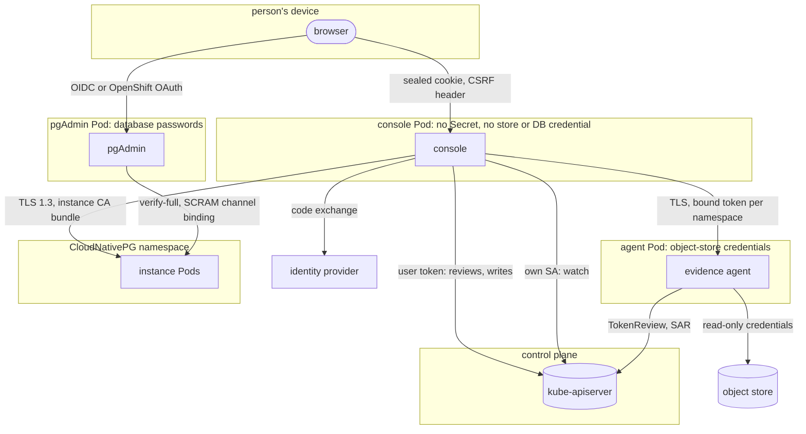

# Trust boundaries

Each box below is a separate trust zone: a process with its own identity and its
own secrets. Each arrow is what crosses from one zone to the next. The rules and
their limits are stated on the [security model](../security.md); this page shows
where they apply.

## The zones

The diagram groups the components by what they hold; an arrow's label names what
it carries and what checks it.

## What crosses each boundary

### Browser ↔ console

- **Carries:** the session cookie, which holds the person's API-server token sealed
  with the console's session key, and nothing else (no role, no level). The cookie
  is `__Host-` prefixed, `HttpOnly`, `SameSite=Strict`.
- **Checks:** every unsafe API call needs the `X-PgToolBox-Request: 1` header and a
  same-origin `Sec-Fetch-Site` (or a matching `Origin`), because on OpenShift every
  Route under `*.apps.<domain>` is the same *site*. Sign-in is rate-limited; the
  server-rendered sign-in pages carry a Content-Security-Policy that allows no
  script. The revocation list ends console sessions an admin names.
- **Trusts nothing from the browser** about identity: who the person is comes from
  a SelfSubjectReview of the token.

See [Authentication](../console/authentication.md).

### Console ↔ API server

Two identities cross this boundary, never mixed:

| Identity | Used for | Bounded by |
|---|---|---|
| the console's ServiceAccount | informers (list, watch) over the watched namespaces; `get`/`watch` of the revocation ConfigMap; `get`/`watch`/`update` of its own state ConfigMap; with digest delivery, `get`/`update` of its digest Lease and `create` of leases; with MCP, `get`/`update` of its MCP Lease and its two MCP EndpointSlices | Roles in the watched namespaces, two Roles naming one ConfigMap each and, with delivery, one naming the Lease (`create` cannot be scoped by name; the console creates only that Lease) and, with MCP, one naming its MCP Lease and slices (no `create`); no Secret verb, no `impersonate`, no other write |
| the signed-in person's token | SelfSubjectReview, SelfSubjectAccessReviews, and every write | that person's RBAC, enforced and audited by the API server |

A positive access review is cached 10 s and a positive identity 30 s; denials are
never cached, and a write is always decided by the API server at the time it is
sent. The exceptions to "the console writes nothing as itself" are its own state
ConfigMap (sign-outs as SHA-256 hashes and "since" times, [what survives a
restart](../console/configuration.md#what-survives-a-restart)) and the restore
drill teardown ([restore drills](../console/restore-drills.md#which-clusters-the-console-deletes)).

See [Authorization](../console/authorization.md).

### Console → instance Pods

- **Carries:** `GET /pg/status` on port 8000 and `GET /metrics` on 9187. No
  credential: the console presents nothing to the instance.
- **Checks:** TLS 1.3 only, the server certificate verified against the CA bundle
  of the Clusters' server CA certificates (`ca.crt` only), which the operator
  mirrors for a `PgToolBoxConsole` and an admin supplies for a chart-installed console
  ([the instance CA bundle](../console/configuration.md#the-instance-ca-bundle))
  and the Cluster's Service name. No bundle, or a Cluster not in it, is "not
  verifiable": there is no plaintext or unverified fallback.
- **Treats the answer as untrusted:** bodies are size-bounded and the `/pg/status`
  parser is fuzzed.

### Console → evidence agent

- **Carries:** read-only `GET` requests of the `evidence/v1alpha1` contract and a
  bearer token. In operator mode the token is the console's projected
  ServiceAccount token for audience `pgtoolbox-evidence-agent/<namespace>`, one per
  watched namespace, rotated by the kubelet; it is useless against the API server
  and against the agents of every other namespace. In team mode it is a shared
  token from a Secret both Pods mount.
- **Checks on the console's side:** it calls an agent only at an endpoint of the
  form `https://<service>.<agent's namespace>.svc`, only when the operator's field
  manager wrote `status.endpoint` and `status.caBundle`, with TLS 1.3, that CA only
  (no system roots), no proxy and no redirect.
- **Checks on the agent's side:** a TokenReview that must return the agent's own
  audience, then a SubjectAccessReview: may this subject `get` this
  `EvidenceAgent`.
- **Treats the answer as untrusted:** every body is validated against the
  contract's invariants and bound to the agent's Cluster and repository
  fingerprint; nothing but conclusions comes back, never a credential.

See [the evidence agent](../evidence-agent.md#trust) for the sequence and its
known limit.

### Evidence agent → object store

- **Carries:** list and get requests under the Barman server's prefix, with the
  credentials the `ObjectStore` (or the Cluster's in-tree configuration) names, or
  the Pod's workload identity.
- **Checks:** the code reaches the store only through a read-only interface; the
  credentials can still write, because barman-cloud needs them to, which is why
  the agent Pod is confined and its image allow-listed. Only the Secrets the
  `EvidenceAgent` (`spec.allowedSecrets`) or the chart's values
  (`evidence.agents[].secrets`) list are mounted or read. The credentials never
  leave this Pod.

### pgAdmin ↔ instances, browser ↔ pgAdmin

- **Carries:** PostgreSQL sessions on port 5432 to `<cluster>-rw` (or another
  offered Service), with the password of an offered role.
- **Checks:** `sslmode=verify-full` against the Cluster's CA and
  `channel_binding=require` (SCRAM). The passwords are read from the named Secrets
  by the `passfile-sync` sidecar through a Role scoped to those names, and written
  to a memory-backed volume.
- **Opening pgAdmin is holding those passwords**, so the browser side is gated by
  identity: pgAdmin's own OIDC sign-in with `requiredClaims`, or on OpenShift the
  `oauth-proxy` asking for `connect pgadmins/<name>`.

See [pgAdmin is a credential-holder](../security.md#pgadmin-is-a-credential-holder).

## What never crosses

- No Secret value reaches the console: not a database password, not an
  object-store credential, not the instance CA key.
- No SQL leaves the console; no object-store request leaves the console or the
  operator.
- No request parameter changes a NetworkPolicy selector, an agent endpoint or an
  instance address: they come from the watched namespaces and the API server.

Network policies add a second fence around these paths where the CNI enforces
them ([console NetworkPolicy](../console/networkpolicy.md)).
