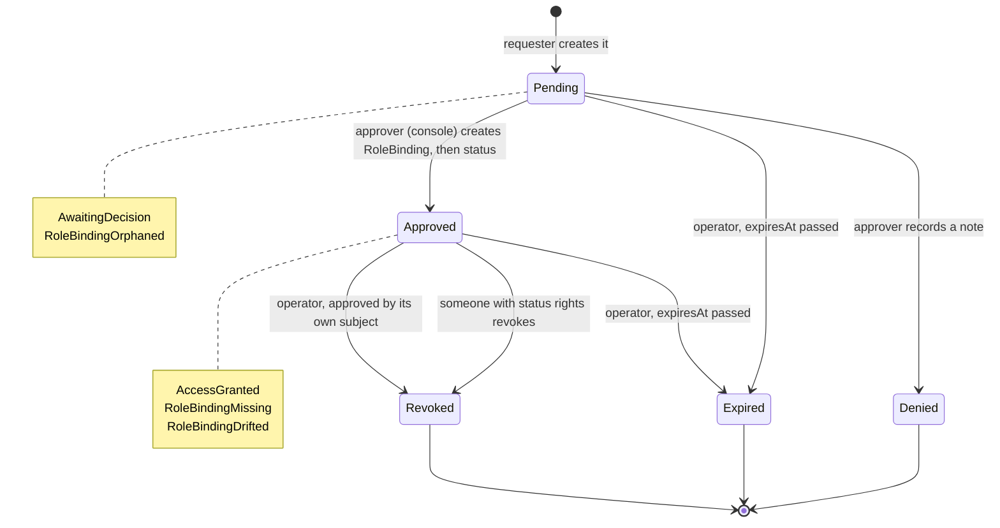
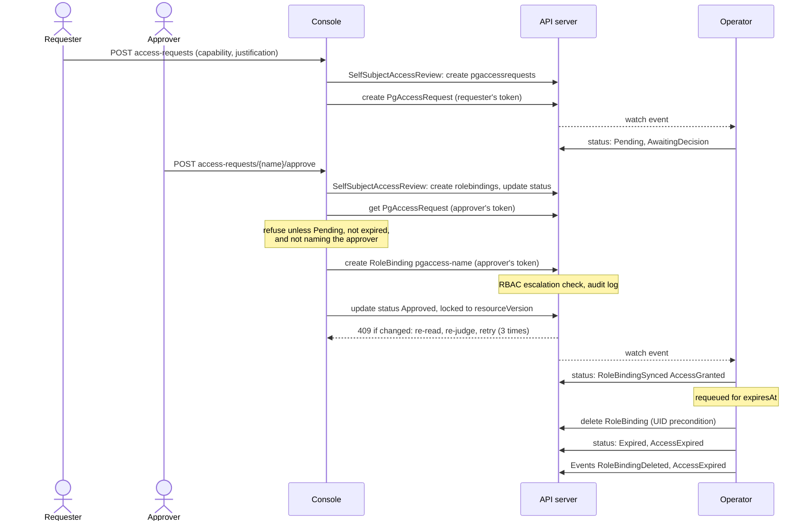

# Access requests

A person who can see a namespace's Clusters but needs more (or a person who
needs the console at all, if someone grants them the right to ask) asks for it
in the console; someone who may already grant it decides. The request is a
standard Kubernetes object, `PgAccessRequest`, and the grant is a standard
`RoleBinding`: the console is only a screen over them, and everything it does
can be done, and audited, with `kubectl`.

## What can be asked for

One of the two ClusterRoles the product ships (see [authorization](./authorization.md)),
in one namespace:

| `capability` | ClusterRole bound | What it allows |
|---|---|---|
| `viewer` | `pgtoolbox-console-viewer` | See the namespace's Clusters, their pods, events and logs; ask for more. |
| `operator` | `pgtoolbox-console-operator` | The viewer's rights, plus the console's operations (backup, restart, reload, promote) and opening pgAdmin. It does **not** decide access requests: a time-boxed grantee could otherwise bind themselves a second, permanent RoleBinding, or approve someone else. |

**A grant always covers every Cluster of the namespace.** A request may name a
Cluster (`spec.cluster`) to tell the decider what it is for, but Kubernetes RBAC
cannot narrow a RoleBinding to one object of a kind, so an approval binds the
ClusterRole for the whole namespace. The request's status (`grantedScope:
Namespace`, and the `ConfigurationValid` condition) and the console both say so.
If that is too much, put the Cluster in a namespace of its own.

## Who may do what

| To | You need, in the namespace | Shipped in |
|---|---|---|
| Ask (create a request, see the ones naming you) | `create pgaccessrequests` | `pgtoolbox-console-viewer` |
| See every request | `list pgaccessrequests` | `pgtoolbox-console-viewer` |
| Approve or deny | `create rolebindings`, `update pgaccessrequests/status`, and `bind` on the role granted (or its every rule) | `pgtoolbox-console-approver`, the namespace's `admin` |
| Revoke | `update pgaccessrequests/status` | `pgtoolbox-console-approver`, the namespace's `admin` |

`pgtoolbox-console-approver` is the deciding role, and no request can grant it
(a request's `capability` is `viewer` or `operator`). It holds `bind` on exactly
`pgtoolbox-console-viewer` and `pgtoolbox-console-operator`, so an approver need not
hold the roles they grant; whoever holds it may bind either role to anyone in the
namespace, themselves included, so give it to the people who already own the
namespace's access, next to `pgtoolbox-console-viewer` (which lets the console show
them the namespace):

```bash
kubectl -n team-a create rolebinding team-a-leads-approver \
  --clusterrole=pgtoolbox-console-approver --group=team-a-leads
```

Approving a request for the `operator` capability hands out database-superuser
power, not a console button: `pgtoolbox-console-operator` can `patch clusters`, and a
`Cluster` spec decides who the superuser is and what the instances run (see
[the ClusterRoles](./authorization.md#the-two-clusterroles)). Decide it as you would
a request for the `postgres` password; time-box it with the request's duration.

The console asks the API server (a SelfSubjectAccessReview, with your token) before it shows a button
or attempts a write, and answers 403 for anything you may not do. It then writes
**with your own token**: the API server authorizes the write, applies its
RoleBinding *escalation check* (you can only bind a role whose every permission
you already hold in that namespace) and records you in its audit log. The
console's own ServiceAccount only reads requests; it cannot create a RoleBinding.

Access requests need the pgToolBox operator: it reconciles each request (expiry,
revocation, the orphaned-RoleBinding cleanup). On a cluster where
`PgAccessRequest` is not served, such as a `pgtools` install without the
operator, the console offers nobody to ask or decide, and a request, approval,
denial or revocation answers 501 "access requests need the pgtoolbox operator"
rather than a 403 that would send you after a role.

One rule is the console's own: **nobody approves a request that names them**
(their user, their ServiceAccount, or a group they are in). Ask someone else. If a
client other than the console records an approval by the request's own user or
ServiceAccount, the operator revokes it (`SelfApprovalRefused`).

## Lifecycle

The request's `status.phase`, who moves it, and the `RoleBindingSynced` reason
the operator reports in each phase:



`Denied`, `Expired` and `Revoked` are terminal: the operator deletes any
RoleBinding the request still controls and reports `AccessDenied`,
`AccessExpired` or `AccessRevoked`. Deleting the request, in any phase, deletes
its RoleBinding through the garbage collector (the binding's owner reference).

- **Approve**: the console creates `RoleBinding pgaccess-<request>` (subject →
  ClusterRole, owned by the request) and then records `status.decidedBy` (your
  username, as the API server names you) and `decidedAt`. The decision is locked
  to the version of the request it was judged on: if someone decided in between,
  you get a conflict, not an overwrite.
- **Deny** needs a note; the requester sees it.
- **Revoke** records `revokedBy`/`revokedAt`; the operator deletes the RoleBinding.
- **Self-approval**: an approval whose `decidedBy` is the request's own user or
  ServiceAccount is revoked by the operator (`revokedBy: pgtoolbox-operator`,
  reason `SelfApprovalRefused`). The console refuses it before it happens,
  including for a group the approver is in; the operator can only compare
  usernames, so it cannot catch a group's member approving for the group.
- **Expiry**: with `spec.expiresAt`, the operator deletes the RoleBinding at that
  time and marks the request `Expired`. A pending request past its expiry can no
  longer be approved. Without it, the grant lasts until revoked.
- **What expiry and revocation do not end**: deleting the RoleBinding stops new
  authorizations, not access already open. The console keeps a positive
  authorization for up to 10 s and an identity for up to 30 s; on OpenShift,
  pgAdmin's oauth-proxy checks the right to connect at sign-in only, so a
  pgAdmin session opened before the expiry lasts for the session lifetime,
  **1 h by default, up to the PgAdmin's `auth.openshiftOAuthProxy.sessionMaxAge`**
  (at most 12 h; raising it takes `get` on the namespace's Secrets when the
  PgAdmin offers credentials); and
  pgAdmin's open database connections and websockets last until they close.
  To end an `operator` grant at once, delete the Secret
  `<name>-pgadmin-proxy-cookie` (the operator generates a new one) and then the
  pgAdmin Pod: every pgAdmin session of that PgAdmin ends, not only the user's.
  Restarting the Pod alone closes the connections but keeps the cookie valid.
  Terminate the user's backends in PostgreSQL (`pg_terminate_backend`) too.
- **Four eyes on the console path only**: the console and the operator refuse
  self-approval, but an approver holds `create rolebindings` and `bind` on both
  roles, so they can bind `pgtoolbox-console-operator` to themselves with
  `kubectl create rolebinding`, no request involved, and the operator never sees
  it. Treat `pgtoolbox-console-approver` as the right to grant yourself access,
  and audit RoleBindings to the two roles at the API server.
- **Deleting the request** deletes its RoleBinding (owner reference, garbage
  collector).

A request is immutable once made, and its status only moves forward
(`Pending → Approved | Denied | Expired`, `Approved → Revoked | Expired`): the
CRD's validation rules refuse anything else, whoever writes. `decidedBy` and
`roleBinding` cannot change once recorded.

### From request to grant

What each party does, and with whose identity, from the request to its expiry:



The console reads the request live (never from its cache) before deciding, and
every read and write in a decision carries the approver's token. If the status
write fails after the RoleBinding was created, the binding is left behind; the
operator deletes it one minute after its creation (`RoleBindingOrphaned`) unless
an approval was recorded by then.

## What the operator does, and does not

The operator never creates or changes a RoleBinding, so it holds no `bind` or
`escalate` permission and cannot be used to grant anything. It only takes grants
away and reports what the namespace's RBAC actually says, in the request's
`RoleBindingSynced` condition (and `Ready`):

| Reason | Meaning |
|---|---|
| `AwaitingDecision` | Pending; nothing is bound. |
| `AccessGranted` | Approved, and the RoleBinding binds exactly the subject to the ClusterRole. |
| `RoleBindingMissing` | Approved, but the RoleBinding is gone (deleted by hand). It is never recreated: revoke and ask again. |
| `RoleBindingDrifted` | The request's RoleBinding was edited to bind something else; the operator deleted it. |
| `RoleBindingOrphaned` | An approval created the RoleBinding but its status write failed; after a minute the operator deleted it. |
| `SelfApprovalRefused` | Approved by its own user or ServiceAccount; the operator revoked the request and deleted the RoleBinding. |
| `AccessDenied`, `AccessExpired`, `AccessRevoked` | Terminal; nothing is bound. |

Each deletion is also a `RoleBindingDeleted` Event on the request. The operator's
`/metrics` carries `pgtoolbox_pgaccessrequest_info{capability,phase,subject_kind}`,
`pgtoolbox_pgaccessrequest_condition` and, for approved requests that expire,
`pgtoolbox_pgaccessrequest_expires_timestamp_seconds` (never the subject's name).

## From the command line

```shell
# Ask (as yourself; the console fills the subject the same way)
kubectl -n team-a create -f - <<'YAML'
apiVersion: pgtoolbox.fyannk.dev/v1alpha1
kind: PgAccessRequest
metadata: {generateName: operator-}
spec:
  subject: {kind: User, name: "oidc:jane@corp.example"}
  cluster: orders
  capability: operator
  justification: "INC-4211: restart the lagging standby"
  expiresAt: "2026-11-02T18:00:00Z"
YAML

kubectl -n team-a get pgaccessrequests        # short name: pgar
```

Deciding from the command line means doing what the console does: create the
RoleBinding with `kubectl create rolebinding` and then record the decision in
`status` (`kubectl edit --subresource=status`). The console does both, in the
right order, with the checks above.
