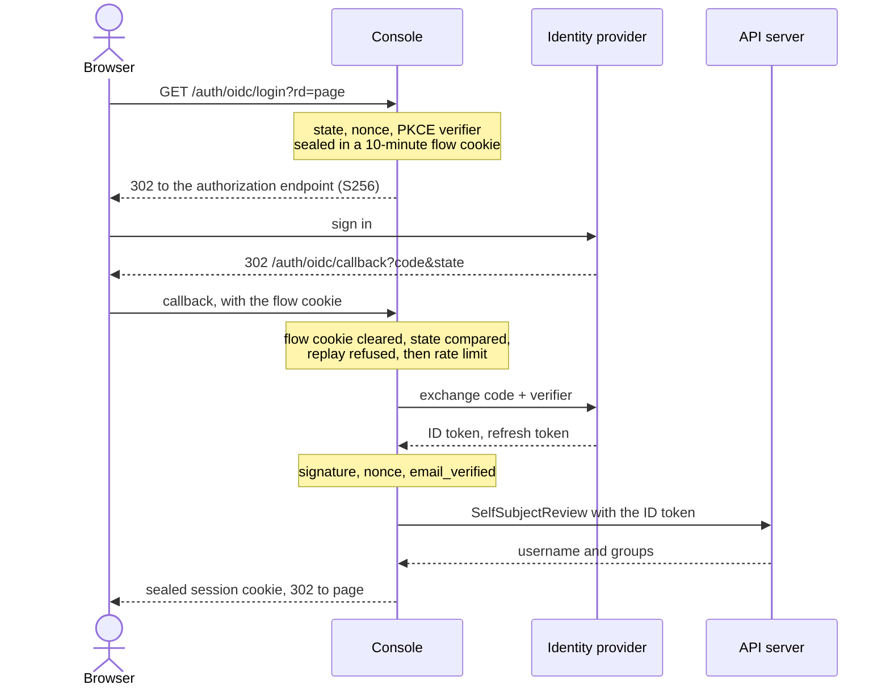
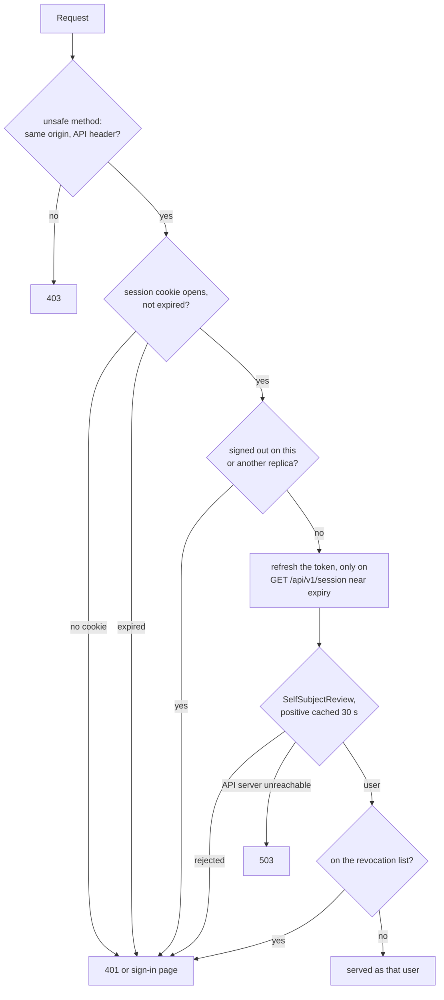

# Authentication

The console never decides who someone is. After sign-in it holds one thing for
the person: **a token the Kubernetes API server accepts**. Every identity it
shows or uses (username and groups) comes from a `SelfSubjectReview` the API
server answered for that token, so the API server's own authenticator is the only
source of names. No level, role or group is stored in a cookie, and no group
claim is read from an ID token (`OIDC_GROUPS_CLAIM` does not exist).

Consequence for RBAC: a RoleBinding subject must be spelled exactly as the API
server reports the person. Sign in once and read `GET /api/v1/session` (or the
user menu) to see the username and groups the console got; that is what to bind.

## Providers

`console.auth.provider` (the `AUTH_PROVIDER` variable) is one of:

| Provider | Person does | Needs |
|---|---|---|
| `token` | Pastes an API-server token into the sign-in form. | Nothing. Works on every cluster. |
| `oidc` | Signs in at the identity provider (authorization-code flow with PKCE and a nonce). | The **API server must trust the same issuer**: `--oidc-*` flags or an `AuthenticationConfiguration`, because the ID token the console keeps is sent to the API server as the bearer token. |
| `openshift` | Signs in through OpenShift's OAuth server. | OpenShift. The console's ServiceAccount is the OAuth client. See [OpenShift](openshift.md). |

The pasted-token form stays offered next to an SSO provider as the break-glass
path. Remove it with `console.auth.tokenLogin=false` (`AUTH_TOKEN_LOGIN=false`).

On a managed control plane that cannot be told to trust your identity provider,
SSO with `oidc` does not work: the console cannot forward a token the API server
would reject. Use `token`, or an external proxy that forwards an API-server token.
Impersonation (the console calling the API server with its own token plus
`Impersonate-User`) is not offered; see the [security model](../security.md).

### The `oidc` provider

| Setting | Chart value | Notes |
|---|---|---|
| `OIDC_ISSUER_URL` | `console.auth.oidc.issuerURL` | https only. |
| `OIDC_CLIENT_ID` | `console.auth.oidc.clientID` | |
| `OIDC_CLIENT_SECRET_FILE` | `console.auth.oidc.clientSecret.existingSecret` and `.key` | A Secret you create; the chart mounts it as a file. The console reads no Secret through the API. |
| `OIDC_REDIRECT_URL` | `console.auth.oidc.redirectURL` | Register `https://<host>/auth/oidc/callback` with the provider. |
| `OIDC_SCOPES` | `console.auth.oidc.scopes` | Must contain `openid`. The default is `openid email profile offline_access`; `offline_access` is what lets the console refresh a token. Without it a session lasts as long as the ID token. |
| `OIDC_CA_FILE` | `console.auth.oidc.caConfigMap` | A ConfigMap with `ca.crt`, for a private provider. |
| `OIDC_REQUIRE_EMAIL_VERIFIED` | `console.auth.oidc.requireEmailVerified` | Default `true`: a login whose ID token carries an `email` claim without `email_verified=true` is refused (a token with no `email` claim passes). Set `false` only for a provider that omits `email_verified`. |
| `OIDC_GRANT_CLIENT_ID`, `OIDC_GRANT_CLIENT_SECRET_FILE` | `console.auth.oidc.grantClient.clientID` and `.clientSecret` | Optional, off by default: a second client of the same issuer for the identity provider sign-ins of [MCP clients' grants](mcp.md#the-identity-provider-sign-in-of-a-grant). Register it with the same redirect URI, and make the API server accept its audience too (below). |

A sign-in with `oidc`, from the click to the session cookie:



With an OIDC grant client (`OIDC_GRANT_CLIENT_ID`), the API server must accept
both audiences, for example:

```yaml
apiVersion: apiserver.config.k8s.io/v1
kind: AuthenticationConfiguration
jwt:
  - issuer:
      url: https://idp.example.com
      audiences: [pgtoolbox-console, pgtoolbox-console-grants]
      audienceMatchPolicy: MatchAny
    claimMappings:
      username: {claim: email, prefix: "oidc:"}
```

The `openshift` provider follows the same flow without the nonce and the ID
token: the session keeps OpenShift's access token. If the API server does not
accept the token (it does not trust the issuer), the sign-in fails there with a
message that says so, and no cookie is set.

### The `token` provider (break-glass)

`POST /auth/token` takes the pasted token (an optional `Bearer ` prefix is
dropped), spends one sign-in attempt, verifies it with a `SelfSubjectReview` and
keeps it in the sealed session; the session ends no later than the token's own
expiry when the token says it (a `kubectl create token` token does). The form is
accepted only from the console's own page (same origin). Every action is then audited by the API server as the
ServiceAccount or user the token belongs to; revoking access is deleting the
binding. The product stores no password.

`console.breakGlass.enabled=true` (off by default) renders the identity behind the
form: a ServiceAccount `pgtoolbox-console-breakglass` that holds no token and mounts
nothing, and in each watched namespace a RoleBinding to the `pgtoolbox-console-operator`
ClusterRole, which must exist (`operator.userRoles.create`, or `config/rbac`). When
it is needed, mint a short-lived token and paste it into the form:

```bash
kubectl -n team-a create token pgtoolbox-console-breakglass --duration=1h
```

Whoever can create that token holds `pgtoolbox-console-operator` rights in the watched
namespaces, so leave it off until you need it, or create the binding by hand and
delete it afterwards.

## Sessions

- The session cookie holds the person's token **sealed** with AES-256-GCM under
  keys derived with HKDF-SHA256 from the session secret. The sealed token is
  useless against the API server by itself (it is ciphertext) and the console
  never writes a level or a group into it. The cookie is split into at most two
  chunks, `HttpOnly`, `SameSite=Strict`, and named `__Host-pgtoolbox-console-0`/`-1` when
  `COOKIE_SECURE` is true (the default). The login flow uses a separate short
  `SameSite=Lax` cookie for the round trip to the provider (ten minutes at most).
- **Session secret.** `SESSION_KEY_FILE` points at a file with one secret per
  line, each at least 32 bytes. The chart generates one Secret and keeps it
  across upgrades (`console.auth.sessionKey`). The first line seals; every line
  opens: to rotate, put a new secret first and keep the old line for one session
  lifetime.
- **Lifetime.** `SESSION_IDLE_TIMEOUT` (default `1h`) and `SESSION_MAX_AGE` (default `12h`, never less than the idle
  timeout). A session ends at the first of: sign-in plus `SESSION_MAX_AGE`, last
  activity plus `SESSION_IDLE_TIMEOUT`, and, for a token that cannot be
  refreshed, the token's expiry. Activity slides the idle timer at most once a
  minute, and only for requests from the console's own pages. An `oidc` session
  with a refresh token renews its ID token when the UI calls `GET
  /api/v1/session` within two minutes of the token's expiry; the event stream
  asks the UI to do so 90 seconds before the session would end. A failed refresh
  ends the session when the token expires. `IDP_TIMEOUT` (default `10s`) bounds
  calls to the provider.
- **Identity cache.** The console remembers a positive `SelfSubjectReview` answer
  for 30 seconds. A token revoked at the API server stops working for *writes*
  immediately (they carry the token) and for views within that time.
- **CSRF.** Every unsafe method needs a same-origin request (`Sec-Fetch-Site:
  same-origin`, or an `Origin` equal to the console's), and an API call
  (`/api/...`) also the header `X-PgToolBox-Request: 1`; anything else is a 403
  before the request reaches the session check.
  `SameSite` alone does not protect on OpenShift, where every Route under
  `*.apps.<domain>` is the same site.
- **Single-use flows.** A sign-in flow is used once on the server, not only
  because the browser drops its cookie: the replica that accepts a callback
  remembers a SHA-256 of the flow's state until the flow expires (ten minutes),
  and a replayed cookie and state are refused before any budget is charged and
  before any code exchange. The memory is per replica (at most what the
  code-exchange bound admits in ten minutes, about 60,000 digests):
  behind several replicas a flow can be replayed once on each other replica,
  each time charged to that replica's budgets. Starting a flow stores nothing on
  the server (the flow lives in its sealed cookie), so starting many costs only
  the sealing.
- **Rate limit.** Sign-in attempts are limited per client address and per
  replica. The per-replica bounds protect the API server and the identity
  provider; they are not meant to ration people, so the ones an
  unauthenticated sender can reach are large, and the ones a genuine sign-in
  needs once it has proved something are separate, so junk never reaches them.
  - An **OAuth callback** is charged only once its flow cookie and state match
    (a callback without them costs the console nothing). It then spends its
    client address's budget (ten a minute, a burst of ten) and the replica's
    code-exchange bound (100 a second, a burst of 200), which caps the requests
    junk codes make the console send to the IdP; the IdP's own rate limit is the
    real bound on what it accepts. Only a **successful** exchange spends a
    SelfSubjectReview, from a bound of its own (20 a second, a burst of 40, so a
    whole team can sign in at once): a junk code costs one refused exchange and
    nothing else.
  - A **pasted token** is charged three budgets in turn, and a refusal by one
    spends none of the next: the token's own (ten a minute, keyed on a digest of
    it), so retrying one token does not spend its address; the sender's address
    (twenty a minute, a budget of the token form only, so junk tokens never lock
    the OAuth sign-in), so distinct junk tokens from one address stop there; and
    the replica's bound on reviews of tokens it has never accepted (100 a
    second, a burst of 200), which caps what a flood from many addresses makes
    the API server authenticate.
  - Over any budget the console answers 429 without asking anyone, and counts it
    in `pgtoolbox_console_throttled_requests_total{bucket}`
    ([metrics](metrics.md)).

  **When the client address is shared** (hops without CIDRs, or hops 0 behind
  a public URL, below), no per-address budget is charged, on either path: every
  client behind the proxy has its address, and anyone could spend that budget
  for everyone. Callbacks are then bounded by their single use and the
  per-replica bounds, pasted tokens by their own budget and the per-replica
  bound. **What a flood can still do**: one sender making more than 100 junk
  callbacks a second refuses new OAuth sign-ins on that replica while it lasts,
  and makes the console send up to 100 refused token requests a second to the
  IdP; more than 100 junk tokens a second refuses new token sign-ins. Sessions
  already open, MCP clients already connected and grants already issued keep
  working. Name the proxies, so each client keeps its own budget.
  Each key space has a table of its own, so a spray that fills one (10,000
  keys) resets only that one.
  Raw API-server tokens presented as MCP bearers spend the token form's bound
  the first time, after their address's (or, behind a shared address, their
  own) budget. A bearer this replica accepted before is remembered by a digest
  (at most 4,096, until it expires, an hour at most) and its re-review, once
  its 30-second cached answer ends, spends a bound of its own (20 a second, a
  burst of 40): a flood of junk bearers cannot fail a connected client.
- **Client address.** Every per-address budget and the audit trail's
  `client_ip` use the direct peer, unless the peer is a trusted proxy.
  `TRUSTED_PROXY_HOPS` (0 to 8) is how many proxies append to
  `X-Forwarded-For`; `TRUSTED_PROXY_CIDRS` (comma-separated CIDRs, at most 32)
  is who they are. The header is read only from a peer inside one of those
  CIDRs, walked from the right for at most the hops, and the first address that
  is not a trusted proxy is the client. **Hops without CIDRs trust no peer and
  the header is ignored**: any Pod that reaches the console's port directly
  could otherwise name a new address on every request, escape every
  per-address budget, drain the shared review bound for everyone and forge
  `client_ip` in the audit trail. `0.0.0.0/0,::/0` trusts every peer and is
  safe only where a NetworkPolicy admits nothing but the proxies; the operator
  and the chart write it only then. With hops but no CIDRs the console knows
  the address is shared and drops the per-address budgets (above). With hops 0
  and a `PUBLIC_URL` that is not loopback it cannot know either (a clusterIP
  exposure behind an Ingress of your own, a load balancer that rewrites the
  source address), so it treats the peer's address as shared in the same way.
  Per-address budgets apply only with trusted CIDRs, or with hops 0 on a
  loopback `PUBLIC_URL` (or none). The console warns at start in both shared
  cases. The `pgtools` chart sets one hop when `console.exposure.type` is
  not `none` (`console.trustedProxyHops`, `console.trustedProxyCIDRs`); the
  operator [follows the published exposure](../operator/console.md#trusted-proxies-and-the-ingress-networkpolicy).
- **Sign-out** is `POST /logout` (`GET /logout` shows the confirmation page). It
  clears the cookie, drops the cached identity and refuses that session until its
  absolute expiry: on this replica at once, and on the others within about a
  second through the [state ConfigMap](configuration.md#what-survives-a-restart),
  which holds the SHA-256 of the session ID, never the session. Without that
  ConfigMap (missing or forbidden) the refusal stays on this replica, and a
  copied cookie stays usable on another until it expires or is put on the
  [revocation list](#revoking-sessions). It does **not** revoke the token at the
  identity provider or at OpenShift's OAuth server.

What the console checks on every request after sign-in:



A refused session is cleared, and the sign-in page says why (`expired`,
`rejected`, `revoked`). An API call gets a 401 with the sign-in URL in its body
instead of a redirect.

`PUBLIC_URL` (the chart derives `https://<exposure.host>`) is the origin people
type. It is used for cookies, redirects and the CSRF check, and must be `https`
while `COOKIE_SECURE` is true.

## Revoking sessions

The console has no session database. Two replicas agree through a ConfigMap
(`console.revocations.configMapName`; the chart creates it empty) that every
replica watches and never writes. An admin edits its keys:

| Key | Value | Effect |
|---|---|---|
| `notBefore` | an RFC 3339 time | Every session signed in earlier is revoked. |
| `users` | one `<username> <RFC 3339 time>` per line | That user's sessions signed in earlier are revoked. |
| `sessions` | one session ID or bearer reference per line | That session is revoked. The ID is in the `login.success` audit line. A `bearer-<16 hex>` reference (the `session` of an `mcp.call` audit line) refuses that one token on the [MCP endpoint](mcp.md). |

Blank lines and lines starting with `#` are ignored. A list that does not parse
is refused as a whole and **the last good list stays in force**, so a typo neither
revokes everyone nor un-revokes anyone; the metric `pgtoolbox_console_revocation_list_valid`
goes to `0`. The console's Role may `get` and `watch` that one ConfigMap by name
and nothing else of its kind.

## Audit lines

The console logs one line per event with `audit=<event>`, the client address and
the user agent: `login.success`, `login.failure`, `access.denied`, `logout`,
`session.revoked`. The Kubernetes audit log remains the complete record of what
people *did*, because writes carry their own token.

## Environment variables

The chart sets these; the binary reads them. Unlisted settings are in
[configuration](configuration.md).

| Variable | Default | |
|---|---|---|
| `AUTH_PROVIDER` | none (required) | Comma list of `token`, `oidc`, `openshift`. |
| `AUTH_TOKEN_LOGIN` | `true` | Offer the token form beside SSO. |
| `SESSION_KEY_FILE` | none (required) | See above. |
| `SESSION_IDLE_TIMEOUT`, `SESSION_MAX_AGE` | `1h`, `12h` | |
| `PUBLIC_URL`, `COOKIE_SECURE`, `TRUSTED_PROXY_HOPS` | empty, `true`, `0` | |
| `TRUSTED_PROXY_CIDRS` | empty | The proxies whose `X-Forwarded-For` is read; empty trusts none ([client address](#sessions)). |
| `IDP_TIMEOUT` | `10s` | |
| `REVOCATION_CONFIGMAP`, `POD_NAMESPACE` | | The ConfigMap name and the console's namespace. |
| `OIDC_*`, `OPENSHIFT_*` | | As above and on the [OpenShift page](openshift.md). |
| `TLS_CERT_FILE`, `TLS_KEY_FILE` | | Serve HTTPS from mounted files (`console.tls.secretName`). |
