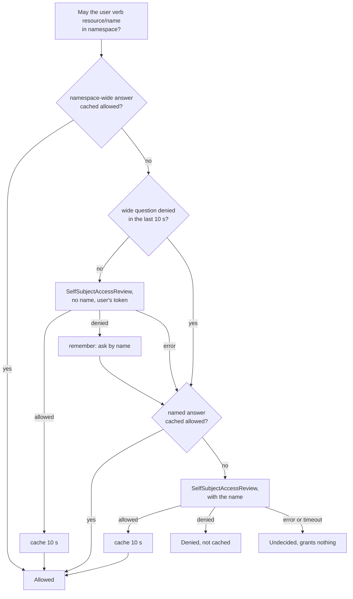

# Authorization

Kubernetes RBAC is the only access-control model. The console adds no roles, no
levels and no groups of its own.

## The access review model

For each question "may this person do *verb* on *resource* in *namespace*", the
console posts a `SelfSubjectAccessReview` to the API server with the person's own
token. Any authenticated user may create one, so the console's ServiceAccount
needs no cluster-scoped grant, and the API server's audit log shows the person. The API server answers from its configured authorizers (RBAC,
or whatever the platform adds).

- **Parallel and bounded.** Reviews run concurrently (16 at once, at most 4 per
  person, 5 s each), so a cluster list of many Clusters renders progressively.
- **Cached for 10 seconds, positives only.** A grant shows up on the next request;
  a revocation shows up in views within 10 seconds. A *denied* answer is never
  cached.
- **An error grants nothing.** If the API server cannot be asked, the capability
  is false and listed as undecided; the application says "could not check" rather
  than hiding a button silently.
- **Writes cannot be wrong.** A write goes to the API server with the person's
  own token ([operations](../operations.md)), so a stale positive in the cache can
  never grant a write. Revocation applies to writes immediately.

`SelfSubjectRulesReview` is deliberately not used: it costs a call per namespace
and is incomplete where cloud IAM decides access.

How one question about a named object (a Cluster, a `PgAdmin`) is answered. The
console first asks the same question without the name (in a review, no name means
every object of the resource), so a person allowed on all Clusters of a
namespace costs one review there, not one per Cluster:



The memo of a denied namespace-wide question only sends the next question
straight to the named review; it never denies anything by itself. Identical
questions asked at the same moment (the list and the event stream filtering the
same Clusters) share one review. The cache key is the whole identity (username,
UID, groups and extra) and the question, so two people, or one person with two
group memberships, never share an answer.

**What a denial looks like.** A request the review refuses is a `403` whose
`detail` names the question and the role to ask for, for example `you may not get
clusters.postgresql.cnpg.io/orders in namespace team-a: ask for the
pgtoolbox-console-viewer role there`. A request whose review could not be made is a
`503` (`the Kubernetes API server could not be asked ...; retry`), never a
`403` and never an answer. In a Cluster's capabilities, `undecided` lists the
ones that could not be checked; they read `false` until the API server answers.

## What decides what

| Capability | Granted when the person may |
|---|---|
| See a Cluster | `get clusters.postgresql.cnpg.io/<name>` in its namespace. One namespace-wide review per namespace decides the cluster list; Clusters are reviewed by name only where it is denied. |
| Read logs | `get pods/log` in the Cluster's namespace (and for the pod, on a log request). |
| Back up | `create backups.postgresql.cnpg.io` in the namespace. |
| Reload, restart | `patch clusters.postgresql.cnpg.io/<name>`. |
| Promote | `patch clusters.postgresql.cnpg.io/<name>/status`. |
| "Operations" as a whole | all three of `patch clusters`, `patch clusters/status` and `create backups`. |
| Open pgAdmin | `get pgadmins.pgtoolbox.fyannk.dev/<name>`. |

A Cluster the person may not `get` answers **403 whether it exists or not**, so
the API is no oracle for what exists. A Cluster in a namespace the console does
not watch is not served at all.

The cluster list is the watched namespaces' Clusters (optionally narrowed by
`console.clusterSelector`), filtered by those reviews. An RBAC `resourceNames`
grant works: the person sees exactly the named Clusters. A Cluster whose review
failed is listed as *could not check*, never with its data. The event stream
filters what it sends with the same reviews.

## Granting access

Use ordinary RoleBindings in the watched namespace. The smallest grant, from the
chart's notes:

```bash
kubectl -n team-a create role cluster-viewer \
  --verb=get,list,watch --resource=clusters.postgresql.cnpg.io
kubectl -n team-a create rolebinding cluster-viewer \
  --role=cluster-viewer --group=<group as the API server reports it>
```

That is enough to see the Cluster; the console reads the rest of its data with
its own ServiceAccount. For the usual cases use the two ClusterRoles below.

### The two ClusterRoles

The operator half (and the OLM bundle, and `config/rbac`) ships two ClusterRoles people
are bound to, and a third that decides access requests.
**Bind them per namespace with a RoleBinding.** The product renders no
ClusterRoleBinding for them, and a cluster-wide binding would grant nothing beyond
a console's watched namespaces anyway.

```bash
kubectl -n team-a create rolebinding alice-viewer \
  --clusterrole=pgtoolbox-console-viewer --user=alice@example.com
kubectl -n team-a create rolebinding ops-team \
  --clusterrole=pgtoolbox-console-operator --group=team-a-dba
```

| ClusterRole | Grants | For |
|---|---|---|
| `pgtoolbox-console-viewer` | `get`/`list`/`watch` on the CloudNativePG kinds (`clusters`, `backups`, `scheduledbackups`, `poolers`, `databases`, `databaseroles`, `publications`, `subscriptions`, `failoverquorums`, `imagecatalogs`), `objectstores`, and pods, services, PVCs and events; `get` on `pods/log`. | People who look. |
| `pgtoolbox-console-operator` | Everything in the viewer, plus `create backups`, `create databaseroles`, `patch clusters` and `clusters/status`, and `get pgadmins`. | People who operate. |
| `pgtoolbox-console-approver` | `get`/`list`/`watch` on PgAccessRequests, `update` on their status, `create rolebindings`, and `bind` on exactly the two roles above. | People who decide [access requests](./access-requests.md#who-may-do-what). No request can grant it. |

Neither role touches a Secret. `get pgadmins` is in the second role only, on
purpose: **whoever may open pgAdmin holds the credentials of every role it
offers** (see [pgAdmin](../operator/pgadmin.md#who-may-open-it)). The chart
renders the roles with `operator.userRoles.create` (default `true`).

A third ClusterRole, `pgtoolbox-aggregate-to-admin`, is bound to nobody: it adds
`get`/`list`/`watch` on PgAdmins, EvidenceAgents and PgAccessRequests, `create` on
PgAccessRequests and `update` on their status, to the built-in `admin` role
(`operator.userRoles.aggregateToAdmin`, default `true`). Kubernetes lets a user
grant only what they hold, so this is what lets a namespace admin bind the two
roles above to their team (given the CloudNativePG rights they name) and install a
`pgtools` console that links to these objects. It is not added to `edit`.

## What the console's own ServiceAccount may do

The console's authority is bounded by its namespace and is the same for every
person it serves.

| Object | Where | Grants |
|---|---|---|
| `Role` and `RoleBinding` `<release>-console` | each watched namespace | `get`/`list`/`watch` on the CloudNativePG kinds, `objectstores`, `pgadmins`, `evidenceagents`, pods, PVCs, services, PDBs, leases and jobs; `list`/`watch` on events and resource quotas; `get` on replica sets and deployments; `get` on `pods/log` unless `console.rbac.podLogs=false`. |
| `Role` and `RoleBinding` `<release>-console-revocations` | release namespace | `get`/`watch` on **one** ConfigMap, by `resourceNames`. |
| `Role` and `RoleBinding` `<release>-console-state` | release namespace | `get`/`watch`/`update` on **one** ConfigMap, `<release>-console-state`, by `resourceNames`: the [state the replicas share](configuration.md#what-survives-a-restart). |
| `Role` and `RoleBinding` `<release>-console-digest` | release namespace, only with a digest delivery channel | `get`/`update` on **one** Lease, `<release>-console-digest`, by `resourceNames`, and `create` on leases: only the Lease's holder [delivers the digests](timeline-and-digest.md#daily-digest). RBAC cannot scope `create` by name (it is authorized before the object exists); the console creates only that Lease (`hack/readonlycheck` pins the call). Leases are in the built-in `edit` and `admin` roles, so a namespace admin may grant this. |
| `ClusterRole` and binding `<namespace>:<release>-console:clusterimagecatalogs` | cluster, only with `console.clusterImageCatalogs.enabled` | `get`/`list`/`watch` on `clusterimagecatalogs`. |
| `ClusterRole` `<namespace>:<release>-console:metrics-reader` | cluster, only with `console.metrics.readerClusterRole` | `get` on the URL `/metrics`, bound to the scraper, not the console. |

There is no Secret verb, no wildcard and no `impersonate` verb anywhere, and no
write except on the console's own state ConfigMap, its digest Lease (with
delivery) and, opt-in, the drill teardown.
The ServiceAccount does not automount its token; the container gets a projected
short-lived one. The chart's unit tests and `make validate-packaging` check this on
the rendered objects, and `make test-e2e-chart` proves it against a real API server
with access reviews over every API resource.

Anything the console shows that its ServiceAccount read (logs, informer data) is
shown only after the person's own review passed. Anything it writes, it writes as
the person.
