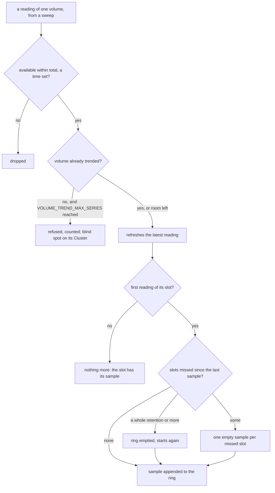
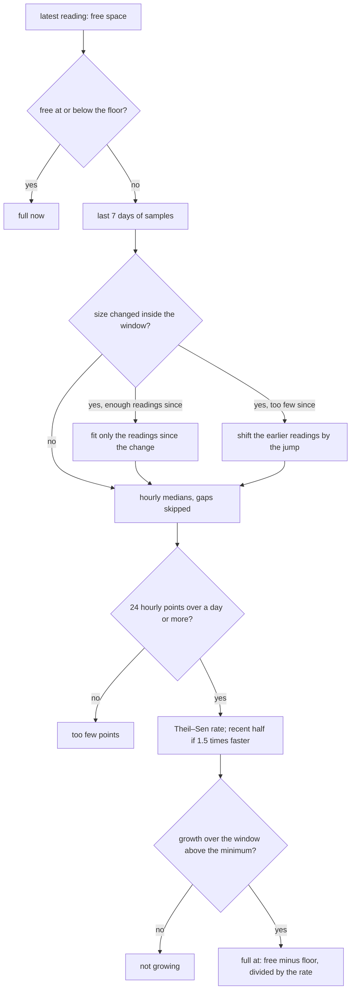
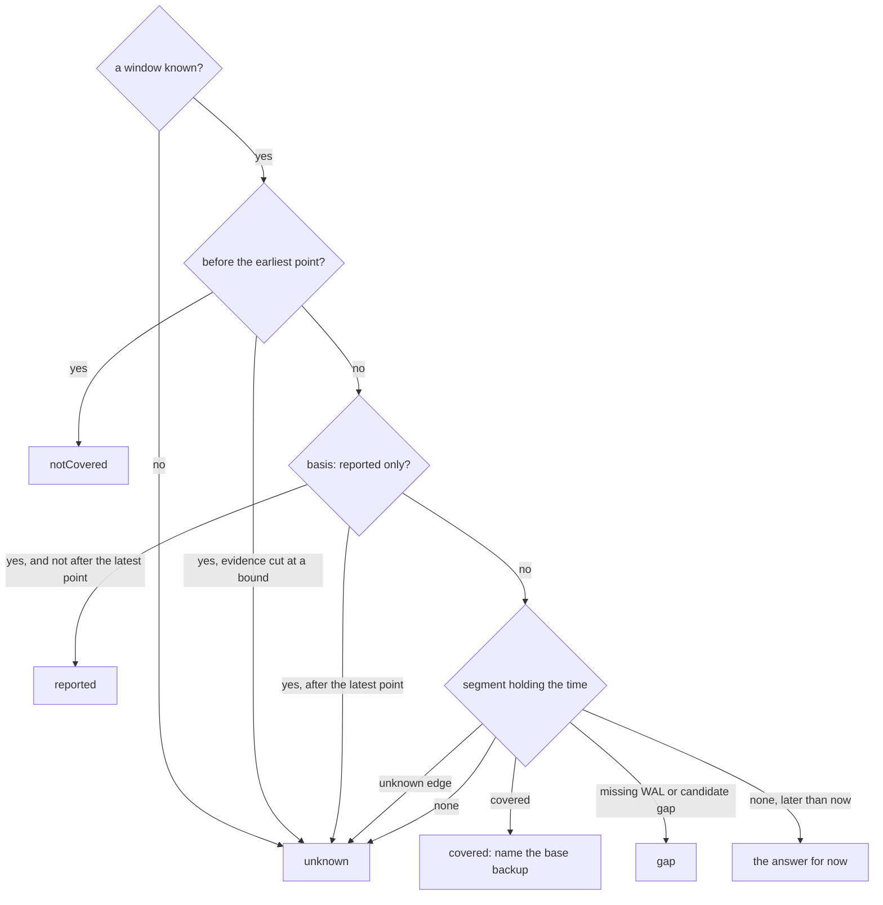

# Volume forecasts and the recovery window

Two estimates sit next to the raw facts. The **storage screen** says when each
volume will fill. The **backups screen** draws the span a restore can target and
answers "can I restore to this time?". Each one states its basis and what it does
not prove.

## Volume forecasts (storage screen)

### Where the data comes from

The console trends a volume only when an instance reports it:

- `volumeUsages` in `/pg/status` (one `statfs` per volume, tablespaces included),
- or, failing that, the `cnpg_disk_*` metrics (data and WAL volumes only).

Upstream CloudNativePG reports neither. The panel then says so and draws nothing,
and the blind spot `storage.volumeUsageNotReported` stays on the screen. Builds
that report volumes (such as the autoGrow fork) fill the panel on their own. The
console detects the data, never the build.

A volume counts as full for PostgreSQL when *available* reaches one WAL segment
(16 MiB) or 0.05 % of the filesystem. Available is `statfs` `bavail`, so the
reserved blocks are excluded. The forecasts run toward:

- the current filesystem's size, always;
- and, when the volume's storage section declares `autoGrow`, its `maxSize`. The
  operator grows the PVC in steps up to `maxSize`, so that date is when the steps
  run out, not when the next one happens.

`autoGrow` is not in the upstream `Cluster` type, so the console reads it from a
second, raw view of each Cluster, stripped to its name and its `autoGrow` stanzas
(well under 1 KB per Cluster). The two views share one cache configuration but
are two watch streams of the same objects.

Inodes get a forecast of their own, toward the current inode count.

### The long trend

| Variable | Default | Bounds | Meaning |
|---|---|---|---|
| `VOLUME_TREND_INTERVAL` | 15 m | 1 m to 1 h, not shorter than `INSTANCE_STATUS_INTERVAL` | One sample per volume per slot: the first reading of the slot. |
| `VOLUME_TREND_RETENTION` | 30 days | 7 to 90 days | How long the samples are kept, about 2,880 per volume by default. |
| `VOLUME_TREND_MAX_SERIES` | 16384 | 16 to 100,000 | Volumes trended at once. Past the bound, new volumes are not trended: the trended ones keep their history, refusals are counted, and an affected cluster shows the blind spot `storage.volumeTrendsAtCapacity`. A full series of 30 days at 15 minutes is about 23 KB. |

Memory per volume is about 23 KB at the defaults, so the default bound costs at
most about 360 MiB; rings grow as samples arrive, so a younger or smaller fleet
holds less. A volume silent for a whole retention is forgotten. The three
variables multiply: the console refuses to start when
`VOLUME_TREND_MAX_SERIES × VOLUME_TREND_RETENTION / VOLUME_TREND_INTERVAL`
samples of 8 bytes would exceed 768 MiB. Twice the default retention or twice
the default volumes still fits.

Count this memory when you size a console for a large fleet: a console sized
from a load test that ran for hours has not filled its trend yet, and it grows
by up to 360 MiB over the first 30 days.

How one reading becomes a sample (`Store.Observe` in
`pkg/cnpgstatus/volumetrend/store.go`):

A slot is `VOLUME_TREND_INTERVAL` long. The ring holds
`VOLUME_TREND_RETENTION / VOLUME_TREND_INTERVAL` samples, the oldest overwritten
first. A sample is the space and the inodes consumed; the filesystem's size and
inode count are kept apart, as a short list of changes, which is how the fit
below finds resizes. A sweep that read nothing leaves an empty sample: a gap, never
a zero.

When `HISTORY_PATH` is set, the trend is snapshotted to `volume-trends.gob` beside
the history journal. A snapshot is written once per slot and again at shutdown, so
the trend survives restarts. A snapshot taken at another cadence is ignored, and
the trend starts empty.

### The forecast

Each forecast is computed on demand from the ring, and cached until a new sample
arrives (`Store.Forecasts`, `extrapolate` in `forecast.go`):

The floor is the [full threshold](#where-the-data-comes-from) for space and zero
for inodes. The same steps run toward `maxSize` with autoGrow, with the free space
plus what the steps may still add.

1. The samples of the last **7 days** are reduced to hourly medians, so a burst
   inside one hour weighs one point.
2. A **Theil–Sen** fit (the median of the pairwise slopes) gives the rate. A
   one-off drop, such as a `VACUUM FULL` or WAL recycled after a checkpoint,
   barely moves it.
3. The forecast refuses rather than guesses:
   - **too few points** below 24 hourly points or one day of span;
   - **not growing** when the fitted growth over the window is under
     max(1 MiB, 0.05 % of the capacity), or max(16, 0.05 %) for inodes.
4. **Growing faster than linear**: when the recent half of the window grows at
   least 1.5 times faster than the first half, the date uses the recent rate. Both
   rates are shown.
5. The interquartile slopes give the earliest–latest range and a confidence:
   **high** when the spread of the slopes is under half the rate, over at least
   72 hourly points and without acceleration; **medium** under one and a half
   times the rate; **low** otherwise, or when the lower quartile is not growing.
   The acceleration check needs 12 hourly points in each half of the window.
6. **Resizes**: growing a filesystem shifts the space counted as used by the
   reserved blocks it adds (5 % on ext4 by default), a step a fit would read as
   growth. When the size changed inside the window, the fit uses only the
   readings since the last change if they meet the minimums above; otherwise the
   readings before each change are shifted by the jump across it. The forecast
   says which.
7. **Inodes on XFS**: an inode total that changes inside the window (XFS
   allocates inodes on demand) leaves no inode forecast.
8. **Two targets with autoGrow**: the space forecast always runs toward the
   current filesystem. Free space at or below one WAL segment (16 MiB) or
   0.05 % of the filesystem is **full now**, autoGrow or not: an expansion that is
   refused, slow or outpaced leaves PostgreSQL writing there. With autoGrow and a
   readable `maxSize` above the current size, a second forecast runs toward
   `maxSize`.

### WAL growing while archiving fails

PostgreSQL keeps every WAL segment until it is archived. When archiving fails
(`ContinuousArchiving` failing, or the primary's live archiver failing with a
backlog), the console flags one of the primary's volumes: the WAL volume, or the
data volume when WAL shares it. Growth on that volume is a symptom: fix archiving
first.

### Diagnostics

| Check | Finds |
|---|---|
| `volume-full-forecast` | A volume full within 14 days (warning) or 3 days (high), in bytes or inodes, or full now (critical, autoGrow or not). With autoGrow, the date is the one toward `maxSize`. |
| `wal-growing-archiving-failing` | The primary's WAL volume growing while archiving fails (high; critical once full). |
| `volume-autogrow-stopped` | The fork operator's `VolumeAutoGrowStopped` (`MaxSizeReached`, `WALArchivingFailing`) or `VolumeExpansionRefused` condition. |

On a cluster whose instances report no volumes, the two forecast checks report a
source that is off, not a fault.

## Recovery window (backups screen)

### With repository evidence

The bar is drawn from the [evidence agent's](../evidence-agent.md) recovery paths,
toward the newest timeline a path could follow. A timeline seen in the archive
but not connected by valid history is reported, not used as the target, and an
off-target path (a backup that cannot reach the newest timeline, or a path
toward a sibling branch that a default restore does not follow) is neither the
target nor drawn. A sibling may have a lower or a higher number than the
timeline `latest` resolves to: what counts is the ancestry, not the number.
What an off-target path still reaches is listed under the bar as "restorable
only by naming a timeline", with the base backup and the `targetTLI` a restore
along it must give (`recovery_target_timeline: 'N'`); a restore check on such a
time, when no default restore covers it, carries that hint as a caveat.

A timeline warning from the agent (a history file no default restore reads is
malformed) hides no coverage: it is shown above the bar with the file name and
added to every answer's caveats, since a restore that names that timeline would
fail.

- **Covered** spans: each path covers from its base backup's end to the
  archive-receipt time of the last contiguous WAL segment. Only a path whose WAL
  reaches its backup's end segment (the consistency point) is drawn. Where paths
  overlap, each piece names the newest backup whose own path covers it: the backup
  CloudNativePG restores from when no `backupID` is given.
- **Not usable** spans: a pgBackRest backup the agent rates not usable for a
  reason its recovery path does not show (a broken chain, a manifest of its own
  or of a backup it depends on that does not verify or was not inspected,
  pgBackRest's own error flag after a page-checksum failure) is drawn as
  `unknown` with the first reason, never as covered, even when its WAL reaches
  the frontier: the agent judges the path from the WAL alone. The window is then
  a warning. A usable backup still covers what it reaches. The console keeps the
  newest 1,000 backup items but more recovery paths: a pgBackRest path whose
  backup is not among the items read has no usability rating, so it is drawn the
  same way (`backup-not-listed`), never as covered; to have every backup rated,
  expire old backups or lower the retention so the repository holds fewer than
  1,000. A path whose backup the repository's backup list, read complete, no
  longer has (a retention purge since the paths were read, while the paths kept
  are stale) is drawn the same way in either format (`backup-not-in-repository`).
  When the backup list was cut at a bound, it cannot say that a backup is gone:
  a stale path whose backup it does not list is drawn the same way too
  (`backup-not-confirmed`) until the paths are read again.
  The repository's format is the one its snapshot identity names.
- **Holes** between spans, each with a kind:
  - **missing WAL**: a confirmed gap. When the agent says a former primary may
    still hold the missing segment (it stopped on a parent timeline before a
    switch whose child already has WAL), the hole, or the time after the latest
    point, says so: CloudNativePG archives that instance's waiting segments
    before it rejoins, so do not delete that instance or its volume. When the
    sweeps kept readings of exactly one instance as primary on the timeline the
    WAL stops on, the advice names that instance. When that instance has
    rejoined the Cluster since the switch (it is the current primary again, or
    a Ready standby read since then), it no longer holds unarchived WAL:
    CloudNativePG archives the WAL waiting on it before it starts again, so the
    bar says the WAL was archived since the repository was read, or was never on
    it, instead of advising to keep it;
  - **candidate gap**: seen by one scan, not confirmed by a second;
  - **unknown**: the evidence cannot tell.
- **Markers**: the repository's base backups (completed, failed, incomplete) and
  the failed `Backup` objects.

"Structurally covered" is the strongest claim. The agent reads segment names, not
WAL bytes, and never runs a restore. The latest point is bounded by when the last
segment *reached* the repository. The newest transactions may still exist only on
the instance, especially while archiving fails.

Unless a [restore drill](restore-drills.md) of the Cluster passed in the last 90
days (the window of the `restore-drill-overdue` check), the bar, the evidence
counts and the restore check also say "not restore-tested".

When the newest edge is uncertain (the newest span is not covered, or the recent
end is unknown or not restorable), the panel suggests two queries to copy and run
on the primary yourself: `SELECT * FROM pg_stat_archiver;` shows what PostgreSQL
last archived and last failed to archive, and `SELECT pg_switch_wal();` forces
the current segment out to the archive. After that, refresh the evidence (or,
without an agent, check `pg_stat_archiver` again). The panel always shows them on
the reported basis, whose end is never a WAL frontier. The console is read-only,
so it runs neither query.

The console narrows the suggestion (the timeline's `edgeAdvice`) from what it
read of the Cluster first, on the evidence and the reported basis alike, then
from one list of reasons:

- when no primary runs or none was read (the Cluster is hibernated, the
  current primary is fenced, restarting or unreachable; `archiverHibernated`,
  `archiverUnread`, `liveTimelineNotArchivedPrimaryUnread`,
  `archivingFailedPrimaryUnread`), it shows neither query, whatever else the
  reasons say;
- when WAL archiving is failing, failed recently or lags behind
  (`archivingFailing`, `failedRecently`, `archiveBacklog`, or archiving read as
  failing under a reported window), it shows `pg_stat_archiver` only: a
  switched segment would wait like every other one;
- when the archiving instance is in recovery (a replica cluster's designated
  primary, or a primary mid-promotion; `archiverNotReported`), where
  `pg_switch_wal()` fails with "recovery is in progress", or the repository's
  newest timeline is another cluster's (`repositoryAheadOfLive`), which a WAL
  switch here does not move, it shows `pg_stat_archiver` only.

### Without repository evidence

The operator's or plugin's own window (`serverRecoveryWindow`, or the in-tree
recoverability points) is drawn hatched as **reported**. It is never drawn as
covered.

The end of that window is the **last base backup**
(`serverRecoveryWindow[].lastSuccessfulBackupTime`), not the end of the archived
WAL: the operator does not report how far archived WAL reaches beyond it. The bar
and the overview label it so, and the time from it to now is drawn **unknown**,
never covered and never "not covered".

What the console can add there is the archiving instance's own report on
`/pg/status` (`pg_stat_archiver.last_archived_time`, shown on the overview as
"Last archived WAL", with the age of the sweep that read it). The time after the
window is split at that instant, and each span says what the archiver supports:

| Archiving (overview) | Before the last archived WAL time | After it |
|---|---|---|
| healthy, keeping up, and the sweep fresh | "a restore to this time may well be possible" | its WAL "may still be only on the primary" |
| failing (`ContinuousArchiving` critical, or a failure with backlog) | its WAL "may be in the repository" | its WAL "is likely not in the repository" |
| behind: N segments waiting (`readyWalFiles` at the backlog threshold on consecutive sweeps), no failure | "N segments waiting": its WAL "may not be in the repository yet" | "N WAL segments are waiting": its WAL "is likely still only on the primary" |
| anything else (unknown, stale) | its WAL "may be in the repository" | its WAL "may still be only on the primary" |

The archiver is `status.currentPrimary` (the designated primary in a replica
cluster). When that instance was not read, archiving is unknown: no other
instance that reports itself primary stands in for it. A fenced or restarting
instance answers `/pg/status` without reading PostgreSQL
(`mightBeUnavailableMaskedError`): that answer counts as not read, and the
sparklines show a gap. A `last_archived_time`
later than the sweep that read it (an instance clock running ahead) is read as
the sweep's time.

**The backlog threshold** is 3 waiting segments, or one more than the archiver's
parallelism when that is larger (`wal.maxParallel` of the in-tree archiver or of
the barman-cloud plugin's `ObjectStore`). The archiver is the one CloudNativePG
uses: the first enabled plugin with `isWALArchiver: true`, else the in-tree
`barmanObjectStore`, else the first backup plugin. A parallel archiver leaves
the segments it uploaded ahead as `.ready` files, so a busy, healthy primary
routinely shows a handful and one reading proves nothing: a **backlog** counts
only when the count is at or above the threshold on two consecutive sweeps (a
failed read is skipped). When the parallelism is unknown (a pgBackRest plugin,
or an unreadable `ObjectStore`) it needs three sweeps over which the count
never shrinks and ends larger than it began. A backlog turns the WAL archiving
contributor to a warning (`ArchiveBacklog`) even while `ContinuousArchiving` is
`True`. Too few sweeps to judge (a console that just started) is `unknown`
(`ArchiveBacklogUnconfirmed`), never `ok`, and the recovery screens read it as a
backlog. On an idle primary a hung archiver holds a steady count: under unknown
parallelism a count at the threshold over three sweeps that did not grow is also
a backlog when the archiver archived nothing over them (`last_archived_time` not
after the oldest sweep's, or none). Only the sweeps of the primary's current
term count (`status.currentPrimaryTimestamp`). The diagnostics findings
`cnpg-wal-archive-backlog` and `cnpg-instance-archive-backlog` fire later, at 32
segments, so a screen with the finding never shows archiving as healthy.

With `ContinuousArchiving` `True` but the archiving instance not read, archiving
is `unknown` (`PrimaryUnread`), with the time the condition last changed: the
condition changes only when an `archive_command`'s outcome changes, so it does
not say that WAL reaches the repository now. One missed read does not flip it
(the same pod's previous reading stands, with its own time); a second miss in a
row or a restarted pod is unread. A hibernated Cluster reads `inactive`
(`Hibernated`): nothing is going wrong, but nothing confirms that every segment
written before hibernation was archived. An instance whose manager answered
without reaching PostgreSQL (fenced, restarting or rewinding) counts as not read.

A replica cluster's archiver is its designated primary, a standby that archives
with `archive_mode=always`. CloudNativePG counts `.ready` files only on a
primary, so the console reads its archiving as `unknown`
(`ArchiveBacklogNotReported`), never `ok`; outside a replica cluster the same
reading is a primary mid-promotion. The API serves `archivingWal` only for
`status.currentPrimary`, the one instance that archives. The
`cnpg-wal-files-waiting` check judges fresh primary readings only, and says so
instead of clearing when there is none.

The last archived time is when PostgreSQL archived a segment, not the newest
commit in it, so even "may well be possible" is an `unknown` answer: an evidence
agent is what can place the time. A sweep counts as stale after three sweep
intervals, as for the "Instance self-reports" contributor.

### Can I restore to…?

`GET /api/v1/namespaces/{ns}/clusters/{name}/backups/restore-check?at=<RFC 3339>`
reads its answer off the same timeline (`restoreCheck` in
`internal/console/status/recovery.go`), in this order:

The answer is one of:

- `covered`: name the base backup to restore from;
- `notCovered`: before the earliest point (a confirmed hole after the latest
  point is a `gap`);
- `gap`;
- `reported`: only the unverified window covers the time;
- `unknown`.

Every answer comes with its caveats. The uncertain edges are drawn as `unknown`
segments, so the bar and the answer always agree:

- the end of the archived WAL and the edge of a hole, within three
  `archive_timeout` periods (at least 15 minutes; one hour when `archive_timeout`
  is 0): segment names cannot place the target;
- the oldest restore point, within the agent's refresh interval plus the age of
  its last scan (from the scan's start, on the earlier of the agent's and the
  console's clock): a retention purge may have removed that backup since, with
  the WAL only it needs. The band is the span of the retention anchors that may
  have gone, up to the first restore point of the next one, and the whole
  window when that is every listed backup or a scan was missed for longer than
  a refresh cycle and a scan's duration. What counts as an anchor and how many
  may have gone depends on the format:
  - Barman Cloud: every listed backup that did not fail is an anchor;
  - pgBackRest: only fulls are anchors (`expire` drops a full with its chain; a
    full marked `backup-error` still counts), or the backups of the archive
    retention's type when `repo-retention-archive` is set. A `Backup` object of
    the Cluster that began, or ended, since the scan (less one refresh slack and
    five minutes of clock skew) may have run an `expire`: the band reaches the
    newest anchor, and the whole window when the retention would drop every
    listed one, is time-based and due, or is not reported. A `Backup` is timed
    by its stop time or CloudNativePG's completion stamp
    (`status.reconciliationTerminatedAt`); times that are implausible (before
    2000, in the future, or earlier than the object's creation) or absent (a
    restored status) count as a backup that could have ended at any time. When
    the `Backup` objects were not read, the whole window. A `pgbackrest backup`
    run by hand creates no `Backup` object; the listing bands the same way when
    it shows an `expire` may still have been pending at the scan: more fulls
    than `repo-retention-full`, WAL drawn across the archive retention's cut,
    or, under a time-based retention, a backup that ended within one refresh
    interval before the scan.
  Within a normal refresh cycle the band does not extend, and retention never
  removes the newest backup, so the band stops at its first restore point;
- after a WAL archiving failure an instance reported (`lastFailedWALTime`, the
  newest over every instance read, so a former primary's failure survives a
  failover) in the day before the latest point, the day before the failure: WAL
  that arrives after an outage carries older commits than its arrival time. The
  band is dropped once the archiver has caught up before the latest point
  (`last_archived_time` after `last_failed_time` and every sweep since saw fewer
  `.ready` files than the threshold), so a retried 503 leaves no trace;
- while a backlog persists on the primary, from the newest sweep at or before
  the agent's scan that read no `.ready` file since it became primary, less one
  `archive_timeout`: nothing waited then, so every segment completed by then was
  in the repository when the agent read it. A reading of one or two files proves
  nothing, and a failed read is no reading. When no kept sweep
  (`RING_RETENTION`, one hour by default) gives that bound (a busy primary may
  never read zero), the sweep period is unknown, or `archive_timeout` is 0, the band is the
  day before the latest point. The window is then a warning, never healthy;
- while the primary's archiver is not read (`PrimaryUnread`, or hibernated): the
  same band, from the newest sweep that read it with nothing waiting, else the
  day before the latest point. The window is a warning and every answer carries
  the caveat "the primary's archiver was not read". A hibernated Cluster's window
  is `unknown` instead, for as long as it sleeps: nothing confirms that the WAL
  written before it reached the repository, but nothing is going wrong;
- at an end of the archived WAL on a timeline older than the newest one (after a
  failover: the parent timeline's tail, or a hole before the switch). Until the
  new timeline's history file is archived and the agent reads the repository
  again, every path targets the parent timeline, so the live timeline (the
  current primary's current WAL file, else its sweeps since the promotion) counts
  too, and the time after the newest point says that the repository held no WAL
  of that timeline when it was last read. The window is a warning
  (`liveTimelineNotArchived`): wait for the next evidence refresh, or run
  `pg_switch_wal()` on the new primary. With the primary unread
  (`liveTimelineNotArchivedPrimaryUnread`) the warning gives no such advice.
  When archiving is failing and no readable instance reports the failure, the
  warning says so instead (`archivingFailing`: switching WAL would not help);
  with the primary unread (`archivingFailedPrimaryUnread`) it says the last
  attempt the Cluster reports failed, with the condition's age. A hibernated
  Cluster says so (`unknown`); with `ContinuousArchiving` False it adds that the
  last attempt failed, at warning (`archivingFailedHibernated`). When the live
  timeline is not known, an end that reached the repository before the promotion
  counts the same way: the band starts at the newest sweep that read that
  timeline's own primary with nothing waiting, from
  before the promotion, else the day before that end;
- when the repository's newest timeline is ahead of the one the current primary
  writes (`repositoryAheadOfLive`): another cluster may archive into this
  repository (a cluster restored by point-in-time recovery, or a promoted
  replica cluster), and a default restore follows the newer timeline. The fork
  is not placed: from the newest end of a base backup on the live line, else
  from the oldest restore point, to the newest, the bar is `unknown`. The window
  is a warning that asks to check that no other cluster's backup configuration
  names this repository;
- every "by then" claim of a sweep is dated when its read returned, and every
  "not yet" claim when the sweep started, so a read that straddles the agent's
  scan never narrows a band;
- while the archiver reports no `.ready` count (`ArchiveBacklogNotReported`): the
  day before the latest point, with its own reason and caveat;
- a recovery path that reaches its frontier but that the evidence agent rates
  below healthy (a pgBackRest WAL segment size not proven across a log id or a
  timeline switch, or a coverage roll-up that says something no path carries,
  such as a stanza split) is drawn as `unknown` with the agent's reason, never
  as covered. The window is then a warning. A roll-up that is not healthy
  because of another backup is listed as a reason of the window and greys out
  nothing.

Inside the end-of-archived-WAL edge, the last `archive_timeout` plus an
allowance for the archiver's latency (one sweep interval, at least one minute)
before the latest point (the whole edge when `archive_timeout` is 0) is drawn
as **end of the archived WAL** (`walEnd`, a warning band): the last commit can
be one `archive_timeout` before its segment switched, and the segment reached
the repository some time after. The latest point is when the last segment
*reached* the repository, not its last commit, so the bar labels it **WAL
received until**, and names apart the **newest covered target**
(`newestCoveredTarget`): the end of the newest covered span once every edge
above is drawn, the newest instant the check answers `covered`. It is
structurally covered, not restore-tested, and is left out when only a path not
rated healthy reaches the newest end. A `covered` answer adds that a restore
that names no timeline follows `recovery_target_timeline 'latest'`. A
`recovery_target_time` after the last commit makes PostgreSQL stop with
"recovery ended before configured recovery target was reached": to restore
everything the repository holds, restore to the end of WAL (no recovery
target). A stretch of WAL with no commit record (an anti-wraparound `VACUUM` on
a quiet database) can push the last commit further back than the band; this is
a known limit.

After the latest point the answer is never `notCovered`. Missing WAL confirmed
after the newest path is a `gap`. Otherwise the answer is `unknown`: a fresh and
complete frontier is a fact about the agent's scan, not about now, and the
answer says the time was "not in the repository when it was last read" with the
scan time (while archiving fails, "likely not in the repository"; with a
backlog, "likely still only on the primary"). A time later than now gets the
answer for now. After a path that stops at unknown evidence, from stale
evidence, when a collection was cut, or on the reported basis, it is also
`unknown`.

Every sentence of the timeline, the answer and its caveats carries a stable code
and its values, so the console says it in the reader's language; the evidence
agent's own reasons are shown as written, except its timeline reasons, which the
console recognises. When the evidence names a timeline history file as missing
or unreadable, the restore check names it (for example `00000005.history`).
Stale evidence is never shown as healthy: when reading the paths fails, the last
good ones are kept and marked stale, and judged against the fresh snapshot
beside them. When its timeline evidence is no longer established (after a
failover, say), no kept path is coverage. Paths of another repository are never
kept, and kept paths more than three refresh intervals (at least an hour) older
than the latest scan are dropped; either drop is said (`keptRepositoryChanged`,
`keptTooOld`). A fresh coverage roll-up that is not healthy is not explained by
the kept paths: a kept path rated healthy is then at most a warning, never drawn
covered.
