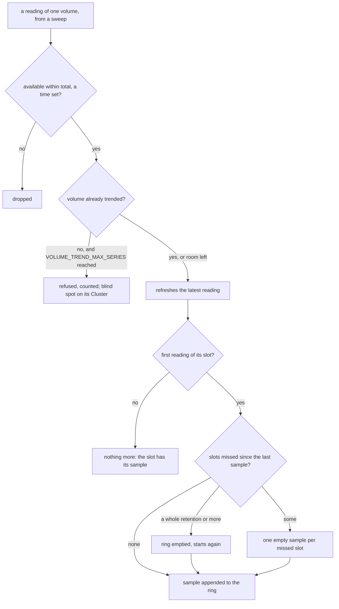
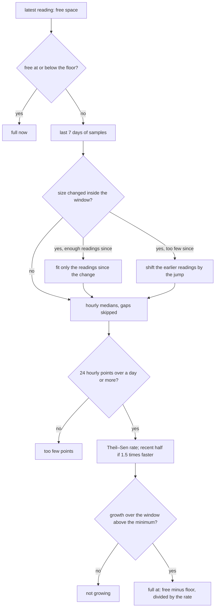
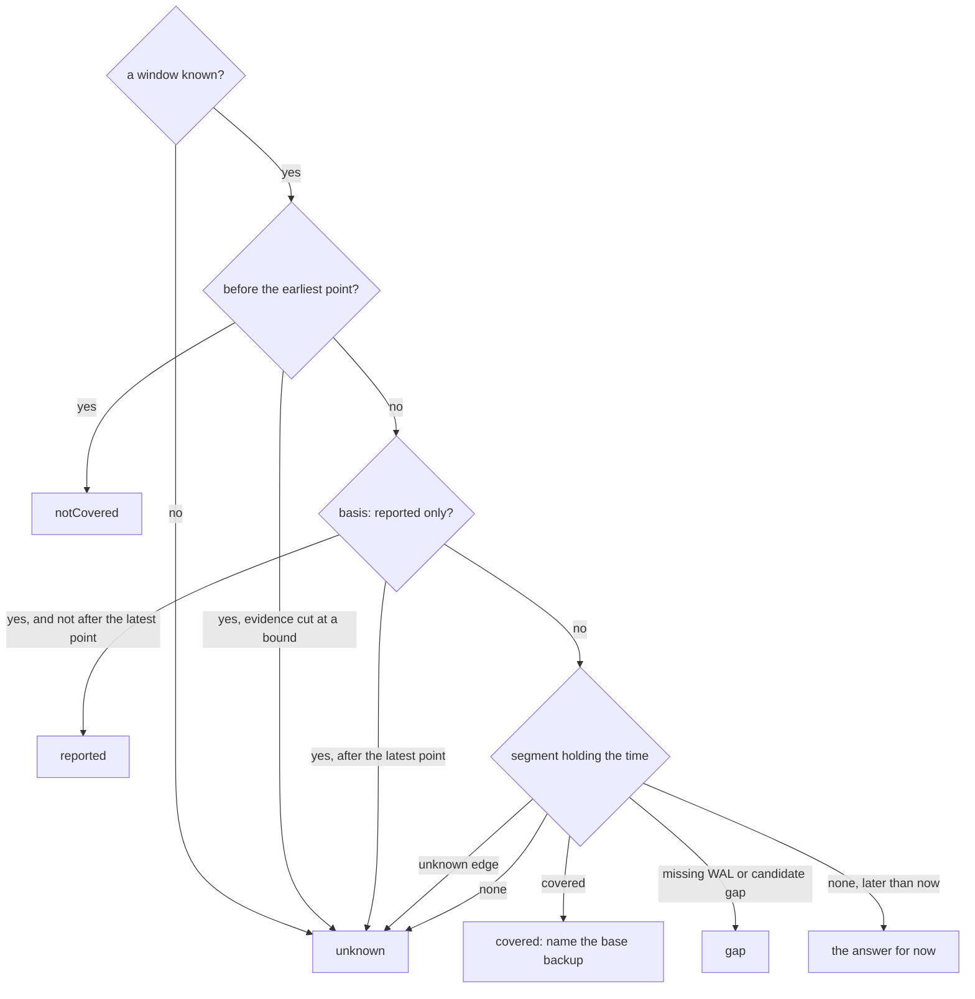

# Volume forecasts and the recovery window

Two estimates sit next to the raw facts. The **storage screen** says when each
volume will fill. The **backups screen** draws the span a restore can target and
answers "can I restore to this time?". Each one states its basis and what it does
not prove.

## Volume forecasts (storage screen)

### Where the data comes from

The console trends a volume only when an instance reports it:

- `volumeUsages` in `/pg/status` (one `statfs` per volume, tablespaces included),
- or, failing that, the `cnpg_disk_*` metrics (data and WAL volumes only).

Upstream CloudNativePG reports neither. The panel then says so and draws nothing,
and the blind spot `storage.volumeUsageNotReported` stays on the screen. Builds
that report volumes (such as the autoGrow fork) fill the panel on their own. The
console detects the data, never the build.

A volume counts as full for PostgreSQL when *available* reaches one WAL segment
(16 MiB) or 0.05 % of the filesystem. Available is `statfs` `bavail`, so the
reserved blocks are excluded. The forecasts run toward:

- the current filesystem's size, always;
- and, when the volume's storage section declares `autoGrow`, its `maxSize`. The
  operator grows the PVC in steps up to `maxSize`, so that date is when the steps
  run out, not when the next one happens.

`autoGrow` is not in the upstream `Cluster` type, so the console reads it from a
second, raw view of each Cluster, stripped to its name and its `autoGrow` stanzas
(well under 1 KB per Cluster). The two views share one cache configuration but
are two watch streams of the same objects.

Inodes get a forecast of their own, toward the current inode count.

### The long trend

| Variable | Default | Bounds | Meaning |
|---|---|---|---|
| `VOLUME_TREND_INTERVAL` | 15 m | 1 m to 1 h, not shorter than `INSTANCE_STATUS_INTERVAL` | One sample per volume per slot: the first reading of the slot. |
| `VOLUME_TREND_RETENTION` | 30 days | 7 to 90 days | How long the samples are kept, about 2,880 per volume by default. |
| `VOLUME_TREND_MAX_SERIES` | 16384 | 16 to 100,000 | Volumes trended at once. Past the bound, new volumes are not trended: the trended ones keep their history, refusals are counted, and an affected cluster shows the blind spot `storage.volumeTrendsAtCapacity`. A full series of 30 days at 15 minutes is about 23 KB. |

Memory per volume is about 23 KB at the defaults, so the default bound costs at
most about 360 MiB; rings grow as samples arrive, so a younger or smaller fleet
holds less. A volume silent for a whole retention is forgotten. The three
variables multiply: the console refuses to start when
`VOLUME_TREND_MAX_SERIES × VOLUME_TREND_RETENTION / VOLUME_TREND_INTERVAL`
samples of 8 bytes would exceed 768 MiB. Twice the default retention or twice
the default volumes still fits.

Count this memory when you size a console for a large fleet: a console sized
from a load test that ran for hours has not filled its trend yet, and it grows
by up to 360 MiB over the first 30 days.

How one reading becomes a sample (`Store.Observe` in
`pkg/cnpgstatus/volumetrend/store.go`):

A slot is `VOLUME_TREND_INTERVAL` long. The ring holds
`VOLUME_TREND_RETENTION / VOLUME_TREND_INTERVAL` samples, the oldest overwritten
first. A sample is the space and the inodes consumed; the filesystem's size and
inode count are kept apart, as a short list of changes, which is how the fit
below finds resizes. A sweep that read nothing leaves an empty sample: a gap, never
a zero.

When `HISTORY_PATH` is set, the trend is snapshotted to `volume-trends.gob` beside
the history journal. A snapshot is written once per slot and again at shutdown, so
the trend survives restarts. A snapshot taken at another cadence is ignored, and
the trend starts empty.

### The forecast

Each forecast is computed on demand from the ring, and cached until a new sample
arrives (`Store.Forecasts`, `extrapolate` in `forecast.go`):

The floor is the [full threshold](#where-the-data-comes-from) for space and zero
for inodes. The same steps run toward `maxSize` with autoGrow, with the free space
plus what the steps may still add.

1. The samples of the last **7 days** are reduced to hourly medians, so a burst
   inside one hour weighs one point.
2. A **Theil–Sen** fit (the median of the pairwise slopes) gives the rate. A
   one-off drop, such as a `VACUUM FULL` or WAL recycled after a checkpoint,
   barely moves it.
3. The forecast refuses rather than guesses:
   - **too few points** below 24 hourly points or one day of span;
   - **not growing** when the fitted growth over the window is under
     max(1 MiB, 0.05 % of the capacity), or max(16, 0.05 %) for inodes.
4. **Growing faster than linear**: when the recent half of the window grows at
   least 1.5 times faster than the first half, the date uses the recent rate. Both
   rates are shown.
5. The interquartile slopes give the earliest–latest range and a confidence:
   **high** when the spread of the slopes is under half the rate, over at least
   72 hourly points and without acceleration; **medium** under one and a half
   times the rate; **low** otherwise, or when the lower quartile is not growing.
   The acceleration check needs 12 hourly points in each half of the window.
6. **Resizes**: growing a filesystem shifts the space counted as used by the
   reserved blocks it adds (5 % on ext4 by default), a step a fit would read as
   growth. When the size changed inside the window, the fit uses only the
   readings since the last change if they meet the minimums above; otherwise the
   readings before each change are shifted by the jump across it. The forecast
   says which.
7. **Inodes on XFS**: an inode total that changes inside the window (XFS
   allocates inodes on demand) leaves no inode forecast.
8. **Two targets with autoGrow**: the space forecast always runs toward the
   current filesystem. Free space at or below one WAL segment (16 MiB) or
   0.05 % of the filesystem is **full now**, autoGrow or not: an expansion that is
   refused, slow or outpaced leaves PostgreSQL writing there. With autoGrow and a
   readable `maxSize` above the current size, a second forecast runs toward
   `maxSize`.

### WAL growing while archiving fails

PostgreSQL keeps every WAL segment until it is archived. When archiving fails
(`ContinuousArchiving` failing, or the primary's live archiver failing with a
backlog), the console flags one of the primary's volumes: the WAL volume, or the
data volume when WAL shares it. Growth on that volume is a symptom: fix archiving
first.

### Diagnostics

| Check | Finds |
|---|---|
| `volume-full-forecast` | A volume full within 14 days (warning) or 3 days (high), in bytes or inodes, or full now (critical, autoGrow or not). With autoGrow, the date is the one toward `maxSize`. |
| `wal-growing-archiving-failing` | The primary's WAL volume growing while archiving fails (high; critical once full). |
| `volume-autogrow-stopped` | The fork operator's `VolumeAutoGrowStopped` (`MaxSizeReached`, `WALArchivingFailing`) or `VolumeExpansionRefused` condition. |

On a cluster whose instances report no volumes, the two forecast checks report a
source that is off, not a fault.

## Recovery window (backups screen)

### With repository evidence

The bar is drawn from the [evidence agent's](../evidence-agent.md) recovery paths,
toward the newest timeline a path could follow. A timeline seen in the archive
but not connected by valid history is reported, not used as the target, and an
off-target path (a backup that cannot reach the newest timeline, or a path
toward a sibling branch that a default restore does not follow) is neither the
target nor drawn. A sibling may have a lower or a higher number than the
timeline `latest` resolves to: what counts is the ancestry, not the number.
What an off-target path still reaches is listed under the bar as "restorable
only by naming a timeline", with the base backup and the `targetTLI` a restore
along it must give (`recovery_target_timeline: 'N'`); a restore check on such a
time, when no default restore covers it, carries that hint as a caveat.

A timeline warning from the agent (a history file no default restore reads is
malformed) hides no coverage: it is shown above the bar with the file name and
added to every answer's caveats, since a restore that names that timeline would
fail.

- **Covered** spans: each path covers from its base backup's end to the
  archive-receipt time of the last contiguous WAL segment. Only a path whose WAL
  reaches its backup's end segment (the consistency point) is drawn. Where paths
  overlap, each piece names the newest backup whose own path covers it: the backup
  CloudNativePG restores from when no `backupID` is given.
- **Not usable** spans: a pgBackRest backup the agent rates not usable for a
  reason its recovery path does not show (a broken chain, a manifest of its own
  or of a backup it depends on that does not verify or was not inspected,
  pgBackRest's own error flag after a page-checksum failure) is drawn as
  `unknown` with the first reason, never as covered, even when its WAL reaches
  the frontier: the agent judges the path from the WAL alone. The window is then
  a warning. A usable backup still covers what it reaches. The console keeps the
  newest 1,000 backup items but more recovery paths: a pgBackRest path whose
  backup is not among the items read has no usability rating, so it is drawn the
  same way (`backup-not-listed`), never as covered; to have every backup rated,
  expire old backups or lower the retention so the repository holds fewer than
  1,000. A path whose backup the repository's backup list, read complete, no
  longer has (a retention purge since the paths were read, while the paths kept
  are stale) is drawn the same way in either format (`backup-not-in-repository`).
  When the backup list was cut at a bound, it cannot say that a backup is gone:
  a stale path whose backup it does not list is drawn the same way too
  (`backup-not-confirmed`) until the paths are read again.
  The repository's format is the one its snapshot identity names.
- **Holes** between spans, each with a kind:
  - **missing WAL**: a confirmed gap. When the agent says a former primary may
    still hold the missing segment (it stopped on a parent timeline before a
    switch whose child already has WAL), the hole, or the time after the latest
    point, says so: CloudNativePG archives that instance's waiting segments
    before it rejoins, so do not delete that instance or its volume. When the
    sweeps kept readings of exactly one instance as primary on the timeline the
    WAL stops on, the advice names that instance. When that instance has
    rejoined the Cluster since the switch (it is the current primary again, or
    a Ready standby read since then), it no longer holds unarchived WAL:
    CloudNativePG archives the WAL waiting on it before it starts again, so the
    bar says the WAL was archived since the repository was read, or was never on
    it, instead of advising to keep it;
  - **candidate gap**: seen by one scan, not confirmed by a second;
  - **unknown**: the evidence cannot tell.
- **Markers**: the repository's base backups (completed, failed, incomplete) and
  the failed `Backup` objects.

"Structurally covered" is the strongest claim. The agent reads segment names, not
WAL bytes, and never runs a restore. The latest point is bounded by when the last
segment *reached* the repository. The newest transactions may still exist only on
the instance, especially while archiving fails.

Unless a [restore drill](restore-drills.md) of the Cluster passed in the last 90
days (the window of the `restore-drill-overdue` check), the bar, the evidence
counts and the restore check also say "not restore-tested".

When the newest edge is uncertain (the newest span is not covered, or the recent
end is unknown or not restorable), the panel suggests two queries to copy and run
on the primary yourself: `SELECT * FROM pg_stat_archiver;` shows what PostgreSQL
last archived and last failed to archive, and `SELECT pg_switch_wal();` forces
the current segment out to the archive. After that, refresh the evidence (or,
without an agent, check `pg_stat_archiver` again). The panel always shows them on
the reported basis, whose end is never a WAL frontier. The console is read-only,
so it runs neither query.

The console narrows the suggestion (the timeline's `edgeAdvice`) from what it
read of the Cluster first, on the evidence and the reported basis alike, then
from one list of reasons:

- when no primary runs or none was read (the Cluster is hibernated, the
  current primary is fenced, restarting or unreachable; `archiverHibernated`,
  `archiverUnread`, `liveTimelineNotArchivedPrimaryUnread`,
  `archivingFailedPrimaryUnread`), it shows neither query, whatever else the
  reasons say;
- when WAL archiving is failing, failed recently or lags behind
  (`archivingFailing`, `failedRecently`, `archiveBacklog`, or archiving read as
  failing under a reported window), it shows `pg_stat_archiver` only: a
  switched segment would wait like every other one;
- when the archiving instance is in recovery (a replica cluster's designated
  primary, or a primary mid-promotion; `archiverNotReported`), where
  `pg_switch_wal()` fails with "recovery is in progress", or the repository's
  newest timeline is another cluster's (`repositoryAheadOfLive`), which a WAL
  switch here does not move, it shows `pg_stat_archiver` only.

### Without repository evidence

The operator's or plugin's own window (`serverRecoveryWindow`, or the in-tree
recoverability points) is drawn hatched as **reported**. It is never drawn as
covered.

The end of that window is the **last base backup**
(`serverRecoveryWindow[].lastSuccessfulBackupTime`), not the end of the archived
WAL: the operator does not report how far archived WAL reaches beyond it. The bar
and the overview label it so, and the time from it to now is drawn **unknown**,
never covered and never "not covered".

What the console can add there is the archiving instance's own report on
`/pg/status` (`pg_stat_archiver.last_archived_time`, shown on the overview as
"Last archived WAL", with the age of the sweep that read it). The time after the
window is split at that instant, and each span says what the archiver supports:

| Archiving (overview) | Before the last archived WAL time | After it |
|---|---|---|
| healthy, keeping up, and the sweep fresh | "a restore to this time may well be possible" | its WAL "may still be only on the primary" |
| failing (`ContinuousArchiving` critical, or a failure with backlog) | its WAL "may be in the repository" | its WAL "is likely not in the repository" |
| behind: N segments waiting (`readyWalFiles` at the backlog threshold on consecutive sweeps), no failure | "N segments waiting": its WAL "may not be in the repository yet" | "N WAL segments are waiting": its WAL "is likely still only on the primary" |
| anything else (unknown, stale) | its WAL "may be in the repository" | its WAL "may still be only on the primary" |

The archiver is `status.currentPrimary` (the designated primary in a replica
cluster). When that instance was not read, archiving is unknown: no other
instance that reports itself primary stands in for it. A fenced or restarting
instance answers `/pg/status` without reading PostgreSQL
(`mightBeUnavailableMaskedError`): that answer counts as not read, and the
sparklines show a gap. A `last_archived_time`
later than the sweep that read it (an instance clock running ahead) is read as
the sweep's time.

**The backlog threshold** is 3 waiting segments, or one more than the archiver's
parallelism when that is larger: the in-tree `wal.maxParallel`, or the
barman-cloud plugin's `ObjectStore` `spec.configuration.wal.maxParallel` (read
with the `ObjectStore` the console already reads for the reported window). The
archiver is the one CloudNativePG uses: the first enabled plugin with
`isWALArchiver: true`, else the in-tree `barmanObjectStore`, else the first
backup plugin. A barman-cloud entry listed for backups only, beside a pgBackRest
plugin that archives WAL, does not lend its `maxParallel` to pgBackRest. A
serial archiver that keeps up shows zero or one `.ready` file (two on a switch
caught mid-copy), but a parallel one does not: the in-tree archiver and the
barman-cloud plugin upload up to `maxParallel` segments at once and leave the ones
uploaded ahead as `.ready` until PostgreSQL asks for them, and pgBackRest's
asynchronous `archive-push` does the same. A busy, healthy primary routinely
shows a handful. So one reading proves nothing, and a **backlog** counts only
when the sweep sees the count at or above the threshold on two consecutive
sweeps (a failed read is skipped). When the console cannot know the parallelism
(a pgBackRest plugin, or the barman-cloud plugin when its `ObjectStore` is not
readable) it needs three sweeps, over which the count never shrinks and ends
larger than it began. A backlog turns the WAL archiving contributor to a warning
(`ArchiveBacklog`), even while `ContinuousArchiving` is `True`: a hung or slow
`archive_command` fails nothing. A count at the threshold that the sweeps kept
are too few to judge (a console that just started, before its second or third
sweep) is `unknown` (`ArchiveBacklogUnconfirmed`), never `ok`, and the recovery
screens read it as a backlog until enough sweeps can tell.

With `ContinuousArchiving` `True` but the archiving instance not read, archiving
is `unknown` (`PrimaryUnread`), with the time the condition last changed: the
condition is written only when an `archive_command`'s outcome changes, so on its
own it does not say that WAL reaches the repository now. One missed read (a
timeout, a slow answer) does not flip it: the same pod's reading from the sweep
before stands, with its own time as provenance, so the bar does not flicker. A
second miss in a row, or a restarted pod (a new UID has no last reading), is
unread. A hibernated Cluster
reads `inactive` (`Hibernated`), as the Cluster does: no instance runs, and
nothing confirms that every segment written before hibernation reached the
repository, but nothing is going wrong either. The instance self-reports
contributor is `inactive` too (no pod to read), so the overview and fleet
headline of a hibernated Cluster reads `inactive`, not `unknown`. An instance
whose manager answered without reaching PostgreSQL (fenced or restarting) is not
counted as read there: the contributor says "n of m instances read, k answered
without PostgreSQL" and warns. A replica cluster's
archiver is its designated primary, a standby (`isPrimary` false) that archives
with `archive_mode=always`; CloudNativePG counts `.ready` files only on a primary
(`pkg/management/postgres/probes.go` v1.30.1), so its `/pg/status` carries no
`readyWalFiles`. The console records no sample for it (nor for any standby) and
reads archiving as `unknown` (`ArchiveBacklogNotReported`), never `ok`: a
backlog cannot be seen there; replica clusters' archiving stays `unknown` until a
lag bound is read from the exporter's metrics (a later feature). Outside a
replica cluster the same reading is a primary mid-promotion, and the message
says so. The API serves an instance's `archivingWal` only for the instance that
archives, `status.currentPrimary`: the instance manager refuses to archive on
any other pod (a switchover's target primary, a pod that still reports itself
primary), and a replica cluster's other standbys report `isArchivingWAL` true,
but their archiver does nothing. The `cnpg-wal-files-waiting` check judges fresh primary
readings only, and says so instead of clearing when there is none. A standby's zeros, including those of a pod that
was a designated primary before a replica-cluster promotion, are never read as a
quiet sweep or as an archiver that caught up.
The diagnostics findings on the same count (`cnpg-wal-archive-backlog`,
`cnpg-instance-archive-backlog`) fire much later, at 32 segments, so a screen
with the finding never shows archiving as healthy. A stalled archiver shows up in
the count: with `archive_timeout` set, written WAL completes a segment within
it, and a segment the archiver does not take is a `.ready` file. On an idle
primary that writes little, a hung archiver holds a steady count rather than a
growing one, so under unknown parallelism a count at the threshold over three
sweeps that did not grow is also a backlog when the archiver archived nothing
over them: its `last_archived_time` (pg_stat_archiver) is not after the one it
reported at the oldest of those sweeps (both on the instance's clock, which the
sweep keeps per reading), or it reports none. When that oldest sweep read the
archiver with nothing archived yet, any archive since is progress (its first).
Only the sweeps of the primary's current term count (from
`status.currentPrimaryTimestamp`): an instance promoted again never joins the
readings of its earlier term to this one. When the sweep did not keep that
earlier time (a console restored from an older snapshot), it is compared with
the oldest sweep's time plus one sweep interval, so a clock skew within one
interval neither hides a stall nor invents progress. The message then says the
archiver is stalled and since when. A healthy parallel archiver archives a
segment each time PostgreSQL asks for one, so its time moves.

The last archived time is when PostgreSQL archived a segment, not the newest
commit in it, so even "may well be possible" is an `unknown` answer: an evidence
agent is what can place the time. When the archiver was not read, the span says
the time is not known. Failing archiving also adds a caveat that names the last
archived time. The sweep counts as stale after three sweep intervals, the same
rule as the "Instance self-reports" contributor.

### Can I restore to…?

`GET /api/v1/namespaces/{ns}/clusters/{name}/backups/restore-check?at=<RFC 3339>`
reads its answer off the same timeline (`restoreCheck` in
`internal/console/status/recovery.go`), in this order:

The answer is one of:

- `covered`: name the base backup to restore from;
- `notCovered`: before the earliest point (a confirmed hole after the latest
  point is a `gap`);
- `gap`;
- `reported`: only the unverified window covers the time;
- `unknown`.

Every answer comes with its caveats. The uncertain edges are drawn as `unknown`
segments, so the bar and the answer always agree:

- the end of the archived WAL and the edge of a hole, within three
  `archive_timeout` periods (at least 15 minutes; one hour when `archive_timeout`
  is 0): segment names cannot place the target;
- the oldest restore point, within the agent's refresh interval plus the age of
  its last scan: a retention purge may have removed that backup since. When the
  recovery paths are the last good ones kept stale, the age is that of the scan
  they come from, not the fresher snapshot's. The age runs from the earlier of
  the agent's scan time and the console's fetch time, so an agent clock ahead of
  the console's does not shorten it, and the band never reaches past the
  newest restore point. The age runs from the scan's start (`started_at`):
  the backups were listed during the scan, not when it completed. A purge drops
  a whole backup, with the WAL only it needs, and during a long wait several
  can go: a recovery window's start moves with the clock. pgBackRest expires a
  full backup together with every differential and incremental backup taken
  against it, so there only full backups count as retention anchors, and the
  oldest full's whole chain goes at once; a full marked `backup-error` (page
  checksum errors) is still one, as `expire` counts it. In a Barman Cloud repository every
  listed backup that did not fail is an anchor, including one with no recovery
  path. Once a scan was missed, the band reaches past the newest anchor before
  the oldest anchor's own span plus the age plus one refresh interval, up to
  the first restore point drawn from it or a newer backup: those backups are
  still in the repository, and every time before is unknown until the
  repository is read again. When that reach passes the scan's start, the band
  is the whole window: the base may then be a backup taken since, which the
  snapshot does not list. A scan is missed when its age passes the longer of
  the refresh interval and the last scan's duration, plus that duration, the
  console's one-minute poll and one minute (two refresh intervals when the
  snapshot gives no scan start), whatever the window's length. Within a normal refresh cycle the band does
  not extend, so the oldest backup's span does not flip between covered and
  unknown each time the next scan is a little late. Retention never removes the
  newest backup, so within a normal cycle the band also stops at the newest
  backup's first restore point, and a single backup has none. Past a missed
  scan a single backup's band is the whole window, and so is it when the newest
  listed backup was older at the read than the listed span: retention may have
  stopped (pgBackRest expires only at a backup's end), so the listed backups
  may all be obsolete and a backup taken since the base. A pgBackRest time-based
  full retention (`repo-retention-full-type=time`) bounds the band from the
  clock instead: to the newest full at or before the retention before the
  latest `expire` of a backup since the scan (the latest completion stamp of
  those backups, or now while one is still running or has no stamp), or the
  whole window once that passes the scan. Under pgBackRest a count bounds
  it too, in or out of a refresh cycle: `expire` runs at the end of every
  backup, so the console counts the Cluster's `Backup` objects that ended since
  the scan's start (each counted as a full, the worst case; a completed one at
  the later of its stop time and CloudNativePG's completion stamp, since the
  pgBackRest plugin marks it completed only once `pgbackrest backup` and its
  `expire` returned), and those still in
  progress that began after it (by their start, else when the operator started
  them, `status.reconciliationStartedAt`, since a queued backup waits after its
  creation, else their creation: a plugin backup reports no start until it
  completes), since `expire` runs seconds before CloudNativePG marks the
  `Backup` completed. A stop time CloudNativePG could not have meant
  (1970-01-01, which a plugin that leaves it unset gets, a time more than five
  minutes in the future, which a plugin sending milliseconds gets, or one
  before the backup's start or, alone, its creation) is read as no stop time.
  Such a completed backup is then timed by CloudNativePG's completion stamp
  (`status.reconciliationTerminatedAt`, written by the instance manager, or
  the operator for a volume snapshot, seconds after the backup ended): one
  stamped before the scan ended before it. With no stamp either, it is
  counted as one that could have ended at any time. A `Backup` restored with
  its status (Velero) or migrated from another cluster carries start and stop
  times older than the object itself; when they are coherent, and its
  CloudNativePG stamps are as old (or absent), they are kept, and the backup
  counts when it ended, not as one ended since. Tool times that old on a
  `Backup` stamped at or after its creation are an instance clock running
  behind, and are read as no times. With
  `repo-retention-full=K` (type `count`), L fulls listed and n backups since,
  the oldest L + n − K listed fulls may be gone with their chains, and the band
  runs to the first restore point of the next one; the whole window when that is
  every listed full. An archive retention that keeps fewer backups than the
  fulls (`repo-retention-archive`, or the default from `repo-retention-diff`
  with `repo-retention-archive-type=diff`) keeps WAL continuously only from the
  A-th newest backup of its type (older ones keep only their own consistency
  range): the band runs to the first restore point of the A-th newest of the
  listed and the n new ones, and is the whole window once n reaches A. With no
  backup since the scan, the listing can still show an `expire` about to run: a
  scan that starts between a backup's save and its `expire` (that backup's
  `Backup` stopped earlier than the scan's start) lists more than K fulls, WAL
  drawn continuously from before the A-th newest backup of its type, or, under a
  time-based retention, fulls older than the newest one stopped before that
  `expire`'s run minus the retention. That run is timed at the completion
  stamp of the completed `Backup` whose run holds the newest listed end, by
  which its `expire` had returned, so a healthy daily schedule keeps no band.
  With no such stamp (a backup run outside CloudNativePG) the run may be after
  the scan read the listing, so when the newest listed backup ended within one
  refresh interval before the scan, the run is taken as the latest of the
  scan's completion, the console's fetch and that end; an older backup's
  `expire` ran at its end, before the scan. The band then runs past what that
  `expire` removes; a lowered retention looks the same until the next backup. A
  listing `expire` already made has none. When the `Backup` objects were not read, or the snapshot does not report
  the retention, any backup since the scan may have expired anything: the whole
  window once one may have ended. A `pgbackrest backup` run by hand, which
  creates no `Backup` object, is not counted;
- after a WAL archiving failure an instance reported (`lastFailedWALTime`, the
  newest over every instance read, so a former primary's failure survives a
  failover) in the day before the latest point, the day before the failure: WAL
  that arrives after an outage carries older commits than its arrival time. The
  band is dropped once the archiver has caught up before the latest point: its
  `last_archived_time` is after its `last_failed_time` (PostgreSQL archives in
  order, so the failed segment is in the repository) and every sweep from one
  before the latest point to now saw fewer `.ready` files than the threshold.
  A transient error (an object store's 503, retried) then leaves no trace on the
  bar. While the archiver has not caught up, or caught up only after the newest
  segment reached the repository, the band stays;
- while a backlog persists on the primary (above), from the newest sweep, at or
  before the agent's scan, that read **no** `.ready` file on the primary since
  it became primary, less one `archive_timeout`, with the count and that time:
  nothing waited then, so every segment completed by then was in the repository
  when the agent read it, while segments archived since may have reached it
  late. A reading of one or two files proves nothing (a slow archiver can hold
  them for long), and a failed read is no reading, so a run of failed reads
  widens the band, never narrows it. A busy primary may never read zero, so a
  sweep with files waiting bounds the start too, from the primary's WAL
  positions the sweep keeps: at a sweep with *k* `.ready` files and the write
  position in segment *S*, every segment before *S−k* was archived; segment
  *S−k* switched after the newest earlier sweep whose position had not reached
  the start of *S−k+1*, and a commit in it is at most one `archive_timeout`
  older than its switch. The band then starts one `archive_timeout` before
  that earlier sweep, when that is later than the quiet-sweep bound. The WAL
  segment size comes from the primary's own report (its current WAL file name
  against its position); when that does not settle a single size, this bound is
  not used. When no sweep the console keeps (`RING_RETENTION`, one hour by
  default; a console that just started keeps none) gives either bound, the
  sweep period is not known, or `archive_timeout` is 0, the band is the day
  before the latest point. The window is then a warning, never healthy;
- while the primary's archiver is not read (archiving `PrimaryUnread`, or the
  Cluster hibernated): the same band, from the newest sweep that read it with
  nothing waiting or the WAL-position bound above, else the day before the
  latest point. Nothing says how long
  the newest archived WAL waited on the primary, so the window is a warning and
  every answer carries the caveat "the primary's archiver was not read". A
  hibernated Cluster's window is `unknown` instead, and its band and caveat say
  the Cluster is hibernated: it writes no WAL and runs no archiver, so there is
  nothing to act on, but nothing confirms that the WAL written before it reached
  the repository; it stays `unknown`, not amber, for as long as it sleeps;
- at an end of the archived WAL on a timeline older than the newest one, the
  repository's or the one the current primary writes (after a failover: the
  parent timeline's tail, or a hole before the switch). Right after a failover
  the repository lags: until the new timeline's history file is archived and
  the agent reads the repository again, every path targets the parent
  timeline, so the live timeline (the current primary's current WAL file, else
  its sweeps since the promotion) counts too, and the time after the newest
  point says that the repository held no WAL of that timeline when it was last
  read (or, once its history file is archived, no WAL segment of it yet). The
  window is then a warning (`liveTimelineNotArchived`), not healthy: wait for
  the next evidence refresh, or run `pg_switch_wal()` on the new primary to
  archive its first segment. When the primary was not read (fenced or
  unreachable: the sweep has no reading of it, whatever the archiving
  condition says), the warning (`liveTimelineNotArchivedPrimaryUnread`) gives no
  such advice.

  When archiving is failing (`ContinuousArchiving` False, or the primary's last
  attempt failed with WAL waiting) and no readable instance reports the failure,
  the window is a warning that says so (`archivingFailing`), ranked before the
  lag: the repository lacks the new timeline because archiving fails, and
  switching WAL would not help. The primary's last good reading stands through
  one missed read for this as for the archiving fact, so a single missed read
  keeps the recent-failure reason.

  With the primary unread, nothing archives that could change the condition: the
  warning (`archivingFailedPrimaryUnread`) says the last archive attempt the
  Cluster reports failed, with the condition's age (`False since ...`), not that
  archiving is failing now.

  A hibernated Cluster says it is hibernated instead (`unknown`): no instance
  runs to switch WAL on. With ContinuousArchiving False it adds that the last
  attempt failed, with its time, at warning (`archivingFailedHibernated`): that
  WAL may be only on the Cluster's volumes. A reported window says the same.

  When the live timeline is not known, an end that reached the repository
  before the promotion counts the same way. That WAL
  was archived by a former primary, whose backlog the current primary's
  readings do not show, and a crash can lose its `.ready` tail. Only the
  readings of that timeline's own primary count: each sweep records the
  timeline a primary writes (the timeline of its current WAL file, which,
  unlike `timelineId`, does not lag a promotion), so after two failovers the
  quiet sweeps of the second timeline's primary never bound the end of the
  first. The band starts at the newest sweep that read that timeline's primary
  with nothing waiting (less one `archive_timeout`) or at its WAL-position
  bound, both from before the promotion (`status.currentPrimaryTimestamp`);
  when the sweeps kept no reading of it (its pod is gone, the rings' retention
  passed, the reading named no timeline), only readings with WAL waiting, or
  readings that come after that end and so say nothing of it, the day before
  that end;
- when the repository's newest timeline is ahead of the one the current primary
  writes (`repositoryAheadOfLive`): another cluster may archive into this
  repository (a cluster restored by point-in-time recovery, or a promoted
  replica cluster, with CloudNativePG's empty-archive check skipped), and a
  default restore follows the newer timeline, so a time past the fork may
  restore that cluster's data. The fork is not placed: from the newest end of a
  base backup on the live line, else from the oldest restore point, to the
  newest, the bar is `unknown`. A backup is on the live line when it is on the
  live timeline, or when the agent evaluated a path from it toward the live
  timeline, which it does only along valid history that does not branch before
  the backup's end; a backup on a lower-numbered sibling timeline (another
  cluster's line) does not count. A pgBackRest repository publishes one path
  per backup, toward the newest timeline, so there only a backup on the live
  timeline counts. The window is a
  warning that asks to check that no other cluster's backup configuration
  names this repository;
- every "by then" claim of a sweep (nothing waited, every commit before a time
  was archived) is dated when its read returned, and every "not yet" claim (the
  write position had not reached a segment) when the sweep started, so a read
  that straddles the agent's scan never narrows a band;
- while the archiver reports no `.ready` count (`ArchiveBacklogNotReported`: a
  replica cluster's designated primary, or a primary mid-promotion that still
  reads as a standby): the day before the latest point, with its own reason and
  caveat, since no sweep can show that nothing waited on it;
- a recovery path that reaches its frontier but that the evidence agent rates
  below healthy (a pgBackRest WAL segment size not proven across a log id or a
  timeline switch, or a path capped because the agent's coverage roll-up says
  something no path carries, such as a stanza split) is drawn as `unknown` with
  the agent's reason, never as covered; a healthy path still covers what it
  reaches. The window is then a warning. A roll-up that is not healthy because
  of another backup (an old backup stopped at a gap, one unknown path) is
  listed as a reason of the window and greys out nothing.

Inside the end-of-archived-WAL edge, the last `archive_timeout` plus an
allowance for the archiver's latency (one sweep interval, at least one minute)
before the latest point (the whole edge when `archive_timeout` is 0) is drawn
as **end of the archived WAL** (`walEnd`, a warning band): the last commit can
be one `archive_timeout` before its segment switched, and the segment reached
the repository some time after the switch. The latest
point is when the last segment *reached* the repository, not its last commit, so
the bar labels it **WAL received until**, and names apart the **newest covered
target** (`newestCoveredTarget`): the end of the newest covered span once every
edge above is drawn, the newest instant the check answers `covered`. It is
structurally covered, not restore-tested (only a passed restore drill tests a
restore), and it is left out when only a path not rated healthy reaches the
newest end (a healthy path that ends there too names it). A `covered`
answer adds that a restore that names no timeline follows the default
`recovery_target_timeline 'latest'`. A
`recovery_target_time` after that commit makes PostgreSQL stop with "recovery
ended before configured recovery target was reached". To restore everything the
repository holds, restore to the end of WAL (no recovery target) instead. The
band assumes a commit near the end of the WAL: a stretch of WAL with no commit
record (an anti-wraparound `VACUUM` on a quiet database) can push the last
commit further back than the band, and a `recovery_target_time` inside it then
fails the same way. This is a known limit; restoring to the end of WAL is not
affected.

After the latest point the answer is never `notCovered`. Missing WAL confirmed
after the newest path is a `gap`. Otherwise the answer is `unknown`: a fresh and
complete frontier is a fact about the agent's scan, not about now. WAL written
just after the frontier may have sat in a segment that was not archived yet
when the agent read the repository (`archive_timeout`), and it may have arrived
since. The answer then says the time was "not in the repository when it was
last read" and names the scan time; while archiving fails it says that time's
WAL "is likely not in the repository", and with a backlog that it "is likely
still only on the primary". A time later than now gets the answer for
now. After a path that stops at unknown evidence, from stale evidence, when a
collection was cut, or on the reported basis (whose end is the last base backup),
it is also `unknown`.

On the reported basis, a window that comes from the evidence agent's own
`recovery_window` (pgBackRest without recovery paths) is named as the agent's,
not the operator's. Every sentence of the timeline, the answer and its caveats
carries a stable code and its values, so the console says it in the reader's
language, with Go's English kept for a code the interface does not know yet.
The timeline's reasons are sent as such phrases too, one per part. The evidence
agent writes its own reasons in English: the console recognises the agent's
timeline reasons ("timeline N needs an explicit targetTLI", "a default restore
stops on timeline N", a history file missing or unreadable) and says them in the
reader's language; any other reason of the agent's is shown as written. When the
evidence names a timeline history file as missing or unreadable (one such file
can withhold every restore point), the restore check names it, for example
`00000005.history`. Stale evidence is never shown as healthy. When reading
the paths fails, the last good ones are kept and marked stale. They are judged
against the fresh snapshot beside them: when its timeline evidence is no longer
established (after a failover, say), no kept path is coverage, and its coverage
and timeline reasons replace the old ones. Paths of another repository are never
kept, and kept paths more than three of the agent's refresh intervals (at least
an hour) older than its latest scan are dropped; either drop is said
(`keptRepositoryChanged`, `keptTooOld`), with what to check: the evidence
agent's logs and the object store. A fresh coverage roll-up that is not healthy
is not explained by the kept paths, even when it reads the same as the one they
were read with (the agent's roll-up names no path, so a new gap in the newest
backup's range reads like an older backup's): a kept path rated healthy is then
at most a warning, never drawn covered, even when an older kept path is as
degraded as the roll-up.
