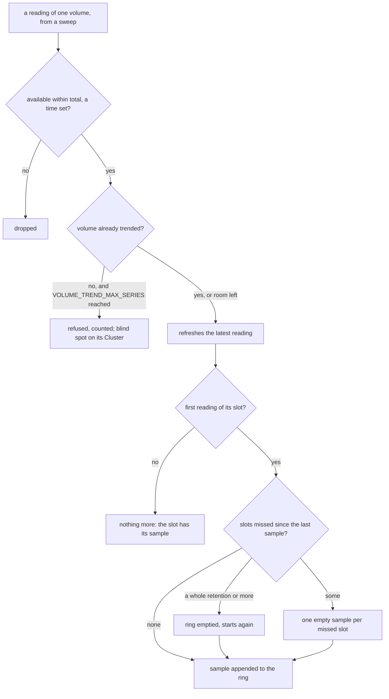
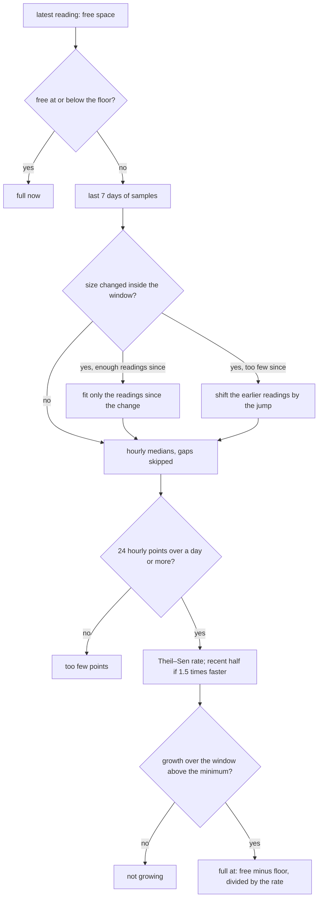
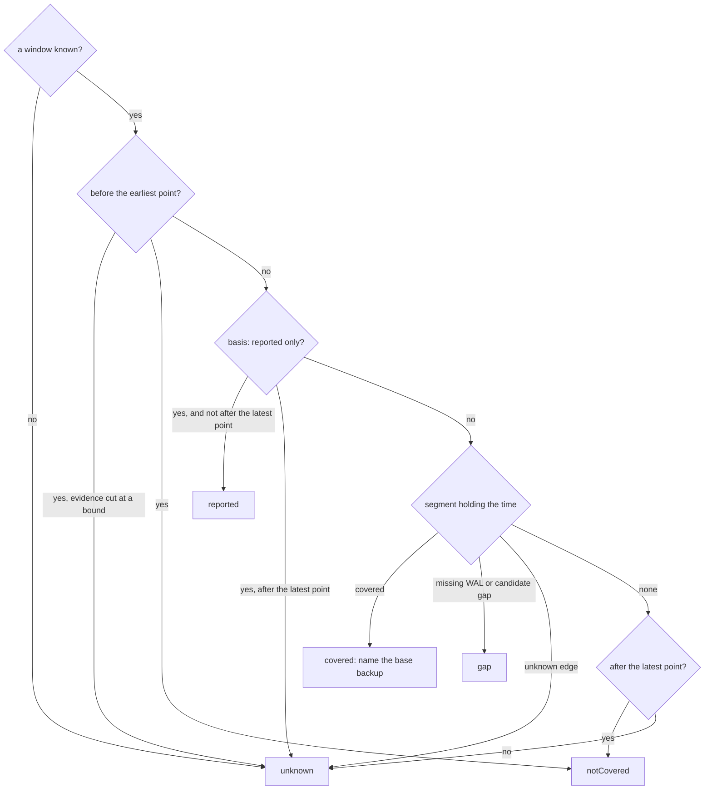

# Volume forecasts and the recovery window

Two estimates sit next to the raw facts. The **storage screen** says when each
volume will fill. The **backups screen** draws the span a restore can target and
answers "can I restore to this time?". Each one states its basis and what it does
not prove.

## Volume forecasts (storage screen)

### Where the data comes from

The console trends a volume only when an instance reports it:

- `volumeUsages` in `/pg/status` (one `statfs` per volume, tablespaces included),
- or, failing that, the `cnpg_disk_*` metrics (data and WAL volumes only).

Upstream CloudNativePG reports neither. The panel then says so and draws nothing,
and the blind spot `storage.volumeUsageNotReported` stays on the screen. Builds
that report volumes (such as the autoGrow fork) fill the panel on their own. The
console detects the data, never the build.

A volume counts as full for PostgreSQL when *available* reaches one WAL segment
(16 MiB) or 0.05 % of the filesystem. Available is `statfs` `bavail`, so the
reserved blocks are excluded. The forecasts run toward:

- the current filesystem's size, always;
- and, when the volume's storage section declares `autoGrow`, its `maxSize`. The
  operator grows the PVC in steps up to `maxSize`, so that date is when the steps
  run out, not when the next one happens.

`autoGrow` is not in the upstream `Cluster` type, so the console reads it from a
second, raw view of each Cluster, stripped to its name and its `autoGrow` stanzas
(well under 1 KB per Cluster). The two views share one cache configuration but
are two watch streams of the same objects.

Inodes get a forecast of their own, toward the current inode count.

### The long trend

| Variable | Default | Bounds | Meaning |
|---|---|---|---|
| `VOLUME_TREND_INTERVAL` | 15 m | 1 m to 1 h, not shorter than `INSTANCE_STATUS_INTERVAL` | One sample per volume per slot: the first reading of the slot. |
| `VOLUME_TREND_RETENTION` | 30 days | 7 to 90 days | How long the samples are kept, about 2,880 per volume by default. |
| `VOLUME_TREND_MAX_SERIES` | 16384 | 16 to 100,000 | Volumes trended at once. Past the bound, new volumes are not trended: the trended ones keep their history, refusals are counted, and an affected cluster shows the blind spot `storage.volumeTrendsAtCapacity`. A full series of 30 days at 15 minutes is about 23 KB. |

Memory per volume is about 23 KB at the defaults, so the default bound costs at
most about 360 MiB; rings grow as samples arrive, so a younger or smaller fleet
holds less. A volume silent for a whole retention is forgotten. The three
variables multiply: the console refuses to start when
`VOLUME_TREND_MAX_SERIES × VOLUME_TREND_RETENTION / VOLUME_TREND_INTERVAL`
samples of 8 bytes would exceed 768 MiB. Twice the default retention or twice
the default volumes still fits.

Count this memory when you size a console for a large fleet: a console sized
from a load test that ran for hours has not filled its trend yet, and it grows
by up to 360 MiB over the first 30 days.

How one reading becomes a sample (`Store.Observe` in
`pkg/cnpgstatus/volumetrend/store.go`):

A slot is `VOLUME_TREND_INTERVAL` long. The ring holds
`VOLUME_TREND_RETENTION / VOLUME_TREND_INTERVAL` samples, the oldest overwritten
first. A sample is the space and the inodes consumed; the filesystem's size and
inode count are kept apart, as a short list of changes, which is how the fit
below finds resizes. A sweep that read nothing leaves an empty sample: a gap, never
a zero.

When `HISTORY_PATH` is set, the trend is snapshotted to `volume-trends.gob` beside
the history journal. A snapshot is written once per slot and again at shutdown, so
the trend survives restarts. A snapshot taken at another cadence is ignored, and
the trend starts empty.

### The forecast

Each forecast is computed on demand from the ring, and cached until a new sample
arrives (`Store.Forecasts`, `extrapolate` in `forecast.go`):

The floor is the [full threshold](#where-the-data-comes-from) for space and zero
for inodes. The same steps run toward `maxSize` with autoGrow, with the free space
plus what the steps may still add.

1. The samples of the last **7 days** are reduced to hourly medians, so a burst
   inside one hour weighs one point.
2. A **Theil–Sen** fit (the median of the pairwise slopes) gives the rate. A
   one-off drop, such as a `VACUUM FULL` or WAL recycled after a checkpoint,
   barely moves it.
3. The forecast refuses rather than guesses:
   - **too few points** below 24 hourly points or one day of span;
   - **not growing** when the fitted growth over the window is under
     max(1 MiB, 0.05 % of the capacity), or max(16, 0.05 %) for inodes.
4. **Growing faster than linear**: when the recent half of the window grows at
   least 1.5 times faster than the first half, the date uses the recent rate. Both
   rates are shown.
5. The interquartile slopes give the earliest–latest range and a confidence:
   **high** when the spread of the slopes is under half the rate, over at least
   72 hourly points and without acceleration; **medium** under one and a half
   times the rate; **low** otherwise, or when the lower quartile is not growing.
   The acceleration check needs 12 hourly points in each half of the window.
6. **Resizes**: growing a filesystem shifts the space counted as used by the
   reserved blocks it adds (5 % on ext4 by default), a step a fit would read as
   growth. When the size changed inside the window, the fit uses only the
   readings since the last change if they meet the minimums above; otherwise the
   readings before each change are shifted by the jump across it. The forecast
   says which.
7. **Inodes on XFS**: an inode total that changes inside the window (XFS
   allocates inodes on demand) leaves no inode forecast.
8. **Two targets with autoGrow**: the space forecast always runs toward the
   current filesystem. Free space at or below one WAL segment (16 MiB) or
   0.05 % of the filesystem is **full now**, autoGrow or not: an expansion that is
   refused, slow or outpaced leaves PostgreSQL writing there. With autoGrow and a
   readable `maxSize` above the current size, a second forecast runs toward
   `maxSize`.

### WAL growing while archiving fails

PostgreSQL keeps every WAL segment until it is archived. When archiving fails
(`ContinuousArchiving` failing, or the primary's live archiver failing with a
backlog), the console flags one of the primary's volumes: the WAL volume, or the
data volume when WAL shares it. Growth on that volume is a symptom: fix archiving
first.

### Diagnostics

| Check | Finds |
|---|---|
| `volume-full-forecast` | A volume full within 14 days (warning) or 3 days (high), in bytes or inodes, or full now (critical, autoGrow or not). With autoGrow, the date is the one toward `maxSize`. |
| `wal-growing-archiving-failing` | The primary's WAL volume growing while archiving fails (high; critical once full). |
| `volume-autogrow-stopped` | The fork operator's `VolumeAutoGrowStopped` (`MaxSizeReached`, `WALArchivingFailing`) or `VolumeExpansionRefused` condition. |

On a cluster whose instances report no volumes, the two forecast checks report a
source that is off, not a fault.

## Recovery window (backups screen)

### With repository evidence

The bar is drawn from the [evidence agent's](../evidence-agent.md) recovery paths,
toward the newest timeline a path could follow. A timeline seen in the archive
but not connected by valid history is reported, not used as the target, and an
off-target path (a backup that cannot reach the newest timeline) is neither the
target nor drawn.

- **Covered** spans: each path covers from its base backup's end to the
  archive-receipt time of the last contiguous WAL segment. Only a path whose WAL
  reaches its backup's end segment (the consistency point) is drawn. Where paths
  overlap, each piece names the newest backup whose own path covers it: the backup
  CloudNativePG restores from when no `backupID` is given.
- **Holes** between spans, each with a kind:
  - **missing WAL**: a confirmed gap;
  - **candidate gap**: seen by one scan, not confirmed by a second;
  - **unknown**: the evidence cannot tell.
- **Markers**: the repository's base backups (completed, failed, incomplete) and
  the failed `Backup` objects.

"Structurally covered" is the strongest claim. The agent reads segment names, not
WAL bytes, and never runs a restore. The latest point is bounded by when the last
segment *reached* the repository. The newest transactions may still exist only on
the instance, especially while archiving fails.

Unless a [restore drill](restore-drills.md) of the Cluster passed in the last 90
days (the window of the `restore-drill-overdue` check), the bar, the evidence
counts and the restore check also say "not restore-tested".

When the newest edge is uncertain (the newest span is not covered, or the recent
end is unknown or not restorable), the panel suggests two queries to copy and run
on the primary yourself: `SELECT * FROM pg_stat_archiver;` shows what PostgreSQL
last archived and last failed to archive, and `SELECT pg_switch_wal();` forces
the current segment out to the archive. After that, refresh the evidence. The
console is read-only, so it runs neither query.

### Without repository evidence

The operator's or plugin's own window (`serverRecoveryWindow`, or the in-tree
recoverability points) is drawn hatched as **reported**. It is never drawn as
covered.

The end of that window is the **last base backup**
(`serverRecoveryWindow[].lastSuccessfulBackupTime`), not the end of the archived
WAL: the operator does not report how far archived WAL reaches beyond it. The bar
and the overview label it so, and the time from it to now is drawn **unknown**.
With healthy archiving those hours are usually restorable; an evidence agent is
what can place them.

### Can I restore to…?

`GET /api/v1/namespaces/{ns}/clusters/{name}/backups/restore-check?at=<RFC 3339>`
reads its answer off the same timeline (`restoreCheck` in
`internal/console/status/recovery.go`), in this order:

The answer is one of:

- `covered`: name the base backup to restore from;
- `notCovered`: before the earliest point, or (repository evidence only) after
  the latest point and before the agent last read the repository;
- `gap`;
- `reported`: only the unverified window covers the time;
- `unknown`.

Every answer comes with its caveats. The uncertain edges are drawn as `unknown`
segments, so the bar and the answer always agree:

- the end of the archived WAL and the edge of a hole, within three
  `archive_timeout` periods (at least 15 minutes; one hour when `archive_timeout`
  is 0): segment names cannot place the target;
- the oldest restore point, within the agent's refresh interval plus the age of
  its last scan: a retention purge may have removed that backup since;
- after a WAL archiving failure the primary reported (`lastFailedWALTime`) in
  the day before the latest point, the day before the failure: WAL that arrives
  after an outage carries older commits than its arrival time.

After the latest point the answer is `notCovered` only when the newest path
reaches the archive frontier, the evidence is fresh and complete, and the time is
before the agent last read the repository: that is a fact about the scan. From
the last read to now it is `unknown`, since WAL archived since may cover it.
After a path that stops at unknown evidence, from stale evidence, when a
collection was cut, or on the reported basis (whose end is the last base backup),
it is `unknown`. Stale evidence is never shown as healthy. When reading
the paths fails, the last good ones are kept and marked stale.
