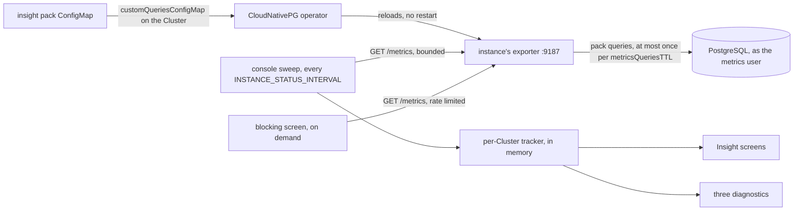
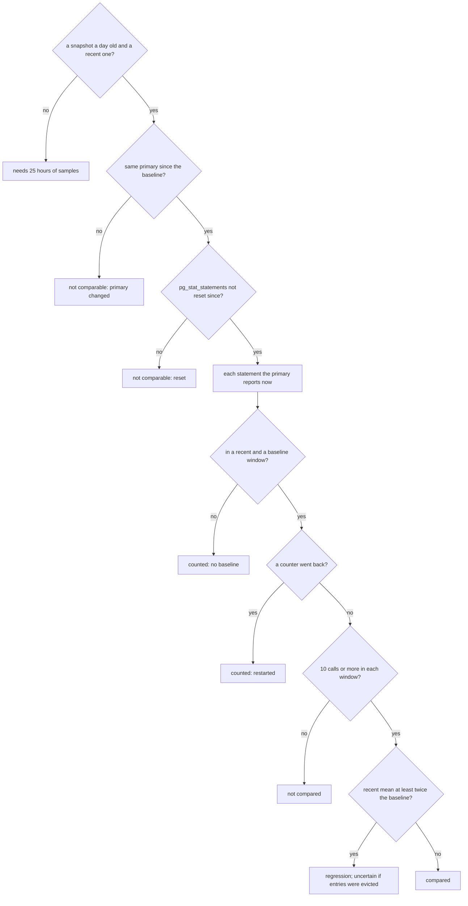

# Insight pack

The insight pack lets the console show what a DBA usually checks with SQL:
transaction id wraparound, vacuum health, blocking, connection saturation, the
costliest statements and index hygiene. The console still never connects to
PostgreSQL. The pack is a set of CloudNativePG **custom queries**. The
instances' own exporters run them, and the console reads their results from the
`:9187/metrics` endpoint it already scrapes.

The path from one opt-in line to a screen, with nothing new connecting to
PostgreSQL (`deploy/insight-pack`, `internal/console/sweep`,
`pkg/cnpgstatus/insight`):



The tracker keeps every instance's latest reading. Only the primary's readings
feed its histories (transaction id rate, dead rows per table, statement
snapshots), and a reading the exporter served again from its cache adds no
sample: samples are timed by when the exporter ran the queries, not when the
console read them.

## Opting a Cluster in

The `pgtools` chart creates the ConfigMap `<release>-insight-pack` in each
watched namespace (`insightPack.enabled`, default `true`). Creating it changes
nothing. A team opts in its own Cluster, without asking the platform, by adding
one line to the Cluster (here for the release `pgc`; the console's Insight screen
shows the line with the right name):

```yaml
spec:
  monitoring:
    customQueriesConfigMap:
      - name: pgc-insight-pack
        key: queries
```

The operator reloads the instances' exporters. There is no restart. Without the
chart, apply the ConfigMap `pgtoolbox-insight-pack` in the Cluster's namespace
first, and reference that name:

```bash
kubectl apply -n team-a -f deploy/insight-pack/insight-pack.yaml
```

**The ConfigMap's name.** The chart names the ConfigMap after the release so
that two releases in one namespace do not collide, and tells its console the
same name (`INSIGHT_PACK_CONFIGMAP`). The console matches that name against the
Cluster's `customQueriesConfigMap` (a Cluster that lists another name reads as
"not referenced") and puts it in the opt-in line. Set
`insightPack.configMapName` to choose the name, for example
`pgtoolbox-insight-pack` to keep the name the teams already reference. With
`insightPack.enabled: false`, the chart's console expects
`pgtoolbox-insight-pack`, the name of `deploy/insight-pack/insight-pack.yaml`; a
console the operator renders, or `config/console`, does too. Whatever the name,
the console reads the pack from the exporters, not from the ConfigMap.

To opt out, remove the line. To stop shipping the ConfigMap, set
`insightPack.enabled: false`.

**ConfigMaps applied by hand.** A team that applies the ConfigMap itself, by
hand or through its own GitOps, owns it. Helm does not take over a ConfigMap it
did not create, so a chart install or upgrade fails on it. List those
namespaces in `insightPack.skipNamespaces`, and give the copy the chart's name
(or set `insightPack.configMapName` to the copy's). A hand-applied copy is also
upgraded by hand. Until it is, the console reports that Cluster's pack as
outdated and still shows what the older pack reports.

**Requirements**

- PostgreSQL 14 or later. On PostgreSQL 13 only `pgtoolbox_pack` runs, the
  query that reports the pack's version and `server_version_num`. The console
  then says PostgreSQL 13 is not supported, rather than showing empty screens.
- CloudNativePG 1.24 or later, for `predicate_query`.
- For query insight, `pg_stat_statements` in `shared_preload_libraries`, at
  version 1.9 or later, created in the `public` schema of the database the
  exporter connects to. CloudNativePG does all of this when any
  `pg_stat_statements.*` parameter is set in `spec.postgresql.parameters`.
  Without it, the statements query returns no rows and no error.

**Versions.** The ConfigMap carries its version as the label and annotation
`pgtoolbox.fyannk.dev/insight-pack-version`, and the exporter reports it as
`cnpg_pgtoolbox_pack_info{version="1"}`. When a Cluster runs an older pack than
the console reads, the console says so and still shows what the older pack
reports. The `cnpg.io/reload` label makes a chart upgrade reload the new pack
on the instances.

## What it costs

Every query:

- runs as CloudNativePG's metrics user (`pg_monitor` on every supported CloudNativePG),
  in a read-only transaction;
- starts with a `predicate_query` that sets `statement_timeout = 1s`,
  `lock_timeout = 100ms` and `max_parallel_workers_per_gather = 0` for that
  transaction only;
- returns a bounded number of rows (`LIMIT`);
- takes no lock on a user table. Sizes come from `relpages`, not from
  `pg_relation_size`. Index expressions and predicates are compared as stored
  node trees: an md5 of `pg_index.indexprs` and `indpred` with token positions
  removed. They are not deparsed, because `pg_get_expr` would lock each table
  it reads.

A query that times out or fails is skipped. It is counted in
`cnpg_errors_total` and the rest of the scrape is unaffected. A query that runs
in every database can fail in one database only, for example on a lock held
there. The console then names that database and marks the panels drawn from
that query as partial. The exporter caches the results for the Cluster's
`spec.monitoring.metricsQueriesTTL` (30 s by default), so the queries run at
most once per TTL, however often the console, Prometheus or anyone else
scrapes. The pack does not set CloudNativePG's per-query `cache_seconds`, so
the Cluster's TTL applies to all of it.

These timings are three warm runs per query on PostgreSQL 18 and 14, as a
`pg_monitor` role. The 20,000 tables and 80,400 indexes were all in one
database, and 400 of the indexes were duplicates. The host was shared and busy
(load average 40 to 50 on 16 cores), so read these as upper bounds:

| Query | Where | Rows | Small database | 20,000 tables, PG 18 | 20,000 tables, PG 14 |
|---|---|---|---|---|---|
| `pgtoolbox_pack`, `_settings` | every instance | 1, ≤ 20 | < 1 ms | < 1 ms | < 1 ms |
| `pgtoolbox_xid`, `_database`, `_xmin` | primary | 1, ≤ 50, 1 | < 1 ms | < 1 ms | < 1 ms |
| `pgtoolbox_prepared_xacts` | primary | ≤ 50 | < 1 ms | < 1 ms | < 1 ms |
| `pgtoolbox_tables` | primary, every database | ≤ 25 per database | 1–4 ms | 84–156 ms | 199–346 ms |
| `pgtoolbox_vacuum_progress` | primary, every database | ≤ 10 | < 1 ms | < 1 ms | < 1 ms |
| `pgtoolbox_blocking`, `_backends`, `_connections` | every instance | ≤ 50, 1, ≤ 40 | < 1 ms | < 1 ms | < 1 ms |
| `pgtoolbox_statements`, `_info` | primary | ≤ 60, 1 | 1–3 ms | depends on `pg_stat_statements.max` | idem |
| `pgtoolbox_indexes` (unused, invalid) | primary, every database | ≤ 30 per database | 1–4 ms | 207–370 ms | 334–521 ms |
| `pgtoolbox_index_duplicates` | primary, every database | ≤ 15 per database | 1–4 ms | 232–393 ms | 331–1,014 ms |

The index checks are two queries, so a slow duplicate search never costs the
unused and invalid lists. On PostgreSQL 14 one duplicate-search run reached the
1 s timeout on the busy host. On a catalog that size the duplicate list can
then be missing for a scrape, and the console says so. PostgreSQL 14 also loads
its statistics snapshot for the first statistics read of a transaction (25 to
150 ms here), which the table and index queries pay.

The blocking query examines the 50 longest lock waits only.
`pg_blocking_pids` costs grow with the lock table, so this bounds the cost
when thousands of backends wait.

The statements query reads `pg_stat_statements(false)`, which **leaves out the
statement text**. The text never leaves the database. Prepared transactions are
reported as a count and an oldest age per database: their gid is application
data and is never exported.

The exporter's own connection is left out of the counts it would distort
(active sessions, lock waits, the oldest transaction). It is still counted in
`client`, because it holds a connection slot.

**What the console reads.** The console reads at most 2 MiB from an exporter,
or 8 MiB once that exporter has reported the pack. At its sweep concurrency of
8, that is at most 64 MiB in flight. A larger response is cut at its last
complete line. The console then says so: it never reports "not enabled"
because the pack's series came after the cut, and it marks the panels that may
be missing rows as partial.

**On-demand reads.** The blocking screen re-reads the primary's exporter at
most once a second per Cluster, and at most 10 times in 10 seconds per user
across Clusters. These reads share the sweep's read slots, so they never add
to its concurrency. With `metricsQueriesTTL: 0` the exporter caches nothing,
and every read, the sweep's included, runs every pack query on the primary,
with the costs above. Keep the default TTL unless the extra load is acceptable.

**Prometheus.** If Prometheus also scrapes the instances, it stores these
series too. The blocking series carry a `pid` label, so they come and go with
backends. Drop `cnpg_pgtoolbox_blocking_.*` in your scrape config if that
churn matters to you.

## What the console shows

The **Insight** section of a Cluster first says whether the pack is enabled.
If it is not, the section shows the line above. Each screen states what it
rests on: the instance that reported it, when the exporter ran the queries
(which can be up to a TTL before the console read them), and which numbers are
the console's own derivation. A panel built from a query that failed, or from
rows the console cut, is marked partial and says what is missing.

- **Wraparound and vacuum**: the age of each database's oldest transaction id
  and multixact, measured against the anti-wraparound autovacuum threshold, the
  vacuum failsafe and the stop limit (2^31 − 3 million). The time to each
  threshold uses the consumption rate the console measured over the last hour.
  The thresholds come from the instance's own settings, then from the
  Cluster's `spec.postgresql.parameters`, then from PostgreSQL's defaults. The
  screen lists any defaults it assumed.
  - What holds the xmin horizon back: replication slots' `xmin` and
    `catalog_xmin`, the oldest backend snapshot and running transaction, and
    prepared transactions.
  - Tables: those with the oldest `relfrozenxid` and the most dead rows, each
    with its autovacuum threshold. The threshold is unknown for a table never
    vacuumed nor analyzed. On PostgreSQL 18 it is capped by
    `autovacuum_vacuum_max_threshold`. A TOAST table is shown with the table it
    belongs to, the one to vacuum.
  - Whether autovacuum keeps up with each table. This is the console's
    verdict, from its own samples over the last hour.
- **Blocking**: the lock graph of each instance, root blockers first. A
  prepared transaction holds its locks without a backend: it appears as its
  own blocker (pid 0) and ends only with `COMMIT PREPARED` or
  `ROLLBACK PREPARED`. While the screen is open, it can read the primary's
  exporter again (see above). It shows how old the exporter's data was when
  read. The console cannot end a backend; the screen links to pgAdmin, where
  `pg_terminate_backend(pid)` does.
- **Query insight**: the primary's costliest statements by total and by mean
  time. It also lists the statements whose mean time is at least twice what it
  was in the same hour a day earlier. This comparison needs 25 hours of the
  console's own samples on the same primary. The screen says how much it has,
  and starts again after a failover, a `pg_stat_statements` reset or a console
  restart. The console keeps each hour's costliest statements only. A statement
  that entered them lately has no baseline and is counted, not compared. So is
  a statement whose counters went back within a window. When
  `pg_stat_statements` evicted entries meanwhile (`dealloc`), the regressions
  are marked uncertain. To read a statement's text, run the query shown beside
  it in pgAdmin. The team-wide page lists the same for every Cluster you may
  see, and says when its list of 100 statements was cut.
- **Index hygiene**:
  - Unused: indexes never scanned since their database's statistics reset.
    Indexes that back a constraint (primary key, unique, exclusion, a foreign
    key's target) or the replica identity are excluded. Those whose leading
    columns are a foreign key's are flagged: they serve its checks, so few
    scans are expected and they may still be needed. "Never scanned" counts
    **primary scans only**: an index used only by queries on replicas reads as
    unused here.
  - Invalid indexes.
  - Duplicates of another index on the same table. Two indexes are duplicates
    only when they have the same columns, expressions, predicate, operator
    classes, collations, sort order, uniqueness, `NULLS NOT DISTINCT`,
    exclusion and deferrability. The index kept is the one backing a
    constraint. When both back one, the pair is shown but marked not
    droppable.
- **Connections**: per instance, client connections against the slots
  ordinary roles may take (`max_connections` minus
  `superuser_reserved_connections` and, from 16, `reserved_connections`).
  They are broken down by database, application and state, with the oldest
  idle-in-transaction session.

### How a regression is found

The tracker keeps one snapshot of the primary's statement counters an hour, 26 of
them. A regression compares a statement's mean time since a snapshot at least
45 minutes old with its mean between two snapshots a day back
(`compare` in `pkg/cnpgstatus/insight/tracker.go`):



At most 20 regressions are listed, costliest first (the milliseconds per hour
they add).

Three diagnostics read the pack. They say they could not run when the pack is
not enabled. When the console cut the exporter's response before the pack's
series, they report that as a fault:

| Check | Warning | High | Critical |
|---|---|---|---|
| `insight-wraparound` | age above 1.5 × the anti-wraparound threshold | past the failsafe, or under 7 days to the stop limit | past the warning limit (40 million before wraparound), or under 24 hours to the stop limit |
| `insight-idle-in-transaction` | a session idle in a transaction for more than 10 minutes | more than 1 hour | — |
| `insight-connection-saturation` | more than 80% of the usable connection slots | more than 95% | — |

A wraparound finding lists what holds freezing back in that database:
prepared transactions, replication slots, the oldest snapshots.

The tables, the blocking graph, the regressions and the rates live in the
console's memory: a restart starts them again. The metrics screen keeps a short
history of the pack's transaction-id rate, lock waits, idle-in-transaction
sessions and client connections.

## What it cannot see

- **Multixact member space.** The pack reads multixact ids, not member space.
  Member space can run out first. PostgreSQL then freezes multixacts earlier
  than `autovacuum_multixact_freeze_max_age` says, which the forecasts do not
  show.
- **Counters reset without `stats_reset`.** A failover or a crash recovery
  resets the scan and vacuum counters without setting `stats_reset`. An index
  read as unused may have been scanned before that.
- **Replicas' statements and scans.** Statements and index scans are read on
  the primary only.
