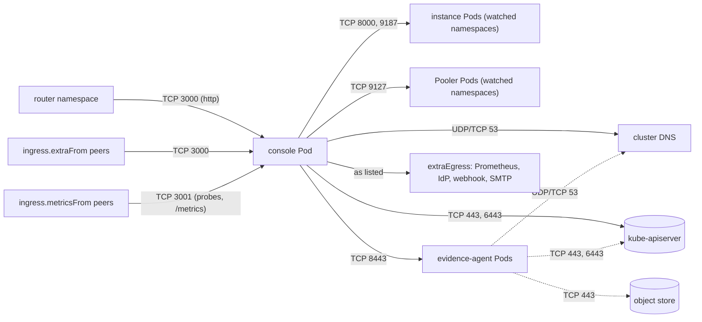

# NetworkPolicy: the installing admin's choice

`console.networkPolicy.enabled` is `false`, and that is deliberate. Whether the
cluster enforces NetworkPolicies, and whether this namespace wants one, is known
only to whoever installs the chart. A default-deny rendered unasked breaks
exposure, DNS or the API-server path the moment the list misses something. The
chart therefore ships a policy **template** and renders nothing unless asked.

**RBAC and SubjectAccessReview are the isolation the product guarantees.** The
policy is an extra network boundary, with two limits stated plainly:

1. **Enforcement is a property of the CNI.** The chart cannot prove the cluster
   enforces NetworkPolicy; on a CNI that does not, the object is accepted and does
   nothing.
2. **It is derived from `watchNamespaces`, never from a request.** Nothing a user
   sends changes a selector.

## What it renders

When enabled, the policy lists the console's real egress and nothing more. The
diagram shows the flows it admits with the default values, and, dashed, the
evidence agents' own policy (`evidence.networkPolicy.enabled`, team mode).

| Direction | Peers | Ports |
|---|---|---|
| Egress | The watched Clusters' instance pods (`cnpg.io/podRole: instance`) | `8000` (status), `9187` (metrics) |
| Egress | Their poolers (`cnpg.io/podRole: pooler`) | `9127` |
| Egress | The evidence agent pods of the watched namespaces (label `app.kubernetes.io/name=evidence-agent`, which the operator's and the chart's agents both carry) | `8443` |
| Egress | The API server | `networkPolicy.apiServer.ports` (443, 6443) |
| Egress | DNS | `networkPolicy.dns` (53, UDP and TCP) |
| Egress | `networkPolicy.extraEgress`, raw NetworkPolicy egress rules | as you list them |
| Ingress | For `console.exposure.type: route`, the namespaces labelled `policy-group.network.openshift.io/ingress` (the OpenShift routers, host-network ones included); for `ingress` and `httpRoute`, the namespace `console.exposure.routerNamespace`; and `networkPolicy.ingress.extraFrom` | the console port (`console.port`, 3000) |
| Ingress | `networkPolicy.ingress.metricsFrom` | the probe port (`console.probePort`, 3001), for `/metrics` |

With nothing exposed and no extra peer, no ingress is admitted at all. Kubelet
probes come from the node and are not subject to the policy.

**What the policy does not open by itself.** The console also calls, when
configured, the OIDC identity provider (discovery and the code exchange), a
Prometheus outside the watched namespaces (`PROMETHEUS_URL`), the digest's
webhook, chat webhook or SMTP server, a trace collector, and, with
`console.mcp.oauthClientMetadataDocuments`, HTTPS (TCP 443) to the Internet for
the [MCP client metadata documents](mcp.md#client-id-metadata-documents-and-egress).
None of them is in the rendered policy: add each to `networkPolicy.extraEgress`,
or sign-in, the Prometheus charts, the digest, tracing or those MCP clients stop
working once the policy is enforced. The pooler port is admitted for
the poolers' exporter; the current console reads no pooler metrics.

The instance, pooler and agent ports and labels are values
(`networkPolicy.instance`, `networkPolicy.evidenceAgent`); `make validate-packaging`
compares the agent's label and port with the constants the operator uses.

## The API server

The API-server egress allows the addresses you give in
`networkPolicy.apiServer.addresses` (the ClusterIP and endpoints shown by
`kubectl get endpointslice kubernetes -n default`). With none listed and
`networkPolicy.apiServer.lookup: true`, **the default in this minor**, the chart
reads the `kubernetes` EndpointSlice at install time. That needs `get` on
`endpointslices.discovery.k8s.io` in the `default` namespace, which a namespace admin usually lacks:
Helm's `lookup` returns every error but "not found", so the install then stops
with a Forbidden error. NOTES prints a warning while the lookup is used.
`helm template` and `--dry-run` have no cluster to ask.

**The next minor defaults `lookup` to false.** Before then, pick one:

- list `networkPolicy.apiServer.addresses`;
- `mode: any` (any address on the listed ports), the documented fallback for API
  servers behind a load balancer;
- keep `lookup: true` and install as a cluster admin.

With `lookup: false` and no addresses, the chart **fails** instead of guessing and
names these ways out. The same applies to `evidence.networkPolicy` and
`pgadmin.networkPolicy`.

## OpenShift

Set `networkPolicy.dns.namespace` to `openshift-dns` and `networkPolicy.dns.ports`
to `[5353]`. A Route admits the routers by the
`policy-group.network.openshift.io/ingress` namespace label (host-network
routers included), so `console.exposure.routerNamespace` is not used; the same
holds for `pgadmin.exposure.routerNamespace`.

## Verification

`make test-e2e-chart-netpol` exercises the enabled policy on kind with Calico, as
an additional check, after a canary proves the CNI really enforces. Probes from an
ephemeral container in the console Pod, before and after `networkPolicy.enabled`,
show that the console keeps working and cannot reach the other namespace's
instance pods or evidence agent; a user signs in through the router namespace and
lists their Cluster under the policy.

The operator ([`operator.networkPolicy`](../operator/index.md#networkpolicy-and-admission-policy))
and each [`PgAdmin`](../operator/pgadmin.md#networkpolicy) have their own optional
policies with the same rule: off by default, the admin's decision.
