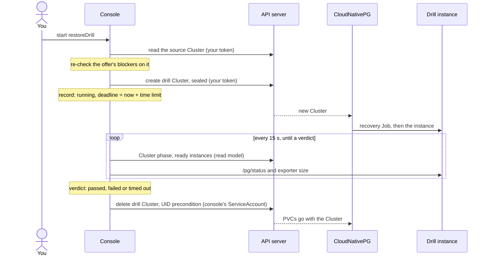
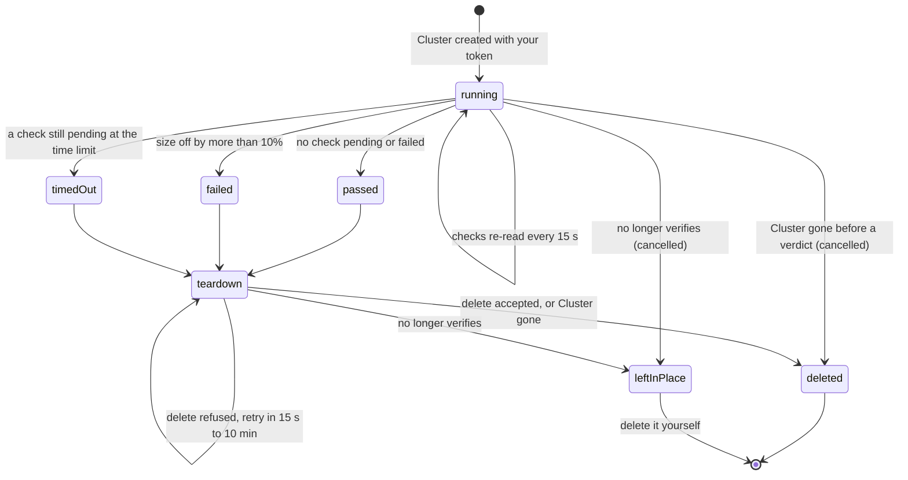

# Restore drills

A backup you have never restored is a hope, not a backup. A restore drill
restores a Cluster's latest completed backup into a throwaway one-instance
Cluster, checks that it comes up, and deletes it. The Backups screen keeps the
result: when the last drill passed, how long it took, how much it restored, and
why a drill failed.

Drills are **off by default**. A person starts a drill from the Backups screen
(or the Operations screen); nothing is scheduled.

## What a drill does

What the console reads, creates and deletes over one drill, and with whose
identity:



1. **The offer.** The console offers "Run a restore drill" when all of these
   hold, and otherwise says exactly which one is missing:
    - drills are enabled on this console;
    - the API server allows *you* to `create clusters` in the drill namespace
      (a `SelfSubjectAccessReview` sent with your token);
    - the Cluster has a completed Backup (for a pgBackRest Cluster: the
      evidence agent reports a recovery window, see
      [pgBackRest Clusters](#pgbackrest-clusters));
    - its recovery source can be used from the drill namespace: the
      barman-cloud plugin (`barman-cloud.cloudnative-pg.io`) and its
      `ObjectStore`, one of the two pgBackRest plugins (source namespace only),
      or the in-tree `barmanObjectStore` (drills of
      in-tree Clusters run in the source namespace only, where its credentials
      are). In another namespace, the drill's `ObjectStore` must exist and have
      the source's `destinationPath`, `endpointURL` and `serverName`: the console
      reads both and refuses a mismatch, and refuses when it cannot read either;
    - the object store does not use a workload identity (IAM role, GKE workload
      identity, Azure AD; see [below](#workload-identity));
    - no drill of this Cluster is already running (by the console's records or
      by the drill labels in its read model), fewer than `maxConcurrent` drills
      of this console are running (default 3), and the Cluster is not itself a
      drill.
2. **The drill Cluster** is created **with your own token**, like every other
   operation, so the API server authorizes, admits and audits it under your
   name. It is named `<prefix><source>-<yymmddhhmm>` (at most 50 characters),
   is labelled `pgtoolbox.fyannk.dev/restore-drill-of=<source>` and
   `pgtoolbox.fyannk.dev/drill-owner=<console namespace>`, and is pinned:
    - `bootstrap.recovery` from one `externalClusters` entry: the barman-cloud
      plugin (`barmanObjectName`, `serverName` of the source), the source's
      pgBackRest plugin (see [below](#pgbackrest-clusters)) or the source's
      in-tree object store;
    - `instances: 1`, the source's running image and PostgreSQL parameters,
      with three forced (see [what a drill can still reach](#what-a-drill-can-still-reach)):
      `max_logical_replication_workers: 0`, `cron.launch_active_jobs: off`,
      `timescaledb.max_background_workers: 0`;
    - **no WAL archiver, no `backup` section, no plugins, no replica
      configuration, no `serviceAccountTemplate`**: the drill does not write to
      the source's repository through CloudNativePG;
    - the drill labels also in `inheritedMetadata`, so CloudNativePG puts them on
      the drill's Pods and recovery Job, which the
      [drill NetworkPolicy](#the-drill-networkpolicy) selects;
    - CPU, memory and storage from the console's configuration, else the
      source's; the source's volume selector, data source and volume name are
      dropped, so a drill never binds the source's volumes.

    The console refuses to create a Cluster that breaks any of this, and a test
    pins it.
3. **The check, without SQL.** Every 15 seconds the console looks at the drill
   through its read model:
    - **healthy**: the Cluster reaches *Cluster in healthy state* with its one
      instance ready;
    - **promoted** (recovery ended): once healthy, the instance's `/pg/status`
      reports it primary on a timeline (it has left recovery);
    - **size**: once promoted, the exporter's database size of the drill (the
      sum over its databases) is within ±10% of the source primary's size at
      the start of the drill. If the drill's exporter gives no reading within
      five minutes of the promotion, or the source's gave none at the start,
      the check reads *not checked*, never passed.
4. **The teardown.** As soon as the result is known, or at the time limit
   (default 2h, then *timed out*), the console deletes the drill Cluster with
   its **own ServiceAccount**: you may have signed out by then. CloudNativePG
   deletes the drill's PVCs with it (they are owned by the Cluster). A refused
   or failed delete is retried with a growing delay (up to 10 minutes) and
   logged once per change, not at every attempt.

   A drill is recorded **deleted** only after the console saw its delete
   accepted or the Cluster gone. When the console cannot read the drill
   namespace, the drill's state stays unknown. When a drill Cluster is still
   there but its seal no longer verifies (someone edited it, or the session key
   was rotated), the console does not touch it and records it **left in
   place**: delete it yourself.

A drill does **not** check that your application can read its data, that every
database and table is there, row counts, or a point-in-time target. The Backups
screen states this with every result.

## Results

A drill's record moves through these states; the verdict (`passed`, `failed`,
`timedOut`, `cancelled`) and the teardown are recorded separately, so a failed
drill can still be deleted, or left in place:



- The checks run in order: *promoted* waits for *healthy*, *size* waits for
  *promoted*. Only the size check can fail; the other two can only stay pending,
  so a drill that never gets healthy ends **timed out** at
  `RESTORE_DRILL_TIME_LIMIT` (counted from the start), with the reason naming
  the first check not reached.
- A size check that reads *not checked* does not hold the verdict back: the
  drill **passes** on the other two, and the result says the size was not
  checked.
- **cancelled**: the drill Cluster disappeared (or was replaced under its name)
  before a verdict, or stopped verifying as this console's drill. The console
  reads the Cluster by name before concluding; a drill Cluster missing from the
  cache for less than two minutes after its creation is not judged.
- The record keeps: the source and the backup restored (with its end time), the
  start, deadline, healthy, promotion, verdict and teardown times, the timeline
  the drill was promoted on, the source and restored sizes, each check's outcome
  and text, the reason of a failure, and the last teardown error. A replica or
  a restarted console that has no record rebuilds it from the drill Cluster's
  sealed annotation.
- Every console replica runs the same supervision: the verdict is a function of
  what each reads, and the delete is idempotent and preconditioned on the UID,
  so replicas agree without coordinating.

## What a drill can still reach

A drill that left recovery is a **running, writable copy of a production
database**. What the console neutralises, and what it does not:

| | |
|---|---|
| WAL archiving, backups, replicas | **Off**: no archiver, no `backup` section, no plugin, one instance. |
| Logical replication subscriptions | **Off**: `max_logical_replication_workers: 0`, no apply worker starts. |
| pg_cron jobs | **Off** with pg_cron 1.5 or later (`cron.launch_active_jobs: off`); an older pg_cron ignores the setting. |
| TimescaleDB jobs | **Off**: `timescaledb.max_background_workers: 0`. |
| Other extensions' background workers, foreign data wrappers, `dblink`, HTTP or messaging extensions, anything a session calls | **Not neutralised.** The console cannot know them. |

What holds the rest is the [drill NetworkPolicy](#the-drill-networkpolicy), so
**restore drills need a CNI that enforces NetworkPolicy**. Without one, a drill
whose database calls out (a foreign server, a queue, a webhook) calls out like
production does.

## Which CA signs a drill

The console checks a drill by reading its `/pg/status` over TLS against its
instance CA bundle, so the drill's server certificate must chain to a CA in that
bundle. CloudNativePG would give each drill a CA of its own (`<drill>-ca`); the
console sets the drill's `spec.certificates.serverCASecret` instead, according to
`RESTORE_DRILL_SERVER_CA`:

| Mode | Signed by | For |
|---|---|---|
| `own` | the drill's own `<drill>-ca` | a bundle that follows Clusters created later: the operator's mirror of a `PgToolBoxConsole` |
| `source` | the source Cluster's server CA Secret | a bundle you fill beforehand (the `pgtools` chart, `spec.instanceCABundleRef`): it already holds the source's CA |
| `secret` | the CA Secret `RESTORE_DRILL_SERVER_CA_SECRET` names | a dedicated drill namespace: create the Secret (`ca.crt`, `ca.key`) there and add its `ca.crt` to the bundle |

- **The console reads no Secret.** CloudNativePG reads the named Secret for the
  drill and signs its server certificate with it; it never owns, renews or
  deletes a CA Secret it did not create, so deleting the drill leaves the
  source's CA as it was. The console's RBAC does not change.
- **Only the server CA.** The drill's client CA, which signs its
  `streaming_replica` and superuser client certificates, stays its own
  `<drill>-ca`; the console refuses a drill with any other
  `spec.certificates` field.
- **What `source` and `secret` grant.** CloudNativePG's instance Role lets the
  drill's Pods read the named Secret, `ca.key` included, as the source's own
  Pods can. The drill runs in the source's namespace with the source's data;
  the drill NetworkPolicy is what keeps its Pods from the network.
- **When `source` cannot apply,** the offer says so (`DrillNotVerifiable`) and
  starts nothing: a drill in another namespace (CloudNativePG reads a Cluster's
  CA Secret in its own namespace), or a source whose server certificate is
  user-provided (`spec.certificates.serverTLSSecret`: its CA Secret need not hold
  a signing key). Use `secret` there.
- Why not let the console read `<drill>-ca`? That Secret also holds the drill
  CA's signing key, the key that signs its superuser client certificate.
  Kubernetes RBAC cannot grant one key of a Secret, and `resourceNames` cannot
  name a drill that does not exist yet, so the grant would be `get secrets` in
  every drill namespace, the superuser passwords of the Clusters there
  included.

A drill instance the console cannot verify anyway (a CA missing from the bundle)
shows the reason in its *promoted* check, and ends **timed out**.

## The drill NetworkPolicy

With drills on, the console's install renders a NetworkPolicy in every drill
namespace that selects the drill Pods (`drill-owner` of this console, a
`restore-drill-of` label):

- **egress**: DNS, the API server (the instance manager and the barman-cloud
  sidecar talk to it), and the object store; nothing else;
- **ingress**: the CloudNativePG operator on the instance's status port, and this
  console on the status and metrics ports (the drill's checks).

By default the API server and object store rules allow their ports (443 and
6443, and 443) to **any address**, so that the policy renders without knowing
your cluster. Close them: set the API server's addresses and the object store's
(an `ipBlock`, or a `namespaceSelector` and `podSelector` for an in-cluster
object store such as MinIO). An object store on another port needs its port
listed.

- pgtools chart: `console.restoreDrills.networkPolicy` (`apiServer.mode:
  addresses` with `apiServer.addresses`, `objectStore.to`, `objectStore.ports`,
  `operator.namespace` and `operator.podLabels`, `dns`).
- `PgToolBoxConsole`: `spec.restoreDrills.networkPolicy` (`apiServerCIDRs`,
  `objectStore`, `objectStorePorts`, `operatorNamespace`).

Turning it off (`enabled: false`) is for clusters where the namespace's own
policies already fence the drill Pods.

## Which Clusters the console deletes

The teardown grant is the one delete the console holds, and it is narrow:

- an opt-in Role in the drill namespace with `get`, `list`, `watch` and
  `delete` on `clusters.postgresql.cnpg.io`, and nothing else;
- the console deletes only Clusters carrying its drill labels **and** a seal: an
  HMAC over the namespace, the name and the drill record. Labels alone are not
  enough: anyone who can create a Cluster can copy labels, but nobody without
  the seal's key can forge the seal. A Cluster that this console did not seal
  is never touched. By default the key is derived (HKDF with its own label)
  from the console's session secret, so whoever can read the session Secret can
  forge a seal. To give the seal a key of its own, mount a Secret of its own
  and point `RESTORE_DRILL_SEAL_KEY_FILE` at it. The file holds one key per line,
  at least 32 bytes each: the first seals, and all of them verify. Keep that
  Secret readable by the console alone. When you switch keys, a drill that is
  still running under the old key no longer verifies, so the console leaves it
  in place and does not delete it;
- the delete carries the drill's UID as a precondition, so a Cluster recreated
  under the same name is not deleted by mistake.

Consequences to weigh before you turn drills on:

- **Who else holds the grant.** Like any ServiceAccount permission, the teardown
  grant is usable by anyone who may create Pods in that namespace (they can run
  a Pod as the console's ServiceAccount). The seal protects against the console
  deleting the wrong Cluster, not against such a person; the
  [delete guard](#the-delete-guard) does.
- **A dedicated drill namespace is strongly recommended.** With the pgtools chart,
  set `restoreDrills.namespace` to a namespace that holds drills only: the
  teardown grant then reaches drills only, whatever happens to the guard. With a
  `PgToolBoxConsole`, drills run in the console's own namespace, so give drill-running
  consoles a namespace of their own.
- **Where the data goes.** A drill is a full copy of the database, including its
  roles and their password hashes. Anyone who can read Pods, exec into them or
  read Secrets in the drill namespace can read it until the drill is deleted. Use
  a drill namespace no less restricted than the source's.
- **What a shared namespace shows.** In a namespace other teams use, anyone who
  can list Clusters, Pods or Events there sees each drill's name (which carries
  the source Cluster's name and the start time), its `restore-drill-of` and
  `restore-drill-source-namespace` labels (the source's name and namespace),
  its size and its logs; the drill's object store reference names the source's
  bucket and path. A dedicated drill namespace keeps this to the people who run
  drills.

## The delete guard

A ValidatingAdmissionPolicy holds a console's ServiceAccount, on the API server,
to what the console itself checks: it may delete a `clusters.postgresql.cnpg.io`
only when the Cluster carries this console's `drill-owner` label, a
`restore-drill-of` label and a drill seal annotation, and its name starts with
the console's drill prefix (`spec.restoreDrills.prefix`, default `drill-`).
Anybody else, an administrator included, is not concerned.

- **Operator** (`pgtoolbox` chart): rendered with the operator when the cluster
  serves `admissionregistration.k8s.io/v1` policies
  (`operator.restoreDrillGuard.enabled: auto`; `true` renders it without
  discovery, for `helm template` and GitOps). Two policies: the label and seal
  check applies to any ServiceAccount of the namespace bound to the shipped
  `pgtoolbox-console-restore-drills` ClusterRole, whatever its name (the role
  carries a marker rule for that purpose: `teardown` on
  `restoredrills.pgtoolbox.fyannk.dev`, which no API serves); the prefix check
  reads the namespace's PgToolBoxConsoles as parameters and applies to each
  console's exact ServiceAccount. The second fails open (no console, or the CRD
  gone), the first never does.
- **kustomize**: `config/default` includes `config/admission`, so
  `kubectl apply -k config/default` applies the guard too.
- **OLM**: a bundle cannot carry an admission policy. A cluster admin applies it
  with `kubectl apply -k config/admission` (or the file
  `config/admission/restore_drill_guard.yaml` of the release).
- **pgtools chart**: it is cluster-scoped, which a namespace admin cannot
  install, so it is **opt-in**: a cluster admin sets
  `console.restoreDrills.admissionPolicy.create: true` (or applies the rendered
  policy). Do it wherever drills are on.

Your RBAC must still let you `create clusters` in the drill namespace. The
shipped `pgtoolbox-console-operator` ClusterRole does not grant it; give it to the people
who run drills, in the drill namespace only.

## Configuration

### pgtools chart

```yaml
console:
  operations:
    enabled: true       # drills are an operation
  restoreDrills:
    enabled: true
    namespace: ""       # empty: each Cluster's own namespace; must be watched
    prefix: drill-
    timeLimit: 2h       # 10m to 24h
    maxConcurrent: 3    # 1 to 20; one per source in any case
    resources:
      requests: { cpu: 500m, memory: 1Gi }
      limits: { cpu: "2", memory: 4Gi }
    storage:
      size: 50Gi        # empty: the source's
      storageClass: ""  # empty: the source's
    serverCA:
      mode: auto        # secret when secret is set, else source when namespace
                        # is empty, else own
      secret: ""        # a CA Secret in every drill namespace, for mode secret
    networkPolicy:
      enabled: true
      apiServer: { mode: addresses, addresses: [10.0.0.1] }
      objectStore:
        to: [{ ipBlock: { cidr: 192.0.2.10/32 } }]
        ports: [443]
    admissionPolicy:
      create: true      # a cluster admin; Kubernetes 1.30+
```

Enabling drills renders a `<release>-restore-drills` Role and RoleBinding and a
`<release>-console-restore-drills` NetworkPolicy in the drill namespace (or in
every watched namespace when `namespace` is empty), and, with
`admissionPolicy.create`, the cluster-scoped delete guard.

### PgToolBoxConsole

```yaml
apiVersion: pgtoolbox.fyannk.dev/v1alpha1
kind: PgToolBoxConsole
spec:
  restoreDrills:
    enabled: true
    timeLimit: 2h
    maxConcurrent: 3
    storage:
      size: 50Gi
    networkPolicy:
      apiServerCIDRs: [10.0.0.1/32]
      objectStore: [{ ipBlock: { cidr: 192.0.2.10/32 } }]
      objectStorePorts: [443]
      operatorNamespace: cnpg-system
```

A `PgToolBoxConsole` watches its own namespace only, so its drills run there; there is
no namespace field. Its drills keep their own CA, which the operator's instance
CA mirror follows; with `spec.instanceCABundleRef` (a bundle you keep) they are
signed by the source's server CA. The operator binds the console's ServiceAccount to the
shipped `pgtoolbox-console-restore-drills` ClusterRole in that namespace and
renders the `<name>-restore-drills` NetworkPolicy, and removes both when drills
are turned off.

### Environment

| Variable | Default | |
|---|---|---|
| `RESTORE_DRILL_ENABLED` | `false` | Offer drills. Needs `OPERATIONS_ENABLED`. |
| `RESTORE_DRILL_NAMESPACE` | empty | Where drills run; empty is the source's namespace. Must be one of `WATCH_NAMESPACES`. |
| `RESTORE_DRILL_PREFIX` | `drill-` | Name prefix, a DNS label start of at most 20 characters. |
| `RESTORE_DRILL_TIME_LIMIT` | `2h` | From `10m` to `24h`. |
| `RESTORE_DRILL_MAX_CONCURRENT` | `3` | Drills of this console running at once, 1 to 20. |
| `RESTORE_DRILL_CPU_REQUEST`, `_MEMORY_REQUEST`, `_CPU_LIMIT`, `_MEMORY_LIMIT` | empty | Positive quantities; a limit not below its request. Empty: the source's. |
| `RESTORE_DRILL_STORAGE_SIZE`, `_STORAGE_CLASS` | empty | The drill's volume. Empty: the source's. |
| `RESTORE_DRILL_SERVER_CA` | `own` | `own`, `source` or `secret`: [which CA signs a drill](#which-ca-signs-a-drill). `source` needs `RESTORE_DRILL_NAMESPACE` unset. |
| `RESTORE_DRILL_SERVER_CA_SECRET` | empty | The CA Secret of `secret`, in every drill namespace; only with `secret`. |
| `RESTORE_DRILL_SEAL_KEY_FILE` | empty | Absolute path of a mounted file of the drill seal's own keys, one per line. Empty: the keys derive from the session secret. |

## A drill in another namespace

With the barman-cloud plugin, a drill outside the source's namespace needs an
`ObjectStore` **of the same name** in the drill namespace, with the source's
`destinationPath`, `endpointURL` and `serverName`; the console compares them and
refuses a drill on a mismatch.

**Its credentials must be read-only.** The drill Cluster has no archiver and no
backup configuration, so CloudNativePG does not write with them; but the
credentials are in the drill namespace, mounted in the drill's Pods, where
whatever runs there could use them. A read-only key is what makes "a drill cannot
damage the repository" true.

## pgBackRest Clusters

A Cluster that backs up with the Dalibo (`pgbackrest.dalibo.com`) or the Opera
(`pgbackrest.cnpg.opera.com`) pgBackRest plugin is drilled through the same
plugin:

- the drill's `externalClusters` entry names the same plugin with only the
  parameters that say where to read: Dalibo `stanzaRef` (and `pluginConfigRef`
  when the source sets one), Opera `pgbackrestObjectName` and `stanza`. Opera's
  stanza is always written: its default is the recovering Cluster's own name,
  which on the drill would be the wrong stanza;
- the drill has **no `spec.plugins`**: CloudNativePG archives WAL only through
  the plugins listed there, so the drill reads the source's stanza and never
  writes to it. The console refuses a drill Cluster whose `spec.plugins` is set,
  and names the case where it would point at the source's Stanza or Archive;
- the backup restored is the **newest backup of the evidence agent's recovery
  window** (`bootstrap.recovery.recoveryTarget.backupID`), read from a live
  snapshot only, and the drill replays the archived WAL after it. Neither plugin
  reports recoverability on the Cluster, so a pgBackRest Cluster without an
  evidence agent cannot be drilled (`NoRecoveryWindow`). The agent must have
  resolved the Stanza or Archive the Cluster names now (`StanzaObjectMismatch`,
  checked when the agent reports it in its EvidenceAgent status), and with
  Opera, the agent's stanza must be the one the Cluster names (`StanzaMismatch`);
- the drill runs in the **source's namespace** only (`PgBackRestOtherNamespace`):
  both plugins read their Stanza or Archive in the recovering Cluster's
  namespace, and the console does not read those objects to check that a copy
  elsewhere points at the same repository.

The drill's restore uses the credentials the source's Stanza or Archive names.
They usually can write: what keeps the drill from writing is that it has no
archiver and no backup configuration, as for any drill.

## Workload identity

A drill whose object store authenticates with a workload identity (an AWS IAM
role, GKE workload identity, Azure AD) is refused, with that reason. The
credentials then come from the Pods' ServiceAccount: a drill would need the
source's `serviceAccountTemplate`, which binds the drill to the production cloud
role, write access to the repository included. The console never copies it.

To drill such a Cluster, use the barman-cloud plugin and a separate drill
namespace whose `ObjectStore` (same name, `destinationPath`, `endpointURL` and
`serverName`) uses static, read-only key credentials. An in-tree
`barmanObjectStore` with a workload identity cannot be drilled: its drills run
in the source's namespace, with the source's configuration.

## Where results are kept

With persistent history (`history.persistent`), drill results survive restarts
in the history journal, checks included. Without it, the outcome of each
finished drill goes to the console's shared-state ConfigMap
(`STATE_CONFIGMAP`): the drill, its source, the backup, the result, its times
and the console's reason, but no check detail and nothing secret. After a
restart such a drill shows "its checks were not kept". With neither the
journal nor the ConfigMap (none is configured, or it is missing or forbidden),
results live in this replica's memory only, and the panel says "drill history
lost at restart". In every case a running drill is still found and torn down
after a restart: the console verifies the seal, not its memory. The console
keeps the last 50 drills per Cluster (and 500 in the ConfigMap), and never
drops a Cluster's newest passed drill to stay within that bound.

## The overdue-drill note

With restore drills enabled, the diagnostics check `restore-drill-overdue`
adds a note to a Cluster the console could drill (it backs up through the
barman-cloud plugin, a pgBackRest plugin or `barmanObjectStore`, and is not
itself a drill) when the
console's record holds no passed drill of it in the last 90 days.

The note claims nothing the record cannot back. The record is complete only
from the moment it started: the console's start when results live in memory,
the day the ConfigMap started keeping drill outcomes when results are kept there,
the day the history journal started keeping drills when history is persistent
(the journal records that day once), or the console's start again when a stored
record could not be read. Until that start is 90 days old, the check reports
that it cannot judge, as a switched-off source, rather than "no drill". So a
console without persistent history only reaches a verdict after 90 days of
uptime. Drills run by hand, or by another console, are not in the record.

While a drill runs, its Cluster appears in the fleet like any other, and
diagnostics about backups (it has none, on purpose) may show for it.
