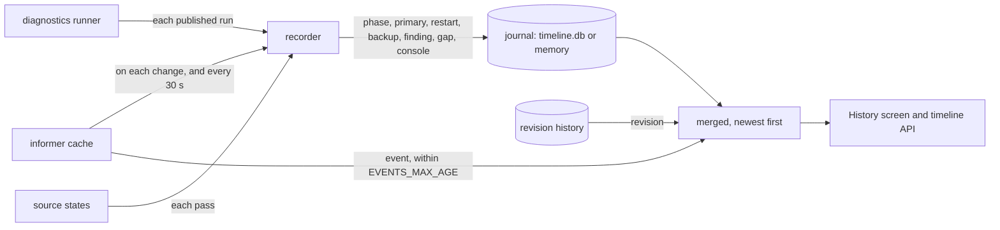
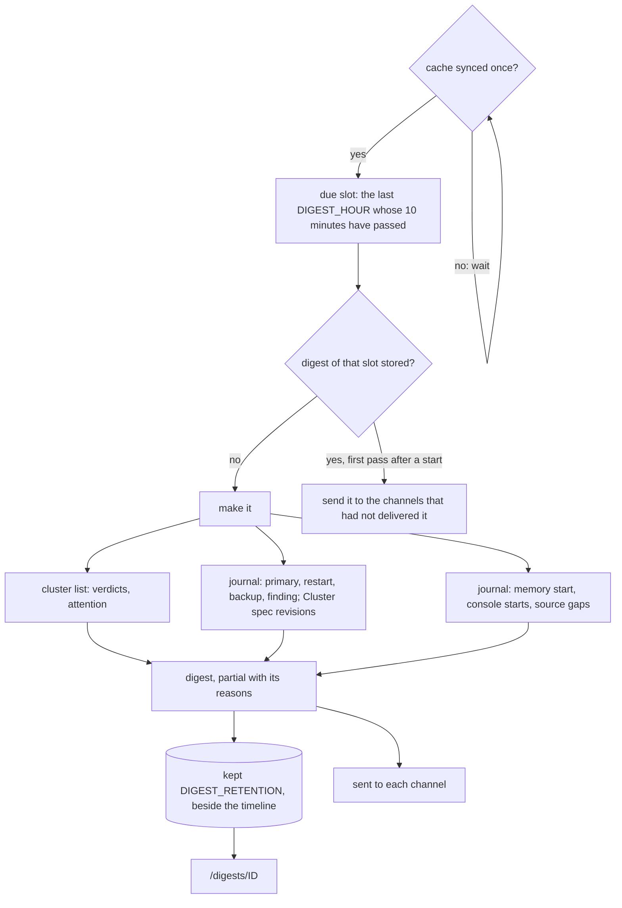
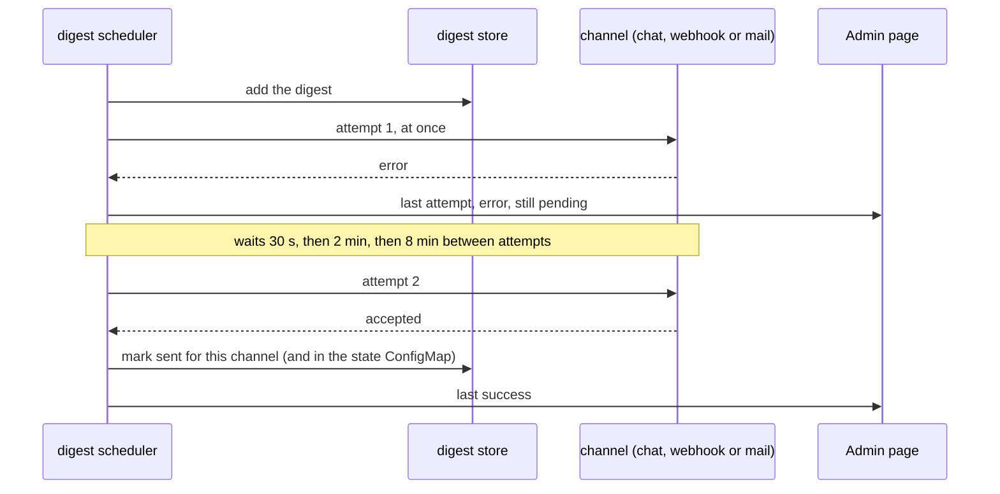
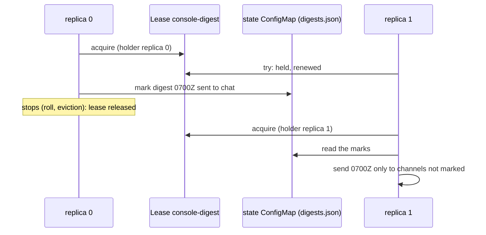

# Timeline, change preview and daily digest

## Incident timeline

A Cluster's **History** screen opens on its incident timeline: one time axis of
what happened to the Cluster, newest first. The revision list is the second tab.

| Kind | What it is | Whose clock |
|---|---|---|
| `phase` | The Cluster phase changed | the console's (observed) |
| `primary` | The primary changed: a **failover** when the phases seen just before say so, a **switchover** otherwise | the operator's timestamp (reported) |
| `restart` | An instance's `postgres` container restarted, with the exit reason | the kubelet's (reported) |
| `backup` | A Backup completed or failed | the backup's stop time (reported); with none plausible (1970, or in the future), the operator's completion stamp `reconciliationTerminatedAt` (reported), else the console's (observed) |
| `finding` | A diagnostics finding appeared, worsened, improved or cleared | the console's (observed) |
| `revision` | A spec change, creation or deletion from the history | the console's (observed) |
| `event` | A Kubernetes Event of the Cluster's objects, within `EVENTS_MAX_AGE` | the API server's (reported) |
| `gap` | A source the console reads went stale, unavailable or forbidden, then live again | the console's (observed) |
| `console` | The console itself started | the console's (observed) |

Where each kind comes from: a recorder compares what the informer cache holds
between passes and writes what changed to a journal; the screen merges the journal
with the revision history and the Events at read time (`internal/console/timeline`,
`Timeline` in `internal/console/status/timeline.go`).



You can filter by kind and choose the window (1 h, 6 h, 24 h, 7 d or a custom UTC
window of up to 31 days). The filter and window are kept in the URL, so a view can
be shared. Every entry carries its provenance, and links to the screen that explains
it: replication for a primary change, the instance for a restart, the backups,
diagnostics, the revision or the Events.

What the timeline will not claim:

- **A finding present at start is "first observed", not "appeared"**: the console
  cannot know when it began.
- **A change found after a restart is marked "between X and Y"**: X is the last
  heartbeat of the previous console process and Y the first observation.
- **A finding is not "cleared" when its check could not run.** That is
  "unavailable", not fixed.
- **A primary change names a cause only when it saw one.** The cause is the latest
  failover or switchover phase seen since the previous change. With none seen, the
  change is "primary changed (cause not observed)"; with both seen, the latest is
  named and marked uncertain.
- **What the memory lost is not reinvented.** When a Cluster's older events were
  evicted, or a Cluster was deleted and recreated under the same name, the next
  observations say "first observed", never "appeared" or "changed".
- **The memory is bounded.** The timeline keeps at most `HISTORY_MAX_REVISIONS`
  events, and a per-Cluster share, so one flapping Cluster cannot crowd out the
  rest. The screen says when older entries were evicted, and from when the console's
  own record starts.

The timeline follows the history: it is on with `HISTORY_ENABLED`. It is kept in
`timeline.db`, next to `HISTORY_PATH`, when the history is persistent, and in memory
otherwise. If that file cannot be read at start (it is damaged), the console moves
it aside as `timeline.db.corrupt-<UTC time>`, logs a warning, starts an empty
timeline and records the loss on the console's start entry; the next digest is
partial. A file locked by another process is never moved: the start fails instead.

API: `GET /api/v1/namespaces/{ns}/clusters/{name}/timeline?from=&to=&kind=finding,primary&limit=`.

## Change preview

A Cluster revision's page (`History` → a revision) shows **what this change sets
in motion**, read from the definition before and after:

- For each changed PostgreSQL parameter: **reload** or **restart**, from its
  PostgreSQL context for the Cluster's major (13 to 18). A parameter CloudNativePG
  fixes or blocks is shown as **refused**. A parameter the Cluster's major does
  not have (PostgreSQL would reject the configuration) is **unknown**.
- A *lower* value of `max_connections`, `max_worker_processes`,
  `max_wal_senders`, `max_prepared_transactions` or `max_locks_per_transaction`
  (including removing it, so it returns to its default) restarts the primary
  **first**, because hot standbys need at least the primary's value. Under
  `supervised`, CloudNativePG waits for you instead.
- Adding the first or removing the last `pg_stat_statements.*`, `pgaudit.*`,
  `auto_explain.*` or `pg_failover_slots.*` parameter changes the
  `shared_preload_libraries` CloudNativePG manages, which needs a **restart**.
- Changes outside the parameters:
  - image or pod template changes roll the Pods;
  - a new major version runs the major upgrade;
  - certificates are reloaded;
  - hibernation on shuts every instance down, and hibernation off starts them all;
  - fencing stops PostgreSQL on the listed instances, and lifting it starts them;
  - scaling touches no running instance.
- Who restarts, and in what order: the replica Pods are recreated on their
  volumes, then the primary. It restarts in place, is switched over to the most
  advanced replica, or waits for you (`supervised`), according to
  `primaryUpdateStrategy` and `primaryUpdateMethod`.

A change the tables do not know is reported as **unknown**, never guessed. If any
change is unknown, the preview says **"unknown, at least X"**, where X is the worst
effect it could classify, and it never says "no restart". When the PostgreSQL major
cannot be read from the image, or the operator version is outside the tables, the
preview is marked **unverified**. A stored revision holds the spec only, so the
order is given by role, not by instance name.

The computation is a pure function (`pkg/cnpgstatus/preview`). The same code can
preview a proposed spec.

## Daily digest

Each day at `DIGEST_HOUR` (UTC), the console closes a digest of the last 24 hours.
It reads only what the console already holds: the journal above and the cluster
list (`internal/console/digest`).



A digest holds:

- spec changes of the Clusters themselves (their other objects' revisions stay on
  each Cluster's history);
- findings that appeared, worsened or cleared;
- failovers and switchovers;
- failed backups and container restarts (what the kubelet reports: a rollout or an
  in-place PostgreSQL restart is not counted);
- the Clusters whose verdict needs attention.

Each digest is made 10 minutes after its hour, so the window's last minutes reach
the console first. It is never made before the console's cache has synced: an
unsynced cache lists no Cluster, which would read as an all-clear. After a restart
or a suspend, only the latest missed digest is made, as a catch-up; its health and
attention are labelled as of when it was made, not as of the window's end.

A digest is **partial**, and says why, when the console did not observe the whole
window:

| Reason | What happened |
|---|---|
| the console's memory begins after the window did | new console, or the timeline was lost |
| the console was down during the window | a restart whose previous life ended before the window closed |
| a source was not live during the window | a watch or the diagnostics were down for part of it, including a gap that opened earlier |
| a namespace's Clusters cannot be read | they are missing from the digest |
| no timeline | the console has no journal to read |

A partial digest is never an all-clear: its message starts with `PARTIAL` and its
subject says so. Entries are listed for the Clusters that need attention only (at
most 50 each, 1,000 per digest); every Cluster keeps its counts.

`/digests` lists the digests. Each one has its own link,
`/digests/20261103T0700Z`, and every reader sees only the Clusters they may `get`;
the others are counted, never named.

| Variable | Default | |
|---|---|---|
| `DIGEST_ENABLED` | on with persistent history (`HISTORY_PATH`) | `true` with `HISTORY_ENABLED=false` is refused; `true` with in-memory history gives each replica its own page, lost on restart, and no delivery |
| `DIGEST_HOUR` | `7` | UTC hour, 0 to 23 |
| `DIGEST_RETENTION` | `720h` | 24h to 366 days. Digests survive restarts only with persistent history |
| `DIGEST_CHAT_WEBHOOK_URL_FILE` | off | a file holding a Slack or Mattermost incoming-webhook URL (https), sent `POST {"text": ...}` |
| `DIGEST_WEBHOOK_URL_FILE` | off | a file holding a webhook URL (https), sent the JSON summary (`"type": "pgtoolbox-console.digest"`) |
| `DIGEST_SMTP_ADDRESS` | off | `host:port` of the mail server |
| `DIGEST_SMTP_TLS` | `starttls` | `starttls` (refused if the server does not offer it) or `tls` (implicit, port 465). There is no plaintext mode |
| `DIGEST_SMTP_USERNAME`, `DIGEST_SMTP_PASSWORD_FILE` | none | AUTH PLAIN over TLS; set together |
| `DIGEST_SMTP_FROM`, `DIGEST_SMTP_TO` | none | a bare address; up to 20 comma-separated addresses |
| `DIGEST_DELIVERY_TIMEOUT` | `10s` | bound of one attempt, 1s to 1m |
| `DIGEST_LEASE` | empty | the `coordination.k8s.io` Lease, in the console's namespace (needs `POD_NAMESPACE`), whose holder alone delivers. Set by the chart and the operator with a delivery channel, to `<console>-digest`. Empty: this replica delivers on its own (a single replica only) |

Delivery rules:

- **Delivery is off until a channel is set**, and it needs persistent history
  (`HISTORY_PATH`): the message links to the digest's page, which in-memory
  history loses at the next restart.
- **One replica delivers.** Every replica makes the digest and keeps its page;
  only the replica holding the Lease `DIGEST_LEASE` sends it (client-go leader
  election: a 15 s lease, renewed every 2 s, released at a graceful shutdown).
  Which channel delivered which digest is shared through the
  [state ConfigMap](configuration.md#what-survives-a-restart) (`digests.json`),
  so a roll or a failover sends nothing twice: a new holder waits for the shared
  marks (two minutes at most), then sends the current digest to the channels
  that had not delivered it, and an attempt still running on the old holder is
  cancelled with its lease. A replica that stops between a send and the write of
  its mark (about a second) can make the next holder send that one digest again:
  at least once, never lost. A Lease the console may not read or write means no
  replica delivers (never two): the **Admin** page shows the `digestLeader`
  source, which replica holds the Lease and why none does, and
  `pgtoolbox_console_digest_leader` is 1 on the holder.
- **Messages carry a summary and a link only**: the counts, the names of the
  Clusters that need attention, and `PUBLIC_URL/digests/<id>`.
- **Credentials are files.** Each credential (a webhook URL is one) is a file the
  chart or the operator mounts from a Secret you create. The file is re-read at
  every attempt, so a rotation needs no restart. The console reads no Secret
  through the API, and never logs a URL or a password, nor echoes one in an error.
- **Retries and failures.** Each channel makes up to four attempts over about ten
  minutes (at once, then after 30 s, 2 min and 8 min), each bounded by
  `DIGEST_DELIVERY_TIMEOUT`. A channel still retrying when the next digest is sent
  gives the old one up. Every channel's last outcome, including its error, is on the **Admin**
  page; a mail server's answer is shown as its code and first line, without
  addresses. A failing channel never delays the digest page, the other channels or
  anything else.
- **Restarts.** Which channels delivered a digest is stored with it, and shared
  between the replicas. After a restart, a channel that had not delivered the
  current digest gets it, and one that had is not sent it again.

One delivery, per channel, on its own goroutine (`Service.send` and
`Service.deliver` in `internal/console/digest/service.go`):



Who sends, with two replicas (`internal/console/leader`, `Service.Lead`):



### Configuring it

With the pgtools chart:

```yaml
console:
  publicURL: https://console.example.com
  history:
    persistent: true
  digest:
    hour: 6
    delivery:
      chat: {existingSecret: pgtoolbox-console-digest-chat, key: url}
      smtp:
        address: smtp.example.com:587
        username: pgtoolbox-console
        password: {existingSecret: pgtoolbox-console-digest-smtp, key: password}
        from: pgtoolbox-console@example.com
        to: [dba@example.com]
```

With the operator, the same settings go under `spec.digest` of the `PgToolBoxConsole`
(`chatWebhookSecretRef`, `webhookSecretRef`, `smtp.passwordSecretRef`); see the
[API reference](../reference/api.md). If the console's NetworkPolicy is enabled,
open the webhook or mail server in `console.networkPolicy.extraEgress`, narrowly:
an `ipBlock` and the ports it uses (443, or 465/587 for mail). The pgtools README
has an example; a bare `{}` rule opens all egress.
