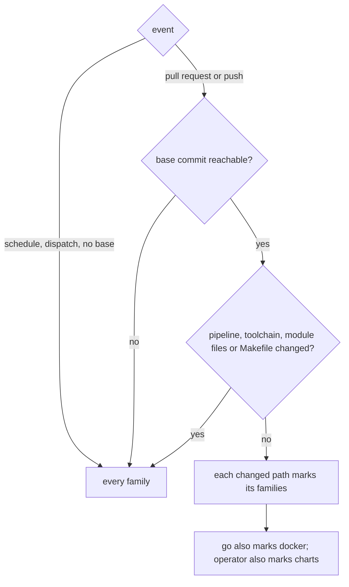
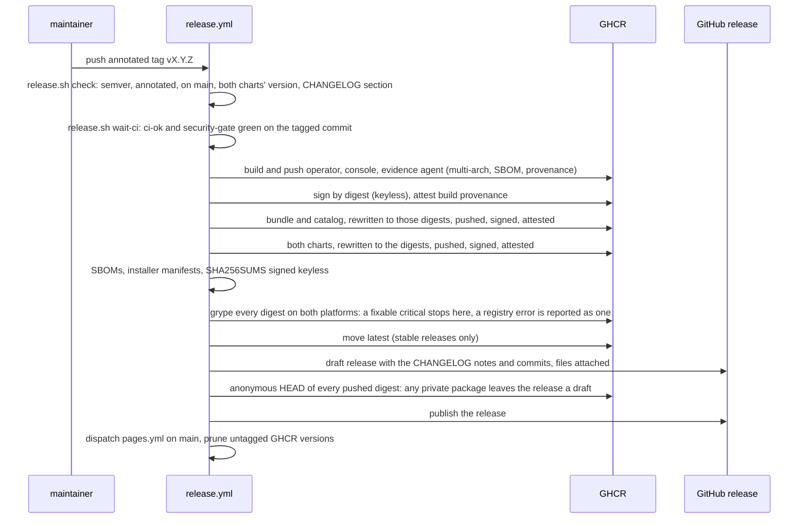

# CI and releases

The repository lives on GitHub (`github.com/fyannk/pgToolBox`) and its pipeline is
GitHub Actions on GitHub-hosted `ubuntu-latest` runners. Every job runs a
`make` target, so a failure reproduces on a laptop with the same command (`make
help` lists them). Tools come from `mise.toml`, the single source of tool versions,
through the local `toolchain` action (`jdx/mise-action`); `make doctor` checks a
laptop against it.

The rules every workflow follows: every `uses:` pinned to a full commit SHA with a
version comment, `permissions: {}` at the top and the least privilege per job (each
grant with a comment saying why), `persist-credentials: false` on checkout, no
`${{ }}` expression inside a `run:` script (values go through `env:`),
`set -euo pipefail`, one concurrency group per workflow. `make lint-workflows` runs
actionlint and zizmor and must stay clean.

Caches (`.github/actions/toolchain`) are written only by runs on `main` (push,
nightly, dispatch) and restored everywhere: a cache a pull request writes would be
visible to that pull request alone and would push `main`'s out of the repository's
10 GB budget. The Go module cache is keyed by `go.sum`; each job has its own Go
build and golangci-lint cache, refreshed daily; the image layers go to the `gha`
cache from the `images` job of the nightly run on `main` (each export is several GB,
so once a day, not on every merge). mise itself is pinned in the action, so a
new mise release cannot change a job overnight. Each image is built once per run,
in `images`, and the e2e jobs load that archive instead of building their own.

## The workflows

| Workflow | Runs on | What |
|---|---|---|
| `ci.yml` | pull request, push to `main`, nightly at 04:17 UTC, by hand | The single pipeline. Its last job, `ci-ok`, is the required check. |
| `e2e-kind.yml` | called by `ci.yml` | One kind scenario on a fresh runner, with the images of the run loaded (reusable workflow). |
| `security.yml` | pull request, push to `main`, daily at 03:37 UTC, by hand | CodeQL, govulncheck, osv-scanner, npm audit, grype on the images, gitleaks, gosec, zizmor, kube-linter. Its last job, `security-gate`, is the required check. |
| `scorecard.yml` | push to `main`, weekly on Tuesday, by hand | OpenSSF Scorecard, published and uploaded to code scanning. |
| `pages.yml` | when `security.yml` finishes on `main`, nightly at 04:47 UTC, by hand, after a release | Builds the documentation, renders the Security page, deploys both to GitHub Pages. |
| `release.yml` | tag `v*` or `pkg/evidence/v*`; by hand for an existing tag | The release. It checks out and runs nothing but the tagged commit, and restores no cache. |
| `release-dry-run.yml` | a pull request touching the release files; weekly on Sunday | The release's build as a dry run: nothing pushed or signed, no write permission. |
| `matrix.yml` | nightly at 01:41 UTC, by hand | The end-to-end scenarios on Kubernetes 1.34 and 1.36 × CloudNativePG 1.30.1, plus CloudNativePG `main` (non-blocking): one job per Kubernetes × CloudNativePG × scenario, all at once, on the images built once for the run. |
| `image-watch.yml` | nightly at 04:23 UTC | Scans the latest published images and keeps one tracking issue for fixable criticals. |
| `automerge.yml` | Dependabot pull requests | Arms auto-merge for patch and minor updates. |

## What `ci.yml` runs

| Job | Make target | Gate |
|---|---|---|
| `lint` | `lint` | golangci-lint on both modules (build-tagged e2e and envtest code included), gofumpt/gci, `go vet`, and the repository checks (`hack/check-*.sh`: headers, read-only boundary, dependency closure, layering, toolchain, documented settings) |
| `lint-files` | `lint-workflows lint-docker lint-shell` | actionlint, zizmor, hadolint, shellcheck |
| `generated` | `verify-generated` | deepcopy code, CRDs, RBAC and their Helm/OLM copies, OpenAPI and fixtures, the check and API references and the insight pack regenerate to the committed files |
| `test`, `race-fuzz` | `build test`; `test-race` and `test-fuzz`, one job each | unit tests; the race detector; every fuzz target for a few seconds |
| `envtest` | `test-envtest` and the operator suites | CRD CEL rules, reconcilers and the operator binary on a real API server |
| `console-core` | `verify-pins test-console-core test-e2e-console-authz test-bounds` | the informer cache per CloudNativePG minor, the write path, SubjectAccessReview semantics, read-model pins, bounded resources |
| `ui`, `ui-e2e` | `ui-check ui-audit`, `ui-e2e` | Biome, knip, tsc, tokens, Vitest, stories with axe, build, size budgets, `pnpm generate:check`; Playwright with axe and screenshots in the baseline image |
| `headlamp` | `headlamp-check` | the Headlamp plugin builds and tests |
| `docs` | `docs`, `docs-spell`, `docs-links` | the site builds with broken links failing it, generated references are current, spelling; external links are reported, not enforced |
| `packaging` | `chart-gates bundle-validate kustomize-validate` | helm lint and template, helm-unittest, ct lint, kubeconform, kube-linter, alert rules, README values, Helm vs kustomize vs OLM field by field, `operator-sdk bundle validate` |
| `images` | `hack/image-profile.sh` and the container tests | each image is built once per run, for `linux/amd64` and `linux/arm64`; the amd64 image is held to the container profile (below) and handed to every `e2e-*` job as an artifact |
| `olm-images`, `evidence-integration` | `bundle-build catalog-build`, `test-evidence-integration` | the OLM images build; Barman and pgBackRest fixtures and S3, Azure and GCS provider parity |
| `e2e-*`, `olm-scorecard` | `test-e2e-<scenario>`, `scorecard` | kind scenarios: console, chart (and with NetworkPolicy), EvidenceAgent, PgAdmin, access requests, team mode, pgBackRest (one job per plugin cell, `E2E_VARIANT`), and the OLM scorecard; each loads the archives of `images` and runs with `PREBUILT_IMAGES=1`, so its `make docker-build*` steps only tag them |
| `ci-ok` | none | passes when every job passed or was skipped on purpose |

**The container profile** (`hack/image-profile.sh`, plus the console's and the
evidence agent's behavioural tests): a numeric non-root `USER`; an exec-form
entrypoint; the OCI labels (title, source, version, licenses); a licence under
`/licenses`; no shell; no setuid or setgid file; the binary starts and answers
`--help` under an arbitrary UID with a read-only root filesystem, every capability
dropped and no network, and again as a UID in group 0, the way OpenShift's
restricted SCC runs it.

## Which jobs a change runs

`ci.yml` does not use `paths:` filters on the workflow. A required check that a path
filter skips never reports, and the merge waits for it forever. Its first job,
`changes`, runs `hack/changed-paths.sh` instead, which prints one `true` or `false`
per job family. A skipped job is a decision visible in the job list, and `ci-ok`
treats skipped as passed and failed or cancelled as not, so a documentation-only
change stays light and still gets its one required check.



| Family | Marked by | Jobs |
|---|---|---|
| `go` | any `.go` file, `hack/`, `pkg/`, `api/`, `internal/`, `cmd/` | build and test, race and fuzz, lint, generated files, envtest |
| `operator` | `api/`, `config/`, `internal/operator/`, `cmd/operator/`, `test/e2e/`, `pkg/` | PgAdmin, EvidenceAgent, access and team e2e |
| `console` | `internal/console/`, `cmd/console/`, `hack/console/`, `pkg/`, `ui/` | console core, console and chart e2e |
| `evidence` | `pkg/evidence/`, `internal/evidence/`, `cmd/evidence-agent/`, `hack/evidence/` | evidence integration, EvidenceAgent e2e |
| `charts` | `charts/`, `deploy/olm/`, the packaging scripts, `api/`, `config/`, and whatever marks `operator` | packaging, OLM images, chart e2e, OLM scorecard |
| `docs` | `docs/site/`, any Markdown file, `.codespellrc`, `lychee.toml` | documentation |
| `ui` | `ui/` | console UI and its end to end |
| `headlamp` | `headlamp/`, `hack/mk/headlamp.mk` | Headlamp plugin |
| `workflows` | `.github/` | actionlint and zizmor |
| `docker` | `Dockerfile`, `.dockerignore`, the release scripts, `ui/`, and whatever marks `go` | hadolint, image builds and container profiles |

## Security

`security.yml` runs on every pull request and every push to `main`, daily, and by
hand. Each scanner writes SARIF to GitHub code scanning under its own category and a
normalised result that `hack/security_report.py` merges.

| Scanner | Looks at | Blocks |
|---|---|---|
| CodeQL (go, javascript-typescript, actions) | the source | code scanning results, through the ruleset |
| govulncheck | both Go modules, by call graph | any reachable vulnerability |
| osv-scanner | `ui/pnpm-lock.yaml`, `docs/site/package-lock.json`, `headlamp/package-lock.json`, both `go.mod` | a fixable critical; on a pull request a new fixable high |
| `npm audit` | the docs site and the SPA's runtime dependencies | any advisory not in `hack/npm-audit-accepted.txt` |
| grype | the three images, built from the commit | a fixable critical; on a pull request a new fixable high |
| grype | the latest published images, by digest | reported (the nightly `image-watch.yml` keeps an issue) |
| gitleaks | the whole history | any secret (paths that hold canary tokens on purpose are in `.gitleaks.toml`) |
| gosec (golangci-lint) | both Go modules | reported; `make lint` is the gate |
| zizmor | `.github/` | reported; `make lint-workflows` is the gate |
| kube-linter | both Helm charts, every `ci/*-values.yaml` rendering | reported; `make chart-gates` is the gate |

The policy is `SECURITY.md`'s: a fixable critical blocks; a finding is dismissed
only when it is shown to be unreachable or not a vulnerability where it stands, and
the dismissal is a line in `hack/security-accepted.txt` naming the exact package or
file, with its reason; "no fix available" is never a reason, so such a
finding stays open and visible. "New" means not in the newest completed run on
`main`. A scanner that did not run fails the gate, it does not count as zero.

### The Security page

`pages.yml` builds one GitHub Pages site: the documentation at
`https://fyannk.github.io/pgToolBox/` and, in it, the [Security page](/security/) at
`https://fyannk.github.io/pgToolBox/security/`. The page is a page of the site
(`docs/site/src/pages/security.tsx`, with the site's navbar, footer and theme); after
the build, `hack/security_report.py render` writes its data, `build/security/results.json`,
from the `security-results` artifact of the newest completed `security.yml` run on
`main` (never a pull request's), the open CodeQL alerts read from code scanning, and
the OpenSSF Scorecard score read from its public API. The page reads that file in the
browser and lists, per scanner, the tool and version, when it ran and on which commit,
the counts by severity, the open findings with whether a fix exists, the digests of
the scanned images, the Scorecard score and the accepted findings.

`results.json` is the page's view model: every status label, every fix label and the
choice of which findings are listed are decided in Python and tested by
`make test-hack`; the page only lays them out. Its shape carries a `schema` number
(currently 2, documented beside `RESULTS_SCHEMA` in `hack/security_report.py`); the page
refuses a schema it does not know rather than guess. The raw envelopes, every finding
included, are kept under `envelopes`. A scanner that did not run reads **not run** (or
**failed**) with the reason; with no `results.json`, or one from a run in which no
scanner produced anything, the page says no security run has been published yet. It
never turns a missing result into zero findings.

To try the page on sample data:

```bash
make docs-build
python3 hack/security_report.py render --input sample-results.json \
  --output-dir docs/site/build/security --accepted hack/security-accepted.txt
python3 hack/security_report_test.py      # also part of `make test-hack`
```

Then serve `docs/site/build` under `/pgToolBox/` (for example `npm run serve` in
`docs/site`) and open `/pgToolBox/security/`.

## Dependencies

Dependabot (`.github/dependabot.yml`) covers both Go modules, the three npm trees
(`ui`, `docs/site`, `headlamp`), the Docker base images and the GitHub Actions pins.
Updates are grouped weekly (Monday morning, Europe/Paris), at most five pull requests
per ecosystem, with a seven-day cooldown so a freshly published release is not
proposed until it has survived a week, and Conventional Commit prefixes
(`build(deps)`, `ci(deps)`). `automerge.yml` arms auto-merge for patch and minor
updates, which then wait for the same required checks as any change. A major update
is its own pull request and waits for a person.

What Dependabot cannot read is bumped on a quarterly toolchain day: `mise.toml`
(Go, Node, pnpm, Helm, kind, kubectl and the linters), the cosign release in the
workflows (`hack/check-toolchain.sh` fails if it differs from `mise.toml`), the
pinned images and versions in `hack/e2e-*.sh`, and the major updates Dependabot
opened. Pin only versions that have been published for at least two weeks.

## The release

A release is an annotated tag on a commit of `main`, pushed by the maintainer. `v*` and `pkg/evidence/v*` tags are protected by a ruleset (they cannot be moved or deleted), and `release.yml` runs its first job in the `release` environment, which admits only those tags and waits for the maintainer's approval: nothing is built or pushed before that approval, and a dispatch from a branch never starts. Every image's signature and provenance are verified in the workflow, with the commands the release page gives users, before anything points at them.
`ci.yml` has no tag trigger: the tagged commit already had its run when it reached
`main`, and `release.yml` waits for the `ci-ok` and `security-gate` checks of that
exact commit instead of starting another. The logic is in `hack/release.sh`; the
workflow is a list of its subcommands and of actions.



Before the tag: `make release-check TAG=vX.Y.Z` (semver, both charts' version, the
CHANGELOG section, which must be dated: a heading that still says `Unreleased` is
refused for a final tag; `REQUIRE_TAG=1` once the tag exists) and `make release-dry-run`
(every image built for both architectures into OCI archives, the charts and
manifests pinned and packaged, nothing pushed). The tag is created and pushed by a
person:

```bash
git tag -a v0.1.0 -m "pgToolBox 0.1.0"
git push origin v0.1.0
```

A release candidate (`v0.1.0-rc.1`) is the rehearsal: the same workflow, a GitHub
pre-release, and `latest` does not move. It is cut from the tree of the final
version (charts and CHANGELOG say `0.1.0`; `release-check` accepts the open
`## [0.1.0]` section for an `-rc.N` tag, and the archives are stamped
`0.1.0-rc.1`). It creates the GHCR packages, which start **private**: make each one
public (see [repository settings](repository-settings.md#packages)), check an
anonymous pull, and only then tag the final version. The tag patterns `v*` and
`pkg/evidence/v*` of the tag ruleset and of the `release` environment cover
release candidates.

Image builds take `SOURCE_DATE_EPOCH` and the `created` label from the tagged
commit's time, and the scan and the SBOMs cover both `linux/amd64` and
`linux/arm64` (one `sbom-<image>-<arch>.spdx.json` each).

If the release job stops at the anonymous-pull check, the images, charts, bundle and
catalog are already pushed and signed, and the release is a draft that names the
packages to open. Make them public, then **Re-run failed jobs**.

A pull request that touches the release files, and the weekly schedule, run the same
build as a dry run with version `0.0.0-dryrun`: nothing is pushed or signed. A tag
`pkg/evidence/vX.Y.Z` releases the nested evidence module instead: the module
checks, green CI, and a release with no images (`make release-check-module
TAG=pkg/evidence/vX.Y.Z` first). A failed run is finished with
**Re-run failed jobs** on that run, not with a new dispatch: a new run rebuilds the
images and moves the tag to new digests, while a re-run of the failed jobs reuses the
digests the earlier jobs already pushed and signed. The `tag` input of a dispatch is
for a tag whose run is gone; a release that is already published is left as it is. What a release
contains and how to verify it is on [Release and verification](../release.md).

After a release, a `prune` job deletes the untagged versions the pushes leave in GHCR
(`delete-untagged` with `validate`, so a manifest that a tagged index, a signature
or an attestation references is kept). It never enables ghost-image deletion: that
mode can delete tagged release versions.
