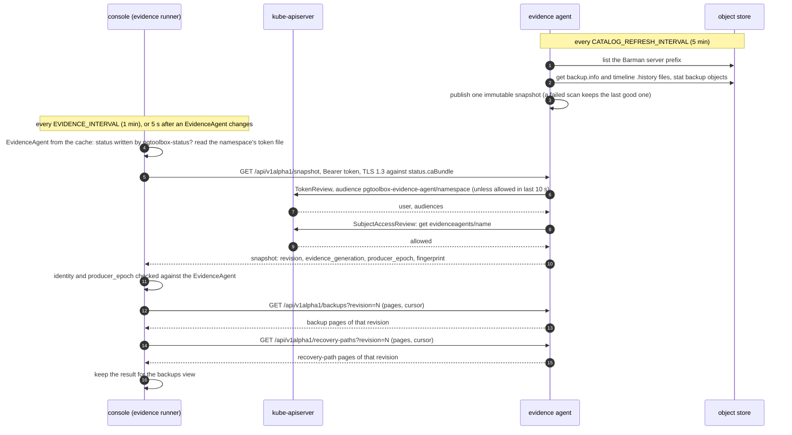

# The evidence agent

CloudNativePG reports what it *believes* about backups: `Backup` objects, the
barman-cloud plugin's recovery window. The evidence agent is the independent
cross-check: it reads the **repository itself** (the object store) and reports
what is actually there. The console shows the
operator's claim and the repository's evidence side by side, and names the
disagreements.

The agent is the `pgtoolbox-evidence-agent` image run in its `agent` mode. You declare
it with an [`EvidenceAgent`](operator/evidenceagent.md); the operator creates the
Deployment. Without the operator, the `pgtools` chart deploys it for the Clusters
its values list ([team mode](#team-mode-without-the-operator)). The same binary
also has a standalone mode (a read-only viewer UI); pgToolBox does not deploy it.

## What it reports

For one Barman server in one repository: the backups found, the WAL ranges and
gaps, the recovery paths, and a conclusion for each of three questions (WAL
continuity, recovery coverage, retention) with a typed state and a stable reason
code. The console shows those restatements and nothing else of the agent's
diagnostic text: no finding says what the repository "would or would not restore".
A WAL finding nests under the operator's archiving condition when both are
current, which places the repository's observation beside the operator's claim
without merging them.

A backup that cannot reach the newest timeline (its timeline branched off
before the backup was consistent, or is not an ancestor of the newest one) gets
an *off-target* recovery path (`off_target: true`) on its own timeline. A
default CloudNativePG restore (`recovery_target_timeline` `latest`) fails from
it, so the path is at most a warning and a restore from it must name the
timeline. Barman Cloud and pgBackRest give such a path the same state; for
Barman the coverage conclusion is then not healthy (it takes the worst path),
for pgBackRest the backup is not counted as usable. A path that is already not
healthy (WAL missing, for example) keeps its own reason and gains the
off-target one, which names the timeline a restore must ask for. When every
backup is left behind like this, coverage says that no backup is on or before
the newest timeline's branch point.

Both formats resolve the newest timeline as PostgreSQL resolves
`recovery_target_timeline` `latest`: from the backup's timeline they probe the
history file of the next timeline, then the one after, and stop at the first
one the archive does not have. A timeline above a missing history file is not
where a default restore goes, however much WAL it has. Its recovery paths are
unknown ("timeline 3 needs an explicit targetTLI; history 2 is missing"), the
timeline conclusion is unknown, and the backup's own-timeline path is unknown
too. A history file that is listed but cannot be read, is malformed or is over
the size bound, or a listing of history files cut at its bound, leaves the
timeline a default restore follows undecided. No path is then healthy.

Recovery then reads one history file, the one of the timeline `latest`
resolved to, and follows the ancestry it lists. A timeline that is not on it
is a sibling branch: a default restore never follows it, even when its number
is lower. Its path is off target (`off_target: true`, reason code
`coverage-path-needs-target-timeline`), at most a warning, and its reason says
which `targetTLI` a restore toward it must give; for Barman such a sibling path
does not weigh on the coverage conclusion. For example, timeline 2 forked after
the backup ended and timeline 3 is a point-in-time restore forked before it
ended: `latest` resolves to 3, which leaves the backup's timeline before the
backup was consistent, so the default restore fails; both the own-timeline
path and the path to timeline 2 are warnings, and only `targetTLI: 2` (or the
backup's own timeline) restores. pgBackRest judges a backup toward the newest
timeline only, so it gives the same answer for that path.

Because the probe only tests that a history file exists, a listed history whose
content is malformed, duplicated or contradictory still counts as present. Only
the history recovery reads (that of the timeline `latest` resolves to) and a
history the probe stops at because it cannot be read decide the timeline
conclusion; for Barman, a bad history no default restore reads (an old branch)
makes the timeline conclusion a warning that names the file, and hides no
coverage. A backup's own timeline needs no history file: PostgreSQL reads an
absent one as "no parents".

For pgBackRest, which stores the WAL segment size nowhere, the size comes from
the backups' LSNs (`backup-lsn`); when they do not decide it, from the archive's
segment names (`wal-names`): a segment number rules out every size with fewer
segments per log, and the number at which a log rolls over to the next (`FF`
for 16 MiB) names one size. Only when neither decides is the 16 MiB default
assumed (`assumed-default`), and never when a segment name rules it out.

The console applies further limits to the recovery paths it receives, for
both formats. The first two leave the recovery window without covered spans and give
the reason in its place:

- the agent's timeline conclusion is unknown or unhealthy, so the timeline a
  default restore follows is not established (a timeline warning, about a
  history no default restore reads, limits nothing and is kept as a warning);
- the agent does not declare the `recovery-timeline-latest` and
  `recovery-timeline-ancestry` features in `producer.features`, which means it
  is an older build that may call a path healthy when a default restore does
  not follow it.

A third limit keeps the spans: no path claims more than the agent's own
coverage conclusion, so when that conclusion is not healthy (for example "a
default restore succeeds from none" of the backups), a path that reads healthy
is shown as a warning.

A Cluster backed up through a pgBackRest plugin is read the same way, as one
stanza of one repository; see
[Clusters backed up with pgBackRest](guides/pgbackrest.md).

For a pgBackRest stanza, the retention question is checked against the plugin's
own retention (`retentionPolicy` for Dalibo, `retention` for Opera). The operator
passes it to the agent as `PGBACKREST_RETENTION_FULL`, `_FULL_TYPE`, `_DIFF`,
`_ARCHIVE` and `_ARCHIVE_TYPE`. The agent replays pgBackRest's expire rules as of
the newest backup. It reports `RetentionNotApplied` (a warning) when backups or
WAL that expire should have removed are still in the repository. It reports
`RetentionShortfall` (an error) when backups or WAL that the retention keeps are
missing. When no full retention is set, the stanza reports
`RetentionNotConfigured` (a warning): pgBackRest then never expires anything.
The console's Backups screen shows the comparison in the stanza panel: the
options as the agent received them, the archive retention expire applies, the
backups of each type and the newest backup it was evaluated at. The checks
`repository-retention-unhealthy` (a shortfall), `repository-retention-not-applied`
and `repository-retention-not-configured` restate it. An agent given no
retention reports the comparison as not evaluated.

Its code only reads from the store, through a read-only interface. It uses **the
credentials the `ObjectStore` already names**, which the barman-cloud plugin needs
to write with, so the Pod holds credentials that can write. That is why the Pod is
confined (restricted Pod Security, non-root, read-only root filesystem, no
service-account token automounted) and why the agent image is
[allow-listed](operator/images.md). The credentials are mounted as files inside the
agent's own Pod only and never reach the console; the console receives conclusions
only.

## The channel

The wire contract is `evidence/v1alpha1`, served over in-cluster HTTPS on port
`8443`, media type `application/vnd.pgtoolbox.evidence.v1alpha1+json`,
paths `/api/v1alpha1/{snapshot,backups,wal-ranges,wal-gaps,recovery-paths}`, with
`/healthz` unauthenticated. It is defined in the nested
zero-dependency Go module `pkg/evidence` (tagged separately, `pkg/evidence/vX.Y.Z`)
and its JSON schema and golden files are checked in CI.

| Property | How |
|---|---|
| Server identity | The agent's serving certificate comes from the operator's CA (or the OpenShift service CA). The CA is published in `EvidenceAgent.status.caBundle`, which the console reads with the `get` it already has. No Secret is involved. |
| Client authentication | The console presents a **bound ServiceAccount token per namespace**: for the agents of namespace `N`, a token projected with `audience: pgtoolbox-evidence-agent/N`, rotated by the kubelet (`console.evidenceToken`, on by default). The chart projects one token per watched namespace at `/var/run/secrets/pgtoolbox.fyannk.dev/evidence-agent/N/token` (`EVIDENCE_TOKEN_DIR` is the directory). A token is useless against the API server, against every other audience, and against the agents of every other namespace. |
| Authorization | The agent validates the token with a **TokenReview** for its own namespace's audience only (the audience must come back in the answer) and then asks a **SubjectAccessReview**: may this subject `get` `evidenceagents/<its own name>` in its namespace. The console's Role already grants that. The agent's ServiceAccount holds one small ClusterRole: `create` on `tokenreviews` and `subjectaccessreviews`. A token issued for another namespace's agents, or for the cluster-wide audience `pgtoolbox-evidence-agent`, is refused with the error code `audience-mismatch` (HTTP 401). |
| Status provenance | The console calls an agent only when the operator's status field manager (`pgtoolbox-status`) owns `status.endpoint` and `status.caBundle` in the object's `managedFields`. Otherwise the agent is shown as **"not verifiable: status not written by the operator"** and nothing, not even the token, is sent to it. |
| Freshness | Every snapshot carries `producer_epoch` and a `producer_instance`; the console keys its cache on them, so a restarted agent cannot leave a stale list. A snapshot with a stale epoch is discarded (`pgtoolbox_console_evidence_fetches_total{outcome="stale_epoch"}`). |
| Identity | `destination_fingerprint` ties a snapshot to the repository `status.fingerprint` names. |

### One exchange

The sequence shows one pass of the console's evidence runner against one agent in
operator mode, and the agent's own background scan that the answers come from.



- **The agent serves from memory.** A request never reaches the object store: the
  agent answers from the last publication of its background scan, which reads
  only listed `backup.info` files and timeline history files and stats the backup
  objects it found. A Barman data artifact smaller than any archive of its kind
  (1024 bytes for a `.tar`, 18 for a `.tar.gz`: an empty upload) makes its backup
  unusable; the size says nothing more about the content. A scan that fails
  leaves the previous publication in place.
- **The console reads one publication.** Every page request names the snapshot's
  `revision`; a page from another revision means the agent published in the
  meantime, and the console starts again from the snapshot, once. Any other
  failure fails the whole pass, so a partial answer never replaces a good one.
  The console does not call `/api/v1alpha1/wal-ranges` or `wal-gaps`: their
  conclusions are in the snapshot.
- **Caching on both sides.** The agent keeps an allowed token for 10 s (keyed by
  its SHA-256) and a token the API server rejected for one minute; a denied
  SubjectAccessReview is never cached. The console keeps each agent's last result
  and its HTTPS client (rebuilt when the endpoint or CA changes), re-reads the
  token file on every pass, and reads at most four agents at once
  (`pkg/evidence/v1alpha1`, `internal/console/evidence`, `internal/evidence/agent`).
- **Team mode** follows the same exchange without the API server: the console
  takes the agent from `EVIDENCE_AGENTS_FILE`, presents the shared token, and the
  agent compares it in constant time instead of asking for reviews.

One reader per repository: a second replica would double the object-store traffic
and publish a second, independent epoch. Readiness follows the process, not the
store, so stale or unknown evidence is still served, and says so, while the
repository is unreachable.

## Trust

The console treats the agent as untrusted output: it renders evidence, takes no
credentials from it and sends nothing but the audience-bound token of the agent's
own namespace.

**Per-namespace audience.** With one cluster-wide audience, a token the console
presented to one agent would be accepted by every other agent the console may
`get`: anyone who could write `evidenceagents/status` in one watched namespace
could point `status.endpoint` at a server of their own, receive the token there
and replay it to the agents of the other namespaces. Each namespace therefore has
its own audience: a token captured that way opens only the agents of the
namespace where the status was written, which that writer can already reach.
Console and agents must run the same release (the operator rolls the agents with
it).

**Status provenance, and its limit.** The field-manager check catches a status
written by any other tool or by hand. It is not authentication: the field manager
is named by the client that writes, so a writer that calls itself
`pgtoolbox-status` passes it. The per-namespace audience is what bounds that case.
Grant `update`/`patch` on `evidenceagents/status` to nobody but the operator.

### What the console shows

| Backups view | Meaning | What to do |
|---|---|---|
| not verifiable: audience mismatch | The agent refused the console's token as issued for another audience. | The console's token for this namespace is missing from its projection, or the agent and the console come from different releases: run the chart and the operator at the same version. |
| not verifiable: status not written by the operator | `status.endpoint` or `status.caBundle` was set by another field manager than `pgtoolbox-status`. | Find who wrote the status (`kubectl get evidenceagent -o yaml --show-managed-fields`); the operator rewrites it on its next reconcile. |

The console exports `pgtoolbox_console_evidence_agent_status{namespace,name,state}` (1 for
the agent's current state among `pending`, `live`, `stale`, `unavailable`, 0 for
the others) and `pgtoolbox_console_evidence_fetches_total{outcome}`, whose outcomes include
`audience_mismatch` and `status_writer`. The per-agent gauge has four series per EvidenceAgent:
whoever may create EvidenceAgents in a watched namespace adds series, so cap them
with a ResourceQuota (`count/evidenceagents.pgtoolbox.fyannk.dev`) where that
matters. When anyone but the operator rewrites `status.endpoint` or
`status.caBundle`, the operator reconciles at once and writes its own values back.

## Network

The console reaches agents on port `8443` of pods labelled
`app.kubernetes.io/name=evidence-agent`; the chart's optional
[NetworkPolicy](console/networkpolicy.md) allows exactly that. The agent needs
egress to the object store, to the API server (for the two reviews) and DNS.

## Team mode: without the operator

A team that installs only the `pgtools` chart (namespace-admin rights, no CRD,
nothing cluster-scoped) lists its Clusters under `evidence.agents`:

```yaml
evidence:
  agents:
    - cluster: orders
      secrets: [orders-s3]        # every Secret the ObjectStore names
      objectStore: orders-store   # optional
  tls:
    mode: certManager             # none (default) | certManager | openshiftServiceCA
    certManager:
      issuerRef: {name: team-ca}
```

The chart renders, per entry, a Deployment, a Service, a ServiceAccount and a Role
in the release namespace. The same image runs with a different profile:

| | With the operator (`EvidenceAgent`) | Team mode (`pgtools`) |
|---|---|---|
| Repository coordinates | resolved by the operator, rendered as environment | resolved by the agent (`AGENT_RESOLVE=cluster`) with the operator's own resolution code |
| What a Cluster edit may steer | only the Secrets of `spec.allowedSecrets`, `http` only with `spec.allowInsecureEndpoint`, the Pod's cloud identity only with `spec.workloadIdentity` | the same, from `evidence.agents[].secrets`, `.allowInsecureEndpoint` and `.workloadIdentity` (`AGENT_ALLOWED_SECRETS`, `AGENT_ALLOW_INSECURE_ENDPOINT`, `AGENT_WORKLOAD_IDENTITY`) |
| pgBackRest repository, CA and endpoint pin | `spec.pgbackrest.repository`, `.endpointCA`, `.endpoint` | `evidence.agents[].pgbackrest.repository`, `.endpointCA`, `.endpoint` (`AGENT_PGBACKREST_REPOSITORY`, `AGENT_PGBACKREST_ENDPOINT_CA_SECRET`, `AGENT_PGBACKREST_ENDPOINT_CA_KEY`, `AGENT_PGBACKREST_ENDPOINT`). With the pin (a `host[:port]`), a `Stanza` or `Archive` naming another endpoint is refused, so whoever edits it cannot send the credentials elsewhere; an Azure storage key or SAS token goes outside the Azure Blob domains (Azurite) only to the pinned endpoint |
| Credentials | Secret keys mounted as files, or workload identity | read through the API from the Secrets listed in `AGENT_ALLOWED_SECRETS` (and the Role), or workload identity; the S3 key pair is re-read every two minutes, so a rotated key needs no restart; every other Secret value (endpoint CA, region, S3 SSE-C key, Azure or GCS credential) is re-read every two minutes too and a change restarts the agent |
| Change of the Cluster or ObjectStore | the operator rolls the Deployment | the agent watches both by name and exits; the kubelet restarts it with the new resolution |
| Client authentication | bound token, TokenReview + SubjectAccessReview | a shared token (`AGENT_AUTH=sharedtoken`) from a Secret both sides mount and re-read, compared in constant time; a missing token file refuses every request (503) |
| Transport | HTTPS, the operator's CA | `evidence.tls.mode`: plain HTTP, cert-manager, or the OpenShift service CA |
| Agent RBAC | a ClusterRole for the two reviews | a namespaced Role: its Cluster and ObjectStore (get, list, watch), `get` on the listed Secrets; nothing cluster-scoped |
| How the console finds it | lists `EvidenceAgent` objects | a fixed list, `EVIDENCE_AGENTS_FILE` (a ConfigMap the chart writes) |
| Freshness | `producerEpoch` compared with the status | none to compare (no status); the epoch is the agent's start time |

A Secret the ObjectStore names but the list does not is **never read**: the
backups view shows the refusal, naming the ObjectStore, the Secret and the value
to add (`evidence.agents[].secrets`). The agent never lists Secrets. Workload
identity is explicit in both modes: IRSA or EKS Pod Identity on AWS (never the
node's instance metadata, `AWS_EC2_METADATA_DISABLED=true`), Azure workload
identity, GKE Application Default Credentials.

What the console shows in team mode uses the same states and metrics; the reasons
name the chart's objects instead of the `EvidenceAgent` status:

| Backups view | What to do |
|---|---|
| the evidence agent the chart deployed for this Cluster does not answer | Check its Deployment and Service (`kubectl logs deploy/<release>-evidence-<cluster>`). |
| the evidence agent refused the console's shared token | The console and the agent mount different token Secrets; both read `evidence.token`. |
| the evidence agent has no usable shared token file | The agent's token Secret is missing or shorter than 32 characters. |
| the CA file … is missing or holds no PEM certificate | cert-manager has not issued yet, or the issuer does not fill `ca.crt`. |
| no evidence agent of EVIDENCE_AGENTS_FILE names this Cluster | Add the Cluster to `evidence.agents`. |

**Limits.** A Cluster created later gets no agent until it is listed; barman-cloud
repositories (plugin `ObjectStore` or in-tree `spec.backup.barmanObjectStore`) on
S3, Azure Blob or GCS, with Secret credentials or workload identity, as in
[the supported profile](operator/evidenceagent.md#the-supported-profile)
and pgBackRest repositories through Dalibo's or Opera's plugin
(`evidence.agents[].stanza` or `.archive`); the agents
run in the release namespace, which the console must watch; with
`evidence.tls.mode: none` the shared token crosses the pod network in clear text,
so prefer a TLS mode or enable `evidence.networkPolicy` (ingress from the console
pods only; egress to DNS, the API server and the object store). See the
[pgtools chart README](https://github.com/fyannk/pgToolBox/blob/main/charts/pgtools/README.md#evidence-agents-without-the-operator).
