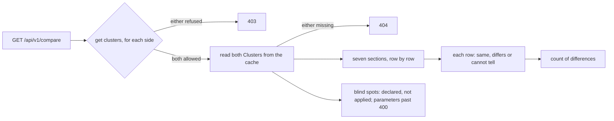
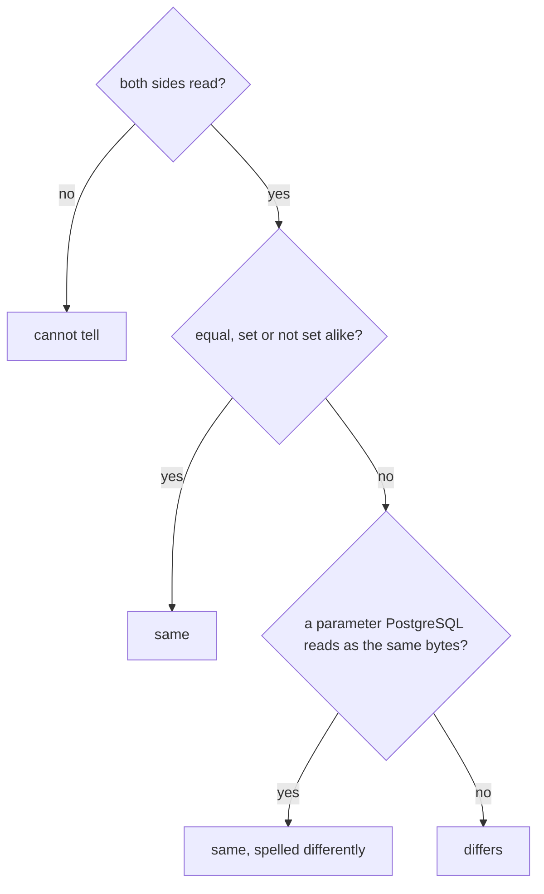

# Comparing two Clusters

`/compare` shows two Clusters side by side: why does staging behave differently
from production, which of two Clusters drifted from the template. Open it from
the cluster list (tick two rows, then **Compare**), from any Cluster
(**Compare with…**, which fills in the first side), from the top bar or from the
command palette. The two Clusters are in the URL
(`/compare?left=team-a/orders&right=team-a/billing`), so a comparison can be
shared.

## How a comparison is made

One request answers the whole page (`Compare` in `internal/console/status/compare.go`,
behind the `/api/v1/compare` handler). Both sides are authorized before either is
read, and both are read from the console's informer cache, never from the API
server at request time.

## What is compared

| Section | Rows |
|---|---|
| Versions and image | PostgreSQL major, `status.image`, `spec.imageName`, `spec.imageCatalogRef`, the detected CloudNativePG version. |
| Instances | `spec.instances`, ready instances, primary update strategy and method, `failoverDelay`, `switchoverDelay`, whether it is a replica Cluster. |
| PostgreSQL parameters | Every key of `spec.postgresql.parameters` on either side, and `shared_preload_libraries`. |
| Resources | CPU and memory requests and limits first, then any other resource (huge pages included). |
| Storage | Data and WAL volume size and storage class, tablespaces. |
| Backup configuration | Method (plugin or in-tree), object store, retention policy, backup target, scheduled backups. |
| Topology | Synchronous replication, pod anti-affinity (enabled, type, topology key), node selector, tolerations, poolers. |

The values are what the Cluster **declares** (its `spec`), plus the few status
fields named in the rows; they are not what PostgreSQL is running with. The
page says so in its blind spots.

## Same, differs, cannot tell

The server decides every row; the page only draws it.

- **Same**: both sides were read and are equal. A memory parameter written in two
  spellings that PostgreSQL reads as the same number of bytes (`2GB` and
  `2048MB`, `131072` and `1GB` for `shared_buffers`) is the same, with the note
  "the same value, spelled differently". Units are parsed exactly as PostgreSQL
  does: case-sensitive `kB`, `MB`, `GB`, `TB`, the parameter's base unit for a
  bare number.
- **Differs**: both sides were read and are not equal; the row is highlighted.
  "Not set" (the default applies) on one side and a value on the other differs.
- **Cannot tell**: one side could not be read by the console, including a list that
  failed this time (a failed read is never "nothing declared"). It is never counted
  as the same: the total of differences includes it, and **Show only differences**
  keeps it.

Values are compared in full; a long value is shortened for display only, after the
comparison. Parameter names are matched case-insensitively, as PostgreSQL matches
them (`Work_Mem` and `work_mem` are one row, with a note); of two spellings on one
side, the later in sorted order wins, as the later line of `postgresql.conf` does.
At most 400 parameter names are compared; any beyond that are counted in a blind
spot.

**Show only differences** hides the rows that are the same.

## Authorization

`GET /api/v1/compare?leftNamespace=&leftName=&rightNamespace=&rightName=` runs the
same access review as every per-Cluster view (`get clusters`) **for each side**,
before reading either. If you may not see one of them, the whole comparison is
refused with 403; a missing Cluster gives 404. The comparison is never half
shown.
