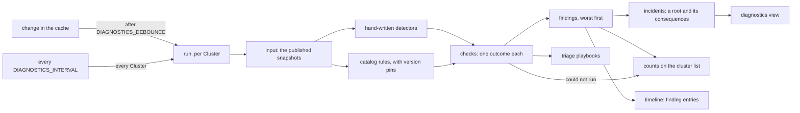
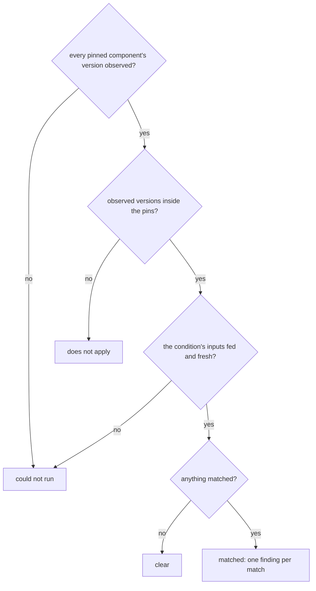
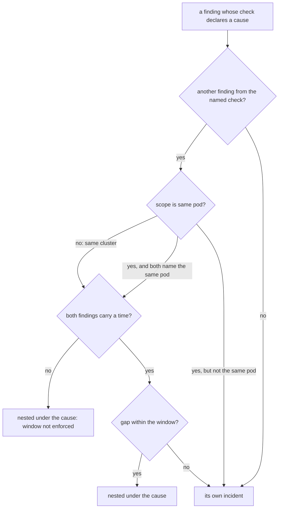
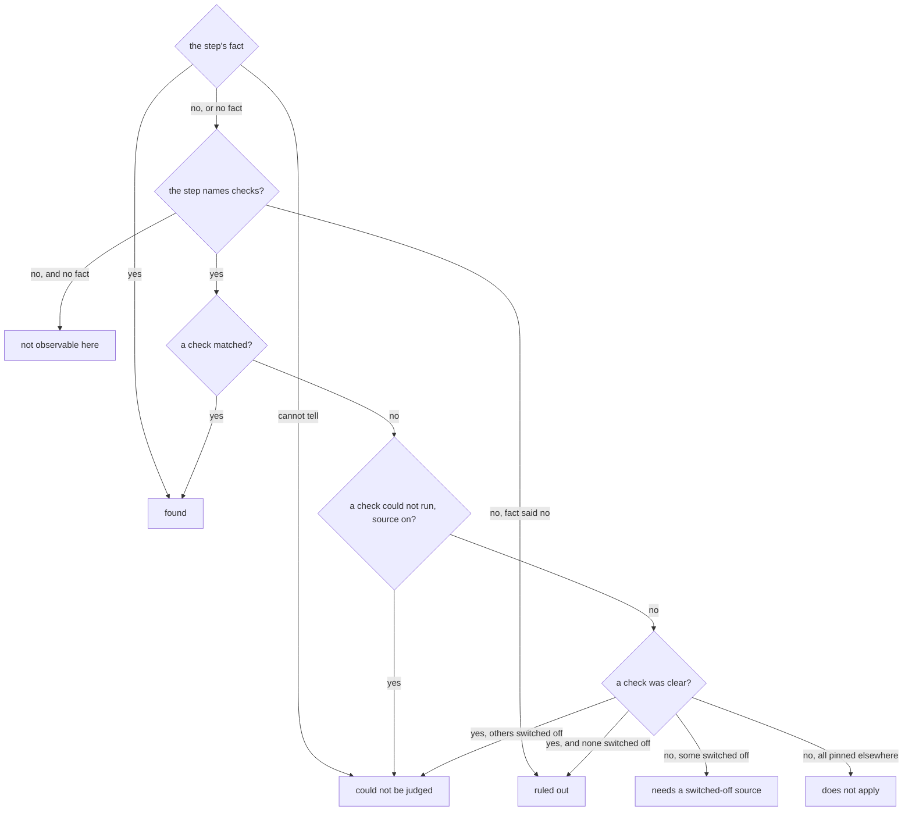

# Diagnostics

The diagnostics view (`/api/v1/namespaces/{namespace}/clusters/{name}/diagnostics`)
and the triage view (`/triage`) turn facts the console already holds into
**findings**: statements about what is wrong and where, each anchored to the claim
it rests on. Every check is a pure function over snapshots the console already
published; a check runs no probe and calls neither the API server nor an exporter.
The catalog is listed on [Checks and playbooks](../reference/checks.md), generated
from the code.

Anyone who may see the Cluster (`get clusters`) may see its diagnostics; the
engine adds no second permission.

## How a run happens

The pipeline below shows what starts a run, what it reads and where its result
goes (`internal/console/diag`, `pkg/diagnose`, `internal/console/status`).

A background runner computes the diagnostics of every watched Cluster. A run
follows every change of the Cluster's inputs (changes within
`DIAGNOSTICS_DEBOUNCE`, 2 s by default, coalesce into one run) and, as a safety net,
every `DIAGNOSTICS_INTERVAL` (1 minute); **a request never triggers a run**. Each run
is published as an immutable snapshot. It also carries a clock for findings: since
when the console has seen each finding in an unbroken series of runs. That clock is a
floor ("unchanged since at least ... when the console first saw it"), not the
moment the fault began. A run that panics is shown as failed, never as "nothing
found". `DIAGNOSTICS_ENABLED=false` turns the runner off.

## The four outcomes

Each check answers one of four ways:

| Outcome | Meaning |
|---|---|
| matched | The check found what it looks for; its findings are listed. |
| clear | Its inputs were readable and nothing matched. |
| could not run | An input it needs is not available: never observed, not permitted, or contact lost and what is held is stale. It rules **nothing** out. |
| does not apply | The rule's version pins exclude the versions observed. Distinct from clear on purpose: the rule ruled itself out, not the failure. |

A catalog rule reaches its outcome in this order (`evaluateRule` in
`pkg/diagnose/rule.go`). A rule with no condition matches on its pins alone. A
hand-written detector has no pins: it either names the input it could not read
(could not run) or reports findings.

Two rules keep an empty screen honest. First, **a stale source reads as
unavailable**, exactly as an unobserved one does: "nothing matched in what was last
seen" is not "nothing is wrong now", and a match found in stale data would be a claim
about the past dressed as the present. Second, an input that is not wired makes its
checks "could not run", never clear. "No findings" therefore means "none of the
checks that could run matched", and the view lists what could not run.

## What feeds the run

| Fed | Not fed (their checks report "could not run") |
|---|---|
| From the informer cache: the Cluster, member pods, events, backups and schedules, poolers, the failover quorum, the primary lease, declared database objects and image catalogs. From the console's runners: the instance-status and metrics sweep, log following (`ALLOW_LOGS`), the API server version, [repository evidence](../evidence-agent.md) and the revision history (`HISTORY_ENABLED`) | Infrastructure (Services, Jobs and VolumeSnapshots are outside the console's Role; PVCs alone would make the Service checks read "no read-write Service"), resource quotas (outside the Role), and pooler pods and pooler metrics (pooler membership needs the ReplicaSet and Deployment chain, also outside the Role) |

A source is fed only when the matching switch is on and the console's Role lets it
read: log checks need `ALLOW_LOGS` and `get pods/log`, the timeline checks need the
history. Whatever is not fed is named on the view, never counted as clear.

## Findings and incidents

A finding carries one of four **severities**, a property of what was found rather
than of the check (the same check can report a note or a critical):

| Severity | Meaning |
|---|---|
| critical | Doing damage now: PostgreSQL is not serving or refuses writes, data is unusable or being lost, or recovery is impossible. |
| high | A protection or redundancy is gone while PostgreSQL still serves: WAL archiving, backups, the object store, a replica able to take over. Nothing is lost yet; left alone it becomes critical. |
| warning | Something an operator should look at. |
| note | Worth knowing; costs nothing. |

The cluster list shows the counts as squares: purple for critical, red for high,
orange for warning, blue for note, and grey for checks that could not run.

A finding names its **subject** (the object it is about, such as `Pod/orders-2`)
and, where its source reports one, the **time** of the observation. A catalog
relation between two checks states three terms:

| Term | Meaning |
|---|---|
| scope | *same cluster* (any two findings) or *same pod* (both must name the same pod). |
| window | The largest gap allowed between the two observations. Enforced only when both findings carry a time; otherwise the relation rests on scope alone rather than inventing an instant. |
| strength | *established mechanism* (something the upstream component documents or implements) or *plausible* (a common pattern the catalog names without a mechanism it can point to). |

A finding nests under its cause only when the relation admits the pair, and the
nested card shows the terms it was admitted on. The test, for each relation the
finding's check declares, against every other finding of the same run
(`Relation.Holds`, then `incidents` in `internal/console/status/diagnostics.go`):

A consequence of a consequence joins the same incident, under its root, and the
incident takes the worst severity among its findings. When a named cause also
matched but on another object or outside the window, the finding stays its own
card instead of a nesting the evidence does not support. The engine knows why the
relation did not hold, but the view does not show that reason yet. Findings that
carry it also have a "what to do" block, labelled as
guidance and kept apart from the evidence, because advice is the one thing no
source reported.

## Triage

Triage reads the same run from the other direction. A **playbook** is an ordered list
of questions for one symptom, in the order the upstream troubleshooting guide asks
them (platform, operator, database, the paths out of it), each answered by checks
that already ran:

| Playbook | Symptom |
|---|---|
| `cannot-connect` | Clients cannot connect |
| `writes-refused` | Writes are refused or hang |
| `backups-not-happening` | Backups are not happening |
| `will-not-come-up` | The cluster will not come up |
| `replica-behind` | A replica is behind or not replicating |
| `operation-stuck` | A switchover, failover or upgrade is stuck |
| `operator-silent` | The operator seems to be doing nothing |

A playbook adds no observation and no judgement; tests refuse a step that names a
check the catalog does not declare. A step is **found** (a check matched), **ruled
out** (every check behind it ran and found nothing, which rules out exactly what
those checks describe), **could not be judged** (a check behind it could not run, and
none matched), pinned to other versions or switched off, or **not observable here**
(nothing the console observes answers it; it hands over the upstream guide's own
command instead). A step is never ruled out on a check that could not run.

Each step is answered in this order (`answer` in `pkg/diagnose/triage/triage.go`).
A step may carry a fact besides its checks, a yes/no statement read from the
input such as "the operator names no current primary"; the fact is asked first.

## Version pins

A claim mined from an operator's source is a claim about specific releases, so
catalog rules carry version pins that state what was actually verified: CloudNativePG
**1.30.0 and 1.30.1**, the supported minor (pgToolBox supports CloudNativePG 1.30 and
later). On any other release, 1.29 included, the pinned rules answer "does not
apply". Versions are **observed, never configured**: CloudNativePG's
from the operator image the instance pods run, PostgreSQL's from the Cluster status,
the Barman Cloud plugin's from its sidecar image tag.

The pins are verified, not merely recorded. The coverage test requires every phase,
condition reason, backup and pooler phase and Warning event reason the verified
releases can write to be either listened for or declined by name in the catalog's
declined list (rendered on the [checks reference](../reference/checks.md)). And
`make verify-pins`, run in CI, fetches each verified CloudNativePG release's source
through the Go module proxy and greps every pinned rule's strings in it, so a
reworded upstream message fails the build instead of silently never matching.
Some of the console's own knowledge expires on a calendar (an end-of-life rule): the
catalog's tests fail once that date passes, naming what to go and read.

The Cluster phase is a free sentence, and a later CloudNativePG minor can keep a
string while changing what it means. The phase table is verified at the 1.30.0 tag.
On any other minor the console detects (the planned 1.31, read at upstream main; a
newer one; 1.29), a phase the table reads as healthy is shown as a warning with the
reason "phase table not verified for CNPG 1.x", on the phase chip and in the
verdict. When no CNPG version is detected, the phase is read against the 1.30
table and a healthy one is capped the same way ("CNPG version not detected").
Cluster conditions follow the same rule: an ok condition (`Ready=True`) of an
unverified or undetected minor is shown as a warning with the reason; fork
condition types rest on the fork pin, not the minor. Phases and conditions that
are not healthy keep their colour, and a phase that is not in the table is shown
as written, as a warning, naming the table it was read against (1.30 for an
undetected or unsupported minor).

## Backup schedule cadence

`backup-cadence` reports a `ScheduledBackup` whose schedule starts a base backup
six times a day or more. CloudNativePG reads a schedule with
`github.com/robfig/cron` v1.2.0 `cron.Parse`: seconds come first and the day of
week is optional. The console uses the same parser at the same version, so
a five-field crontab written from habit reads the way the operator reads it:
`0 2 * * *` means second 0, minute 2, every hour. `make verify-pins` fails when a
verified CloudNativePG release requires another version of the library.

The rate is counted exactly, not estimated. It covers six and five fields, lists,
ranges, steps, names, `?`, and every descriptor: `@hourly` is 24 a day, `@every 30m`
48, and `@daily`, `@weekly`, `@monthly` and `@yearly` once on the days they run.
A schedule that runs on some days only is counted on the days it runs, and the
finding says so. The crontab habit `0 2 * * 1-5` ("weekdays at 02:00") becomes
every hour from January to May, which is 24 backups on each of those days.
A schedule the parser refuses, or one that never fires (`0 0 0 30 2 *`), is not
reported here: `cnpg-schedule-invalid` covers those.

## Adding to the catalog

A new check is a catalog rule or a detector in `pkg/diagnose`, with a golden
scenario; `make catalog-docs` regenerates the reference page and a test keeps it equal
to the catalog. Do not edit `docs/site/docs/reference/checks.md` by hand.

## Configuration advisor

PostgreSQL sizes itself from its parameters and cannot see the memory limit of
the container it runs in. When its processes together pass that limit the kernel
kills the container, and CloudNativePG restarts the instance (a killed primary is a
failover). Six checks of the PostgreSQL layer weigh the Cluster's
`spec.postgresql.parameters` against `spec.resources` of the postgres container:

| Check | Severity | Looks for |
|---|---|---|
| `pg-memory-over-limit` | warning | `shared_buffers + wal_buffers + max_connections × work_mem + autovacuum_max_workers × autovacuum memory` above `resources.limits.memory`: the OOM-kill risk |
| `pg-shared-buffers-over-limit` | high | the shared segment alone at or above the limit |
| `pg-effective-cache-size-over-limit` | note | `effective_cache_size` above the limit (the page cache is charged to the container) |
| `pg-huge-pages-missing` | high | `huge_pages = on` without a `hugepages-*` reservation large enough for the shared segment: the next start fails |
| `pg-huge-pages-unused` | note | a reservation PostgreSQL will not use (`huge_pages = off`, or `try` with too small a reservation) |
| `pg-memory-parameter-unparsable` | warning | a memory parameter PostgreSQL would refuse |

How the numbers are read:

- **Units as PostgreSQL reads them**: `B`, `kB`, `MB`, `GB`, `TB`, case-sensitive,
  1024 per step (`1gb` and `1 KB` are refused, as the server refuses them); a bare
  number is in the parameter's own unit (8 kB pages for `shared_buffers`,
  `wal_buffers` and `effective_cache_size`, kB for `work_mem`); `0x` and leading-zero
  octal integers and fractions (`1.5GB`) are accepted as the server accepts them.
- **Defaults** apply to what is not declared, and the evidence says so: `shared_buffers`
  128MB, `work_mem` 4MB, `maintenance_work_mem` 64MB, `max_connections` 100,
  `autovacuum_max_workers` 3, `effective_cache_size` 4GB, `huge_pages` try.
  `wal_buffers = -1` (the default) is `shared_buffers / 32` counted in 8 kB pages
  (integer division), at least 8 pages (64 kB) and at most
  one WAL segment (`bootstrap.initdb.walSegmentSize`, 16 MB by default);
  `autovacuum_work_mem = -1` is `maintenance_work_mem`, capped at 1 GB per worker
  before PostgreSQL 17.
- **Ranges as PostgreSQL enforces them**: a value outside the range of `guc_tables.c`
  (`max_connections` and `autovacuum_max_workers` up to 262143, `work_mem` up to
  2147483647 kB, `shared_buffers` at least 128 kB, …) is reported as one PostgreSQL
  would refuse, and the checks that need it could not run. A value longer than the
  console keeps (64 bytes) is not read, never parsed from a prefix.
- **The memory limit** is the Cluster's `resources.limits.memory`. When the Cluster
  declares none, a LimitRange may still set one on the Pods: the advisor reads the
  postgres container's limit on the instance Pods (the smallest, if they differ). With
  no limit declared and no Pod observed, the checks could not run; with Pods that carry
  no limit either, there is nothing to compare.
- **Huge pages**: Kubernetes accounts huge pages apart from the memory limit, so when
  `huge_pages` is `on` and the reservation holds the shared segment, the segment is
  left out of the memory comparison (an instance with `on` does not start otherwise).
  With `try` PostgreSQL may have fallen back to normal pages, charged to the limit, so
  the segment stays in. `shared_buffers + wal_buffers` is a floor: the real segment
  (`shared_memory_size`) is larger and not reported, so a reservation less than
  10 % (at least 32 MiB) above the floor is "cannot tell" for the huge-page checks.
- **The estimate is the conventional one, not a bound**: a query can use `work_mem`
  several times (each sort or hash node, hashes up to `hash_mem_multiplier` times,
  per parallel worker), while most connections use far less.

What the advisor cannot see, and says: the values are **declared intent**, since
`/pg/status` reports no setting (a change waiting for a restart is judged as if
applied); whether the nodes have free huge pages (the console reads no Node; an
unsatisfiable reservation shows as a Pending pod in the scheduling checks). Without
a memory limit the checks have nothing to compare and stay clear. An unparsable
memory parameter makes the checks that need it "could not run", never clear.
