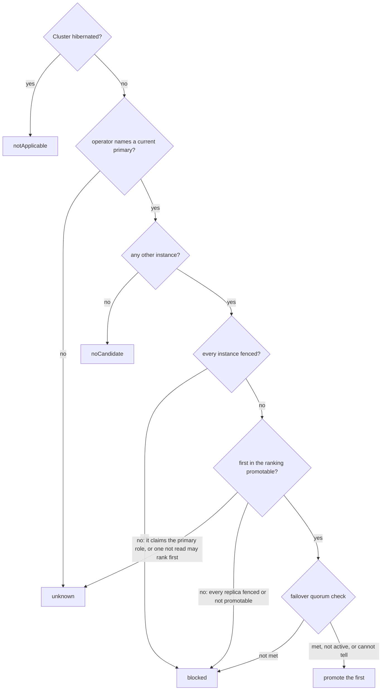
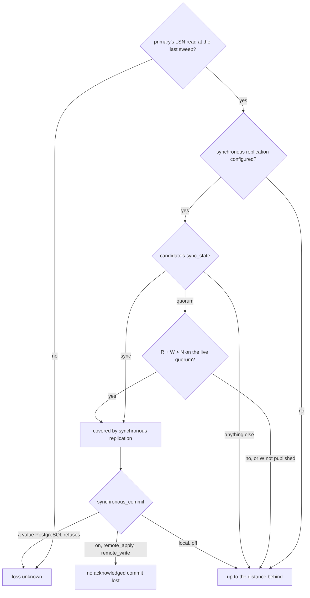

# Failover rehearsal

The Replication view carries a panel titled **If the primary failed now**, and the
Overview carries one line of it. It answers the questions a DBA asks before
trusting a failover: which replica the operator would promote, how far behind it
is, whether a committed transaction could be lost, and what would stop or delay
the promotion. It is computed in Go (`pkg/cnpgstatus.Rehearse`) from readings the
console already holds; it triggers nothing and probes nothing.

## The decision, step by step

The panel's outcome comes out of these questions, in this order (`Rehearse` in
`pkg/cnpgstatus/failover.go`). Each outcome carries a class, which colours the
panel.

| Outcome | Class | When |
|---|---|---|
| `promote` | from the data loss below: ok, warning or unknown | A replica would be promoted. An ok class turns warning when the answer is not certain (an instance not read, a quorum the console cannot judge, an unreadable fencing annotation) or when the candidate runs on the primary's node. |
| `blocked` | critical | Every instance is fenced, every replica is fenced or cannot be promoted, or the failover quorum check fails. |
| `noCandidate` | warning | No other instance: the Cluster has no primary until the old one is back. |
| `unknown` | unknown | No primary named, or the console cannot tell which replica the operator would pick. |
| `notApplicable` | info | The Cluster is hibernated: there is no primary to lose. |

The notes under the sentence, in reading order: the failover quorum does not
apply to a replica cluster; `spec.failoverDelay` when it is set; a replica
cluster promotes a new designated primary; an unreadable
`cnpg.io/fencedInstances` annotation; and the instances the console could not
read.

## The candidate: CloudNativePG's own order

The ranking follows the order the operator sorts instances in before it elects a
new primary (`PostgresqlStatusList.Less` in CloudNativePG):

1. instances whose status could not be read go last, fenced instances after the
   rest;
2. among replicas, the one that has **received** the most WAL comes first, then
   the one that has **replayed** the most, then the pod name.

When every instance is fenced, the operator promotes none; the panel says so and
the outcome is `blocked`. When the first replica the console read is fenced but a
replica it could not read is not, the operator may well promote that one: the
outcome is `unknown`, not `blocked`. A replica that reports itself as a primary is
named: the operator would sort it first, and what it does then is not guessed.

## Distance behind

The distance is the primary's current LSN minus the candidate's received LSN, in
bytes, both from the console's last sweep of `/pg/status`. When the received LSN
is not reported, the replay LSN is used and the figure is an upper bound. The two
positions are read at slightly different instants, so a small negative difference
is shown as zero.

## Data loss: claimed only when synchronous replication is satisfied

"No acknowledged commit lost" is stated only when one of these holds at the last
reading:

- the primary reports the candidate with `sync_state = sync`; or
- the primary reports it with `sync_state = quorum` **and** the live quorum
  holds: R + W > N, where N is the standbys the primary reports in quorum, W the
  required number (from the `FailoverQuorum` when present, else the explicit
  `synchronous.number`) and R those of N read in good standing.

and, in both cases, `synchronous_commit` (from `spec.postgresql.parameters`; CloudNativePG
does not set it) makes commits wait for standbys:

- `on` (the default) or `remote_apply`: the claim stands;
- `remote_write`: the claim stands, qualified: the standby had written the WAL but not
  flushed it, so a crash of its host at the same moment would still lose it;
- `local` or `off`: commits do not wait for any standby, so the loss is "up to the
  distance behind" whatever `sync_state` says;
- a value PostgreSQL would refuse: the loss is unknown.

Even then the claim is "for transactions using the cluster default": a role, a database,
a session or a transaction can lower `synchronous_commit`, which the console cannot see.
The panel lists this as a blind spot.

The claim is a fact about one sweep of `/pg/status`, so the panel shows that sweep's
age next to the data-loss answer ("as of the sweep ..."). When the last sweep is older
than three sweep intervals (the console's one staleness rule for the sweep, also used by
the "Instance self-reports" contributor), the rehearsal is marked stale and "none"
becomes "unknown".

N for the live quorum is the `FailoverQuorum`'s `standbyNames` when the object exists.
Without it, N is an upper bound (every replica of the Cluster, the declared
`standbyNamesPre`/`standbyNamesPost`, and the standbys the primary reports in quorum),
because a disconnected member is missing from the primary's `pg_stat_replication`. In
legacy mode (`maxSyncReplicas`) W is computed by the operator and not published, so
the panel says it cannot tell.

The same rules as a flow (`rehearsalLoss` and `liveQuorum`):

In every other case the loss is "up to the distance behind". A zero distance is worded
as "no WAL missing at the last sweep (asynchronous, so not guaranteed)", or "not proven
synchronous" when synchronous replication is configured, never as zero loss.

## Failover quorum

When `spec.postgresql.synchronous.failoverQuorum` is set, the operator refuses to
promote unless R + W > N holds on the `FailoverQuorum` object's status
(`standbyNames` is N, `standbyNumber` is W, R the members with a readable status
and a ready pod). The panel shows the three figures. A member the **console**
could not read is counted as "maybe": the operator reads the instances itself, so
the answer is "cannot tell" rather than "not met". A missing object or an empty
status means the operator would not promote, and the outcome is `blocked`. The
check does not apply to a replica cluster: the operator does not evaluate it there.

## Placement

The primary's node and each replica's node come from `pod.spec.nodeName`. A
replica on the primary's node is flagged: losing that node loses both.

The console reads no `Node` objects, so it **cannot see zones**
(`topology.kubernetes.io/zone`). This is listed as a blind spot on the panel,
not guessed from node names.

## What it is not

- It is the console's reading, not the operator's. At a real failure the operator
  reads the instances itself, after `spec.failoverDelay`, and the positions will
  have moved. When an input the operator would use is not readable by the
  console, the panel says the result is not certain.
- It does not feed the Cluster's verdict: a rehearsal is a projection, not a
  fault.
