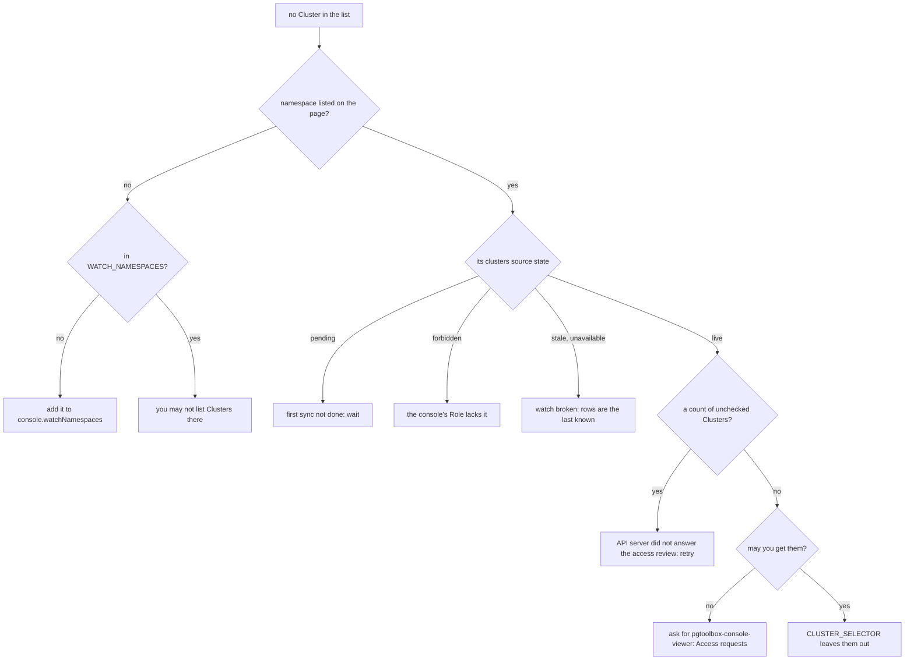
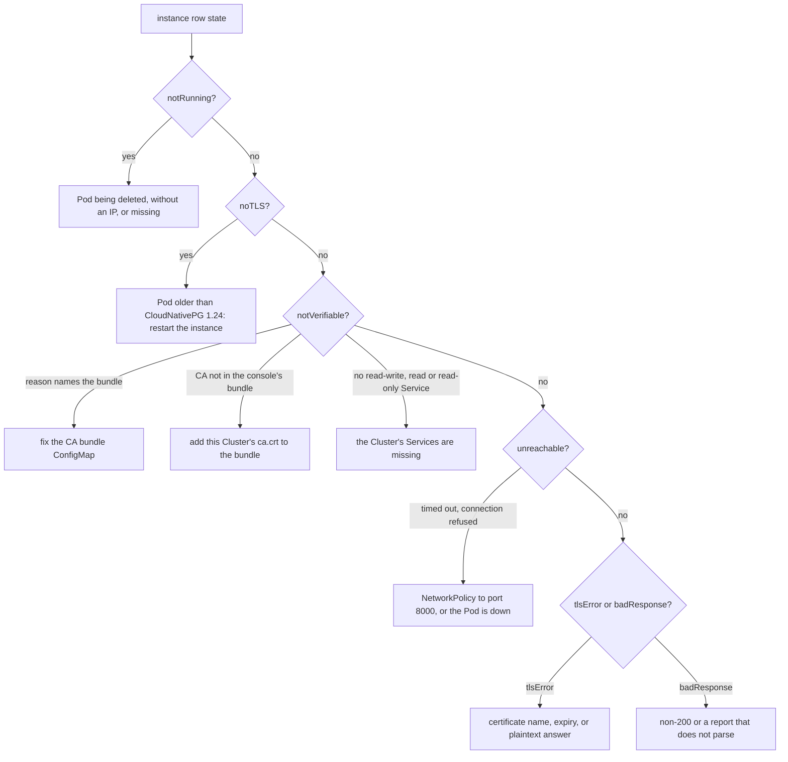
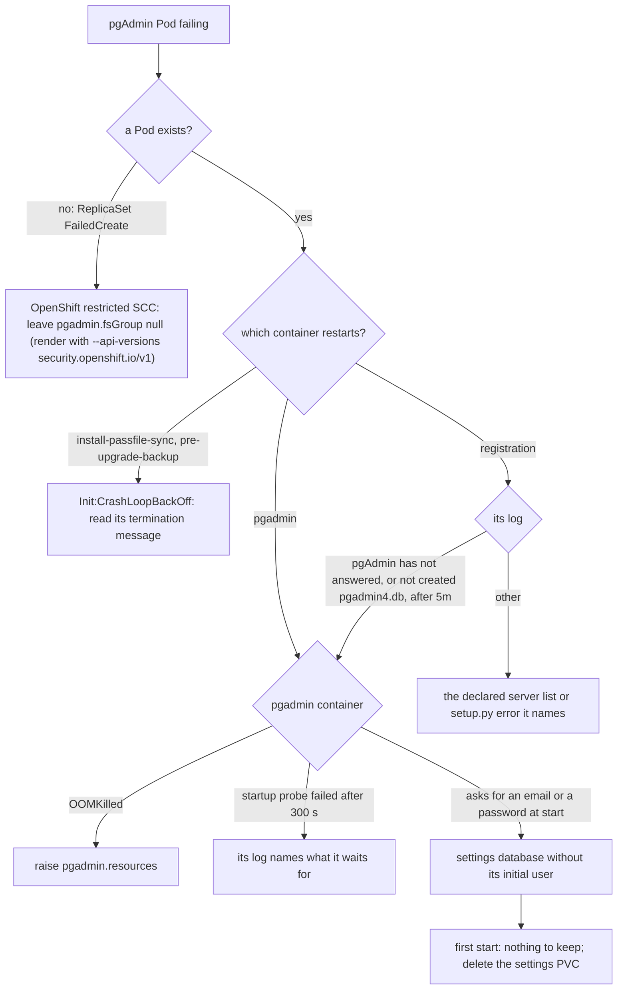
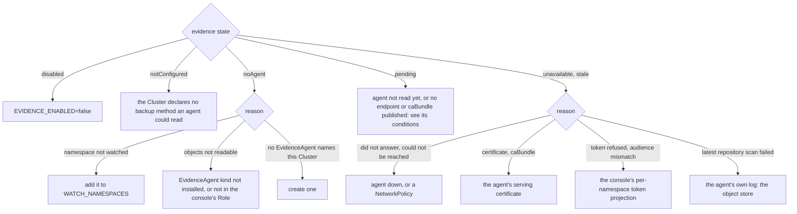
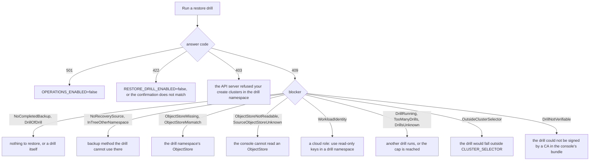
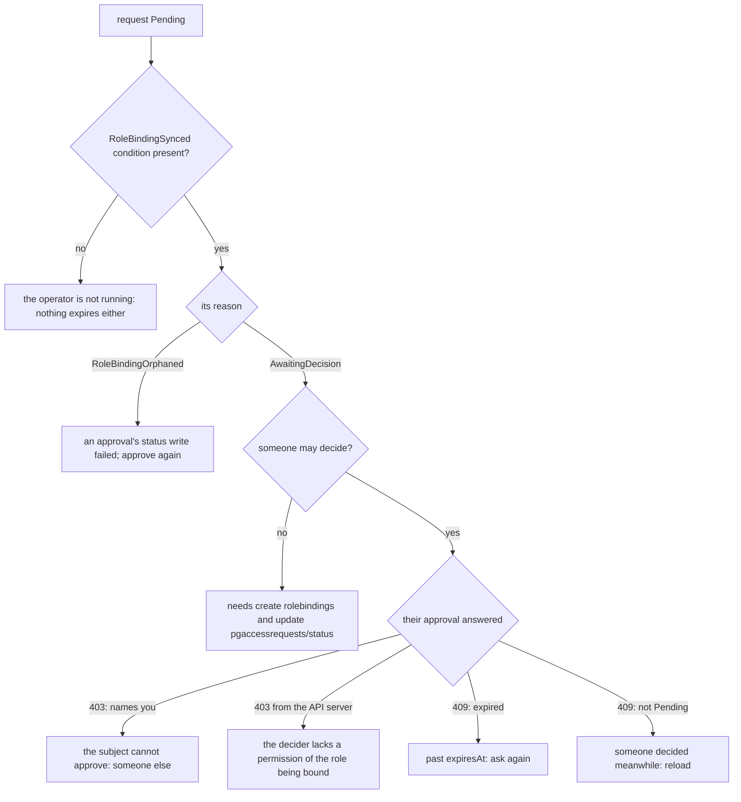

# Troubleshooting

Decision trees for the questions that come up most. Each step names what to look
at: a condition reason (`kubectl get <kind> -o yaml`, under `status.conditions`),
a state the console shows, a metric or a log line. The wording in quotes is the
text the console or the operator writes.

## The console shows no Clusters

The cluster list holds the Clusters of the watched namespaces, filtered by
`CLUSTER_SELECTOR`, and then by what **you** may `get`: the console asks the API
server for each Cluster, with your token. Each namespace shows the state of its
Cluster watch to anyone who may list Clusters there.

- **forbidden**: the console's own ServiceAccount may not list or watch the kind.
  `pgtoolbox_console_cache_informer_calls_total{outcome="forbidden"}` on the
  [console's metrics](../console/metrics.md) names the source. Reinstall or fix the
  console's Role in that namespace.
- **may you get them**: `kubectl auth can-i get clusters.postgresql.cnpg.io -n <ns>`
  as yourself answers the same question the console asks. See
  [Authorization](../console/authorization.md).
- **CLUSTER_SELECTOR** (`console.clusterSelector`) narrows the Clusters the console
  watches at all; a Cluster without the labels is not in its cache.

## A Cluster is "not verifiable" or "unreachable"

These are states of the console's read of each instance's `/pg/status`
(`internal/console/sweep`). The instance row says which state, with its reason.
The checks before any connection come first; a connection that fails is then
classified by its error.

- **The bundle's reasons**: "no CA bundle configured
  (console.instanceStatus.caBundleConfigMap)", the file does not exist, is not
  readable, exceeds 1 MiB, holds a block that is not a certificate, holds a
  certificate that does not parse, or holds none yet. Every instance of every
  Cluster is then not verifiable, and the console logs "instance status CA bundle
  unusable" when that happens. The procedure to build it is on
  [Configuration](../console/configuration.md#the-instance-ca-bundle).
- **CA not in the console's bundle**: the bundle is fine but lacks this Cluster's
  CA. For a `PgToolBoxConsole`, the operator mirrors it: `status.instanceCABundle.missing`
  of the `PgToolBoxConsole` says why it could not (the CA Secret is absent, has no
  `ca.crt`, or holds no certificate), and `InstanceCABundleComplete` is `False`.
  For a chart-installed console, typically a Cluster created after the bundle was
  built.
- **tlsError on every instance of a Cluster that used to be `ok`**: with a bundle
  you fill yourself, the copied CloudNativePG CA has probably expired (it is valid
  90 days and renewed before that, so a copy made once goes stale); rebuild the
  bundle, or let something keep it current
  ([options](../console/configuration.md#console-installed-by-the-pgtools-chart)).
- **unreachable**: check the console's NetworkPolicy egress to the instance pods
  (`8000` for the status, `9187` for the metrics; see
  [NetworkPolicy](../console/networkpolicy.md)) and the instance's own policies.

None of these is retried over a weaker transport: there is no insecure mode.

## A PgAdmin is not Ready

`Ready` copies the first aspect that is not `True`, in this order:
`ConfigurationValid`, `WorkloadReady`, `ExposureReady`, `ServersSynced`
(`internal/operator/pgadmin/reconcile.go`). So `Ready`'s reason already names the
aspect to look at. The full vocabulary is on
[Conditions and reasons](../operator/conditions.md#pgadmin).

```mermaid
flowchart TB
  ready{"Ready reason"} -->|ReconcileError| oplog["the message carries the error; operator log"]
  ready -->|ReconciliationPaused| paused["remove the reconcile: skip annotation"]
  ready -->|"Reconciling, Initializing"| wait["not evaluated yet at this generation: wait"]
  ready -->|"a ConfigurationValid reason"| spec["fix the spec or its references; a stall waits for that change"]
  ready -->|"RolloutInProgress, PodNotReady"| rollout["the Pod is on its way: wait"]
  ready -->|"PodUnschedulable, ImagePullFailed, CrashLoopBackOff"| podfact["the Pod's own fact: kubectl describe pod"]
  ready -->|"UpgradeBackupRunning, UpgradeBackupFailed"| backup["pre-upgrade backup Job; the old image keeps running"]
  ready -->|ConfigDatabaseNotReady| cfgdb["CloudNativePG has not applied the configDatabase role or database"]
  ready -->|"NotAdmitted, NotAccepted, RouteAPIUnavailable, GatewayAPIUnavailable"| expose["the Route, Ingress or HTTPRoute, or its API"]
  ready -->|"PgAdminNotRunning, RegistrationRunning"| reg["registration waits for pgAdmin, or runs"]
  ready -->|RegistrationFailed| regjob["the registration Job's fact is in the message"]
```

`ConfigurationValid` reasons include `ClusterNotFound`, `NoClusterSelected`,
`PoolerNotFound`, `TooManyServers`, `SecretNotFound`, `ImageNotAllowed`,
`ResourceNotOwned` and `GrantMissing` (a cross-namespace Cluster no `PgAdminAccess`
grants). `PgAdminEgressConfined` never enters `Ready`.

## A team's pgAdmin crash-loops on its first start

This is the pgAdmin of the `pgtools` chart, without the operator
([pgAdmin without the operator](../install/pgadmin-without-operator.md)). Its Pod
runs two init containers, the `registration` native sidecar, `pgadmin`, and
`passfile-sync`. Start from which one restarts (`kubectl describe pod`).

- **The registration waits for pgAdmin.** It may run `setup.py` only after pgAdmin
  answers its ping (`--wait-ready http://127.0.0.1:8080/misc/ping`, `--wait 5m`, the
  startup probe's budget). A `setup.py` run while pgAdmin was still creating its
  database left a database without the initial user, on which pgAdmin asks for one
  on a terminal it does not have, and crash-loops for good on that volume. A chart
  whose `registration` container lacks `--wait-ready` can still do that; upgrade
  the chart first, then start from an empty settings volume.
- **Reading a failed container**: `pre-upgrade-backup` and `registration` use
  `terminationMessagePolicy: FallbackToLogsOnError`, so `kubectl get pod -o yaml`
  shows their error under `lastState.terminated.message`; for the others, read
  `kubectl logs --previous -c <container>`.

## Backups or evidence show "unavailable"

The backups screen's evidence block comes from the
[evidence agent](../evidence-agent.md) that names the Cluster
(`internal/console/status/evidence.go`, `internal/console/evidence`). Its state and
reason say which link is missing. "stale" is the same failures with an earlier
good answer kept and marked old.

- **pending with "has not published status.endpoint / status.caBundle yet"**: the
  `EvidenceAgent` is not Ready. Its conditions say why: `ConfigurationValid`
  (`BarmanPluginNotConfigured`, `ObjectStoreNotFound`, `UnsupportedObjectStore`, …),
  `ServingCertificateReady` (`ServiceCAPending` on OpenShift) or `WorkloadReady`.
- **stale with "rollout in progress"**: the agent answered from another
  configuration than its `status.producerEpoch`; it clears when the rollout ends.
- **Other reasons the console names**: the console's ServiceAccount may not get this
  `EvidenceAgent`; the answer does not follow the evidence contract or exceeds its
  size bound; the agent describes another Cluster or repository; the status was
  written by another field manager than the operator (the console does not call such
  an agent).
- **The recovery window** can also be unknown on its own: "the evidence agent has
  not completed a scan of the repository yet", or "does not claim observed recovery
  coverage for this repository".

## A restore drill is refused

A drill is refused before anything is written, and the answer says why
(`internal/console/operations/drill.go`). The Backups screen shows the same
blockers on the offer, so the button already says what is missing.

Each blocker's text names its source (`Backup.status.phase`, the `ObjectStore`, the
`RESTORE_DRILL_MAX_CONCURRENT` cap, …). The rules behind them are on
[Restore drills](../console/restore-drills.md).

## An access request stays pending

The operator reports the request's state in `RoleBindingSynced`; the console
decides nothing by itself, it shows a decision button only to someone the API
server lets decide (`internal/console/api/access.go`,
`internal/operator/accessrequest`).

- **Who may decide**: `pgtoolbox-console-approver` or the namespace's `admin`, in the
  request's namespace, and never the person the request names (their user, their
  ServiceAccount or a group they are in). See
  [Access requests](../console/access-requests.md#who-may-do-what).
- **The escalation check** is the API server's: a decider can only bind a
  ClusterRole whose every permission they already hold in that namespace.
- **Expiry**: a pending request past `spec.expiresAt` turns `Expired` when the
  operator next reconciles it; the console refuses to approve it in the meantime.
