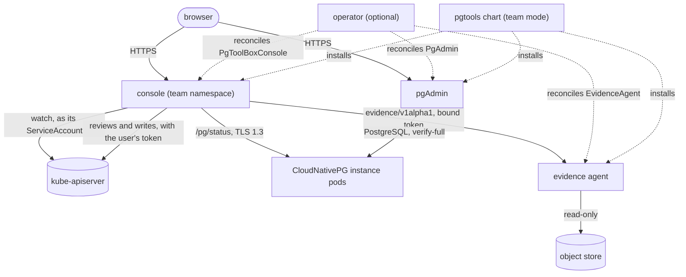

import ThemedImage from '@theme/ThemedImage';
import useBaseUrl from '@docusaurus/useBaseUrl';

# What pgToolBox is

pgToolBox gives the teams that run [CloudNativePG](https://cloudnative-pg.io)
clusters three things, each a separate Kubernetes workload with its own failure
domain:

| Component | Runs as | One per | What it does |
|---|---|---|---|
| [console](console/index.md) | a Deployment installed by the `pgtools` Helm chart, kustomize, or the operator from a [`PgToolBoxConsole`](operator/console.md) | team namespace | Shows the real state of the CloudNativePG clusters of its [watched namespaces](console/configuration.md#watched-namespaces), lets people with the right RBAC [act on them](operations.md). |
| [operator](operator/index.md) (optional) | a Deployment, installed once per Kubernetes cluster | Kubernetes cluster | Reconciles [`PgAdmin`](operator/pgadmin.md), [`EvidenceAgent`](operator/evidenceagent.md), [`PgToolBoxConsole`](operator/console.md) and [`PgAccessRequest`](console/access-requests.md). |
| [evidence agent](evidence-agent.md) | a Deployment the operator creates from an `EvidenceAgent`, or the `pgtools` chart deploys without the operator | backup repository | Reads a Barman Cloud or pgBackRest repository (it only ever reads) and tells the console what the repository holds. |

The top of one Cluster's page in the console: the health verdict with where each
fact was read, and the drawing of how its instances, poolers, backups and storage
are wired. The [console tour](console/tour.mdx) walks through every screen.

{/* The screenshot is a full page; the box shows its first 1,480 of 3,386 pixels. */}

  <ThemedImage
    alt="The console, one Cluster's overview: overall health ok with phase, ready condition, instances, WAL archiving, last backup and diagnostics, each with its source; below, the wiring of poolers, services, primary and replicas, scheduled backup, object store and volumes"
    sources={{
      light: useBaseUrl('/img/screens/overview-healthy-light-1440.png'),
      dark: useBaseUrl('/img/screens/overview-healthy-dark-1440.png'),
    }}
    style={{display: 'block', width: '100%'}}
  />

The pgAdmin image the operator runs lives in its own repository
([github.com/fyannk/pgAdmin](https://github.com/fyannk/pgAdmin), image
`ghcr.io/fyannk/pgadmin`); nothing in this site documents that
image beyond how the operator uses it.

The diagram shows the run-time paths; the operator and the `pgtools` chart are
two ways to put the same three workloads in a namespace
([deployment models](architecture/deployment-models.md)).

[Architecture](architecture/index.md) has every hop with its port and identity,
the console's internals and the trust boundaries.

## The one rule

The console does not keep its own idea of who people are or what they may do.
It signs people in, then asks the Kubernetes API server, with a
SelfSubjectAccessReview sent with the person's own token, whether *this person* may `get` *this* Cluster, read *this*
pod's log, or patch *this* Cluster. Every write is sent to the API server with
the person's own token, so the API server authorizes it and its audit log names
the person. See [Authorization](console/authorization.md) and the
[security model](security.md).

There is no cluster-scoped console. A console is bounded by its namespace: its
authority is Roles in the namespaces it watches (at most sixteen), and nothing
cluster-scoped. "One console that sees every
cluster" is not a supported shape; the answer is one console per team.

## What is supported

| | |
|---|---|
| CloudNativePG | 1.30.1 and later (1.29 and 1.30.0 are not supported). The diagnostics catalog is pinned to the releases whose source it was verified against (1.30.0 and 1.30.1); on another release its pinned checks answer "does not apply". The end-to-end matrix runs 1.30.1. |
| Kubernetes | 1.34 or newer, as CloudNativePG 1.30 supports 1.34 to 1.36 (the charts' `kubeVersion` and the OLM bundle's `minKubeVersion`; the CRDs' CEL rules are tested on 1.34). The end-to-end matrix runs 1.34 and 1.36. |
| Platforms | Vanilla Kubernetes and OpenShift. OpenShift has no CI target: its sign-in is covered by a [manual checklist](console/openshift.md) run before a release. |
| Backups | Barman Cloud repositories (the barman-cloud plugin's `ObjectStore` or the in-tree `spec.backup.barmanObjectStore`) on S3, Azure Blob or Google Cloud Storage; pgBackRest repositories (format 5) written through Dalibo's or Opera's CNPG-I plugin, on S3 or Azure Blob. See [the supported profile](operator/evidenceagent.md#the-supported-profile) and [Clusters backed up with pgBackRest](guides/pgbackrest.md). |

## Where to start

1. [Install](install/index.md) the console in a team namespace (the `pgtools`
   chart, which can also run evidence agents and pgAdmin), and the operator if
   you want those declared as custom resources.
2. Choose how people [sign in](console/authentication.md).
3. Bind the [two user ClusterRoles](console/authorization.md#the-two-clusterroles) to
   the people who should see or operate clusters.

The pages of [Reference](reference/api.md) are generated from the code: the CRD
fields from `api/v1alpha1`, the diagnostics checks from the catalog.
