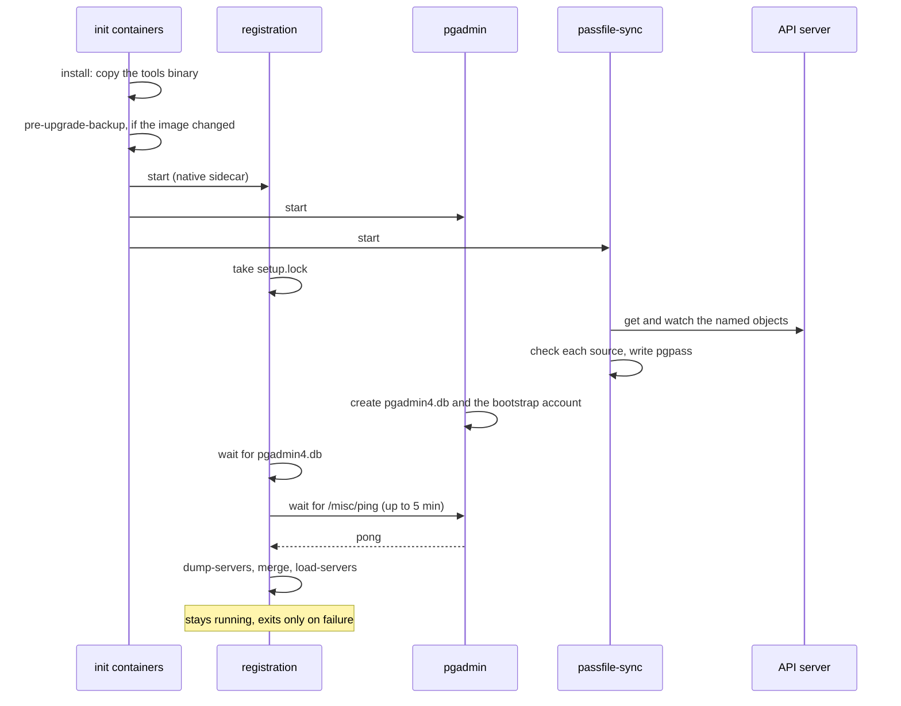

# pgAdmin without the operator

The `pgtools` chart can install one pgAdmin for a team, in the team's namespace,
with namespace-admin rights only: no CRD, nothing cluster-scoped, no operator. It
is off by default (`pgadmin.enabled: false`).

The operator's `PgAdmin` works the Clusters out by itself. The chart cannot: it
does not see the cluster when it renders, and it does not guess. So the servers
are **declared**, and each one says where its credential comes from. A sidecar in
the pgAdmin Pod then checks that source against the live Cluster or DatabaseRole
before it uses it.

## Install

```bash
kubectl -n team-a create secret generic pgadmin-oidc --from-literal=client-secret=...

helm upgrade --install console oci://ghcr.io/fyannk/charts/pgtools \
  --version 0.1.0 --namespace team-a -f pgadmin.yaml
```

```yaml title="pgadmin.yaml"
console:
  pgadmin:
    url: https://pgadmin.example.org   # the console's link to this pgAdmin
pgadmin:
  enabled: true
  admins: [alice@example.org]
  auth:
    provider: oidc
    oidc:
      issuerURL: https://idp.example.org/realms/corp
      clientID: pgadmin
      clientSecret: {existingSecret: pgadmin-oidc}
  exposure:
    type: ingress
    host: pgadmin.example.org
  servers:
    - cluster: orders
      endpoint: rw                       # rw | ro | r | pooler:<name>
      caConfigMap: orders-ca-crt         # the server CA, ca.crt only
      credentials:
        application: {secret: orders-app}
    - cluster: orders
      endpoint: ro
      caConfigMap: orders-ca-crt
      credentials:
        databaseRole: {name: orders-reporting, secret: orders-reporting-password}
    - cluster: billing
      endpoint: rw
      database: billing
      user: billing_owner
      caConfigMap: billing-ca-crt
      credentials: {secret: billing-owner}
    - cluster: reporting
      endpoint: rw
      database: app
      user: alice
      caSecret: reporting-server-ca         # or a Secret holding the CA
      credentials: none                  # pgAdmin asks for the password
```

An `ro` server needs a replica. CloudNativePG's `<cluster>-ro` Service routes to
the replicas only: on a Cluster of one instance it has no endpoints and pgAdmin
gets `Connection refused`; a Cluster that lists `ro` or `r` in
`spec.managed.services.disabledDefaultServices` has no such Service at all. The
chart applies the rule of the operator's `PgAdmin`, which
[skips such an entry](../operator/pgadmin.md#which-clusters): `passfile-sync`,
which watches the declared Clusters, withholds the server, and the
`registration` sidecar does not register it (or removes it). Both log the
server's name and the reason (`no replica: the Cluster has one instance`, `the
Cluster disabled its ro Service`). The rule reads the Cluster's spec, not its
readiness: a replica that restarts does not make the server come and go. Scale
the Cluster to two instances, or enable the Service, and the server is
registered within seconds, without a Pod restart. The console's topology view
marks an `ro` Service with no replica behind it.

On OpenShift, `auth.provider: openshift` puts an oauth-proxy in front of pgAdmin
(it needs `exposure.type: route`; `fsGroup` defaults to none with it, or wherever the API
server serves `security.openshift.io/v1`, since the restricted SCC assigns the range, and
to 5050 elsewhere; `fsGroup: 0` forces none).
Who may pass it is an OpenShift SubjectAccessReview: by default, anyone who may
`get secrets` in the release namespace. `auth.openshift.sar` replaces that
question (the JSON oauth-proxy's `--openshift-sar` takes), for example
`{"namespace":"team-a","resource":"services","verb":"get"}` to admit whoever may read Services there.
There is no local password login in either mode.

## Credentials: named by you, checked live

`credentials` is required on every server; there is no default.

| `credentials` | Checked by the sidecar | User and database |
|---|---|---|
| `application: {secret: S}` | the Cluster designates `S` (`<cluster>-app`, or the `secret` of its `recovery`, `pg_basebackup` or `initdb` bootstrap) | from the Cluster's bootstrap |
| `superuser: {secret: S}` | `enableSuperuserAccess: true`, and `S` is `<cluster>-superuser` or `spec.superuserSecret` | `postgres` / `postgres` |
| `databaseRole: {name: R, secret: S}` | the DatabaseRole `R` names `S` as its password Secret, is applied at its current generation, and `S` is at the version CloudNativePG applied | from the role; database `postgres` unless declared |
| `secret: S` | nothing to check against | `user` and `database` required |
| `none` | no Secret: pgAdmin asks | `user` and `database` required |

A server's CA Secret (`caSecret`, or the derived `<cluster>-ca`) must also be the
Cluster's server CA, and a Pooler endpoint must belong to the Cluster.

## The server CA

libpq verifies every server (`verify-full`) against the Cluster's server CA. Each
server takes it from one of:

- `caConfigMap: <name>` (preferred): a ConfigMap holding only `ca.crt`, mounted
  into `passfile-sync`. The Pod's Role then names no CA Secret for that server.
  The sidecar cannot compare it with the Cluster (it may not read the CA Secret);
  `verify-full` is the check. The kubelet keeps the file current and the sidecar
  follows it without a restart. Until the ConfigMap exists the server has no
  service section and the sidecar's log says so.
- `caSecret: <name>`: a Secret the sidecar reads by name, checked against the
  Cluster's `spec.certificates.serverCASecret`.
- Neither (**deprecated**): the chart derives `<cluster>-ca` and grants the
  sidecar `get` and `watch` on it. That Secret is not named in your values, and
  the one CloudNativePG generates also holds `ca.key`, the CA's signing key: the
  sidecar copies only `ca.crt`, but its Role could read the key. `helm install`
  and `helm upgrade` print a warning naming each such Secret. The next minor
  release requires `caSecret` or `caConfigMap` on every server.

The two fields are exclusive, and all the servers of one Cluster name the same
`caConfigMap`. To make the ConfigMap from CloudNativePG's CA:

```bash
kubectl -n team-a get secret orders-ca -o jsonpath='{.data.ca\.crt}' | base64 -d > ca.crt
kubectl -n team-a create configmap orders-ca-crt --from-file=ca.crt=ca.crt
```

CloudNativePG renews its self-signed CAs (every 90 days by default), and a copy
made once does not follow: keep the ConfigMap current with trust-manager, or give
the Cluster one long-lived `serverCASecret`.

When a check fails (the Cluster was recreated with another bootstrap, the role
points elsewhere or is not applied yet, a Secret is missing) the server stays
listed, pgAdmin asks for the password, and the sidecar logs the server's name and
the reason, never a value:

```bash
kubectl -n team-a logs deploy/console-pgadmin -c passfile-sync
```

The password line appears as soon as the state allows it, and a rotated password
reaches pgAdmin within seconds: the sidecar watches each named object.

The chart's README has the table of which Secret CloudNativePG creates for which
bootstrap (`initdb`, `initdb.secret`, `recovery`, `pg_basebackup`, replica
clusters, `enableSuperuserAccess`).

## What pgAdmin may read

The Pod's ServiceAccount has one Role: `get` and `watch` on exactly the Clusters,
DatabaseRoles, Poolers and Secrets `pgadmin.servers` names, by `resourceNames`
(and, until the next minor, the derived `<cluster>-ca` of a server that names
neither `caSecret` nor `caConfigMap`). A `caConfigMap` is mounted, not read
through the API. The Pod cannot list Secrets or read any other Secret of the
namespace, and it holds nothing cluster-scoped. Only the `passfile-sync` and
proxy containers mount a token.

## What you give up next to the operator

| | Operator (`PgAdmin`) | `pgtools` chart |
|---|---|---|
| New Cluster or DatabaseRole | Registered automatically | Add it to `pgadmin.servers`, `helm upgrade` |
| Which Secret holds which credential | Worked out from the Cluster | Named by you, checked live |
| DatabaseRole password before CloudNativePG applied it | Never offered | Never offered |
| Password rotation | Automatic | Automatic |
| Clusters of other namespaces | With a grant in that namespace | No |
| Status in the console | Conditions per server | Sidecar logs only |
| Settings database | CloudNativePG `Database` | SQLite on a PVC; or a PostgreSQL database you create, its URI in a Secret you name (`pgadmin.configDatabase.existingSecret`) |
| Backup before a pgAdmin upgrade | Job | Init container, local copy; none with `configDatabase` (back the database up where it lives) |

## Start-up and registration

There is no operator to wait for pgAdmin and start a Job, so the Pod does it
itself: the registration runs as a native sidecar (an init container with
`restartPolicy: Always`) beside pgAdmin. The order of a start:



**Why it waits for `/misc/ping` and not only for the file.** pgAdmin creates
`pgadmin4.db` as soon as it starts setting it up. A sidecar that waited only for
the file would let a `setup.py` run open the database before pgAdmin had added
its initial account; pgAdmin would then find a database without one, ask for it
on a terminal it does not have, and crash-loop on that volume for good. So the
sidecar (`pgadmin-register --wait-ready`) also waits for pgAdmin to answer its
ping, within the 5 minutes pgAdmin's startup probe allows.

After a successful registration the sidecar stays running (`--keep-running`), so
the kubelet does not start it again; a failed one exits, and the kubelet restarts
it with its back-off. `kubectl -n team-a logs deploy/console-pgadmin -c registration`
shows the outcome.

How this differs from the operator's [registration](../operator/pgadmin.md#registration):

| | Operator (`PgAdmin`) | `pgtools` chart |
|---|---|---|
| Who registers | a Job, started once pgAdmin is Ready | the `registration` sidecar, at every Pod start |
| What it registers | the operator's offer, recomputed from live objects | the declared list, read once from its ConfigMap |
| When it runs again | the offer, `admins`, sign-in source or volume changed | the Pod restarts (a changed list rolls it), or the servers `passfile-sync` withholds change |
| Pre-upgrade backup | a Job, before the new image rolls out | the `pre-upgrade-backup` init container |
| Credential files | `passfile-sync` reads the offer Secret | `passfile-sync --declared` checks each declared source live |
| Outcome | `ServersSynced` condition | the sidecar's log |

Both serialise `setup.py` runs with the same lock file on the settings volume,
and both keep every server outside the managed group.

## Registration, upgrades, storage

- The declared list is a ConfigMap whose checksum is on the Pod template: a
  `helm upgrade` that changes the list rolls the Pod. At each start the
  `registration` sidecar writes the list into pgAdmin's "PgToolBox" group once
  pgAdmin has created its settings database and answers its ping (above);
  servers people added themselves are kept. It leaves out the servers
  `passfile-sync` withholds (an `ro` or `r` endpoint the Cluster cannot serve),
  read from `withheld.json` on an `emptyDir` the two containers share (names and
  reasons, never a credential; the registration still has no API token), and
  registers again each time that file changes.
- Before the first start of a new pgAdmin image, the `pre-upgrade-backup` init
  container copies the settings database into `.pgtoolbox/backups` on the same
  volume and keeps `pgadmin.backups.keep` copies.
- One replica, `Recreate` strategy: SQLite on a ReadWriteOnce volume. The PVC is
  kept on `helm uninstall` unless `pgadmin.storage.keep: false`.

### Settings database in PostgreSQL

`pgadmin.configDatabase.existingSecret` puts pgAdmin's settings (users, personal
servers, preferences) in a PostgreSQL database instead of SQLite on a volume. The
chart creates nothing in your Clusters (the operator's `PgAdmin` owns a `Database`
and a `DatabaseRole` for it): create the database and a role that owns it, then
put the connection URI in a Secret of the release namespace.

```yaml
pgadmin:
  configDatabase:
    existingSecret: pgadmin-settings-db   # key CONFIG_DATABASE_URI, or set configDatabase.key
```

```sh
kubectl create secret generic pgadmin-settings-db \
  --from-literal=CONFIG_DATABASE_URI='postgresql://pgadmin:<percent-encoded password>@orders-rw:5432/pgadmin?sslmode=verify-full&sslrootcert=system'
```

With it set:

- no PVC is rendered, and `pgadmin.storage.size` becomes the size limit of a
  per-Pod `emptyDir` (sessions and `STORAGE_DIR`);
- the `pre-upgrade-backup` init container is not rendered: there is no SQLite file
  to copy, so back the database up where it lives (a CloudNativePG `Cluster` has
  `Backup`);
- the `config-database-uri` init container gets the URI through a `secretKeyRef`
  and writes it, owner only, to the Pod's `/run/pgadmin` volume as a quoted Python
  literal; pgAdmin's image reads it through
  `PGADMIN_CONFIG_CONFIG_DATABASE_URI_FILE` (the image needs a literal there, and
  refuses the variable and its `_FILE` together). The `registration` sidecar reads
  the raw URI from the same Secret. The kubelet reads the Secret: the URI is never
  in the Deployment, and the Pod's Role does not name it;
- pgAdmin gets the same `CONFIG_DATABASE_URI` setting as the operator's `PgAdmin`
  (the same literal, delivered as a file); the difference is where the value
  comes from, a Secret you name, whose password is yours.

The URI has to be self-contained. The Pod's libpq defaults (`verify-full`, the CA
bundle of the declared servers and the pgpass file) are for the declared servers
and are not applied to the registration sidecar's connection, so put `sslmode`,
the root certificate (`sslrootcert=system` for a publicly trusted CA) and the
password in the URI. Percent-encode the password: the registration refuses a
quote or a backslash, and a control character is refused everywhere. A changed Secret takes a Pod restart
(`kubectl rollout restart`).

Set it at install. Moving an existing SQLite database into PostgreSQL is a manual
step with pgAdmin's own tooling, as for the operator, and one replica remains: it
creates the settings schema.
- `pgadmin.networkPolicy.enabled` (off by default) limits egress to DNS, the
  declared Clusters' and Poolers' pods on 5432, the API server and the identity
  provider on 443, and ingress to the router namespace.
