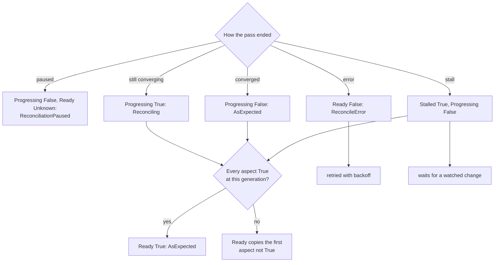
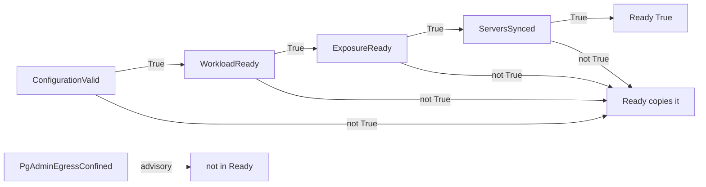
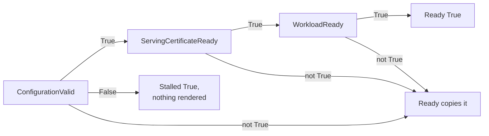
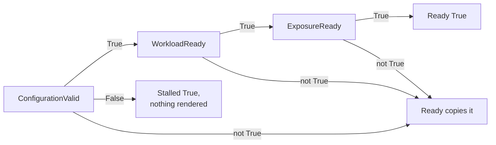
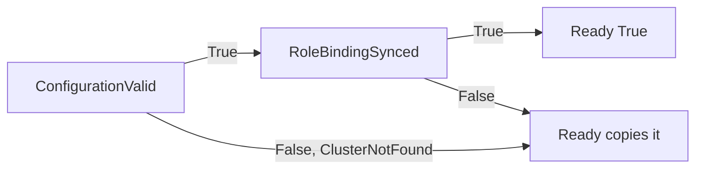

# Conditions and reasons

Every kind (`PgAdmin`, `EvidenceAgent`, `PgAccessRequest`, `PgToolBoxConsole`) reports status the same way: `status.conditions` (standard
`metav1.Condition`s, at most 16), `status.observedGeneration`, and Events. This page
is the vocabulary. Condition types and **reasons are frozen API surface**:
alerting and automation can key on them, they are only ever extended, never
renamed, and a test holds the registered set against a checked-in golden list
(`api/v1alpha1/testdata/reasons`). `make docs` also fails when a registered reason
is missing from this page.

A reason that copies a child's fact (a Pod's `Unschedulable`, an image pull
failure) names the fact; it never says "waiting".

## How Ready is derived

Every controller ends each pass with one status write, decided from how the pass
ended and from the kind's aspects (`internal/operator/conditions`):

A pass is *converged* only when nothing failed and every aspect is `True`.
`Stalled` is `False` (`AsExpected`) in every case but a stall.

- **Unknown on first touch.** A condition not yet evaluated is `Unknown` with reason
  `Initializing`, never a guessed state.
- **Aspects** are the conditions that decide readiness. **`Ready`** is derived from
  them in the same status write: `True` (`AsExpected`) when every aspect is `True`
  at the current generation; otherwise the first aspect that is not `True`, in the
  order below, decides, and `Ready` copies its status, reason and message. An
  aspect not yet evaluated at the current generation makes `Ready` `Unknown`
  (`Reconciling`).
- **An error ends in Ready=False** with reason `ReconcileError` (the message
  carries the class and a bounded error text), so `kubectl get` never says Ready
  while the operator is failing.
- **`Progressing`** is positive: `True` (`Reconciling`) while children converge,
  `False` (`AsExpected`) once converged.
- **`Stalled`** is abnormal-true: `True`, with the stall's reason, only when the
  operator cannot make progress without a change of input (and `Progressing` is
  then `False`). A stall is not retried with backoff; a watched change resolves it.
- **Paused** (`reconcile: skip`): `Progressing=False` and `Ready=Unknown`, both
  `ReconciliationPaused`; a paused `PgAdmin` or `PgToolBoxConsole` whose hostname
  is refused also says `Stalled=True` (`HostnameNotAllowed`), with `Progressing`
  carrying that reason.
- Every message is bounded.
- **Events.** One Event per transition worth attention, after the status write
  succeeded: `Ready` turning `True` (Normal, `AsExpected`); `Stalled` turning
  `True`; an aspect turning `False` (Warning, with its reason) unless the reason is
  one of a child on its way (`RolloutInProgress`, `PodNotReady`, and the kind's
  quiet reasons: `UpgradeBackupRunning` and `ConfigDatabaseNotReady` for
  `PgAdmin`, `ServiceCAPending` for `EvidenceAgent`); a reconciliation error of a class not already reported
  (`ReconciliationFailed`, `QuotaExceeded`, `AdmissionDenied`), once per class,
  not per retry.

## PgAdmin

Aspects of `Ready`, in order: `ConfigurationValid`, `WorkloadReady`,
`ExposureReady`, `ServersSynced`. `PgAdminEgressConfined` is advisory and **never
enters Ready**.

Only some `ConfigurationValid=False` reasons stall the `PgAdmin`: `ImageNotAllowed`, `HostnameNotAllowed`,
`ResourceNotOwned`, `SecretNotFound` (the OAuth2 client Secret, without which
pgAdmin cannot start) and the `configDatabase` problems (`DatabaseAPIUnavailable`,
`DatabaseRoleAPIUnavailable`, `PasswordGenerationUnavailable`, and a
`ConfigurationInvalid` about it). The others (`ClusterNotFound`,
`NoClusterSelected`, `PoolerNotFound`, `TooManyServers`, `GrantMissing`, ...) leave
it running: pgAdmin keeps serving the Clusters that resolve, and the missing
objects are watched. `WorkloadReady=False` with `UpgradeBackupFailed` is a stall
too.

| Condition | `True` | `False` reasons | `Unknown` |
|---|---|---|---|
| `ConfigurationValid` | the references resolve and the offered set is within bounds | `ClusterNotFound`, `NoClusterSelected`, `PoolerNotFound`, `TooManyServers`, `SecretNotFound`, `ConfigurationInvalid` (a cross-object check the CRD cannot express), `ImageNotAllowed`, `HostnameNotAllowed`, `ResourceNotOwned`, `DatabaseRoleAPIUnavailable`, `PoolerAPIUnavailable`, `GrantMissing`, `DatabaseAPIUnavailable`, `PasswordGenerationUnavailable` | `Initializing` |
| `WorkloadReady` | every desired replica runs the current template and is Ready | `RolloutInProgress`, `ReplicaFailure` (the Deployment cannot create a Pod, e.g. a quota), `PodUnschedulable`, `ImagePullFailed`, `CrashLoopBackOff`, `PodNotReady`, `UpgradeBackupRunning`, `UpgradeBackupFailed`, `ConfigDatabaseNotReady` | |
| `ExposureReady` | the Route, Ingress or HTTPRoute is admitted; `NotRequested` for `clusterIP` | `NotAdmitted`, `NotAccepted`, `RouteAPIUnavailable`, `GatewayAPIUnavailable`, `HostnameNotAllowed` (the exposure is withdrawn and `status.url` cleared) | `Reconciling` (not observed yet) |
| `ServersSynced` | the registered servers match the offered set | `RegistrationFailed` (the Job's fact in the message) | `PgAdminNotRunning`, `RegistrationRunning` |
| `PgAdminEgressConfined` | the NetworkPolicy confines egress to named destinations | `PgAdminEgressOpen`, naming every rule that does not | `PgAdminNotRunning` |

Events specific to `PgAdmin`: `RegistrationStarted`, `ServersRegistered`,
`RolloutStarted`, `UpgradeBackupCompleted`, and the Warning `UpgradeBackupSkipped`
(the [skip annotation](pgadmin.md#upgrades) released an upgrade without a backup).

## EvidenceAgent

Aspects of `Ready`, in order: `ConfigurationValid`, `ServingCertificateReady`,
`WorkloadReady`.

Every `ConfigurationValid=False` reason of an `EvidenceAgent` is a stall: nothing
is rendered until the agent, its Cluster or its `ObjectStore` changes.

| Condition | `False` reasons |
|---|---|
| `ConfigurationValid` | `ClusterNotFound`, `BarmanPluginNotConfigured`, `ObjectStoreNotFound`, `ObjectStoreAPIUnavailable`, `UnsupportedObjectStore`, `DestinationInvalid`, `RegionRequired`, `ImageRequired`, `ImageNotAllowed`, `ResourceNotOwned`. Each is a stall; see [the supported profile](evidenceagent.md#the-supported-profile). |
| `ServingCertificateReady` | `ServiceCAPending` while the OpenShift service CA has not issued the certificate or injected the CA bundle. |
| `WorkloadReady` | `RolloutInProgress`, `RolloutStuck`, `ReplicaFailure` (the Deployment's own conditions), `SecretNotFound` (a Secret the `ObjectStore` references does not exist), `SecretKeyMissing` (the container cannot start for a missing key), `PodUnschedulable`, `ImagePullFailed`, `CrashLoopBackOff`, `PodNotReady`. |

Event specific to `EvidenceAgent`: `CertificateIssued` (a newly issued or renewed
operator-signed serving certificate).

## PgToolBoxConsole

Aspects of `Ready`, in order: `ConfigurationValid`, `WorkloadReady`,
`ExposureReady`.

As for an `EvidenceAgent`, every `ConfigurationValid=False` reason is a stall;
`ConsoleRoleMissing` and `ConfigMapNotFound` alone are also looked at again
every two minutes, since neither the installation's ClusterRoles nor a user's
ConfigMaps are in the operator's label-filtered cache.

| Condition | `False` reasons |
|---|---|
| `ConfigurationValid` | `ConsoleImageRequired`, `ImageNotAllowed`, `HostnameNotAllowed`, `ConsoleRoleMissing` (retried every two minutes), `SecretNotFound` (a Secret the console Pod mounts does not exist; the message names it and its field), `ConfigMapNotFound` (the same for a ConfigMap you name; retried every two minutes), `ExposurePolicyInvalid` (the API server refused the ingress NetworkPolicy rendered from `spec.exposure.networkPolicy`; retried every five minutes), `ResourceNotOwned`. Each is a stall; see [PgToolBoxConsole](console.md#reconcile-loop). |
| `WorkloadReady` | `RolloutInProgress`, `RolloutStuck`, `ReplicaFailure`, `SecretKeyMissing`, `PodUnschedulable`, `ImagePullFailed`, `CrashLoopBackOff`, `PodNotReady`. |
| `ExposureReady` | As for `PgAdmin`: `NotAdmitted`, `NotAccepted`, `RouteAPIUnavailable`, `GatewayAPIUnavailable`, `HostnameNotAllowed` (withdrawn, `status.url` cleared); `NotRequested` (True) for `clusterIP`. |

`InstanceCABundleComplete` and `ExposureConfined` are advisory and **never enter
`Ready`**. `ExposureConfined` is present only while an exposure is published,
or while the console's ingress NetworkPolicy is kept without one (`ExposurePolicyKept`)
([trusted proxies](console.md#trusted-proxies-and-the-ingress-networkpolicy)).
For `InstanceCABundleComplete`, a Cluster
whose CA is missing reads "not verifiable" in the console, the console itself
keeps running. It is present only while the operator mirrors the
[instance CA bundle](console.md#the-instance-ca-bundle) (`spec.instanceCABundleRef`
omitted); `status.instanceCABundle` lists the Clusters left out.

| Condition | `True` | `False` |
|---|---|---|
| `InstanceCABundleComplete` | the server CA of every selected Cluster is in `<name>-instance-ca` (or no Cluster is selected) | `InstanceCAMissing`, naming each Cluster and why; `ResourceNotOwned` when a ConfigMap that is not this console's already has the bundle's name |
| `ExposureConfined` | the `<name>-ingress` NetworkPolicy admits only the router, ingress controller or gateway to the console port (present only while a Route, Ingress or HTTPRoute is published) | `ExposureOpen` (no policy rendered), `ExposurePeersBroad` (a peer of `from` admits (nearly) everyone), `ExposurePolicyBypassed` (another NetworkPolicy admits more to the console port), `ExposureTrustUnverified` (the peers could not be checked yet, or a widened `from` waits for the any-peer trust to go), `ExposurePolicyKept` (the policy is no longer rendered and is kept while a console Pod may still trust every peer, or the console is stalled on `HostnameNotAllowed` with the policy left as it was; present then even with nothing published); the message says what the console does with `X-Forwarded-For`, and when the Nodes' podCIDRs could not be checked (no grant, more than 10,000 Nodes, or Nodes without `spec.podCIDRs`) or the check is not meaningful (a console Pod's address is outside its own Node's `spec.podCIDRs`: the CNI allocates elsewhere) |

## PgAccessRequest

Aspects of `Ready`, in order: `ConfigurationValid`, `RoleBindingSynced`. The
operator only takes grants away; the console creates them as the approver (see
[access requests](../console/access-requests.md)).

A `PgAccessRequest` never stalls: `ClusterNotFound` is reported, and expiry and
revocation keep working. `RoleBindingSynced` is `True` in every phase where the
namespace's RBAC matches the request, including the terminal ones, so a denied or
expired request is `Ready`; it is `False` only for `RoleBindingMissing` and
`RoleBindingDrifted`. The controller requeues itself for `spec.expiresAt` and for
the end of an orphan's one-minute grace.

| Condition | `True` reasons | `False` reasons |
|---|---|---|
| `ConfigurationValid` | `AsExpected`; the message says the grant covers every Cluster of the namespace | `ClusterNotFound`: `spec.cluster` names no Cluster in the namespace. Reported, never a stall: expiry and revocation keep working. |
| `RoleBindingSynced` | `AwaitingDecision` (Pending, nothing bound), `AccessGranted` (Approved, the RoleBinding binds exactly the subject to the ClusterRole), `AccessDenied`, `AccessExpired`, `AccessRevoked` (terminal, nothing bound), `RoleBindingOrphaned` (an approval's RoleBinding outlived its failed status write and was deleted), `SelfApprovalRefused` (the operator revoked an approval recorded by its own subject) | `RoleBindingMissing` (Approved, the RoleBinding is gone; never recreated), `RoleBindingDrifted` (a RoleBinding of the request bound something else and was deleted) |

Events specific to `PgAccessRequest`: `RoleBindingDeleted` (Normal, each deletion
with its cause), `AccessExpired` (Normal), `SelfApprovalRefused` (Warning).

## Every reason

Reasons are registered once, by owner. `common` reasons are shared by every kind.

### common

| Reason | Meaning |
|---|---|
| `AsExpected` | The healthy reason of every aspect and of `Ready`. |
| `Initializing` | Not evaluated yet (`Unknown` on first touch). |
| `Reconciling` | `Progressing=True` while children converge; also `Unknown` for a child not observed yet. |
| `ReconcileError` | `Ready=False`: the last reconciliation ended with an error; the message carries the bounded text. |
| `ReconciliationPaused` | The `reconcile: skip` annotation is set. |
| `ConfigurationInvalid` | `ConfigurationValid=False` (and `Stalled=True`): a cross-object check the CRD cannot express failed. |
| `ResourceNotOwned` | An object the operator must manage exists under the generated name and is controlled by someone else. |
| `SecretNotFound`, `SecretKeyMissing` | A referenced Secret does not exist / its key is missing. |
| `ConfigMapNotFound` | A referenced ConfigMap does not exist. |
| `ClusterNotFound` | A referenced CloudNativePG Cluster does not exist in the namespace. |
| `RolloutInProgress`, `RolloutStuck` | A rollout is on its way / the Deployment's progress deadline is exceeded. |
| `PodUnschedulable`, `ImagePullFailed`, `CrashLoopBackOff`, `ReplicaFailure`, `PodNotReady` | The child's own fact, copied. |
| `ScaledToZero` | Registered; no current reconciler sets it. |
| `NotRequested` | The exposure is `clusterIP`: nothing to publish. |
| `NotAdmitted`, `NotAccepted` | The Route or Ingress / the HTTPRoute was not accepted by its controller. |
| `GatewayNotFound`, `HostnameConflict` | The Gateway named by `parentRef` is absent; another route claims the hostname. Registered; the current reconcilers do not set them. |
| `RouteAPIUnavailable`, `GatewayAPIUnavailable` | The optional API the exposure needs is not served or not readable. The operator probes the optional APIs (Routes, Gateways, DatabaseRoles, Poolers, Databases, the backup plugins' kinds) once at start: not served or refused by RBAC (403) turns the feature off until the next start; any other answer, a refused credential (401) included, fails the start, which the restart retries. |
| `ImageNotAllowed` | A `spec.image` or oauth-proxy image repository is outside the operator's [allow-list](images.md) (`ConfigurationValid=False`; both kinds). |
| `HostnameNotAllowed` | `spec.exposure.hostname` is outside the operator's `EXPOSURE_ALLOWED_HOST_SUFFIXES` (chart value `operator.exposure.allowedHostSuffixes`; the message names both) (`ConfigurationValid=False` and a stall; `PgAdmin` and `PgToolBoxConsole`). What was published under the name is withdrawn, whatever else stalls and while the object is paused (`pgtoolbox.fyannk.dev/reconcile=skip`) too: the hostname is checked first, `ExposureReady` turns `False` with this reason and `status.url` is cleared (one Warning for both conditions), and when the image is refused too (`ImageNotAllowed`, and `ConsoleImageRequired` for a `PgToolBoxConsole`) the message names both. Once the hostname is allowed, a condition that still says `HostnameNotAllowed` turns `Unknown` (`Reconciling`) until the loop says what holds now, so another stall (a refused image, a missing ClusterRole) never leaves the old refusal on show. A `PgAdmin`'s settings database (`spec.configDatabase`) is checked once the hostname is fixed. |
| `ReconciliationFailed`, `QuotaExceeded`, `AdmissionDenied` | Event reasons: the classified Warning recorded when an error ends a reconciliation. |

### pgadmin

| Reason | Meaning |
|---|---|
| `NoClusterSelected` | `clusterSelector` matches no Cluster. |
| `PoolerNotFound` | A `pooler:<name>` endpoint names no Pooler of a registered Cluster. |
| `TooManyServers` | The offered set exceeds the bound the credential files and the registration accept (64). |
| `PgAdminNotRunning` | pgAdmin has no Ready Pod yet; registration and the egress statement wait. |
| `RegistrationRunning`, `RegistrationFailed` | The registration Job for the current offered set is running / failed. |
| `RegistrationStarted`, `ServersRegistered` | Events: a new registration Job started / succeeded. |
| `UpgradeBackupRunning`, `UpgradeBackupFailed`, `UpgradeBackupCompleted` | The pre-upgrade backup of the settings database runs / failed (the old image keeps running) / completed (Event). |
| `UpgradeBackupSkipped` | Warning Event: the `pgtoolbox.fyannk.dev/skip-upgrade-backup` annotation named the target image, and it replaced the old one with no backup. |
| `RolloutStarted` | Event: a changed workload hash. |
| `PgAdminEgressOpen` | `PgAdminEgressConfined=False`. |
| `DatabaseRoleAPIUnavailable`, `PoolerAPIUnavailable` | The CloudNativePG `DatabaseRole` / `Pooler` API is not readable, or not served while the spec needs it (a pooler endpoint, `configDatabase`). CloudNativePG 1.30 and later serve `DatabaseRole`; an install whose CRDs lack it only means none is offered: the `PgAdmin` stays `Ready`. |
| `GrantMissing` | A `crossNamespaceClusterRefs` entry names a Cluster no `PgAdminAccess` of its namespace grants this PgAdmin. |
| `ConfigDatabaseNotReady` | CloudNativePG has not applied the `configDatabase` role, its generated password or the database yet; pgAdmin has no Pod until it has. |
| `PasswordGenerationUnavailable` | `configDatabase` needs CloudNativePG to generate the role's password (DatabaseRole `spec.password`, 1.31 and later). |
| `DatabaseAPIUnavailable` | The CloudNativePG `Database` API, which `configDatabase` needs, is not served or not readable. |

### evidenceagent

| Reason | Meaning |
|---|---|
| `BarmanPluginNotConfigured`, `ObjectStoreNotFound`, `ObjectStoreAPIUnavailable`, `UnsupportedObjectStore`, `DestinationInvalid`, `RegionRequired` | See [the supported profile](evidenceagent.md#the-supported-profile). |
| `ImageRequired` | No image can be chosen. |
| `ServiceCAPending` | The OpenShift service CA has not issued the serving certificate or injected the CA bundle yet. |
| `CertificateIssued` | Event: a serving certificate was issued or renewed. |

### console

| Reason | Meaning |
|---|---|
| `ConsoleImageRequired` | `spec.image` is not set and the operator has no default console image (`--default-console-image`). |
| `ConsoleRoleMissing` | A ClusterRole the operator binds for the console (`pgtoolbox-console`; `pgtoolbox-console-pod-logs` unless `podLogs: false`; `pgtoolbox-console-restore-drills` with restore drills) does not exist: the operator installation is incomplete. |
| `InstanceCAMissing` | `InstanceCABundleComplete=False`: at least one selected Cluster's server CA is not in the mirrored bundle; `status.instanceCABundle.missing` gives each Cluster, its CA Secret and the reason (`SecretNotFound`, `SecretKeyMissing` for a Secret without `ca.crt`, `InstanceCAInvalid`, `InstanceCABundleFull`). |
| `InstanceCAInvalid` | A Cluster's server CA Secret has a `ca.crt` with no PEM certificate in it. |
| `InstanceCABundleFull` | The mirrored bundle reached the size a ConfigMap holds (several hundred distinct CAs); the Clusters after it, by name, are left out. |
| `ExposureOpen` | `ExposureConfined=False`: the console is exposed without its ingress NetworkPolicy (an Ingress or a Gateway without `spec.exposure.networkPolicy.from`, or `networkPolicy.enabled: false`), so any Pod can reach its port; the message says which peers the console believes about `X-Forwarded-For`. |
| `ExposurePeersBroad` | `ExposureConfined=False`: a peer of `spec.exposure.networkPolicy.from` admits (nearly) every namespace (a `namespaceSelector` that pins no label value, or only `pod-security.kubernetes.io/*`-like shared labels), every Pod of the namespace (such a `podSelector` alone), the Pod network or every address (an `ipBlock` wider than `/8` or `/32`, holding a whole private IPv4 range, a unique-local IPv6 block wider than `/64`, holding a console Pod's address, or overlapping a Node's `spec.podCIDRs`), so the console trusts no peer with `X-Forwarded-For`. |
| `ExposurePolicyInvalid` | `ConfigurationValid=False`: the API server refused the ingress NetworkPolicy rendered from `spec.exposure.networkPolicy` (what the CRD could not check, such as a label-key prefix longer than 253 characters), or an admission policy or webhook denied it (Invalid or Forbidden); the message carries its answer. Retried every five minutes and on every change of the spec. |
| `ExposurePolicyBypassed` | `ExposureConfined=False`: another NetworkPolicy of the namespace admits, to the console port, peers the exposure does not list (NetworkPolicies add up), or there were more than 250 to check; the console trusts no peer with `X-Forwarded-For`. |
| `ExposureTrustUnverified` | `ExposureConfined=False`: the peers of `networkPolicy.from` could not be checked yet (an `ipBlock` peer while no console Pod has an address and no earlier one verified the same blocks, more than 250 console Pods), or a wider `from` is held back until no console Pod trusts every peer (a Pod stuck terminating that holds it is named); the console trusts no peer with `X-Forwarded-For` meanwhile. |
| `ExposurePolicyKept` | `ExposureConfined=False`: the ingress NetworkPolicy is no longer rendered (the exposure or the policy was turned off) and is kept while a console Pod may still trust every peer it admits: until the rollout without the grant is through and no Pod carries the grant. A Pod stuck terminating that holds it is named, with when its deletion was asked. Also while the console is stalled on `HostnameNotAllowed`: the exposure is withdrawn, and the workload and the policy stay as they were. |

### pgaccessrequest

| Reason | Meaning |
|---|---|
| `AwaitingDecision` | Pending: nothing is bound. |
| `AccessGranted` | Approved, and the RoleBinding is in place. |
| `AccessDenied`, `AccessExpired`, `AccessRevoked` | Terminal: nothing is bound. `AccessExpired` is also the Event of the expiry. |
| `RoleBindingMissing` | Approved, but the RoleBinding does not exist; revoke and request again. |
| `RoleBindingDrifted` | A RoleBinding of the request bound another subject or ClusterRole and was deleted (fail closed). |
| `RoleBindingOrphaned` | A RoleBinding of a request that is not Approved outlived the one-minute grace of an approval in flight and was deleted. |
| `SelfApprovalRefused` | The recorded approver is the subject; the operator revoked the grant (four eyes). |
| `RoleBindingDeleted` | Event: the operator deleted a RoleBinding (expiry, revocation, drift, orphan). |
