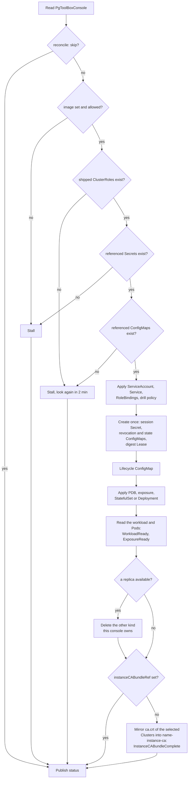

# PgToolBoxConsole

A `PgToolBoxConsole` asks the operator to run **the console for the CloudNativePG
Clusters of its namespace**: the same console the pgtools chart installs
(`console.enabled`), as a resource the operator keeps converged. Both install paths
stay supported; pick one per namespace. Fields are in the
[API reference](../reference/api.md#pgtoolboxconsole).

```yaml
apiVersion: pgtoolbox.fyannk.dev/v1alpha1
kind: PgToolBoxConsole
metadata:
  name: console
spec:
  auth:
    provider: oidc
    oidc:
      issuerURL: https://idp.example.com/realms/corp
      clientID: console-team-a
      clientSecretRef:
        name: console-team-a-oidc
  exposure:
    type: ingress
    hostname: console.team-a.example.com
```

An empty `spec` is a working console: two replicas with persistent history (a
StatefulSet, one 1Gi volume each from the cluster's default StorageClass), token
sign-in, a ClusterIP Service at `http://<name>.<namespace>.svc/` (`status.url`).
`history: {persistent: false}` keeps the history in memory, in a Deployment.

## Chart or PgToolBoxConsole

| | pgtools chart (`console.enabled`) | `PgToolBoxConsole` |
|---|---|---|
| Who installs | whoever runs `helm install` in the namespace | anyone who may create a `PgToolBoxConsole` there |
| Scope | the release namespace, or several (`console.watchNamespaces`) | its own namespace only |
| Read permissions | a Role the chart writes | the shipped ClusterRole `pgtoolbox-console`, bound in the namespace |
| Upgrades | `helm upgrade` | the operator's; the default image follows the operator |
| Settings | every chart value | the common ones (below); the rest stay chart-only |

The console binary, its environment and its mounts are the same: a test renders the
chart and compares it with what the operator builds.

## What the operator creates

All in the `PgToolBoxConsole`'s namespace, controlled by it (deleted with it), named after
it (`<name>`, or `<name>-console` when the name does not already say console):

- the StatefulSet (persistent history, the default) or the Deployment (`history:
  {persistent: false}`), its Service and ServiceAccount, and a PodDisruptionBudget
  when there is more than one replica; the StatefulSet makes one claim per replica,
  `history-<name>-<ordinal>`, deleted with it ([persistent history](#persistent-history));
- RoleBindings of the ServiceAccount to `pgtoolbox-console`, unless
  `podLogs: false` to `pgtoolbox-console-pod-logs`, and with
  `restoreDrills.enabled` to `pgtoolbox-console-restore-drills`
  ([restore drills](../console/restore-drills.md));
- with `restoreDrills.enabled`, the `<name>-restore-drills` NetworkPolicy around
  the drill Pods, unless `restoreDrills.networkPolicy.enabled: false`
  ([the drill NetworkPolicy](../console/restore-drills.md#the-drill-networkpolicy));
- the session-key Secret and the revocation-list ConfigMap, **created once** and
  then left to the console (rotating the key signs everyone out), and a Role and
  RoleBinding letting the console `get` and `watch` that one ConfigMap;
- the state ConfigMap `<name>-state`, **created once** and then written by the
  console ([what survives a restart](../console/configuration.md#what-survives-a-restart)),
  and a Role and RoleBinding letting the console `get`, `watch` and `update`
  that one ConfigMap; the operator ignores the console's writes to it;
- with `digest.delivery`, the Lease `<name>-digest`, **created once** and then
  taken by the replica that delivers the
  [daily digests](../console/timeline-and-digest.md#daily-digest), and a Role and
  RoleBinding letting the console `get` and `update` that one Lease and `create`
  leases (RBAC cannot scope a create by name; the console creates only that one,
  should it be deleted);
- with `mcp.enabled`, the [MCP leader's](../console/mcp.md#one-replica-serves-mcp)
  Lease `<name>-mcp` and EndpointSlices `<name>-mcp-ipv4` and `-ipv6`,
  **created once** and then written by the replicas, the selector-less
  Service `<name>-mcp`, the MCP paths of the exposure (four Routes on
  OpenShift), and a Role and RoleBinding letting the console `get` and
  `update` those three objects by name; with MCP off the Service, the Routes
  and the grant go, the Lease and slices stay until the `PgToolBoxConsole` goes;
- the lifecycle ConfigMap (below);
- unless `spec.instanceCABundleRef` is set, the instance CA bundle
  `<name>-instance-ca` (below);
- for a published exposure, the `<name>-ingress` NetworkPolicy that admits only
  the router, ingress controller or gateway to the console port
  ([trusted proxies](#trusted-proxies-and-the-ingress-networkpolicy));
- the Route, Ingress or HTTPRoute of `spec.exposure`, with a one-hour timeout for the
  console's event stream and cookie affinity (`pgtoolbox-console-replica`) on an Ingress
  (ingress-nginx's annotations, and Traefik's on the Service) or a Route, so a
  person keeps seeing one replica's charts; `spec.exposure.annotations` override
  it.

The operator writes no cluster-scoped object for a `PgToolBoxConsole`: the console checks
each reader's permissions with that reader's own token (`SelfSubjectAccessReview`).

## Reconcile loop

One pass of the `PgToolBoxConsole` controller, in dependency order. Every child is
written with server-side apply, except the session Secret, the revocation
ConfigMap and the state ConfigMap, which are created once:



Before it renders anything, the operator checks that every Secret and
ConfigMap the console Pod would mount and that you name exists in the
namespace. The check reads metadata only, never content, and stalls with
`ConfigurationValid=False`; the message names each missing object and the
field that references it. The existing workload is left as it is, rather than
rolled to Pods that would wait in `ContainerCreating`.

| References | Reason | Picked up |
|---|---|---|
| Secrets: `auth.oidc.clientSecretRef` (with the `oidc` provider), `auth.openshift.clientSecretRef` (with `openshift`), `prometheus.tokenSecretRef`, the digest's `chatWebhookSecretRef`, `webhookSecretRef` and `smtp.passwordSecretRef`, `restoreDrills.sealKeySecretRef` (with drills on) | `SecretNotFound` | as soon as the Secret is created (the operator watches Secret metadata) |
| ConfigMaps: `auth.oidc.caConfigMapRef`, `auth.openshift.caConfigMapRef`, `prometheus.caConfigMapRef`, `instanceCABundleRef`, `lifecycleConfigMapRef` | `ConfigMapNotFound` | within two minutes: the operator caches only its own ConfigMaps, so it looks again rather than wait for an event |

Missing Secrets are reported first. `instanceCABundleRef` and
`lifecycleConfigMapRef` are mounted optional (the operator's own
`<name>-instance-ca` and `<name>-lifecycle` may not exist yet), but a ConfigMap
you name and that is absent would leave every Cluster "not verifiable" or the
diagnostics without their end-of-life table, so it stalls too. Not checked: the
platform's `kube-root-ca.crt` and `openshift-service-ca.crt`, image pull Secrets
(the kubelet goes on without one) and the Ingress certificate (the ingress
controller reads it). An object that exists without the referenced key is
reported by the Pod instead (`WorkloadReady=False`, `SecretKeyMissing` for a
Secret).

An object of a generated name that belongs to someone else stalls the console
with `ResourceNotOwned` at whichever step meets it. Bindings and policies that a
turned-off setting no longer needs (`podLogs`, `restoreDrills`, `digest.delivery`,
a single replica's PodDisruptionBudget) are deleted when this console controls
them. The controller
is woken by the `PgToolBoxConsole`, the objects it owns, the console's Pods, and, for the
CA bundle, the namespace's Clusters (created, deleted, relabelled, or naming
another CA Secret) and changes to their server CA Secrets, and the Secrets the
console mounts; it has no periodic
requeue except the two-minute look for a missing ClusterRole or referenced
ConfigMap.

## Persistent history

`spec.history.persistent` is `true` unless set to `false`: the console is a
StatefulSet of `spec.replicas` (two), `podManagementPolicy: Parallel`, rolling
one Pod at a time, each replica with its own claim `history-<name>-<ordinal>` of
`spec.history.size` (1Gi; see [sizing](../console/configuration.md#replicas-and-history))
in `spec.history.storageClassName` (the cluster's default when omitted). Claims
are deleted with the StatefulSet (so with the `PgToolBoxConsole`) and kept when scaling
down. Without a default StorageClass, set `storageClassName` or `persistent:
false`: otherwise the claims stay `Pending` and `WorkloadReady` says the Pods
cannot be scheduled.

**Switching** between persistent and in-memory history, the operator creates the
new workload and deletes the old one only once the new one has a replica
available: both serve meanwhile, behind the same Service.

**Changing the size or the class.** A StatefulSet's claim template cannot be
changed, so the operator deletes the StatefulSet *without its Pods* and creates
it again with the new template (`WorkloadReady` is `RolloutInProgress` in
between); the running Pods keep serving and are adopted. Existing claims keep
their size (grow one by editing its PVC, where the StorageClass allows
expansion); claims made later take the new one.

## Permissions

The operator binds the shipped console ClusterRoles **without holding their rules**: it
has the `bind` verb on those three names only. So a `PgToolBoxConsole` reads exactly what
`pgtoolbox-console` grants, in its own namespace, and a person who may create a
`PgToolBoxConsole` gains nothing: every page still answers with what the *reader's* own
RBAC allows (a SelfSubjectAccessReview sent with the reader's token). If an installation lacks one it needs,
the console stalls with `ConsoleRoleMissing` and looks again every two minutes.

The Roles it writes (the revocation list, the state ConfigMap, the digest and
MCP Leases, the MCP EndpointSlices) grant only verbs the operator holds itself,
as RBAC escalation prevention requires: hence its `get`, `create` and `update`
on leases and on `endpointslices.discovery.k8s.io`, cluster-wide, which it uses
only to create each console's Leases and its two MCP slices.

## The lifecycle table

The end-of-life dates the diagnostics read come from a ConfigMap,
`<workload>-lifecycle`, the way CloudNativePG treats its default monitoring
queries:

- **None there:** the operator creates it with the table built into the operator.
- **Created by the operator and untouched:** the operator keeps it at its own table,
  so an operator upgrade brings new end-of-life lines.
- **Edited by someone, or annotated `pgtoolbox.fyannk.dev/user-managed: "true"`:**
  it is theirs; the operator never writes it again. Delete it to go back to the
  operator's table.
- **`spec.lifecycleConfigMapRef`:** the console reads that ConfigMap; the operator
  neither creates nor reads it, beyond checking that it exists.

`status.lifecycle.keptBy` says which (`Operator`, `User`, `Referenced`), and
`status.lifecycle.reviewed` the date of the operator's table when it is in use.

## The instance CA bundle

The console verifies each instance's `/pg/status` against the server CAs of the
Clusters it shows ([why](../console/configuration.md#the-instance-ca-bundle)). For
a `PgToolBoxConsole` **there is nothing to do**: the operator keeps that bundle itself, in
the ConfigMap `<name>-instance-ca` (key `ca.crt`), and the console mounts it.

- For every Cluster of the namespace that `spec.clusterSelector` matches, the
  operator reads the server CA Secret (`status.certificates.serverCASecret`, else
  `spec.certificates.serverCASecret`, else `<cluster>-ca`) and copies its
  **`ca.crt` only**: `ca.key` never leaves the Secret, and only the certificate
  blocks of `ca.crt` are copied. The console still reads no Secret, and its
  ServiceAccount gets no new permission.
- A CA shared by several Clusters (one user-managed `serverCASecret` for the
  namespace) appears once. The order is the Clusters' names, so an unchanged set
  rewrites nothing.
- CloudNativePG gives its self-signed CA 90 days and renews it 7 days before it
  expires; the renewal, a new Cluster and a deleted one reach the bundle within
  seconds (the operator watches the Clusters and their CA Secrets), the kubelet
  refreshes the mounted file and the console reloads it, without a restart.
- `status.instanceCABundle` gives the ConfigMap, `keptBy: Operator`, how many
  Clusters are in it and, for those that are not, the Cluster, its Secret and why
  (`SecretNotFound`, `SecretKeyMissing`, `InstanceCAInvalid`,
  `InstanceCABundleFull`). The advisory condition `InstanceCABundleComplete` is
  `False` with `InstanceCAMissing` while one is missing, with one Warning Event per
  transition; it never makes the console un-`Ready`, and the Cluster reads "not
  verifiable" until its CA is there.
- If a ConfigMap that is not this console's already has the name
  `<name>-instance-ca` (for instance one made by hand before the operator kept it),
  the operator leaves it alone and reports `InstanceCABundleComplete=False` with
  `ResourceNotOwned`: delete it and the operator takes over.

**`spec.instanceCABundleRef`** turns this off: the console mounts the named
ConfigMap, which you keep current, and the operator neither reads nor writes it,
beyond checking that it exists (`status.instanceCABundle.keptBy: Referenced`). A copy made once by hand stops
verifying when the copied CA certificate expires, within 90 days; keep it current with
one of the automatic ways listed in
[the chart's case](../console/configuration.md#console-installed-by-the-pgtools-chart).
A mirror left from before the reference was set stays in place, unused, until the
`PgToolBoxConsole` is deleted.

## Images

`spec.image` is optional: the operator runs `--default-console-image`, which the
chart sets to the console image of the same release. An image from another
repository must be on `--console-image-repositories` (chart
`operator.console.imageRepositories`), else `ImageNotAllowed`; see
[images](images.md).

## Trusted proxies and the ingress NetworkPolicy

The console reads `X-Forwarded-For` only from a peer in
`spec.exposure.trustedProxy.cidrs`
([client address](../console/authentication.md#sessions)), so that a
Pod calling the Service directly cannot pose as a new client on every request.
**Without `trustedProxy.cidrs` the header is ignored**, whatever the
NetworkPolicy admits: the console takes the TCP peer, the ingress controller's
or router's address, as the client's. Every user behind it then shares that
address in the per-address sign-in budget and in the audit log's `client_ip`.
Set `spec.exposure.trustedProxy.cidrs` to your ingress controller's addresses
(the router or controller Pods, the nodes for a host-network router) to keep
per-client budgets and audit addresses.

The operator follows the exposure it **publishes**, not the one requested: a
Route without the Route API, an HTTPRoute without the Gateway API, or a hostname
refused by `EXPOSURE_ALLOWED_HOST_SUFFIXES` puts nothing in front, so nothing is
trusted.

| `spec.exposure` | NetworkPolicy `<name>-ingress` | `ExposureConfined` |
|---|---|---|
| `clusterIP` | none | absent |
| `route` (published) | on by default: the console port admits namespaces labelled `policy-group.network.openshift.io/ingress` (the OpenShift routers, host-network ones included), plus `from` | `True` |
| `ingress`, `gateway` with `networkPolicy.from` | the console port admits only `from` | `True` |
| a peer of `from` admits (nearly) everyone | rendered as written | `False`, `ExposurePeersBroad` |
| the API server refuses the rendered policy (its schema, or an admission policy or webhook that denies it) | applied before the exposure: the previous one stays, and no exposure is published or changed | `ConfigurationValid=False` and `ExposureConfined=False`, `ExposurePolicyInvalid`, retried every five minutes |
| `ingress`, `gateway` without `from` | none: the controller's namespace differs per installation, so no default is safe | `False`, `ExposureOpen` |
| `networkPolicy.enabled: false` | none | `False`, `ExposureOpen` |

`TRUSTED_PROXY_HOPS` is `1` on every published exposure (`trustedProxy.hops`,
0 to 8, counts the proxies that append to the header: 2 for a load balancer in
front of the router), and `TRUSTED_PROXY_CIDRS` is `trustedProxy.cidrs`, absent
when they are not set.

- `spec.exposure.networkPolicy.from` lists the router, ingress controller or
  gateway Pods (NetworkPolicy peers, at most 16). For the community
  ingress-nginx:

  ```yaml
  spec:
    exposure:
      type: ingress
      hostname: console.team-a.example.com
      trustedProxy:
        cidrs: [10.244.0.0/16]   # the ingress-nginx Pods' addresses
      networkPolicy:
        from:
          - namespaceSelector:
              matchLabels:
                kubernetes.io/metadata.name: ingress-nginx
            podSelector:
              matchLabels:
                app.kubernetes.io/name: ingress-nginx
  ```

  `enabled: true` without `from` is refused for ingress and
  gateway. Each peer needs a `podSelector`, a `namespaceSelector` or an
  `ipBlock` (alone in its peer, a CIDR whose `except` entries lie inside it);
  selectors take at most 16 labels and 16 expressions, label keys and values
  in their syntax, an operator among `In`, `NotIn`, `Exists`, `DoesNotExist`,
  and values for `In` and `NotIn` only. The CRD refuses the rest, which the API
  server would refuse in the policy; what it still refuses (a label-key prefix
  longer than 253 characters) stalls the console with `ExposurePolicyInvalid`
  instead of failing every reconcile.
- A peer that admits (nearly) everyone reports `ExposurePeersBroad`. The rule:
  a selector is broad when it pins no label value (no `matchLabels` and no `In`
  expression; only `Exists`, `NotIn`, `DoesNotExist`, or nothing), since a key
  alone is on nearly everything (`kubernetes.io/metadata.name` is on every
  namespace). Broad are a `namespaceSelector` that is, or that pins only labels
  many namespaces share (`pod-security.kubernetes.io/*`,
  `security.openshift.io/*`, `openshift.io/run-level`), a `podSelector` that is
  with no `namespaceSelector`, and an `ipBlock` wider than `/8` (IPv4) or `/32`
  (IPv6), holding a whole private IPv4 range (`10.0.0.0/8`, `172.16.0.0/12`,
  `192.168.0.0/16`, `100.64.0.0/10`, where Pod networks are cut from), or a
  unique-local IPv6 block (inside `fc00::/7`) wider than `/64`. The check reads
  the spec only: an `ipBlock` that is the Pod network, and the namespace's
  other NetworkPolicies (they add up: an `allow-same-namespace` lets the
  namespace's Pods in whatever this one says), are not checked. Labels that a
  namespace owner may set on their own namespace cannot be told from an
  installer's: pinning one is the user's responsibility;
  `kubernetes.io/metadata.name` is set by the API server and is the safe
  choice.
- **A Route turns the policy on**, and with it cuts every in-cluster client of
  the Service's `http` port that is not a router: a debug Pod, an in-cluster
  MCP or AI client, a synthetic probe calling `/`. Add them to `from`; on a
  Route `from` adds to the routers, it never replaces them. `kubectl
  port-forward` goes through the kubelet and is not affected.
- The probe port (health and `/metrics`) stays open to any source: kubelets and
  Prometheus reach it, and it never reads `X-Forwarded-For`. Egress is not
  policed by this policy.
- A NetworkPolicy is a boundary only where the CNI enforces it, and the
  operator cannot observe that: `ExposureConfined=True` says what is declared,
  not what the network does.
- When the policy is no longer rendered (the exposure or `networkPolicy`
  turned off), the operator deletes it. While the console is stalled on
  `HostnameNotAllowed` (checked before anything else that stalls, the image
  included) the operator withdraws the exposure but leaves the workload and
  this policy as they were; `ExposureConfined` is removed (nothing is
  published).
- The advisory `ExposureConfined` never enters `Ready`; its message says which
  peers the console believes.
- Sign-in budgets follow the trust. With `trustedProxy.cidrs` each client keeps
  its own: ten OAuth callbacks and twenty pasted tokens a minute per address,
  under per-replica bounds sized to protect the API server and the IdP. Without
  them, or with no hops behind a public URL (a clusterIP exposure behind an
  Ingress of your own), every client has the proxy's address, so the console
  charges no per-address budget, only the per-replica bounds apply, and the
  audit log names the proxy instead of the client
  ([rate limits](../console/authentication.md#sessions)).

## Not in the custom resource

Kept chart-only for now: the console's own egress NetworkPolicy, the metrics
ServiceMonitor, TLS on the Service, the break-glass settings, the IdP timeout
and the cookie flags. Use the chart where you need them.
