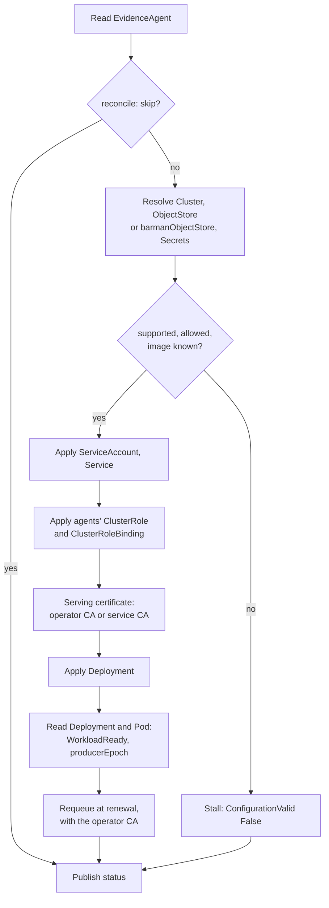

# EvidenceAgent

An `EvidenceAgent` declares a read-only reader of the backup repository of **one
CloudNativePG Cluster in its namespace**. The operator turns it into a Deployment
(one replica), a Service, a ServiceAccount, a serving certificate and the status
fields a console needs to call it. What the agent is and how it is trusted is on
[the evidence agent page](../evidence-agent.md); fields are in the
[API reference](../reference/api.md#evidenceagent).

```yaml
apiVersion: pgtoolbox.fyannk.dev/v1alpha1
kind: EvidenceAgent
metadata:
  name: cluster-example
spec:
  clusterRef:
    name: cluster-example
  refreshInterval: 5m
```

Whoever may `get` an `EvidenceAgent` may read the evidence it serves; that is the
check the agent makes for the console (see the channel).

## Where the repository comes from

In this order:

1. `spec.objectStoreRef`, when set: that `ObjectStore`.
2. The Cluster's enabled **barman-cloud plugin stanza**, which names the
   `ObjectStore` (`barmanObjectName`) and, optionally, the server name
   (`serverName`, else the Cluster's name; the `ObjectStore`'s own
   `configuration.serverName` is not consulted, because the plugin does not
   consult it).
3. The Cluster's in-tree **`spec.backup.barmanObjectStore`** (the configuration
   CloudNativePG itself archives with), whose `serverName` applies.
4. The Cluster's enabled **pgBackRest plugin**: Dalibo's
   (`pgbackrest.dalibo.com`, a `Stanza` named by `stanzaRef`) first, then
   Opera's (`pgbackrest.cnpg.opera.com`, an `Archive` named by
   `pgbackrestObjectName`). See [pgBackRest](#pgbackrest).

`spec.serverName` overrides the server name in every case. The agent uses **the
same credentials Barman uses**, mounted as files from the Secrets the
configuration names, or the Pod's workload identity; they never leave the
Cluster's namespace and never reach the console.

## What the agent's author allows

The Barman configuration is written by whoever may edit the Cluster or the
`ObjectStore`, a wider set of people than whoever writes the `EvidenceAgent`
(`pgtoolbox-console-operator` may `patch clusters`). The operator therefore renders an
agent only for what the `EvidenceAgent` allows, as for pgAdmin ("only named
ones"), and refuses the rest with `ConfigurationValid=False`,
`UnsupportedObjectStore`, naming what to change:

```yaml
spec:
  clusterRef:
    name: orders
  allowedSecrets: [orders-s3, orders-ca]   # up to 16
  allowInsecureEndpoint: false             # default
```

| Setting | Effect |
|---|---|
| `allowedSecrets` | The Secrets the configuration may name. Any other is refused by name; nothing outside the list is mounted. |
| `allowInsecureEndpoint` | Admits a plain-`http` `endpointURL` or emulator destination, over which the keys cross the network in clear text. Off: refused. |
| `workloadIdentity` | The opt-in to the Pod's cloud identity (below). Absent: `inheritFromIAMRole`, `inheritFromAzureAD`, `useDefaultAzureCredentials` and `gkeEnvironment` are refused. |

Two credential settings (access key, secret key, session token, region, endpoint
CA) may never name the same Secret key: the access key and the region travel in
clear in the request signature, so that would publish the secret key.

**Without `allowedSecrets` (deprecated).** An `EvidenceAgent` written before the
list existed keeps working on a plugin `ObjectStore`: every Secret it names is
mounted and a plain-`http` endpoint is accepted, as before (steering it needs
`ObjectStore` write). The Cluster's in-tree `barmanObjectStore` gets no such
grace: with Secrets and no `allowedSecrets` it is refused, the message naming the
Secrets to list. Set `allowedSecrets` on every agent; a later version will
require it.

## The supported profile

The agent reads repositories in the Barman Cloud layout on:

| Store | Credentials |
|---|---|
| **S3** and S3-compatible (`s3://bucket/prefix`) | a static key pair (optionally a session token), or `inheritFromIAMRole` (the Pod's IAM role, e.g. IRSA); optionally an endpoint CA, and an SSE-C customer key (`sseCustomerKey`, a base64-encoded 256-bit key) that the agent sends on every object read (GET and HEAD; a list needs none), as barman-cloud does |
| **Azure Blob** (`https://<account>.blob.core.windows.net/<container>/<prefix>`, or an emulator path with a connection string) | `connectionString`, `storageAccount` + `storageKey`, `storageAccount` + `storageSasToken`, or `inheritFromAzureAD` / `useDefaultAzureCredentials`; national clouds (China, US Government, Germany) too; optionally an endpoint CA (`endpointCA`, e.g. Azurite over TLS), trusted for the Blob endpoint beside the system roots, as barman-cloud trusts it (`REQUESTS_CA_BUNDLE`) |
| **Google Cloud Storage** (`gs://bucket/prefix`) | `applicationCredentials` (a service account JSON key), or `gkeEnvironment` (GKE workload identity); an `endpointCA` (or `endpointURL`) is accepted and not used, as barman-cloud uses neither for Google Cloud Storage: the agent reads the public endpoint with the system roots, and the CA Secret is not read |

Everything else is a named configuration problem, never a guess:

| Situation | `ConfigurationValid=False`, reason |
|---|---|
| The Cluster declares neither an enabled barman-cloud plugin with `barmanObjectName` nor `spec.backup.barmanObjectStore`, and `objectStoreRef` is not set | `BarmanPluginNotConfigured` |
| The `ObjectStore`, `Stanza` or `Archive` does not exist | `ObjectStoreNotFound` |
| The `ObjectStore`, `Stanza` or `Archive` API is not served or not readable by the operator (only when that object is needed) | `ObjectStoreAPIUnavailable` |
| No credentials, credentials for more than one store, an Azure emulator without a connection string, a connection string for another account or endpoint, a Secret outside `allowedSecrets`, two credential settings on one Secret key, a plain-`http` endpoint without `allowInsecureEndpoint`, workload identity without `workloadIdentity`, or a pgBackRest shape outside [the pgBackRest profile](#pgbackrest) | `UnsupportedObjectStore` |
| `destinationPath` is not a credential-free URL of the store its credentials name, or the endpoint or server name is rejected by the shared evidence contract | `DestinationInvalid` |
| AWS S3 (no `endpointURL`) with a key pair and without `s3Credentials.region` | `RegionRequired` |
| `spec.image` is unset and the operator has no default | `ImageRequired` |
| `spec.image` names a repository outside the allow-list | `ImageNotAllowed` ([images](images.md)) |

### pgBackRest

A Cluster archiving with either pgBackRest plugin is read from the plugin's own
object: one stanza of one repository, on S3 or Azure Blob.

The guide [Clusters backed up with pgBackRest](../guides/pgbackrest.md) has the
supported plugin versions, the environment contract, TLS and the limits.

```yaml
spec:
  clusterRef:
    name: orders
  allowedSecrets: [orders-s3, orders-cipher, orders-ca]
  pgbackrest:
    repository: 1                              # repo<n>; default 1
    endpointCA: {name: orders-ca, key: ca.crt} # over the plugin object's CA
```

- **Repository.** `repository` picks `repo<n>`. Dalibo's plugin numbers a
  Stanza's S3 repositories first, then its Azure ones; Opera's numbers the
  Archive's repositories in order (S3 only).
- **Stanza.** Dalibo: the Stanza's `name`. Opera: the Cluster's `stanza`
  parameter, else the Cluster's name, for backups; `configuration.stanza`, when
  it differs, for the WAL (both are read).
- **Encryption.** The repository's cipher pass (`cipherConfig.encryptionPass`,
  `encryptionKey`) is mounted as a file like the credentials, and must be in
  `allowedSecrets`. Only `aes-256-cbc` is read.
- **TLS** is always verified, whatever `verifyTLS` or `disableVerifyTLS` says:
  name the CA (`spec.pgbackrest.endpointCA`, or Opera's `endpointCA`). A plain
  `http` endpoint needs `allowInsecureEndpoint`; `keyType: web-id` or `auto`
  needs `workloadIdentity`.
- **Refused by name** (`UnsupportedObjectStore`): no S3 or Azure repository at
  the chosen number; a `customEnvVar`, sidecar `env` key or additional command
  argument that can move the repository, the stanza or the configuration
  (`PGBACKREST_REPO*`, `PGBACKREST_STANZA`, `PGBACKREST_CONFIG*`, `--repo*`,
  `--stanza*`, `--config*`, the deprecated `backup-host` family, the `--no-` and
  `--reset-` forms and abbreviations); `spec.serverName` or `spec.objectStoreRef` (CEL
  refuses them beside `spec.pgbackrest`); `spec.pgbackrest` on a Cluster
  read through Barman.

`status.pgbackrest` records the plugin, the object (`Stanza` or `Archive` and
its name), the stanza, the WAL stanza and the repository number.

### Workload identity

With `inheritFromIAMRole`, `inheritFromAzureAD` / `useDefaultAzureCredentials` or
`gkeEnvironment` the agent mounts no Secret and uses the Pod's cloud identity,
only when `spec.workloadIdentity` is set. The identity is the agent's
ServiceAccount, which `spec.workloadIdentity` annotates and whose Pod it labels:

```yaml
spec:
  workloadIdentity:
    serviceAccountAnnotations:
      eks.amazonaws.com/role-arn: arn:aws:iam::123456789012:role/orders-backups   # IRSA
      # azure.workload.identity/client-id: <client id>                           # Azure
      # iam.gke.io/gcp-service-account: orders@project.iam.gserviceaccount.com   # GKE
    podLabels:
      azure.workload.identity/use: "true"   # Azure workload identity only
```

CEL accepts only these annotation keys: `eks.amazonaws.com/role-arn`,
`eks.amazonaws.com/sts-regional-endpoints`, `eks.amazonaws.com/token-expiration`,
`azure.workload.identity/client-id`, `azure.workload.identity/tenant-id`,
`iam.gke.io/gcp-service-account`; and only the label
`azure.workload.identity/use`. `{}` is enough where nothing needs annotating (GKE
workload identity federation). Grant the identity read on the bucket or container
(list and get).

The credential is explicit, never an SDK default chain:

- **AWS**: IRSA (the projected web-identity token) or EKS Pod Identity (the agent
  on 169.254.170.23 or fd00:ec2::23). The node's instance metadata is never used:
  `AWS_EC2_METADATA_DISABLED=true` is rendered and the agent disables IMDS in
  code. With neither injected the agent names what is missing. With no region,
  the one the identity webhook injects (`AWS_REGION`) is used.
- **Azure**: Azure workload identity (`WorkloadIdentityCredential`); a managed
  identity or a CLI login is not tried.
- **GCS**: Application Default Credentials (GKE workload identity).

A GCS `applicationCredentials` must be a service account key
(`"type": "service_account"`): other credential types make the agent call
endpoints the JSON names, and are refused.

**Who may set it.** `spec.workloadIdentity` lends the agent a cloud role. With the
operator chart's `operator.admissionPolicy.enabled`, only
`admissionPolicy.workloadIdentity.allowedUsers` and `allowedGroups` (default group
`system:masters`) may add or change it (see [the operator page](index.md#networkpolicy-and-admission-policy)).

### Azure national clouds and connection strings

A `destinationPath` on `*.blob.core.chinacloudapi.cn`,
`*.blob.core.usgovcloudapi.net` or `*.blob.core.cloudapi.de` is read as that
cloud's account (each has its own repository fingerprint). A `connectionString`
carries its own Blob endpoint and account: the agent refuses one whose
`AccountName` is not the destination's account or whose Blob endpoint
(`BlobEndpoint`, else `DefaultEndpointsProtocol` + account + `EndpointSuffix`) is
not the destination's.

A configuration problem is not retried: the object is stalled until the
`EvidenceAgent` or the object it names changes (both are watched), and nothing is
rendered.

## Serving certificate

`spec.tls.issuer`:

- `Operator` (default): the operator keeps a CA per `EvidenceAgent` in a Secret the
  agent Pod never mounts, and signs a renewable serving certificate with it.
- `OpenShiftServiceCA`: the OpenShift service CA issues the certificate through the
  Service annotation and injects its CA bundle into a ConfigMap the operator
  creates. Until it has, `ServingCertificateReady` is `False` with reason
  `ServiceCAPending` (a quiet reason: no Warning Event).

Either way the CA is published in `status.caBundle` (public material, never a key).

## Reconcile loop

One pass of the `EvidenceAgent` controller. The Cluster and the `ObjectStore` are
read past the cache (their watches are metadata-only), and every child is written
with server-side apply:



- The ClusterRoleBinding is shared: it binds the ServiceAccount of every live
  agent that controls its ServiceAccount, recomputed from the cache at each pass
  and when an agent is deleted.
- With the operator's CA, the pass requeues itself for the serving certificate's
  renewal; nothing else is timed. The controller is woken by the agent, the
  objects it owns, its Pods (so an image that cannot be pulled or a crash loop is
  `WorkloadReady`'s reason at once, not when the Deployment's progress deadline
  passes), its Cluster's and `ObjectStore`'s (or `Stanza`'s or `Archive`'s) spec changes, and the shared
  ClusterRole and binding.
- `ResourceNotOwned` stalls at whichever step meets a foreign object;
  an API error ends the pass with `Ready=False` and is retried with backoff.

## Status

| Field | Meaning |
|---|---|
| `endpoint` | The in-cluster HTTPS URL of the agent's Service. |
| `caBundle` | PEM CA that verifies the serving certificate for that host. |
| `fingerprint` | `sha256:` identity of the repository (domain-separated, region-free, from endpoint, bucket, prefix, format and server). A snapshot whose `destination_fingerprint` differs is not this repository's. |
| `producerEpoch` | The generation the running Deployment was rendered from, published once that rollout completed. Every snapshot carries it; an older epoch comes from a superseded configuration. |
| `objectStoreName`, `serverName`, `pgbackrest`, `image` | What was resolved and what runs. |
| `conditions` | [Conditions](conditions.md#evidenceagent). |

## Other fields

`refreshInterval` (30 s to 24 h; default 5 m) is how often the agent re-reads the
repository. `resources` sizes the container. `exposure` accepts `clusterIP` only:
the console is the agent's only client. The agent runs with a read-only root
filesystem, as non-root, with all capabilities dropped and no service-account token
automounted.
