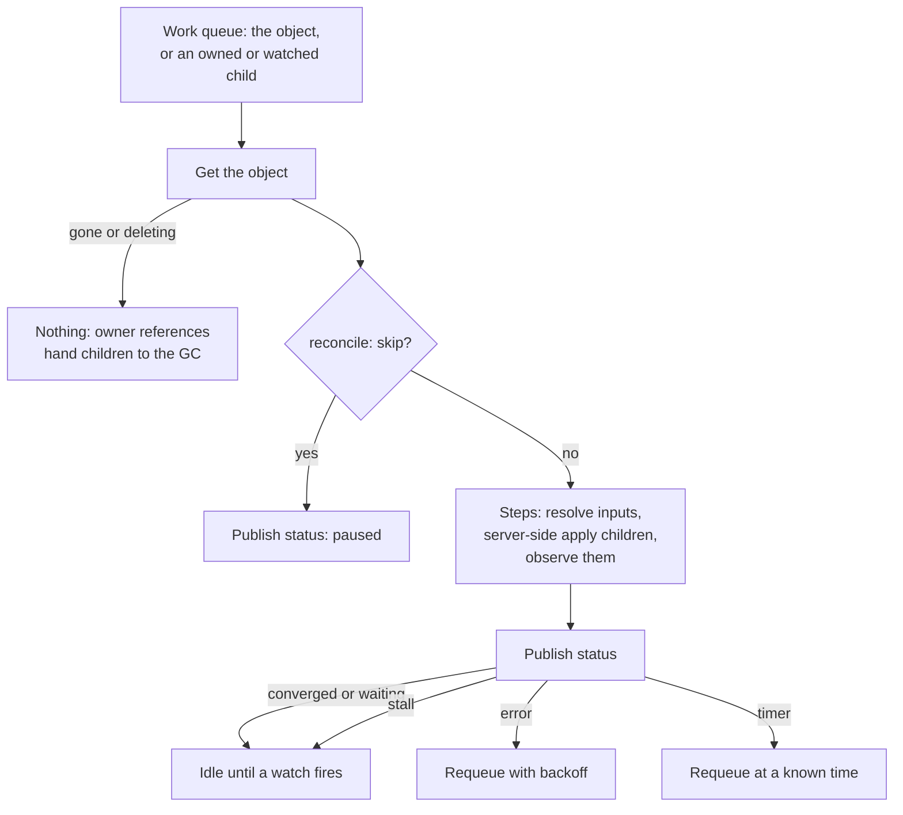

# The operator

The operator owns only state that must persist. It reconciles these kinds in the
API group `pgtoolbox.fyannk.dev`, version `v1alpha1`:

| Kind | Short name | One per | Page |
|---|---|---|---|
| `PgAdmin` | `pga` | team namespace | [PgAdmin](pgadmin.md) |
| `EvidenceAgent` | `pgea` | backup repository (CloudNativePG Cluster) | [EvidenceAgent](evidenceagent.md) |
| `PgToolBoxConsole` | `pgc` | namespace (its CloudNativePG Clusters) | [PgToolBoxConsole](console.md) |
| `PgAccessRequest` | `pgar` | request for time-bound access to a namespace | [Access requests](../console/access-requests.md) |
| `PgAdminAccess` | `pgaa` | grant letting a `PgAdmin` of another namespace use this namespace's Clusters (read by the `PgAdmin` controller; no status) | [Clusters of other namespaces](pgadmin.md#clusters-of-other-namespaces) |

`kubectl get pgtoolbox -A` lists them (category `pgtoolbox`). Fields are in the
[generated API reference](../reference/api.md); status conditions and their
reasons are on [Conditions](conditions.md).

## How a controller works

Each kind has one controller, and every controller runs the same skeleton: read
the object, run its steps in dependency order, and end with **one** status write
on every exit path, skipped when nothing changed:

- **Server-side apply** with field owner `pgtoolbox` and forced ownership, after a
  check that an existing object of that name is controlled by the same custom
  resource; otherwise `ResourceNotOwned`. Status is written with a merge patch
  locked to the resourceVersion read (field owner `pgtoolbox-status`).
- **Stall versus requeue.** A stall (an input only a person can fix: a refused
  image, a missing reference, a foreign object) is not retried: a change of a
  watched object wakes the controller. An API error is returned to
  controller-runtime, which retries with backoff. A timer is set only for a fact
  that changes without an event.
- **No finalizers.** Deleting a custom resource deletes its children through
  owner references (a `PgAdmin`'s settings volume only with `retainPolicy: Delete`).

| Controller | Reads | Applies | Timed requeue |
|---|---|---|---|
| `PgAdmin` | Clusters, Poolers, `DatabaseRole`s, `PgAdminAccess` grants, Secret metadata | volume, ServiceAccount, Role, offer Secret, Service, NetworkPolicy, exposure, Deployment, Jobs; grant Roles in granted namespaces | none |
| `PgToolBoxConsole` | ClusterRole existence, the lifecycle ConfigMap | ServiceAccount, Service, RoleBindings, NetworkPolicy, PVC, PDB, exposure, Deployment; creates the session Secret and revocation ConfigMap once | 2 min while `ConsoleRoleMissing` |
| `EvidenceAgent` | Cluster, `ObjectStore` (past the cache), Secret metadata | ServiceAccount, Service, the agents' ClusterRole and binding, certificate Secrets, Deployment | at the certificate's renewal |
| `PgAccessRequest` | its RoleBindings, the named Cluster | nothing: it only deletes RoleBindings | at `expiresAt`, and at the end of an orphan's grace |

The per-kind flows are on [PgAdmin](pgadmin.md#reconcile-loop),
[PgToolBoxConsole](console.md#reconcile-loop),
[EvidenceAgent](evidenceagent.md#reconcile-loop) and
[access requests](../console/access-requests.md#lifecycle); what the conditions
say is on [Conditions](conditions.md).

## Rules the kinds share

- **Same namespace only.** `clusterRefs`, `clusterSelector`, `clusterRef`,
  `objectStoreRef` and every Secret reference name objects in the custom
  resource's own namespace. The one exception is a `PgAdmin`'s
  `crossNamespaceClusterRefs`, which take effect only while a `PgAdminAccess` in
  the target namespace grants them: an explicit grant object, never an implicit
  selector.
- **Names** are DNS-1035 labels of at most 40 characters, because they prefix the
  generated objects.
- **Pause.** The annotation `pgtoolbox.fyannk.dev/reconcile: skip` pauses
  reconciliation. Status is still published: `Progressing=False` and `Ready=Unknown`
  with reason `ReconciliationPaused`, meaning the operator is not looking and does
  not vouch for the children. One check runs all the same on a `PgAdmin` or a
  `PgToolBoxConsole`: a `spec.exposure.hostname` outside
  `EXPOSURE_ALLOWED_HOST_SUFFIXES` withdraws the Route, Ingress or HTTPRoute
  (`Stalled=True`, `HostnameNotAllowed`), so a pause never keeps a refused name
  published.
- **Ownership.** If an object the operator must create already exists under the
  generated name and is controlled by someone else, it stops with
  `ConfigurationValid=False` (`ResourceNotOwned`) instead of taking it over.
- **Rollouts.** The desired state of each generated child carries a content hash
  in the annotation `pgtoolbox.fyannk.dev/spec-hash`; a changed hash is a rollout
  and the operator says so in an Event. A reconcile that changes no status writes
  none.
- **Metadata propagation.** `spec.metadataPropagation` copies labels and annotations
  onto chosen generated objects; keys under `pgtoolbox.fyannk.dev/` are rejected
  and the operator's own labels always win.

Labels the operator sets (frozen API surface: extended, never renamed):

| Key | On | Meaning |
|---|---|---|
| `app.kubernetes.io/managed-by=pgtoolbox` | every generated object | |
| `pgtoolbox.fyannk.dev/reconcile=true` | every object the operator creates | Selects the operator's own objects. |
| `pgtoolbox.fyannk.dev/pgadmin=<name>` | objects generated for a `PgAdmin` | |
| `pgtoolbox.fyannk.dev/evidenceagent=<name>` | objects generated for an `EvidenceAgent` | |
| annotation `pgtoolbox.fyannk.dev/producer-epoch` | an agent's Pod template | The generation the Deployment was rendered from. |

## Configuration

One struct, defaults in code, overlaid by the environment, then the ConfigMap
`pgtoolbox-operator-config`, then the Secret of the same name in the operator's
namespace (the Secret wins; both optional). It is loaded and validated once before
the manager starts, with all problems in one message. **There is no hot reload:**
edit the ConfigMap, then roll the operator. The effective values, with their
source, are exported as `pgtoolbox_config_info` (values from the Secret are
redacted).

| Key | Chart value | Default | |
|---|---|---|---|
| `WATCH_NAMESPACES` | `operator.config.watchNamespaces` | empty: every namespace the ClusterRole allows | Comma list; restricts the caches. The Helm chart also binds the namespaced rules (Secrets, workloads, RBAC objects) only in the listed namespaces, by RoleBindings in namespaces that must exist at install time, keeps a small ClusterRole of cluster-scoped rules bound cluster-wide (`<fullname>-manager-cluster`, no `bind`), and grants `get` on the `pgtoolbox-operator-config` ConfigMap and Secret in the release namespace, which need not be listed. See [namespaces dropped from the watch](#namespaces-dropped-from-the-watch) for a listed namespace the operator cannot read at start. Narrowing the list leaves what the operator made in a namespace it no longer watches as it was and unmanaged: its PgAdmins, PgToolBoxConsoles and EvidenceAgents keep their Deployments and Secrets but nobody reconciles them (no status, no certificate renewal for the agents, which stop being served once their certificate expires), an agent's ServiceAccount is dropped from the agents' ClusterRoleBinding at the next agent reconcile (the binding lists the agents the operator sees), so the agent can no longer review the tokens it is called with, its `PgAdminAccess` grants keep the Roles and RoleBindings they gave, and the RoleBinding of an approved `PgAccessRequest` there no longer expires: nothing removes it at `spec.expiresAt` or on revocation (the controller that takes grants away does not watch the namespace any more). Delete those objects before you narrow the list, or put the namespace back. The operator also runs Pods there as any ServiceAccount: enforce Pod Security `restricted` on every listed namespace ([security](../security.md#known-limitations)). kustomize and OLM always bind the whole ClusterRole cluster-wide. One operator per cluster is the only supported layout. |
| `POD_NAMESPACE` | downward API | | Where the operator runs. |
| `OPERATOR_IMAGE` | `image.*` | baked in at build | Copied into pgAdmin Pods for the credential sidecar. |
| `PGADMIN_IMAGE` | `operator.pgAdmin.image` | the hardened, digest-pinned image compiled in | |
| `PGADMIN_IMAGE_REPOSITORIES` | `operator.pgAdmin.imageRepositories` | each image's default repository only | The [allow-list](images.md) for `PgAdmin` images. |
| `EXPOSURE_ALLOWED_HOST_SUFFIXES` | `operator.exposure.allowedHostSuffixes` | empty: any hostname | Comma list of DNS suffixes a `PgAdmin`'s or a `PgToolBoxConsole`'s `spec.exposure.hostname` must fall under (the suffix or a name below it). Outside them: `ConfigurationValid=False`, reason `HostnameNotAllowed`, and the Route, Ingress or HTTPRoute already published is withdrawn. Without it, whoever may create those kinds chooses which name the cluster's router or gateway serves. |
| `OAUTH_PROXY_IMAGE` | `operator.oauthProxyImage` | `quay.io/openshift/origin-oauth-proxy:4.18`, pinned by digest | On OpenShift use the release payload's. |
| `MAX_CONCURRENT_RECONCILES` | `operator.config.maxConcurrentReconciles` | `4` | Per controller. |
| `RECONCILIATION_TIMEOUT` | `operator.config.reconciliationTimeout` | `2m` | Bounds one reconcile. |
| `LEADER_ELECTION_LEASE_DURATION`, `_RENEW_DEADLINE`, `_RETRY_PERIOD` | | `30s`, `20s`, `5s` | |
| `UPGRADE_BACKUPS_KEPT` | `operator.config.upgradeBackupsKept` | `3` | [Pre-upgrade backups](pgadmin.md#upgrades) kept per `PgAdmin`. |

Command-line flags: `--metrics-bind-address` (`:8080`), `--metrics-cert-dir`,
`--health-probe-bind-address` (`:8081`: `/healthz` is liveness, the process
answers; `/readyz` is readiness, true only once every informer cache has synced,
so a replica that cannot list what it watches stays out of rotation; both are
served only once the manager starts, so each start-up step (the configuration,
the watched namespaces, the optional-API probes of `PgAdmin` and
`EvidenceAgent`, the manager, and each controller's setup, whose discovery
requests time out after 10 seconds each) has a 20-second deadline, and all of
them together 40 seconds; a step that runs out of either fails the start with
an error that names it, before the shipped liveness probe kills a start that
hangs or crawls, about 55 seconds in), `--leader-elect` (default true),
`--default-evidence-agent-image`, `--evidence-agent-image-repositories`,
`--default-console-image` (`CONSOLE_IMAGE`; the chart passes `console.image`),
`--console-image-repositories` (`CONSOLE_IMAGE_REPOSITORIES`, chart
`operator.console.imageRepositories`) and `--pgadmin-image-repositories` (the last
overrides `PGADMIN_IMAGE_REPOSITORIES`; see [images](images.md)).

### Namespaces dropped from the watch

The operator reads every namespace of `WATCH_NAMESPACES` once at start. It
leaves out, with an error in its log and in
`pgtoolbox_watch_namespaces_dropped{reason}`, a listed namespace it cannot
fully use:

- a listed namespace deleted after the install: once it is recreated, run
  `helm upgrade` (its RoleBinding) and restart the operator (reason
  `clusters-unlistable`);
- a namespace where the operator may not list CloudNativePG Clusters: restore
  the chart's RoleBinding, then restart the operator (`clusters-unlistable`);
- a namespace where the operator lacks any other namespaced permission of its
  manager role: its administrator replaced the chart's RoleBinding with a
  narrower Role (Clusters readable but not Deployments, Secrets, Pods, Roles
  and so on, or Clusters listed but not watched). The log line names the
  namespace and each missing permission (`list,watch deployments.apps`).
  Restore the chart's RoleBinding, then restart the operator (`permissions`);
- a namespace whose permission review fails: an error the API server still
  returns after one retry (a 5xx, a timeout or throttling is retried once), or
  no answer within 6 seconds per attempt. The log line names the namespace
  and the error (`review-failed`). Tens of thousands of RoleBindings in one
  namespace make its review slow; a
  `count/rolebindings.rbac.authorization.k8s.io` ResourceQuota keeps it small.

The check is one SelfSubjectRulesReview per namespace, concurrent, each with
its own deadline inside the start-up deadline, so one slow namespace is left
out alone while the others start. Where the cluster's authorizer cannot list
its rules (a webhook authorizer), each permission the review does not show is
asked again with a SelfSubjectAccessReview, four at a time per namespace. It
asks for exactly the namespaced rules of the manager role the operator ships
with (the generated role, embedded in the binary), plus `list` and `watch` on
every kind its informers hold, with the RBAC authorizer's matching rules (a
Role that grants `pgadmins/*` grants no subresource: RBAC reads it literally).
A namespace left out is not reconciled, and the others are unaffected. Without
this check, an informer refused in one namespace would never sync, and the
operator would stop for every namespace. If the RBAC of a kept namespace
changes after the start so that an informer can no longer sync, the
operator's exit error carries a hint naming the watched namespaces to check.

A namespace left out keeps the status its objects had, which nobody updates
any more, possibly `Ready=True`. Two signals say so:

- **On the objects**, best effort, once at start: in a namespace left out for
  its permissions, where the review shows the operator may still list the
  kind and patch its status, each `PgAdmin`, `PgToolBoxConsole` and
  `EvidenceAgent` turns `Ready=Unknown`, reason `NamespaceNotWatched`, its
  message naming that namespace and the permissions missing there; where it
  may create events, a Warning Event of the same reason goes with it (on the
  transition, or at every start when the status cannot be written). These
  writes bypass the cache, each is bounded to 5 seconds, they run beside the
  start (never in its deadline), and a refused one is logged, not retried. In
  a namespace whose permissions are unknown (`clusters-unlistable`,
  `review-failed`) nothing is attempted. Once the namespace is watched again,
  the next reconciliation computes `Ready` as usual.
- **On the operator**: `pgtoolbox_watch_namespaces_dropped{reason}` and the
  chart's alert `PgToolBoxOperatorNamespacesDropped`
  (`operator.metrics.prometheusRule.enabled`; see
  [metrics](metrics.md#alerts)), which fires whatever the cause.

In a namespace left out, an approved `PgAccessRequest` no longer expires: its
RoleBinding stays past `spec.expiresAt` and a revocation removes nothing, with
no signal to the approver but the operator's log, the gauge and the alert.
Restore the namespace (or delete the RoleBinding by hand) before relying on an
expiry there.

An optional API (Routes, HTTPRoutes, Poolers, Databases, DatabaseRoles, the
backup plugins' kinds) never leaves a namespace out: each namespace's Role
decides for that namespace alone. Refused in some namespaces only (their
administrator bound the operator to a narrower Role there, or a wider one while
the install refuses the API elsewhere), the feature is off in those namespaces
only, with its usual `…APIUnavailable` reason naming the namespace, a log line
at start and `pgtoolbox_optional_api_refused_namespaces{group,kind}`; the other
namespaces keep it, and it is watched only where it can be listed. Refused in
every namespace, it is off everywhere. A change of RBAC is read at the next
start.

A Route or HTTPRoute published before its API was refused in the namespace
is not forgotten. The operator looks it up past the cache at every
reconciliation and deletes it when it is no longer wanted. When it cannot (the
Route is the requested exposure, or its read or deletion is refused),
`ExposureReady` keeps its reason but its message says that a Route or HTTPRoute
published before may remain and must be deleted by hand. It never says the
exposure is gone. On a `PgToolBoxConsole` that publishes nothing else,
`ExposureConfined` is then `False` (`ExposureOpen`) for one found still there,
and `Unknown` (`ExposureOpen`) for one the operator may not read either: it may
be gone. A refused read is reported only when the object's history says one
may have been published (its spec requests that kind, or an earlier status
observed a Route or HTTPRoute or already reported one); a `PgAdmin` or console
that was only ever `clusterIP` or Ingress gets no such sentence. If the Route
or Gateway API itself is removed while the operator runs, nothing of it can
remain and the reconciliation carries on (restart the operator to read the new
API set).

If no listed namespace is left, the operator does not start; nor does
it when the API server refuses its credentials (401) at start, which is retried
by a restart rather than read as a namespace out of reach.

## Availability

Two replicas with leader election, a PodDisruptionBudget (`minAvailable: 1`),
soft topology spread across nodes, and a 40-second termination grace period (the
schema's floor: it covers releasing the lease). The operator being down does not
affect running pgAdmins, evidence agents or consoles; it affects only changes to
the custom resources. Run one operator per Kubernetes cluster: it owns CRDs and
cluster-scoped RBAC.

## NetworkPolicy and admission policy

Both are optional and **off by default**, because each is the installing admin's
decision, never the product's.

- `operator.networkPolicy.enabled`: egress to DNS, the API server (looked up from
  the `kubernetes` EndpointSlice at install time, or `apiServer.mode: any` or
  `addresses`) and `extraEgress`; ingress only from `ingress.metricsFrom`, on the
  metrics port. The API server's addresses are rendered when the chart is
  installed or upgraded: on EKS, and wherever a managed control plane's
  addresses move (upgrades, scaling), set `apiServer.mode: any`, or the
  operator loses the API server until the next `helm upgrade`.
- `operator.admissionPolicy.enabled` (default `true`; kustomize opts in with
  `config/components/admission`, OLM cannot ship it):
  a `ValidatingAdmissionPolicy` (CEL, no webhook). Its rules: only `imageOverride.allowedUsers`
  and `allowedGroups` (default group `system:masters`) may set `spec.image` on a
  `PgAdmin` or `EvidenceAgent`, everyone else getting the operator's default
  image; and only `workloadIdentity.allowedUsers` and `allowedGroups` (same
  default) may add or change `spec.workloadIdentity` on an `EvidenceAgent`, which
  lends the agent a cloud role; a third, the Secret rule: creating or editing a
  `PgToolBoxConsole`, `PgAdmin` or `EvidenceAgent` requires `get` on every Secret it
  references, again when the place a kept Secret is sent changes; a fourth: a
  `PgAdmin` that offers the credentials of Clusters of its namespace, or keeps its
  settings on one (`configDatabase`), requires `get` on the namespace's Secrets,
  again when it widens who may sign in or raises the proxy's `sessionMaxAge` (see
  [Security](../security.md#secret-references-need-get)); a fifth: a projected
  Prometheus token takes `create serviceaccounts/token`; and a sixth: an exposure
  annotation an ingress controller reads as configuration (snippets,
  authentication, source ranges, redirects, canaries, extra hosts, load-balancer
  scheme, middlewares, plugins), on the exposure object or on the Service through
  `metadataPropagation`, requires `create` on the exposure kind (see
  [Security](../security.md#exposure-annotations-that-configure-the-ingress-controller)).
  `validationActions` selects `Deny`, `Warn` and/or `Audit`; `Deny` alone enforces.
  See [images](images.md) for why.

## Permissions

The operator's ClusterRole is generated from the controllers' markers
(`config/rbac/role.yaml`, copied by `make manifests`); the file in the repository
is the authority, and `make validate-packaging` compares the chart and the OLM
bundle with it. It is broad because the operator creates workloads: Secrets (the
serving-certificate CA and key of an `EvidenceAgent`, pgAdmin's bootstrap and
cookie material), Roles and RoleBindings (the name-scoped Role of a pgAdmin
Pod), and the agents' ClusterRole and binding. Three rules matter for the
security model:

- It holds `create` on `tokenreviews` and `subjectaccessreviews`, because the
  evidence agents' ClusterRole needs both and Kubernetes' escalation prevention
  makes a grantor hold what it grants. It also holds `create` on
  `selfsubjectrulesreviews` and `selfsubjectaccessreviews`, for its start-up
  check of each watched namespace (Kubernetes grants both to every
  authenticated user by default; the role does not rely on that).
- It does **not** hold the console's read rules. A `PgToolBoxConsole`'s ServiceAccount is
  bound to two ClusterRoles shipped with the operator, `pgtoolbox-console` and
  `pgtoolbox-console-pod-logs`; the operator has only the `bind` verb on those two
  names, so no `PgToolBoxConsole` can obtain more than they grant.
- It reads user Secrets by metadata only (existence and version); their content
  is never cached.
- The operator never holds a database password. For pgAdmin it writes only an
  *offer* naming Secrets and roles; a sidecar with a name-scoped Role reads the
  Secrets ([how](pgadmin.md#credentials)).

## Metrics

See [Operator metrics](metrics.md).
