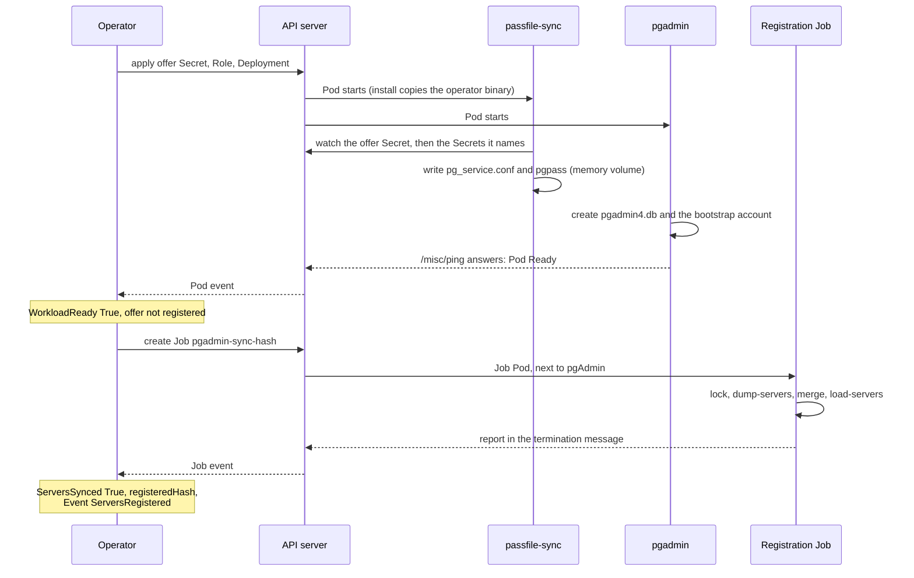
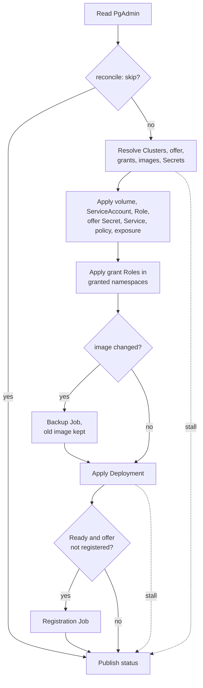

# PgAdmin

A `PgAdmin` declares **one pgAdmin for a team namespace**, registered against the
CloudNativePG Clusters of that namespace. One URL, one set of preferences and one
upgrade per team, instead of one pgAdmin per cluster. Every field is in the
[API reference](../reference/api.md#pgadmin); the samples in `config/samples/`
(`pgadmin_oauth2.yaml`, `pgadmin_openshift.yaml`, `pgadmin_configdatabase.yaml`,
`pgadminaccess.yaml`) are tested against the CRD's validation.

```yaml
apiVersion: pgtoolbox.fyannk.dev/v1alpha1
kind: PgAdmin
metadata:
  name: team-a
spec:
  clusterRefs:
  - name: orders
  - name: billing
  endpoints: [rw, ro]
  credentials:
    superuser: false
  auth:
    oauth2:
      issuerURL: https://idp.example.com/realms/corp
      clientID: pgadmin-team-a
      clientSecretRef: {name: pgadmin-team-a-oidc}
      requiredClaims: {groups: [team-a-dba]}
  admins: [alice@example.com]
  exposure:
    type: ingress
    hostname: pgadmin.team-a.example.com
    ingressClassName: nginx
    tls: {certificateSecretRef: {name: pgadmin-team-a-tls}}
  storage: {size: 2Gi}
```

## Which Clusters

At most one of `clusterRefs` (up to 32 names) and `clusterSelector` (a label
selector); both match Clusters **of the `PgAdmin`'s own namespace only**. Clusters
of other namespaces are named in `crossNamespaceClusterRefs` and need a grant
there (see [Clusters of other namespaces](#clusters-of-other-namespaces)). At
least one of the three is required.
`endpoints` chooses which Service of each Cluster gets a server: `rw` (default),
`ro`, `r`, or `pooler:<name>` for a CloudNativePG `Pooler` of that Cluster.

An endpoint a Cluster cannot serve is not offered for that Cluster. CloudNativePG's
`<cluster>-ro` Service routes to the replicas only, so a Cluster that declares one
instance (`spec.instances: 1`) gets no `ro` server: its Service has no endpoints
and every connection would be refused. A Cluster that lists `ro` or `r` in
`spec.managed.services.disabledDefaultServices` has no such Service, and gets no
server for it either. Each skipped pair appears in `status.servers` as `NotOffered`
with the reason (`no replica: the Cluster has one instance`, `the Cluster disabled
its ro Service`). The operator reads the Cluster's spec, not its readiness: a
replica that restarts does not make the server disappear. Scale the Cluster to
two instances and the next reconcile offers the `ro` server; scale it back to one
and the server is withdrawn like any server no longer offered.

For `verify-full` to succeed, a pooler endpoint's Service name must be among the
Cluster's `spec.certificates.serverAltDNSNames`.

The offered set (clusters × endpoints × credentials) is bounded at 64 servers; more
is `ConfigurationValid=False` with reason `TooManyServers`.

## Credentials

`spec.credentials` selects what each registered Cluster offers. Each offered
credential becomes one shared server per endpoint.

| Field | Default | Offers |
|---|---|---|
| `application` | `true` | The application user (the Cluster's app Secret). |
| `databaseRoles` | `true` | `DatabaseRole`s of the Cluster that CloudNativePG reports applied, with the password Secret at the version it applied. |
| `superuser` | **`false`** | The privileged credentials: the superuser (when the Cluster enables superuser access) and any role that is superuser, `createrole`, `bypassrls` or `replication`, or a member (directly or through roles the Cluster declares) of a `pg_*` role, the superuser, the application owner or another privileged role. |

**Who may ask for them.** With the operator chart's admission policy, creating a
`PgAdmin` that offers credentials of Clusters of its own namespace, or widening
the offer (turning on a kind, adding a Cluster, changing the selector), requires
`get` on the namespace's Secrets: the person who decides what pgAdmin hands out
must be able to read it already ([security](../security.md#secret-references-need-get)).

A privileged role is offered **only** with `superuser: true`. A credential the
Cluster has but this `PgAdmin` does not offer appears in `status.servers` as
`NotOffered` with the reason.

CloudNativePG 1.30 and later serve the `DatabaseRole` kind. Where an install does not
(its CRDs lack it), no `DatabaseRole` is offered and the `PgAdmin` is still `Ready`: `databaseRoles` defaults to `true`, so
the operator cannot tell the default from a request, and the `ConfigurationValid`
message says `no DatabaseRole offered` with the reason. Where the kind is served but
the operator may not list it, only the application and superuser credentials are
offered and `ConfigurationValid` is `False` (`DatabaseRoleAPIUnavailable`).
`configDatabase` always needs the kind.

**How passwords reach pgAdmin.** The operator never holds a database password. It
writes an *offer* into a Secret only it writes: names of Secrets and roles, no
password. A sidecar (`passfile-sync`, the operator's own binary copied into the
Pod by an init container so it runs under pgAdmin's UID) reads exactly the offered
Secrets and the Clusters' `<cluster>-ca` through the Pod's name-scoped Role, and
rewrites a libpq service file and a `pgpass` file atomically on rotation. They live
on a memory-backed `emptyDir` outside pgAdmin's storage directory (mode 0600, the
files bounded to 1 MiB in total), so nothing is downloadable through pgAdmin's file
manager. libpq reads both per connection, so a rotated password
needs no restart and no registration.

Connections use `sslmode=verify-full` against the Cluster's CA,
`PGREQUIREAUTH=scram-sha-256` and `PGCHANNELBINDING=require`. A server that cannot
do SCRAM with channel binding over TLS will not connect; that is intended.

## Who may open it

**Only a DBA.** Whoever reaches pgAdmin holds the credentials of every role it
offers: pgAdmin hides the passwords, but a connected role can change its own, and
a server a person registers can name a managed libpq service. So opening pgAdmin
is equivalent to reading those Secrets.

- On **OpenShift** the `oauth-proxy` sidecar authorizes with a SubjectAccessReview
  for `connect pgadmins/<name>`, which the
  [`pgtoolbox-console-operator`](../console/authorization.md#the-two-clusterroles) role
  grants, and the namespace's `admin` role (through `pgtoolbox-aggregate-to-admin`,
  `operator.userRoles.aggregateToAdmin`, and OLM's own `*` role for its CRDs): a
  namespace admin reads those Secrets anyway. `edit` and `view` do not. The verb
  is `connect`, not `get`, because OLM aggregates `get`, `list` and `watch` on
  every CRD it owns into `view`: with `get`, every namespace reader could open
  pgAdmin. A `PgAdmin` created before this change asked for `get`; the operator
  rolls its Deployment to the new check on upgrade. If you bound a custom role
  with `get pgadmins` to let people open pgAdmin, add `connect`.
  The proxy runs the review **at sign-in only**, so its session is bounded to
  **one hour** (`--cookie-expire=1h`; the proxy's own default is 168h). After
  that the proxy signs the person in again, silently while their OpenShift
  session lasts, and reviews `connect` again: a revoked access (an expired
  [access request](../console/access-requests.md), a removed RoleBinding) closes
  pgAdmin within the hour. pgAdmin's own session, and connections it holds open,
  end with it only once the next request reaches the proxy.
- On **Kubernetes** pgAdmin's own OAuth2 sign-in is the gate, and the identity
  provider, not RBAC, decides who gets in. `requiredClaims` is therefore
  **required** (1 to 8 claims) and must name the same people as the namespace's
  `pgtoolbox-console-operator` RoleBinding. The console shows the link to pgAdmin only to
  people who may `connect` to the `PgAdmin`, but that is a convenience, not the gate.

Per-person identity inside PostgreSQL is not possible with shared servers:
connection parameters belong to the server entry, and everybody who connects as a
shared server is that role. For a person's own role, see
[personal database roles](#personal-database-roles).

## Sign in

Exactly one of `auth.oauth2` and `auth.openshiftOAuthProxy`. pgAdmin has no local
password login.

**`oauth2`** (Kubernetes): pgAdmin's native OAuth2 against an OpenID Connect issuer
(`issuerURL`, https only; pgAdmin reads `/.well-known/openid-configuration`).
`clientSecretRef` names a Secret key (default `client-secret`) that pgAdmin reads
from a mounted file; it never enters the Pod spec or the operator. `usernameClaim`
defaults to `email`, `scopes` to `openid email profile`. Users are created by
pgAdmin on first sign-in. Only the usernames in `spec.admins` get pgAdmin's
Administrator role.

**`openshiftOAuthProxy`** (OpenShift): the proxy terminates TLS with the OpenShift
service CA, authorizes every request with the SubjectAccessReview above and passes
the user to pgAdmin in `X-Forwarded-User`; pgAdmin listens on loopback only, so
the header can come from nothing but the proxy. The proxy image is
`OAUTH_PROXY_IMAGE` unless the spec names one.

Single sign-out is the identity provider's job.

## Registration

pgAdmin's `setup.py` is the only writer of its database, and it runs rarely and from
a **Job**, never from the reconcile loop. When the offered set changes, the
operator waits for a Ready pgAdmin Pod (its readiness probe is `/misc/ping`) and
starts a registration Job named `<name>-pgadmin-sync-<hash>`; the Job takes a lock
on the settings volume, dumps the servers, keeps everything outside the managed
group, and loads the offered servers as **shared servers owned by an internal
bootstrap account**, in the group `PgToolBox`.
People's own servers and IDs are never touched. Its outcome is `ServersSynced`.

How a new `PgAdmin` starts, gets its credential files and has its servers
registered (SQLite settings database; the default):



The Job starts only once pgAdmin is Ready, so it never opens a settings database
pgAdmin is still creating. That matters: `pgadmin4.db` appears as soon as pgAdmin
starts setting it up, and a `setup.py` run that opens it before pgAdmin has added
its initial account leaves a database pgAdmin cannot start on again (it asks for
that account on a terminal it does not have, and crash-loops). The pgtools chart,
which registers from a sidecar beside pgAdmin, waits for `/misc/ping` for the same
reason ([pgAdmin without the operator](../install/pgadmin-without-operator.md#start-up-and-registration)).

The Job's hash covers the offered set, `spec.admins`, the sign-in source and the
settings volume's UID: a change of any of them starts a new Job and deletes the
older ones; a recreated volume is registered again. A Job that failed (its Pod
is retried twice) is not started again: `ServersSynced=False`
(`RegistrationFailed`) names it, and deleting it starts it again.

Rotating a credential does not run the Job: `passfile-sync` watches every Secret
the offer names and rewrites the files, and libpq reads them at the next
connection. `status.servers[]` lists every server
and its state (`Registered`, `Pending`, `NotOffered`), `status.pgAdminVersion` the
version the last Job reported, `status.registeredHash` the offered set it applied.

With `configDatabase`, `passfile-sync` is a native sidecar: its startup probe holds
pgAdmin back until the settings database's service is in the credential files, and
the registration Job writes its own copy of those files, since it opens the same
database.

## Reconcile loop

What one pass of the `PgAdmin` controller does. Every write of a child is a
server-side apply (field owner `pgtoolbox`), refused when an object of that name
belongs to someone else:



- **Stalls** (`Stalled=True`, no retry until a watched object changes):
  `ImageNotAllowed`, `SecretNotFound` for the OAuth2 client Secret,
  `ResourceNotOwned`, `UpgradeBackupFailed`, and the `configDatabase` problems
  (`DatabaseAPIUnavailable`, `PasswordGenerationUnavailable`, ...).
- **Not stalls**: a missing Cluster, Pooler or grant, or too many servers, set
  `ConfigurationValid=False` but the loop goes on, so pgAdmin keeps serving the
  Clusters that resolve.
- **Errors** (an API call that failed) end the pass with `Ready=False`
  (`ReconcileError`) and are retried with controller-runtime's backoff.
- There is no periodic requeue: the controller is woken by the `PgAdmin`, the
  objects it owns (Deployment, Jobs, Services, Roles, Secrets...), its Pods and
  volume, the Clusters, `DatabaseRole`s and Poolers it offers, the
  `PgAdminAccess` grants and the OAuth2 client Secret.
- Status is written once, at the end of every pass, and only when it changed.

## Clusters of other namespaces

A `PgAdmin` registers a Cluster of another namespace only while a **`PgAdminAccess`**
in that namespace grants it. Nothing crosses a namespace implicitly: there is no
cross-namespace selector.

```yaml
# In team-a: the PgAdmin names the Cluster.
spec:
  crossNamespaceClusterRefs:
  - {namespace: team-b, name: payments}
---
# In team-b: the grant, created by team-b's owner.
apiVersion: pgtoolbox.fyannk.dev/v1alpha1
kind: PgAdminAccess
metadata: {name: pgadmin-team-a, namespace: team-b}
spec:
  pgAdmin: {namespace: team-a, name: team-a}
  clusters: [{name: payments}]
```

Without a grant, `ConfigurationValid` is `False` with reason **`GrantMissing`**
naming the Cluster (a Warning Event on the transition), and the Clusters of the
`PgAdmin`'s own namespace are still served. With a grant, the operator keeps, in
the grant's namespace, a Role allowing `get` and `watch` on exactly the offered
Secrets of the granted Clusters (and their CA) and a RoleBinding of that Role to the
`PgAdmin`'s ServiceAccount, both owned by the grant: **deleting the
`PgAdminAccess` revokes the access** (garbage collection deletes them), and a
`PgAdmin` that stops naming the namespace, or is deleted, has them deleted (the
grant stays: re-creating the `PgAdmin` renders them again). The offered servers are
named `<namespace>/<cluster> <endpoint> (<role>)`; `spec.endpoints` and
`spec.credentials` apply as for the own namespace's Clusters, except that the
**privileged credentials** (the superuser and privileged `DatabaseRole`s) of a
granted Cluster are offered only when the grant says `allowPrivileged: true` (default
`false`) as well as the `PgAdmin` asking with `credentials.superuser`: the `PgAdmin`'s
own spec cannot widen a grant. The NetworkPolicy reaches the granted Clusters' Pods
in their namespace. A namespace the operator does not watch (`WATCH_NAMESPACES`)
cannot be referenced (`ConfigurationValid=False`).

**Who decides.** The grant lets the `PgAdmin`'s ServiceAccount read those
credentials, so creating a `PgAdminAccess` is the decision of whoever may read the
namespace's Secrets. Who may create `pgadminaccesses` in a namespace is an RBAC
decision of its owner; the chart's user roles do not grant it. The access extends
to whoever can run Pods as that ServiceAccount in the `PgAdmin`'s namespace (its
editors): grant only to namespaces whose editors you trust with these credentials.
The operator must watch both namespaces.

## Personal database roles

A per-person `DatabaseRole` gives one person their own identity in PostgreSQL. The
console creates it (`POST /api/v1/namespaces/{namespace}/clusters/{name}/database-roles`,
as the signed-in user, who needs `create` on `databaseroles.postgresql.cnpg.io` in the
namespace), with a password **CloudNativePG generates** (DatabaseRole `spec.password`,
CloudNativePG 1.31 and later; on an older minor the console answers that this is not
available). A `DatabaseRole` labelled `pgtoolbox.fyannk.dev/personal-role: "true"` and
annotated `pgtoolbox.fyannk.dev/pgadmin-user: <pgAdmin username>`, however created,
becomes a **personal, non-shared server of that pgAdmin user** (group
`PgToolBox (personal)`) in every `PgAdmin` that registers the Cluster, instead of a
shared one; the registration Job creates the pgAdmin user ahead of their first
sign-in. `status.servers[].pgAdminUser` names the owner, and
`status.personalServerOwners` the users the last registration served (a user whose
roles are gone loses the managed personal group at the next registration, and keeps
their own servers).

The usual rules apply: a privileged personal role is offered only with
`spec.credentials.superuser`, and the password Secret must be at the version
CloudNativePG applied. A personal server is personal in pgAdmin's tree only: the
credential files are shared by the pgAdmin Pod, so whoever opens pgAdmin can still
name any offered service (pgAdmin is DBA-only for that reason). The same holds for
the [settings database](#settings-database-on-a-cluster)'s credentials: a person who
opens pgAdmin can connect as the settings database's owner and edit pgAdmin's own
tables, accounts and roles included.

## Storage

`spec.storage`: `size` (default `1Gi`, may grow, never shrink), `storageClassName`
(immutable) and `retainPolicy`:

- `Retain` (default): the settings volume has no owner reference, survives deletion
  of the `PgAdmin`, and a `PgAdmin` of the same name re-adopts it.
- `Delete`: garbage collection deletes it with the `PgAdmin`.

pgAdmin's SQLite database and storage directory live on this volume.

### Settings database on a Cluster

`spec.configDatabase.clusterRef` puts pgAdmin's settings database on a
CloudNativePG Cluster of the same namespace (pgAdmin's `CONFIG_DATABASE_URI`)
instead of SQLite. The operator owns a `DatabaseRole` (`<name>-pgadmin-config`)
whose password **CloudNativePG generates** into `<name>-pgadmin-config-password`,
and a `Database` (`pgadmin_<name>` by default, `configDatabase.database` otherwise)
owned by that role, both kept in PostgreSQL when the `PgAdmin` is deleted. The
password never passes through the operator: `passfile-sync` (a native sidecar in
this mode, so pgAdmin starts once the credentials are written) puts it in the Pod's
`pgpass`, and the URI pgAdmin gets carries no password, only `verify-full` against
the Cluster's CA.

- It needs CloudNativePG 1.31 or later. On 1.30 the API server refuses
  `spec.password`; the `PgAdmin` is stalled with
  `PasswordGenerationUnavailable` rather than holding a password.
- Until CloudNativePG reports the role, its password and the database applied, the
  Deployment has no Pod and `WorkloadReady` says `ConfigDatabaseNotReady`.
- There is no settings volume: pgAdmin's sessions and file-manager storage
  directory are per Pod and ephemeral, and the pre-upgrade SQLite backup does not
  apply (back the Cluster up).
- `spec.replicas` above 1 is accepted **only** with `configDatabase`. One Pod runs
  while the settings schema is created or migrated (first start, image change);
  the others follow. pgAdmin keeps a user's session and open connections in one
  process, so the Service sets `sessionAffinity: ClientIP` and **the exposure in
  front must be sticky** (an OpenShift Route is by default; an Ingress or a Gateway
  needs its controller's cookie affinity).

`configDatabase` is chosen when the `PgAdmin` is created: adding or removing it
later is refused, and so is changing it. **Moving an existing SQLite settings
database to PostgreSQL is a manual step** with pgAdmin's own tooling, never done by
the operator; pgAdmin has no converter, so what is moved is what its `setup.py`
exports:

1. With the old `PgAdmin` still running, for each person, export their own servers
   and preferences: `kubectl exec deploy/<name>-pgadmin -c pgadmin --
   /venv/bin/python3 /pgadmin4/setup.py dump-servers /tmp/<user>.json --user <user>
   --auth-source oauth2` (`webserver` behind the OpenShift proxy) and `setup.py
   get-prefs --json`, and copy the files out.
2. Create the new `PgAdmin` with `configDatabase` (another name, or delete the old
   one first: its settings volume is kept under `retainPolicy: Retain`).
3. Once it is Ready, for each person, `setup.py add-external-user`, `load-servers
   <file> --user <user> --auth-source oauth2` and `set-prefs` in the new Pod, with
   the same `kubectl exec` (the Pod's environment already points `setup.py` at the
   settings database).

The servers the operator registers come back by themselves; saved query history and
other per-user state that `setup.py` cannot export do not move.

## Upgrades

Changing `spec.image` (or the operator's default) runs a **backup Job**
(`<name>-pgadmin-bk-<hash>`) before the new image rolls out: a consistent copy of
the SQLite database under `.pgtoolbox/backups` on the settings volume, outside the
directory pgAdmin serves. The newest `UPGRADE_BACKUPS_KEPT` (3) are kept. While it
runs, `WorkloadReady` says `UpgradeBackupRunning`; if it fails, the old image keeps
running and the `PgAdmin` is stalled with `UpgradeBackupFailed`. There is no
automatic rollback: restore from the backup yourself.

A completed backup is recorded in `status.upgradeBackup` (`from`, `to`, `hash`).
The Job is deleted an hour after it finishes; the record is what releases the new
image from then on, so a new image slow to become Ready is neither rolled back to
the old one nor backed up a second time. A further change made before that new
image is Ready is backed up with it, and the Deployment is held on it: once
released, it may already have migrated the database, so the older image never runs
on it again.

**When the old image cannot run its backup** (it can no longer be pulled, say), the
`PgAdmin` stays stalled with `UpgradeBackupFailed` (so does a released image that
never became Ready and cannot run the backup before a further change). To go ahead without a backup,
annotate it with the target image, by digest or by its full resolved reference (the
`UpgradeBackupFailed` message names it):

```shell
kubectl annotate pgadmin team \
  pgtoolbox.fyannk.dev/skip-upgrade-backup=sha256:2222...
```

The annotation releases that one change: the new image rolls out, the skip is
recorded in `status.upgradeBackup` (`skipped: true`) and as a Warning Event
`UpgradeBackupSkipped`. It names a target, so a later upgrade is backed up again
even if you leave it in place. There is no fallback to running the backup with the
new image: a newer pgAdmin's copy of the database is not a backup of the old one.
Take a copy of the settings volume yourself first if you need one.

The default image is `ghcr.io/fyannk/pgadmin:9.18-hardened@sha256:...`,
pinned by digest. A tag alone is accepted, but the resolved reference in
`status.image` says it is not pinned. An image outside the operator's
repository allow-list is `ImageNotAllowed`; see [images](images.md).

## Exposure

`spec.exposure.type`: `clusterIP` (default), `route` (OpenShift), `ingress` or
`gateway` (an `HTTPRoute`). `hostname` is required for all but `clusterIP`;
`ingressClassName` and `tls.certificateSecretRef` apply to `ingress` only; `gateway`
needs `gateway.parentRef`. `status.url` is the exposure URL, or the in-cluster
Service URL for `clusterIP`.

## NetworkPolicy

`spec.networkPolicy.enabled` (default `false`) renders a policy around the pgAdmin
Pod. Whether to have one is the installing admin's decision.

The generated egress rules are DNS, PostgreSQL (the registered Clusters' instances
and the Poolers the endpoints use, in this namespace), the API server, and, for
`oauth2`, port 443 to `identityProviderCIDRs` (to any address when none are given),
plus `extraEgress`. Ingress is `ingressFrom`, or any source when empty, because
the router lives in a namespace only the admin knows.

The advisory condition **`PgAdminEgressConfined`** reports, and gates nothing,
whether egress is confined to named destinations. `False` (`PgAdminEgressOpen`)
names every rule that is not. Whoever opens pgAdmin holds the credentials either
way; open egress only means they, or the data those credentials reach, can also
leave the Pod directly.

## Hardening

pgAdmin runs with `SERVER_MODE`, no master password, `ALLOW_SAVE_PASSWORD` and
`ALLOW_SAVE_TUNNEL_PASSWORD` off, the PSQL tool off, update checks off and a secure
session cookie behind any non-`clusterIP` exposure. The Pod meets Pod Security
`restricted` with no fixed UID, and **every container, pgAdmin's included, has a
read-only root filesystem**. pgAdmin writes to three volumes only: the settings
volume (`/var/lib/pgadmin`), `/tmp`, and `/run/pgadmin`, where the image's entrypoint
writes its generated `config_distro.py` (`PGADMIN_CUSTOM_CONFIG_DISTRO_FILE`) and,
for an arbitrary UID, its passwd entry. This needs pgAdmin 9.0 or later in
`spec.image` (both the hardened and the upstream-compatible images of
`ghcr.io/fyannk/pgadmin`); an older pgAdmin's entrypoint writes its
configuration into the image and starts without it.
