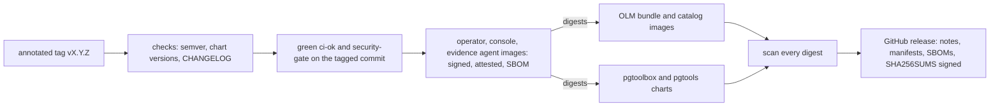

# Release and verification

## What a release contains

A release is the git tag `vX.Y.Z` (semantic version, **annotated** tag; `vX.Y.Z-rc.N`
is a pre-release), published from GitHub (`github.com/fyannk/pgToolBox`) by one
workflow (`.github/workflows/release.yml`). It requires green CI and a passing
security gate on the tagged commit, and nothing is ever published from `main`: a
pull request that touches the release files (and a weekly schedule) runs the same
build as a dry run in a separate workflow (`release-dry-run.yml`) that holds no
publishing permission, pushing and signing nothing.

The order matters for what you verify: the images are pushed and signed first,
then everything that names them is rewritten to their digests before it is built
and signed itself. The images are scanned by digest, on both platforms, before `latest` moves and
before the release becomes visible, and the release is published only once every
pushed digest can be pulled anonymously. The full sequence is on
[CI and releases](development/ci.md#the-release).



| Artifact | Reference | Verify with |
|---|---|---|
| Operator | `ghcr.io/fyannk/pgtoolbox-operator:X.Y.Z` | `cosign verify`, `gh attestation verify` |
| Console | `ghcr.io/fyannk/pgtoolbox-console:X.Y.Z` | `cosign verify`, `gh attestation verify` |
| Evidence agent | `ghcr.io/fyannk/pgtoolbox-evidence-agent:X.Y.Z` | `cosign verify`, `gh attestation verify` |
| OLM bundle | `ghcr.io/fyannk/pgtoolbox-bundle:X.Y.Z` | `cosign verify`, `gh attestation verify` |
| OLM catalog | `ghcr.io/fyannk/pgtoolbox-catalog:X.Y.Z` | `cosign verify`, `gh attestation verify` |
| Helm chart, the operator | `oci://ghcr.io/fyannk/charts/pgtoolbox`, version `X.Y.Z` | `cosign verify`, `gh attestation verify` on the chart reference |
| Helm chart, the team tools | `oci://ghcr.io/fyannk/charts/pgtools`, version `X.Y.Z` | `cosign verify`, `gh attestation verify` on the chart reference |
| Installer manifests | `install-operator.yaml`, `install-console.yaml` on the release page | `SHA256SUMS` + `SHA256SUMS.sigstore.json` |

Images are multi-architecture (`linux/amd64`, `linux/arm64`) with BuildKit's SBOM and
`mode=max` provenance, OCI labels (title, source, version, revision, created,
licenses) and Go built with `-trimpath -ldflags "-s -w"`. Images carry the exact
version as their tag; `latest` is moved only for a release that is not a
pre-release (a version with a `-` part such as `0.2.0-rc.1` is one: the GitHub
release is marked pre-release and no floating tag moves), never from `main`, and
only after the pushed digests passed the scan. The release page attaches the two
charts, the two installer manifests (their images pinned by digest), one SPDX SBOM
per image and platform (`sbom-<image>-amd64.spdx.json`, `-arm64`), `digests.txt` (every reference with its digest), `SHA256SUMS` (a
checksum of every other attached file) and `SHA256SUMS.sigstore.json` (its keyless
signature); its notes are the matching `CHANGELOG.md` section followed by the
conventional commits since the previous release.

The documentation embedded in the console is generated by the image build from the
site of the tagged commit; nothing is committed for it. See
[Documentation for assistants](development/llms-and-bundle.md).

The product version is written in `charts/pgtoolbox/Chart.yaml` and
`charts/pgtools/Chart.yaml` (`version` and `appVersion`, the same in both); the
release check fails if the tag disagrees with either, if the tagged commit is not on
`main`, or if `CHANGELOG.md` has no section for the version. The OLM bundle and
catalog tags follow it. The nested evidence module (`pkg/evidence`) is tagged
separately, `pkg/evidence/vX.Y.Z`, and only when the wire contract changes; consumers
then `go get github.com/fyannk/pgToolBox/pkg/evidence@vX.Y.Z`.

## Verify

Every image, the bundle, the catalog and both charts are **signed by digest** with
cosign **keyless**: the signature is bound to the identity of the release workflow
run (a certificate issued by Sigstore's Fulcio to GitHub's OIDC token) and recorded
in the Rekor transparency log. There is no key to obtain or trust. Each artifact
also carries a GitHub **build-provenance attestation** (SLSA, signed by GitHub and
stored next to the image in the registry), and each image carries BuildKit's SBOM
and `mode=max` provenance, which describe the build and are trustworthy once you
have verified the image digest they are attached to.

```bash
# cosign v2.6 or newer, and the GitHub CLI for the attestation.
IMAGE=ghcr.io/fyannk/pgtoolbox-console
DIGEST=sha256:...   # from digests.txt on the release page, or: docker buildx imagetools inspect $IMAGE:X.Y.Z

# The signature: made by the release workflow of this repository, on a tag.
cosign verify \
  --certificate-identity-regexp '^https://github.com/fyannk/pgToolBox/\.github/workflows/release\.yml@refs/tags/v' \
  --certificate-oidc-issuer https://token.actions.githubusercontent.com \
  "$IMAGE@$DIGEST"

# The build provenance: which commit and workflow run built this digest.
gh attestation verify "oci://$IMAGE@$DIGEST" --repo fyannk/pgToolBox

# BuildKit's SBOM and provenance, read from the image index.
docker buildx imagetools inspect "$IMAGE@$DIGEST" --format '{{ json .SBOM }}'
docker buildx imagetools inspect "$IMAGE@$DIGEST" --format '{{ json .Provenance }}'

# `make verify-image` runs the first two for you
make verify-image IMAGE=$IMAGE@$DIGEST
```

Each of the other images is verified the same way, by tag or, better, by the digest
listed in `digests.txt`. The bundle and catalog are images; the charts are OCI
artifacts with a signature and a provenance attestation but no SBOM.

Pin by digest (`digests.txt`, the release notes) in anything that deploys: a tag can
be moved, a digest cannot. The identity pattern above names the workflow file and
the tag ref, so a signature made by any other workflow, branch or repository does not
verify.

### The charts: digest-pinned images and their own signatures

The charts in the registry are not the charts in the git tree. At release,
`hack/release.sh` packages a copy of each chart whose own images are referenced
**by digest**, the tag kept in a comment next to it: in pgtoolbox the operator, the
console it runs for a `PgToolBoxConsole` and the default evidence agent
(`image.digest`, `operator.console.image.digest`, `operator.evidenceAgent.image`),
in pgtools the console and the evidence agent (`console.image.digest`,
`evidence.image.digest`) and the tools image of pgAdmin without the operator.
The bundle's CSV (`containerImage`, the Deployment, the operator flags and `relatedImages`)
and the catalog's bundle reference are rewritten the same way before their images are
built, so Helm and OLM install exactly the digests that were signed. The git tree keeps
tags because the digests do not exist until the images are pushed; `make validate-packaging`
runs the rewrite with made-up digests and fails when the two renderings disagree or a
reference stays on a tag. Each chart is signed by its own digest:

```bash
helm pull oci://ghcr.io/fyannk/charts/pgtoolbox --version X.Y.Z
cosign verify \
  --certificate-identity-regexp '^https://github.com/fyannk/pgToolBox/\.github/workflows/release\.yml@refs/tags/v' \
  --certificate-oidc-issuer https://token.actions.githubusercontent.com \
  ghcr.io/fyannk/charts/pgtoolbox:X.Y.Z
gh attestation verify oci://ghcr.io/fyannk/charts/pgtoolbox:X.Y.Z --repo fyannk/pgToolBox
helm show values oci://ghcr.io/fyannk/charts/pgtoolbox --version X.Y.Z | grep -B1 'sha256:'
helm show values oci://ghcr.io/fyannk/charts/pgtools --version X.Y.Z | grep -B1 'sha256:'
```

### The installer manifests and the other attached files

The manifests, the chart archives, the SBOMs and `digests.txt` are not in a registry,
so they are verified through `SHA256SUMS`, which is signed keyless as well:

```bash
# in a directory that holds the files downloaded from the release page
cosign verify-blob --bundle SHA256SUMS.sigstore.json \
  --certificate-identity-regexp '^https://github.com/fyannk/pgToolBox/\.github/workflows/release\.yml@refs/tags/v' \
  --certificate-oidc-issuer https://token.actions.githubusercontent.com \
  SHA256SUMS
sha256sum --check --ignore-missing SHA256SUMS      # macOS: shasum -a 256 -c
```

The first command proves the checksum file was signed by the release workflow, the
second that the files you downloaded are the ones it lists. Run both before applying
a manifest; `--ignore-missing` lets you download only the files you need.

### What this proves, and what it does not

The signature proves that the release workflow of this repository, running on a tag,
signed this digest, and the transparency log makes a signature made in secret
visible. It does not prove the source is free of vulnerabilities or that the
maintainers' account was not compromised; the source-level controls are the
[security page](/security/) (scanner results of the latest run
on `main`, including what did not run), the pinned and reviewed workflows, and the
OpenSSF Scorecard. There is no key to rotate or revoke: trust follows the repository
and the workflow path in the identity pattern.

## Versions and compatibility

`make validate-packaging` compares what the Helm chart, the kustomize bases and the
OLM bundle render, field by field: RBAC rules, security contexts, probes, ports, the
environment contract between the chart and the binaries, and the availability rule.
It fails on any other write verb in the user ClusterRoles and on a chart
environment variable the binary does not read.

The packaging gates besides that: `ct lint` and `ct install` of the chart (inside the
chart e2e's kind cluster: the default console, two watched namespaces, the operator alone,
and the console with its NetworkPolicy enforced), kubeconform and kube-linter on every
rendering, `operator-sdk bundle validate` and the OLM scorecard (basic and olm suites) on the
bundle, and a per-image profile check (numeric non-root user, exec entrypoint, OCI labels,
licence file, runs under a read-only root, as an arbitrary UID in group 0 and with no
capabilities, no shell, no setuid file) on the operator, console and evidence-agent images.

The nightly kind matrix runs the end-to-end suite across Kubernetes 1.34 and 1.36
and CloudNativePG 1.30.1, with the CloudNativePG `main` branch as a
non-blocking extra. OpenShift is a manual checklist
([console](console/openshift.md#manual-checklist)).
